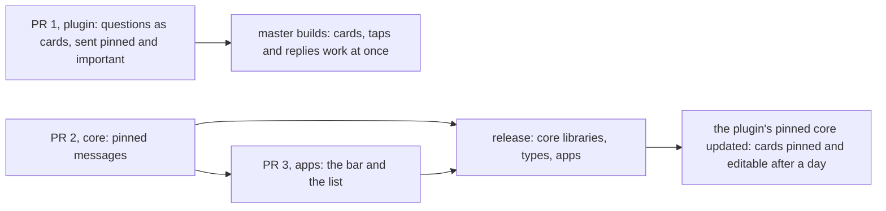
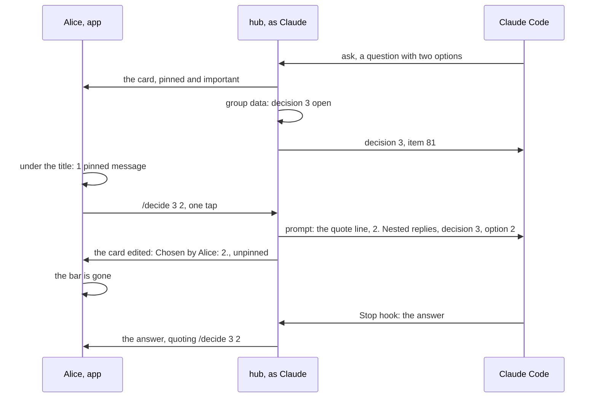
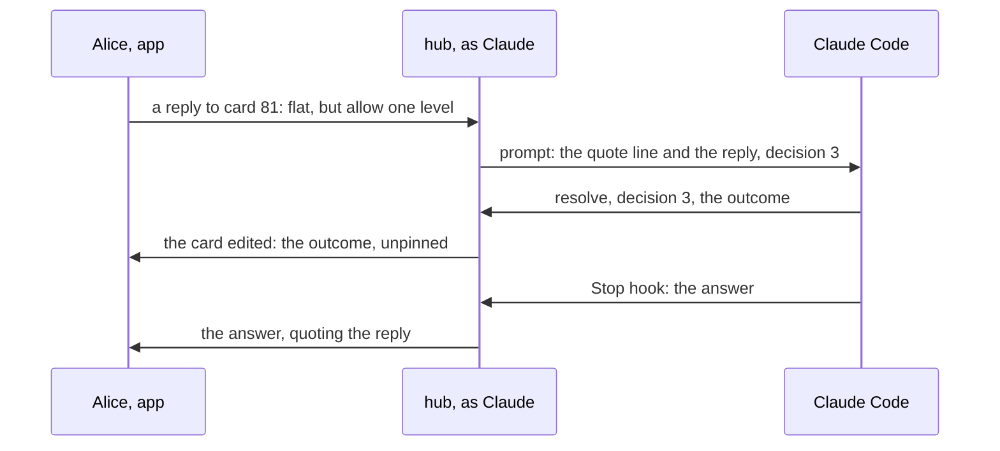
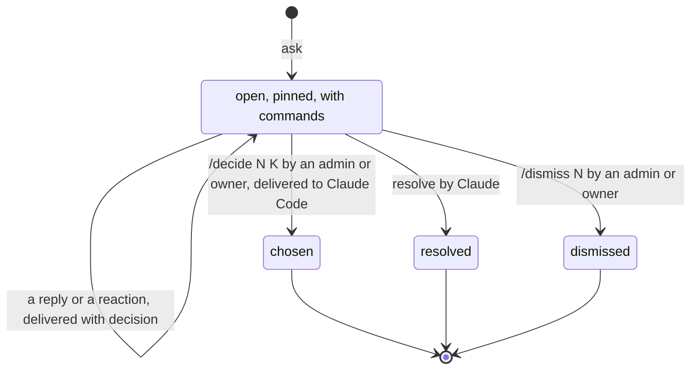
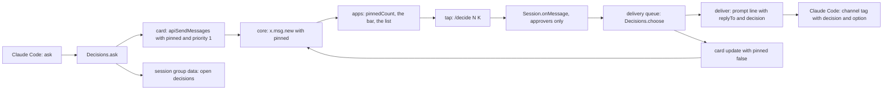

# Pending decisions: Claude's questions as pinned cards

Status: plan for review. Code references: master `8fda06295` (`@simplex-chat/mcp` 0.3.0 with #8157, #8163 and #8162), cited by file and function. Claude Code references: version 2.1.322 and its binary at the offsets given. Plans of other items: `plans/2026-11-12-mcp-replies.md` (merged as #8162), `plans/2026-11-12-mcp-reactions.md`, `plans/2026-11-12-mcp-activity.md` (approved), `plans/2026-11-12-mcp-silent-messages.md`, `plans/2026-10-13-message-priority.md` (approved), `plans/2026-11-13-mcp-threads.md`, `plans/2026-11-13-mcp-session-list.md`, each on its `ep/` branch. The widgets RFC: `docs/rfcs/2025-08-09-chat-widgets.md`.

Three pull requests, in this order:



PR 1 depends on neither of the others: it sends `pinned` and `priority` before the core supports them (decision 38). PR 3 follows PR 2.

## 1. Goal

Roadmap line, in "In your sessions" of `packages/simplex-chat-mcp/ROADMAP.md`: "Claude can offer choices and other small interactive widgets in the chat." This plan delivers the choices. Proposed line, added with this plan's approval and removed by PR 1: "Claude's questions stay pinned in the session until you answer them, with one tap for an option."

The user's words, 2026-11-13, in a session group where progress, reports and questions mix:

> I think we could also have pinned messages or activities for pending decisions - it's in line with widgets workstream. Because currently all questions mix with messages that I generally don't read. One solution is for you to write less, obviously, but it's useful for you to "think aloud", and for me to have a log of your thinking, so it's better to maintain a substructure for pending decisions in chats

The user's words for the roadmap line, 2026-11-11:

> picolisp widgets, to communicate replies to multiple choice answers in chat, and other interactive components agent would generate on the fly

The widgets RFC on activities: "widgets have to be linked with "chat activities", so they can be easily discovered and accessed from any place in the chat while they are active, without scrolling to the point where they were started, and with an additional message posted to the chat once they complete."

Outcome:
- Claude asks each question that needs the members' decision as a card. Claude keeps thinking aloud in its other messages.
- The card is pinned until the question is closed. The apps show the pinned messages of a group under its title, and one tap opens their list.
- An admin or owner answers with one tap on an option. Any member answers in their own words by replying to the card.
- The card shows the outcome and leaves the pinned list when it closes.

## 2. What users see

### 2.1 In a session group

Claude calls `ask` when it needs a decision. The card is posted at once, pinned and important (Q1 A):

```
❓ Which layout should threads use?
1. Flat thread, one level: /'decide 3 1'
2. Nested replies: /'decide 3 2'
Reply to answer in your own words, or /'dismiss 3'.
```

The app shows each `/'...'` as a command that one tap sends: `/decide 3 1`. A question without options:

```
❓ What should the release notes say about the bar?
Reply to answer, or /'dismiss 4'.
```

Under the group's title, while it has pinned messages:

```
📌 1 pinned message
📌 2 pinned messages
```

A tap opens the view `Pinned messages`, with the pinned messages oldest first. Their commands work there as in the chat. A pinned message shows 📌 in its meta, beside the time.

The last line of a closed card replaces the command line, and the options lose their commands:

```
how it closed                           last line of the card             delivered to Claude
an admin or owner taps an option        ✅ Chosen by Alice: 2.            the option, with decision and option
Claude calls resolve                    ✅ OUTCOME                        nothing more
an admin or owner taps /dismiss 3       ⏹️ Dismissed by Alice.            Dismissed., with decision and dismissed, when attached
```

A closed card is unpinned. Replies to the commands:

```
request                                  reply, quoting the command
/decide 3 2, decision 3 closed or absent Decision 3 is not open.
/decide 3 5, no option 5                 Decision 3 has no option 5.
/decide 3 2, Claude Code not running     Session 1 is not running.      the decision stays open
/decide or /dismiss of a member          Only admins and owners of this group can send / commands.   as for every command
```

`/pending` lists the open decisions after the pending actions:

```
5  use Bash  expires 2026-11-14 13:05 UTC
decision 3  Which layout should threads use?
```

Before and after:

```
moment                                    today                                   after
Claude needs a decision                   the question inside its answer          a card: the question, options as taps, pinned, important
the user opens the group later            scrolls through progress and reports    📌 2 pinned messages under the title; tap: the list
an admin or owner taps an option          -                                       /decide 3 2 sent; the card shows the choice, unpinned
a member replies to the card              a prompt with the quote line            the same, with decision 3; Claude closes the card with resolve
the question is no longer needed          stays in the history                    Claude resolves it, or an admin or owner taps /dismiss 3
Claude Code of the session not running    -                                       a tap gets Session 1 is not running.; the card stays open
an app before the pinned release          -                                       the card without the bar and without 📌
```

A tap:



A reply:



The states of a decision:



### 2.2 What Claude sees

Tool `ask`:
```
input    question   1-1000 characters: the question, in Markdown
         options    optional, 2-9 strings of 1-100 characters, one line each: the answers to choose from
output   decision   number of the decision in this session's group
         item       item ID of the card
errors   options: one line each.
         question: too long for its card; shorten the question or the options.
         ask: 20 decisions are open; resolve those that are no longer needed.
         The group of this session is lost. Start a new Claude Code session.
```
Its description: `Asks the members of the SimpleX group of this session a question that needs their decision, and returns at once. The question is posted as a card, pinned in the group until it is closed. With options, an admin or owner chooses one with one tap; any member can reply to the card in their own words. The answer arrives later as a message of the simplex channel with decision.`

Tool `resolve`:
```
input    decision   number from ask
         outcome    1-500 characters: what was decided and by whom, or why no answer is needed
output   decision, item
errors   decision: decision N is not open.
```
Its description: `Closes an open decision with its outcome: when a reply or your user in the terminal answered it, or when it is no longer needed. The card shows the outcome and is unpinned. A decision closed by a tap or dismissed by a member needs no resolve.`

A tap:
```
<channel source="plugin:simplex:simplex" from="Alice" item="90" reply_to="81" reply_to_from="Claude" decision="3" option="2">
> ❓ Which layout should threads use?…
2. Nested replies
</channel>
```

A reply to the card:
```
<channel source="plugin:simplex:simplex" from="Alice" item="91" reply_to="81" reply_to_from="Claude" decision="3">
> ❓ Which layout should threads use?…
Flat, but allow one level of replies.
</channel>
```

A dismissal, when Claude Code is attached:
```
<channel source="plugin:simplex:simplex" from="Alice" item="92" reply_to="81" reply_to_from="Claude" decision="3" dismissed="true">
> ❓ Which layout should threads use?…
Dismissed.
</channel>
```

Channel instructions (`src/session.ts`, `channelInstructions`), added before their last sentence:

`When you need the members to decide something, call ask, and go on with other work: the answer comes later. Keep your progress in your messages, and each question in ask. The members answer questions only through ask. A message with decision is about your open question with that number: with option, a member chose that option, and the question is closed; with dismissed, a member closed it without an answer; otherwise it is a reply or a reaction, and you call resolve with the outcome once it answers the question.`

## 3. Questions for the user

Q1. What keeps Claude's open questions in view: pinned messages or activities?
- A, recommended: messages pinned by their sender. An admin or owner, Claude here, sends a message pinned and unpins it with an update. The message stays editable while it is pinned. The apps show `📌 N pinned messages` under the title, which opens the list. The same flag later serves admins pinning any message, with one more event, and widgets, which stay pinned while they are active. Cost: one optional field in `x.msg.new` and `x.msg.update`, a column, a count, a filter, the bar and the list on both platforms.
- B: activities, as the widgets RFC names them. The same mechanics with a field `active` and a bar `N active`. Pinning by admins later becomes a second concept with its own field and bar. Same cost now.
- C: pinned messages as in other messengers. Admins and owners pin any message with a new event `x.msg.pin`, also from the item menu. Cost: A, and the event's parser, handler, forwarding and history, the permission rules and the menu items. Older apps drop the event.

## 4. Decisions

Facts:
1. The core has no pinned or active state. `ChatMsgEvent` has no such event, and `MsgContainer` has no such field (`src/Simplex/Chat/Protocol.hs`, `ChatMsgEvent`, `MsgContainer`).
2. Reports are the pattern of a counted, listed kind of item. `ChatStats.reportsCount` (`Messages.hs`) is counted for each group in `findGroupChatPreviews_` and by `getGroupReportsCount_` (`Store/Messages.hs`). `getChatItemIDs` filters a group's items by content tag, and by `has_link = 1` for links. Android and desktop show `1 report` or `N reports` in `SupportChatsCountToolbar` under the toolbar (`views/chat/ChatView.kt`), and a tap opens `SecondaryContextFilter.MsgContentTagContext` (`model/ChatModel.kt`). iOS opens reports from the group's info and the chat list, with a flag on the avatar in `ChatInfoToolbar`, through `SecondaryItemsModelFilter.msgContentTagContext` (`Shared/Model/ChatModel.swift`).
3. A sent item is editable for one day: `mkCIMeta` sets `editable = deletable && isNothing itemForwarded`, and `deletable'` compares the item's age with `nominalDay` (`Messages.hs`). `APIUpdateChatItem` refuses an item that is not editable with `CEInvalidChatItemUpdate` (`Library/Commands.hs`, `processChatCommand`). A receiver applies an update of any age when its content changed or the item is live (`Library/Subscriber.hs`, `groupMessageUpdate`, `updateCI`).
4. An update is sent without the notification flag: `hasNotification` is true for `x.msg.new` and six other events (`Protocol.hs`).
5. A receiver stores nothing for an unknown event: `processEvent` ends with `messageError "unsupported message"`, and `isForwardedGroupMsg` is false for it (`Library/Subscriber.hs`, `Protocol.hs`).
6. A change of a group's profile adds an item `RGEGroupUpdated` at every member, unless only the preferences changed (`Library/Subscriber.hs`, `xGrpInfo`; `Library/Internal.hs`, `sameGroupProfileInfo`).
7. The plugin posts cards with `Control.postCardContent` and edits them with `Control.outcome`, through `apiUpdateChatItem`. Their commands are `/'...'` links (`src/control.ts`, `commandsLine`).
8. A command link is tappable in a group whose preferences have commands: iOS `ChatInfo.useCommands` (`SimpleXChat/ChatTypes.swift`), Kotlin `CIMarkdownText` with `chatInfo.useCommands` (`views/chat/item/FramedItemView.kt`). A tap sends the command at once: iOS `sendCommandMsg` (`Shared/Views/Chat/CommandsMenuView.swift`), Kotlin `sendCommandMsg` (`views/chat/item/FramedItemView.kt`). Session groups are created with `controlCommands` (`src/hub.ts`, `Hub.createSessionGroup`).
9. A one-line `/` text of a member below admin is refused with `Only admins and owners of this group can send / commands.` (`src/hub.ts`, `Session.onMessage`, `refusesCommand`).
10. `Session.queue` delivers a session's prompts one at a time, in arrival order. `Session.deliver` replies `Session N is not running.` when no Claude Code is attached (`src/hub.ts`).
11. A session group's custom data `simplexMcpSession` holds `SessionGroupData` `{session, pending, mode}`, saved by `Session.saveData` (`src/hub.ts`). `Hub.open` opens every stored session at the service's start.
12. Actions expire after `expireHours`, from 1 to 23, 23 by default (`src/config.ts`, `src/actions.ts`, `Actions.create`). `Actions.stop` cancels the pending actions at a service stop, and their cards end with `Cancelled: the server stopped.` (`src/control.ts`, `cardText`).
13. The plugin may send a field before its core supports it: `ep/mcp-activity` sends `priority` as an extra property of `ComposedMessage` (its decision 24, Q2 A). `APISendMessages.cmdString` and `APIUpdateChatItem.cmdString` write the messages with `JSON.stringify` (`packages/simplex-chat-client/types/typescript/src/commands.ts`). The core's `ComposedMessage` parser reads named fields, and `UpdatedMessage` has derived JSON, so a core ignores an unknown field (`Controller.hs`). The library's `apiUpdateChatItem` builds the updated message itself (`packages/simplex-chat-nodejs/src/api.ts`); the plugin sends the command with `sendChatCmd`, as `User.connect` does (`src/user.ts`).
14. Claude Code keeps a meta key of letters, digits and `_` (`plans/2026-11-12-mcp-replies.md`, decision 2). `Session.onMessage` computes the `replyTo` of a reply with `toReplyTo`, and `Session.deliver` writes `quoteLine` before the text and `replyTo` on the prompt line (`src/hub.ts`). `channelNotification` writes them as `reply_to` and `reply_to_from` (`src/session.ts`).
15. The plugin's PreToolUse hook allows every tool of the plugin (`hooks/hooks.json`, matcher `mcp__plugin_simplex_simplex__.*`; `plugin/allow.js`). The step lines of `ep/mcp-activity` skip the plugin's tools (its decision 14).
16. The plugin relays only permission requests of Claude Code, with the verdicts `allow` and `deny` (`src/session.ts`, `channelNotification`). Claude Code shows AskUserQuestion as a dialog ("falling back to the question dialog", binary offset 296484100).

Choices, by Q1 A:

17. A sender pins its own message. Pinned messages of a chat are listed under its title.
18. Claude's question is a card of Claude's group, posted by a tool. Other members' questions are out of scope.

Core, PR 2:

19. `pinned`, an optional Bool, is a field of `x.msg.new` and of `x.msg.update`. In an update, an absent field keeps the item's state.
20. In groups, business chats and channels, a message is pinned when its sender is an admin or owner, or the owner of a channel post sent as the channel. A receiver applies `pinned: true` by the same rule, and `pinned: false` from the item's author of any role. A blocked member's message is not pinned. Direct chats and note folders ignore the field.
21. A send without the role is sent unpinned, without an error, as `ttl` without the preference for timed messages (`plans/2026-10-13-message-priority.md`, section 4). The returned item shows it.
22. A sent pinned item stays editable at any age. The update that unpins it is its last edit after a day.
23. An update is sent and applied when the content changed, the item is live, or `pinned` changed.
24. An update of an item that is or was pinned has `pinned` with the item's new state, so a signed message replayed in history has the state.
25. History sends the stored item's state: `sendHistory` passes it to `prepareGroupMsg`.
26. `chat_items.item_pinned`, 0 or 1, with a partial index of pinned items. The count and the list take items of the group outside member support scopes, not deleted.
27. `CIMeta.itemPinned` is a `BoolDef`, false when absent, as `hasLink`. `ChatStats.pinnedCount` is 0 when absent from JSON, for a remote desktop with an older host.
28. API: `ComposedMessage.pinned`, `UpdatedMessage.pinned`, and `/_get chat #N pinned=on PAGINATION`, the field `pinned` of `APIGetChat`. The CLI prints items unchanged.
29. The Node.js and Python libraries: `apiUpdateChatItem` and `api_update_chat_item` get an optional `pinned`.

Apps, PR 3:

30. In a group with `pinnedCount` above 0, a bar under the title shows the pin and `1 pinned message` or `N pinned messages`. On Android and desktop it is a row of `SupportChatsCountToolbar`. On iOS it is a new bar under the navigation bar.
31. A tap opens `Pinned messages`, a secondary view loaded with `pinned=on`. Its items are drawn as in the chat. A command tapped in it is sent to the group's chat, without a scope.
32. A pinned item shows a pin in its meta, as the bell of `plans/2026-10-13-message-priority.md`, section 9.
33. The counters follow the events: a new pinned item adds 1, an update that changes the state adds or removes 1, a deleted pinned item removes 1. The open view adds and removes items the same way.
34. The apps send no pinned messages, as for priority. Pinning from the item menu comes with option C's later event.

Plugin, PR 1:

35. Tools `ask` and `resolve`, as in section 2.2. They are not actions: they need no card and no approval, as `reply`.
36. Decisions are numbered from 1 in each session group. Each open decision is kept in `SessionGroupData.decisions` as `{n, item, question, options}`, with `nextDecision`, and is restored at the service's start. At most 20 are open in a session.
37. A decision has no expiry. It closes by a tap, by `resolve` or by `/dismiss`. A session whose Claude Code ended keeps its decisions until an admin or owner dismisses them, as the hub opens every stored session (fact 11).
38. The card is posted with `pinned: true` and `priority: 1` as extra properties (fact 13). It is closed by `/_update item` with `pinned: false`, sent with `sendChatCmd`.
39. `/decide N K` and `/dismiss N` are commands of the group. They count from admins and owners only, as every command (fact 9; 0.3.0 trust model, rule 3). Members answer by replying.
40. `Session.onMessage` passes the two commands to the delivery queue, so a tap reaches Claude after the member's earlier prompts. A malformed one is a command of `Control`, which replies `Unknown command.`
41. A tap is delivered as a reply to the card: the hub gives `deliver` the card's `replyTo`, the option's text and `decision: {n, option}`. The decision closes after the prompt is pushed. When no Claude Code is attached, `deliver` replies `Session N is not running.`, and the decision stays open.
42. `/dismiss N` closes the decision. Claude gets `Dismissed.` with `decision` and `dismissed` when its Claude Code is attached.
43. A reply or, after `ep/mcp-reactions`, a reaction to an open card is delivered with `decision: {n}`. It stays open until Claude calls `resolve`, because a reply can be a question.
44. The card text is written by the hub from the question and the options (section 2.1). The member's name is shown by `safeName`, as on action cards.
45. When the core refuses the closing edit, Claude posts the card's last line as a reply to the card. A core before PR 2 refuses the edit of a card older than a day (fact 3).
46. `ask` checks with `fitsMessage` that the open card and the closed card with a 500-character outcome each fit one message.
47. `/pending` lists the open decisions after the pending actions, as `decision N  FIRST LINE`, the first line of the question cut to 100 characters with `…`.
48. The prompt line gets `decision?: {n, option?, dismissed?}`. The session server writes the meta keys `decision`, `option` and `dismissed` (fact 14). The protocol version stays 1.
49. The channel instructions get the text of section 2.2.

Composition:

50. Important: a card is priority 1 of the approved priority model. The chat list shows the bell until the card is read, and the bar shows the pin until the decision closes.
51. Threads, whichever of the two lands second: `ask` posts the card in the place of the turn's posts (`ep/mcp-threads`, decisions 43-44). A tap is delivered with the card's thread, so Claude's next posts go there. The pinned count and list take the items of threads too.
52. Session list, whichever lands second: the line of a session counts open decisions, `🔵 6 · website: waiting for you, 2 approvals, 1 decision`. With PR 2 released, the list can be pinned in the Main group and edited past a day, so its daily replacement (`ep/mcp-session-list`, decision 24) ends.
53. Widgets: a widget message is pinned while it is active, as the RFC's activities. Buttons in place of the command links come with the widgets.
54. This item's agents build the three parts, as for `ep/mcp-silent-messages`, and the core team reviews PR 2 and PR 3.

## 5. Design

Options for the place of pending decisions:
```
option                                       producer                  consumers                         older apps                 cost
1. pinned by the sender, a flag in           card sent pinned,         count, filter, bar, list          a normal message           one field, a column,
   x.msg.new and x.msg.update (chosen)       unpinned by an update                                                                  bar and list
2. pinned by admins, a new event x.msg.pin   card, then the event      as 1, the event's handling,       drop the event             1, an event, menus,
                                                                       forwarding and history                                      permissions
3. a message Claude keeps edited with the    one list message          none                              the same                   none: it scrolls up behind
   open questions (plugin only)                                                                                                     every later message
4. threads with the bell                     a thread per question     thread view and summaries         replies in the main chat   threads' whole effort; no
                                                                                                                                    list of open questions
5. a widget message type with buttons        content type              rendering on both platforms,      text fallback              more than 1, and a count
                                                                       and a count of open ones                                     of open ones still needed
6. questions in the Main group (plugin only) cards there               none                              the same                   outside the session's chat;
                                                                                                                                    they scroll there too
7. the group's description                   a profile update          none                              the same                   an item at every member per
                                                                                                                                    change (fact 6)
```
Option 1 is the cheapest that keeps open questions in view. Options 3 and 6 do not keep them in view. Option 4 needs threads first and gives no list. Options 2 and 5 cost more for the same view: an event or a renderer.

Options for answers:
```
option                                   cost
A1. command links, and replies (chosen)  works in every app now; one tap; the reply is the comment
A2. replies only                         every answer typed
A3. buttons of a widget                  a renderer on both platforms; comes with widgets
```

Options for the decision's state:
```
option                                       cost
S1. the hub keeps open decisions in the      a small list in the group's data; taps are checked and closed
    group's data (chosen)                    without Claude
S2. Claude tracks them and edits its cards   a card tool for Claude; a tap reaches Claude unchecked
S3. Actions of the hub                       cancelled at every service stop and bound to 23 hours (fact 12)
```

Options for expiry:
```
option                                       cost
E1. none: tap, resolve or dismiss (chosen)   a dead session's questions stay until dismissed
E2. expiry as actions, 23 hours at most      a question waits at most a day; Claude asks again
```

Changes, PR 2, the core:
```
file                                 function or type                      change
Protocol.hs                          MsgContainer, mcSimple                + pinned :: Maybe Bool; Nothing
                                     XMsgUpdate                            + pinned :: Maybe Bool, last; appJsonToCM: opt "pinned";
                                                                           chatToAppMessage: "pinned" .=? pinned
Controller.hs                        ComposedMessage and its FromJSON      + pinned, .:? "pinned"
                                     UpdatedMessage                        + pinned :: Maybe Bool
                                     APIGetChat                            + pinned :: Bool
Messages.hs                          CIMeta, mkCIMeta, dummyMeta           + itemPinned :: BoolDef; editable for a sent pinned item
                                     ChatStats                             + pinnedCount, 0 when absent
Library/Commands.hs                  processChatCommand APIUpdateChatItem  pinned: decisions 22-24
                                     sendGroupContentMessages_             pinned by decisions 20-21
                                     processChatCommand APIGetChat,        pinned=on
                                     chatCommandP
Library/Internal.hs                  prepareGroupMsg                       + pinned
                                     sendHistory                           the stored item's pinned
                                     NewSndChatItemData, saveSndChatItems, pinned
                                     saveRcvChatItem', mkChatItem_
Library/Subscriber.hs                newGroupContentMessage                pinned by the sender's role
                                     groupMessageUpdate, updateCI          pinned of the update; decision 23
Store/Messages.hs                    createNewChatItem_                    item_pinned
                                     updateGroupChatItem_                  item_pinned from CIMeta
                                     ChatItemModeRow, the item queries     item_pinned
                                     findGroupChatPreviews_,               pinnedCount
                                     getGroupChatInitial_
                                     getChatItemIDs and its callers        the pinned filter
Store/SQLite, Store/Postgres         a migration item_pinned               the column and the partial index
docs/protocol/simplex-chat.md,       x.msg.new, x.msg.update               pinned
simplex-chat.schema.json
bots API docs, TS and Python types   generated by tests/APIDocs.hs
packages/simplex-chat-nodejs,        apiUpdateChatItem,                    + pinned, optional
packages/simplex-chat-python         api_update_chat_item
bots/README.md                       a section "Pinned messages"
```

Changes, PR 3, the apps:
```
platform  file                                      function or type                  change
Kotlin    model/ChatModel.kt                        CIMeta, Chat.ChatStats            itemPinned, pinnedCount
                                                    SecondaryContextFilter            + PinnedContext
                                                    ChatsContext.chatItemBelongsToScope,
                                                    addChatItem, upsertChatItem       the view and the counters of decision 33
          model/SimpleXAPI.kt                       CC.ApiGetChat                     pinned=on
                                                    the receiver of chatItemUpdated,
                                                    chatItemsDeleted                  the counters
          views/chat/ChatView.kt                    SupportChatsCountToolbar          the pinned row; showPinned
                                                    the secondary context switch      the view's app bar
          views/chat/group/PinnedMessagesView.kt    PinnedMessagesAppBar, new         title Pinned messages
          views/chat/item/CIMetaView.kt             CIMetaText, reserveSpaceForMeta   the pin
          moko-resources, base                      strings, ic_push_pin              1 pinned message, %d pinned messages, Pinned messages
iOS       SimpleXChat/ChatTypes.swift               CIMeta, ChatStats                 itemPinned, pinnedCount
          Shared/Model/ChatModel.swift              SecondaryItemsModelFilter         + pinnedContext; the counters
          Shared/Model/AppAPITypes.swift,           apiGetChat                        pinned
          SimpleXAPI.swift
          Shared/Views/Chat/ChatView.swift          the bar under the navigation bar; the view's toolbar
          Shared/Views/Chat/ChatItem/CIMetaView.swift   ciMetaText                    pin.fill
both      spec folders                              the changed functions
```

Changes, PR 1, the plugin:
```
file               function or type                change
src/decisions.ts   Decisions, new                  ask, resolve, choose, dismiss, ofItem, pendingLines; the card texts
src/hub.ts         SessionGroupData                + decisions, nextDecision
                   Session                         + decisions, made from the group's data
                   Session.onMessage               /decide and /dismiss to the queue; a reply to an open card gets its decision
                   Session.deliver                 + decision on the prompt line; returns whether the prompt was pushed
src/tools.ts       ToolName                        + "ask", "resolve"
                   askTool, resolveTool, new       section 2.2
                   Agent, AgentTools.run           decisions; the two tools
src/session.ts     startSession                    registerTools with replyTool, askTool and resolveTool
                   channelInstructions             section 2.2
                   channelNotification             meta decision, option, dismissed
src/protocol.ts    AttachLine.prompt               + decision?: {n, option?, dismissed?}
src/control.ts     SessionOptions                  + decisions(): the lines of /pending
                   Control.ownerCommand, pending   the lines after the actions
```

```
ask {question, options?}:
  group lost: the lost text
  20 open: refusal
  options with a line break: refusal
  open card or closed card with a 500-character outcome too long: refusal
  n = nextDecision; post the open card with pinned true, priority 1
  decisions += {n, item, question, options}; nextDecision = n + 1; save the group's data
  -> {decision: n, item}

choose(n, k, member, command item), in the delivery queue:
  n not open: reply "Decision n is not open."
  no option k: reply "Decision n has no option k."
  pushed = deliver(command item, "k. OPTION", member, replyTo of the card, {n, option: k})
  not pushed: deliver replied "Session N is not running."; n stays open
  close(n, "✅ Chosen by NAME: k.")

dismiss(n, member, command item), in the delivery queue:
  n not open: reply "Decision n is not open."
  close(n, "⏹️ Dismissed by NAME.")
  Claude Code attached: push "Dismissed." with replyTo of the card and {n, dismissed: true}

resolve {decision, outcome}:
  not open: tool error "decision: decision N is not open."
  close(decision, "✅ " + outcome) -> {decision, item}

close(n, line):
  decisions -= n; save the group's data
  update the card to its closed text with pinned false
  refused by the core: post line as a reply to the card

a reply or a reaction quoting item i, where ofItem(i) = n:
  deliver with decision {n}
```

Data flow:


## 6. Compatibility

- Apps before PR 3: the card is a normal message, and its commands work (fact 8). They show no bar and no pin. `/pending` lists the open decisions.
- Cores before PR 2, at receivers: they ignore `pinned`. A forwarding member with such a core encodes an unsigned message again without it. A signed message is forwarded as its bytes and keeps it.
- The plugin's core before PR 2: it drops `pinned` from the card, so nothing is pinned. It refuses the closing edit of a card older than a day; Claude then posts the closing line as a reply (decision 45).
- New members: history sends the last 100 items with their state (decision 25). An older pinned message is absent for them.
- Remote desktop: an older controller ignores the new fields; a newer controller reads them as false and 0 from an older host.
- Downgrade: the column is dropped, and nothing is pinned.
- Claude Code 2.1.316 to 2.1.322 keep the new meta keys (fact 14). A session server started before an update has neither tool nor key; a newer session server restarts an older service (`src/client.ts`, `ServiceClient.ensureService`).
- Plugin data folders: `SessionGroupData` without `decisions` has none.
- `serve`: unchanged; it has neither tool.

## 7. Acceptance and tests

Done when:
```
#   criterion                                                                        PR  checked by
1   ask posts the card pinned and important, numbered per group, kept in the        1   unit: sessions
    group's data and restored after a restart; a 21st is refused
2   a tap of an admin or owner reaches the session with decision and option, and     1   unit: sessions; e2e: service
    the card closes unpinned; without Claude Code the tap gets the reply and the
    decision stays open
3   a reply and a reaction to an open card reach the session with decision;           1   unit: sessions
    resolve closes it with the outcome
4   /dismiss closes it, and the session gets Dismissed. when attached                 1   unit: sessions
5   a refused closing edit posts the closing line as a reply to the card              1   unit: sessions
6   /pending lists the open decisions; a member's /decide is refused                  1   unit: commands, sessions
7   the tools, the meta keys and the instructions                                     1   unit: tools, session
8   a pinned message is stored pinned at every member, by direct connection, by a     2   core: Groups.hs, "pinned messages"
    forwarding member and in history; a member's pin is ignored
9   an update unpins it; a pinned item is edited after a day                          2   core
10  /_get chat pinned=on lists the pinned items; pinnedCount counts them              2   core; fails on master: pinned=on does not parse
11  x.msg.new and x.msg.update with pinned are encoded and decoded                    2   ProtocolTests.hs
12  the apps show the bar, open the list, answer from it, and drop a closed card      3   ios-sim, desktop-linux, android-emu; Kotlin
                                                                                          desktop test of the counters and the view
13  a real session: Claude asks, the question is pinned, a tap answers it             all TESTING check, after the release
```

The test that fails on master, PR 1: the end-to-end test of `service.test.ts` calls `ask` through `/call`. Master's service returns `{"result": null}` for it, as `AgentTools.run` has no case for the tool (`src/tools.ts`), and no card arrives.

Plugin tests, `npm test` and `npm run test:e2e`:
- `sessions.test.ts`, "decisions", new: "posts the card of ask pinned and important, numbers decisions per group, keeps them in the group's data, restores them after a restart and refuses a 21st"; "passes an admin's tap to the session as a reply to the card with decision and option and closes the card unpinned; replies Session 1 is not running. and keeps it open without Claude Code"; "passes a reply and a reaction to an open card with decision and closes it at resolve"; "closes a dismissed decision and tells an attached session"; "posts the closing line as a reply when the core refuses the edit"; "lists open decisions in /pending".
- `cards.test.ts`: the open card, with and without options, and the closed cards, with names that need code spans.
- `tools.test.ts`: the schemas of `ask` and `resolve` and their errors.
- `session.test.ts`: the meta keys `decision`, `option` and `dismissed`, and the instructions.
- `commands.test.ts`: a member's `/decide 1 1` gets the refusal; `/decide x` gets `Unknown command.`
- e2e `service.test.ts`: the session calls `ask`; Alice gets the card, sends `/decide 1 2`; the session's stream gets the prompt with the decision; Alice sees the closed card.

Core tests: `tests/ChatTests/Groups.hs`, `describe "pinned messages"`: `testPinnedSend` (criteria 8 and 10; fails on master), `testPinnedMemberIgnored`, `testPinnedUnpin`, `testPinnedEditAfterDay` (the item's time moved back a day in the database), `testPinnedForwarded`, `testPinnedHistory`, `testPinnedChannel`. `tests/ProtocolTests.hs`: `x.msg.new` and `x.msg.update` with `pinned`. The query plans test regenerates `chat_query_plans.txt` with the partial index. The reduced build runs them with `TESTS='/SimpleX chat client/group tests/'` (`scripts/ci/README.md`, "core").

App tests: the three app test workflows, with a test backend member that pins a message and unpins it; a Kotlin desktop test of the counters and of `PinnedContext`.

## 8. Docs to change

- PR 1, the plugin: `README.md`, step 4: `Claude asks its questions in cards that stay pinned until you answer: tap an option, or reply in your own words.` `REFERENCE.md`, "Prompts and answers": a bullet on decisions, the commands and the meta keys. `spec/api.md`: 4.1, the tools `ask` and `resolve`; 4.3, the commands `/decide` and `/dismiss`, the cards and `/pending`; 4.5, the meta keys and the instructions; 4.6, `decision` of the prompt line. `spec/architecture.md`: `Decisions`, `SessionGroupData`. `spec/flows.md`: a decision answered by a tap, by a reply. `TESTING.md`: the tests and the real-session check. `ROADMAP.md`: the line of section 1 removed; the widgets line becomes "Claude can show other small interactive widgets in the chat."
- PR 2, the core: `docs/protocol/simplex-chat.md` and its schema; `bots/README.md`, "Pinned messages"; the generated API docs and types.
- PR 3, the apps: `apps/ios/spec` and `apps/multiplatform/spec`, the changed functions.

## 9. Conflict areas with the other items

```
file or area                                   where                                          items
Protocol.hs, Controller.hs                     MsgContainer, XMsgUpdate, ComposedMessage,     message priority (priority), mcp-silent-messages,
                                               UpdatedMessage                                 mcp-threads (parent)
Messages.hs                                    CIMeta, mkCIMeta, ChatStats                    mcp-silent-messages (priority, unreadSilent),
                                                                                              mcp-threads (unreadInThreads)
Library/Internal.hs                            prepareGroupMsg, sendHistory, saveRcvChatItem' mcp-silent-messages, mcp-threads
Library/Commands.hs                            APIUpdateChatItem, APIGetChat, chatCommandP    message priority (raise), mcp-threads (parent=)
Store/Messages.hs, migrations                  createNewChatItem_, findGroupChatPreviews_,    mcp-silent-messages (item_priority, Q4 indexes),
                                               getChatItemIDs, the migration order            mcp-threads
apps: CIMetaView, the bars under the title     the bell, the flat rows                        message priority, mcp-flat-sessions
apps: ChatModel counters, secondary filters    unread counters, the thread view               mcp-silent-messages Q4, mcp-threads
src/hub.ts                                     Session.onMessage, deliver, SessionGroupData   mcp-reactions, mcp-threads
src/control.ts                                 ownerCommand pending, SessionOptions           mcp-allow-tool (card commands)
src/session.ts                                 channelInstructions, channelNotification       mcp-reactions, mcp-threads
src/protocol.ts                                AttachLine.prompt                              mcp-reactions, mcp-threads
src/tools.ts                                   ToolName, the plugin's tool definitions        mcp-threads (thread, reply)
src/main-group.ts                              the session list's line                        mcp-session-list (decision 52)
REFERENCE, spec, TESTING, ROADMAP              Prompts and answers, flows, checks             every plugin item
```

## 10. Parts and estimate

```
part                                          size                                         work
PR 1  plugin: decisions                       about 230 TypeScript, 350 test lines         2 days
PR 2  core: pinned messages                   about 250 Haskell, 200 test lines            3 days
PR 3  apps: the bar, the list, the pin        about 220 Kotlin, 220 Swift, strings, icon   3 days, with the app workflows
```
