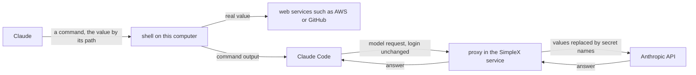
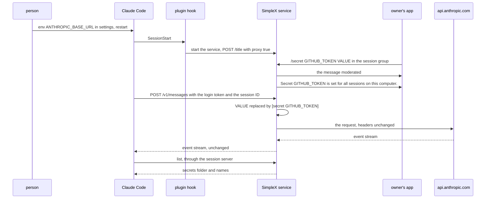
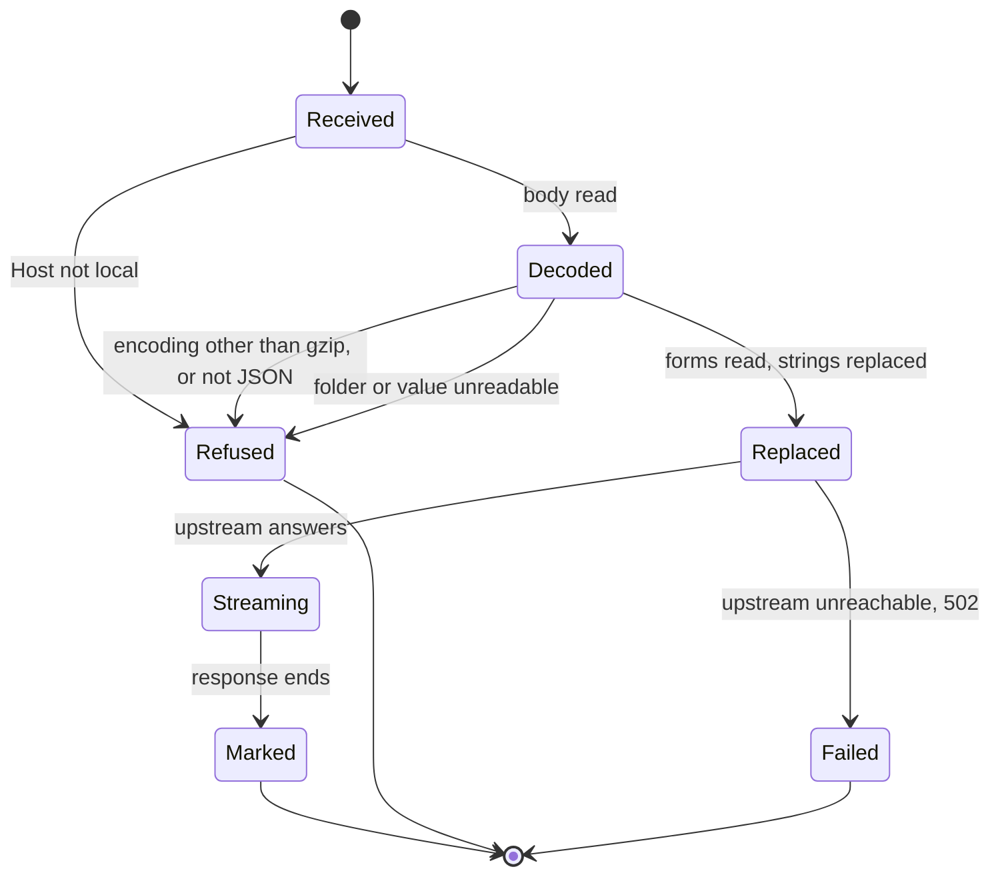
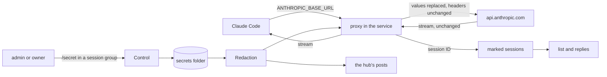
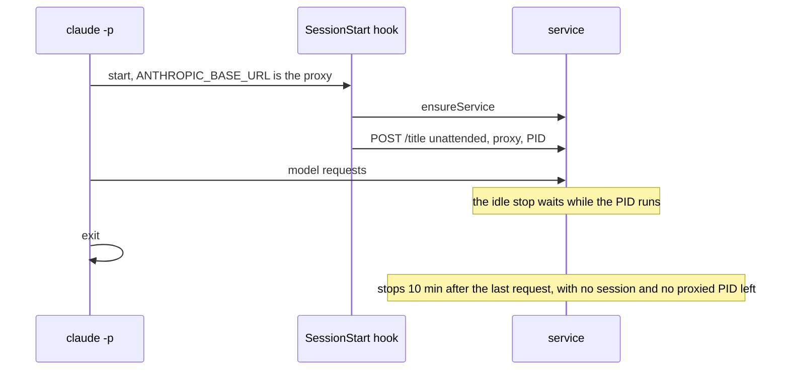

# SimpleX MCP: secrets in Claude Code, redacted by the plugin's service

Status: Q2 A, Q3 A and Q4 A answered by the user on 2026-11-13; Q1 open. The plan waits for the user's approval before implementation. It completes #8151 (https://github.com/simplex-chat/simplex-chat/pull/8151, "mcp server: give the agent secrets without exposing them to the model"), whose head is `cc45d339b`. Code references: #8151 at `cc45d339b` and master `8fda06295`, by file and function. Claude Code references: the 2.1.322 binary at the byte offsets given, the 2.1.323 binary where named, and the official docs, quoted. Runs E1, E2 and E3 used Claude Code 2.1.323 with `claude -p`, a scratch `HOME` and `CLAUDE_CONFIG_DIR`, no plugin, the fake token `CLAUDE_CODE_OAUTH_TOKEN=sk-ant-oat01-fake-…`, a local server that records requests and answers with a canned stream, and `HTTPS_PROXY` set to a local recording proxy:

- E1: `ANTHROPIC_BASE_URL` in the environment; the proxy refused every `CONNECT`.
- E2: `ANTHROPIC_BASE_URL` in the `env` of the scratch `settings.json`, a SessionStart hook that wrote its environment to a file, and the proxy terminating TLS for `api.anthropic.com` with a test CA in `NODE_EXTRA_CA_CERTS`. The prompt carried the marker `MARKER_PROMPT`.
- E3: `ANTHROPIC_BASE_URL` at a closed port, once as in E1 and once as in E2.

## 1. Goal

The user's words, 2026-11-13, in the plugin's session group:

> maybe complete secrets from Alain with proxy? I am assuming plugin would run proxy, right?

#8151 states its limit: "Claude Code: no redaction in this PR."

The secrets are tokens for any web service that Claude uses in its commands, such as AWS IAM keys or a GitHub token. Admins and owners of a session's group send one with `/secret NAME VALUE`. Claude gets the name, never the value, and uses the value by reference:

```
curl -H "Authorization: Bearer $(cat ~/.simplex-mcp-secrets/GITHUB_TOKEN)" https://api.github.com/user
```

The shell puts the value into the command, and the request reaches the web service with the real value. Claude Code's own claude.ai login is not one of these secrets.

The proxy guards one thing: that a secret's value never reaches the model. A command's output becomes part of the conversation, and Claude Code sends the conversation to Anthropic in its next model request. When the output holds a value, as `curl -v` or `env` can print it, the value reaches the model without the proxy.

Claude Code sends its model requests to Anthropic. The proxy sits on that path only:
- Claude Code sends each model request to the proxy in the plugin's service, which replaces every value with `[secret NAME]` and forwards the request to Anthropic.
- Claude Code's login passes through the proxy unchanged; the proxy never stores or logs it.
- Claude's commands to other services don't pass the proxy and keep the real values.



One setting tells Claude Code where to send its model requests: `ANTHROPIC_BASE_URL` in the `env` of the person's own Claude Code settings, `~/.claude/settings.json`. It is a user setting of Claude Code, the same on a laptop and in a container. It applies to Claude Code and to the processes Claude Code starts, such as its hooks, and to no other program. The plugin runs the proxy in its service (`client.ts` `spawnService`, `service.ts` `Service.start`), but it can't add this setting: Claude Code lets no plugin set Claude Code's own environment (facts 3 and 4). The person adds the line once, as with the status line of `ep/mcp-session-usage`.

Outcome:
- Admins and owners of a session's group set secrets there, as owners do in #8151's agent control chat (Q2 A).
- With the setting, every model request of Claude Code on the computer passes the proxy, with each value replaced.
- Claude gets the secrets only in sessions whose model requests pass the proxy (Q3 A).

## 2. What users see

Setup, a user setting of Claude Code, once per computer or container that shares `~/.claude`, then a restart of Claude Code:

```json
{
  "env": {
    "ANTHROPIC_BASE_URL": "http://127.0.0.1:5225"
  }
}
```

The value goes into `~/.claude/settings.json`. With `SIMPLEX_MCP_PROXY_PORT` set, its port replaces 5225.

Commands in a session's group, for its admins and owners:

```
command              reply, a new message without a quote
/secret NAME VALUE   Secret NAME is set for all sessions on this computer. /'unsecret NAME'
/unsecret NAME       Secret NAME is removed.
/secrets             NAME  set by Alice  2026-11-13 10:05 UTC, one line per secret, or No secrets.
```

In a session whose requests have not passed the service, the reply to `/secret` gains this sentence before `/'unsecret NAME'`, and the reply to `/secrets` gains it as its last line:

```
Claude in this session gets no secrets until Claude Code sends its requests through the SimpleX service: add "ANTHROPIC_BASE_URL": "http://127.0.0.1:5225" to "env" in ~/.claude/settings.json, then restart Claude Code.
```

Every message that starts with `/secret`, in any letter case and form, is moderated at once, for every sender, before anything else is done with it. The apps show it as `moderated by Claude`. Such a message is never a prompt to Claude.

```
message starting with /secret                  reply, a new message
in a session group, from an admin or owner     the replies above, or the usage text of #8151
in a session group, from another member        Only admins and owners of this group can send / commands.
in the Main group                              Send /secret in the group of a session; the secret is set for all sessions on this computer.
```

The usage text of #8151: `Usage: /secret NAME VALUE on one line. NAME: capital letters, digits and _, starting with a letter, up to 64 characters. VALUE: 8 characters or more.`

What Claude sees:
- `list` returns `"secrets": {"folder": "/home/alice/.simplex-mcp-secrets", "names": ["GITHUB_TOKEN"]}` in a session whose requests passed the service, and no `secrets` in other sessions.
- Claude uses a value as `"$(cat /home/alice/.simplex-mcp-secrets/GITHUB_TOKEN)"`, as #8151's `list` description states.
- Wherever a value, its URL encoding or its base64 or base64url encoding occurs in a request, the model gets `[secret GITHUB_TOKEN]`. This holds for prompts, tool results, the system prompt, subagents, compaction, session titles, side questions, classifiers and token counts.

What the person sees in the terminal: commands and their outputs with the real values, as before.

What group members see from Claude and `User`: answers, notes of Claude Code's own prompts and terminal prompts, with each value replaced by `[secret NAME]`.

Claude Code with the setting:

```
case                                    Claude Code shows
the service not running                 API Error: Connection refused — a firewall or proxy may be blocking it (ECONNREFUSED),
                                        after about 3 minutes of retries (E3: 176 s and 194 s)
the secrets folder or a value unread    an API error with SimpleX service: the secrets in FOLDER can't be read (REASON), so
                                        this request was not sent.
a value of fewer than 8 characters      an API error with SimpleX service: secret NAME has fewer than 8 characters, so this
                                        request was not sent.
/remote-control                         Remote Control is only available when using Claude via api.anthropic.com.
                                        ANTHROPIC_BASE_URL is set and does not point at api.anthropic.com, so this session is
                                        using a custom endpoint — unset it (or run in a shell without it) to use Remote Control.
```

The plugin's SessionStart hook starts the service at each start of Claude Code, also of `claude -p`, so the first case occurs only when the service fails or the plugin is off.

Before and after:

```
moment                                 #8151                                  this item
/secret in a session group             Secrets are off: the server runs       moderated, then set for all sessions
                                       without --secrets-folder.
/secret in the Main group              Unknown command., as a reply quoting   moderated, and where to send it
                                       the message
list in a session                      no secrets                             secrets, when the session's requests pass the service
a value in a tool result               sent to the model                      [secret NAME], with the setting
Remote Control, cloud moves            available                              off, with the setting
```



## 3. Questions for the user

Answered on 2026-11-13: Q2 A, Q3 A and Q4 A. Q1 is open.

Q1. How Claude Code's model requests come to the proxy, so that secret values never reach the model. Claude's commands to web services are not affected in any option.
- A, recommended: the person adds one line to their own Claude Code settings, `~/.claude/settings.json`, once per computer: `"env": {"ANTHROPIC_BASE_URL": "http://127.0.0.1:5225"}`. Claude Code then sends its model requests to the proxy, which replaces the values and forwards them to Anthropic. Claude Code's login passes through unchanged and is never stored. Costs:
  - Claude Code turns off Remote Control, moving a session to the cloud, server-managed settings and the prompt cache keepalive whenever its model requests go to an address other than Anthropic's (fact 7).
  - Claude Code gets no answers while the SimpleX service is down; it retries for about 3 minutes, then shows an error.
- B: the plugin's service writes the same line into `~/.claude/settings.json` itself, at the first `/secret`. No manual step, with the costs of A. The plugin edits the person's own settings file, which Claude Code's plugin settings exclude (fact 4).
- C: no redaction in Claude Code, as in #8151. Claude in plugin sessions gets no secrets.

Q2. Who sets secrets in the plugin, and for which sessions.
- A, recommended: admins and owners of each session's group, with #8151's commands, which the group's Control already runs. One set per computer, in one folder, for every session whose requests pass the service. A Main group member joins a session group as an admin, so every Main group member can set secrets; the Main group's welcome already trusts them to approve Claude's actions.
- B: only owners, only in the Main group. New commands there, and session groups refuse `/secret`.
- C: one set per session group. Separate folders and names per session. The service still replaces the values of all sessions in every request, as a nested `claude -p` or another session can print any of them.

Q3. A session whose Claude Code does not send its requests through the service.
- A, recommended: Claude gets no secrets there: `list` leaves them out, and the replies to `/secret` and `/secrets` say how to turn redaction on. The plugin fails closed, as #8151's opencode plugin does.
- B: Claude gets them, and the replies warn. Values that commands print reach the model.

Q4. Is the plugin's computer used by one person?
- A, chosen: yes. The docs state that the plugin and its proxy are meant for a computer or a container that one person uses.

## 4. Decisions

Facts:

1. Claude Code creates every Anthropic API client in `MU` (2.1.322, offset 288823556). For the Claude API it passes `baseURL: i.ANTHROPIC_BASE_URL` when the variable is set (288833635). The three `new q0e(` of the binary are inside `MU` (288826028, 288832154, 288833744). Every model request is a `querySource` of such a client: the main thread, `agent:*`, `compact`, `generate_session_title`, `side_question`, `auto_mode`, `web_fetch_apply`, `web_search_tool`, `hook_prompt`, `hook_agent`, `extract_memories`, `prompt_suggestion`, `away_summary` and others (the set `dw` at 286760497, and the `querySource` literals of the binary). The docs (llm-gateway-protocol) list `/v1/messages` and `/v1/messages/count_tokens` as the endpoints Claude Code calls on the base URL.
2. With a claude.ai login and only `ANTHROPIC_BASE_URL` set, requests to that URL carry the login. `yXi` gives a subscriber `{authToken: oauthAccessToken}` (287865453). `Qa`, which turns claude.ai auth off, checks `ANTHROPIC_AUTH_TOKEN`, `ANTHROPIC_API_KEY`, `apiKeyHelper` and `ANTHROPIC_UNIX_SOCKET`, not the base URL (286900130). The docs (llm-gateway): "Setting only that variable, without a gateway credential, doesn't replace the subscription. Requests still route through the gateway, but a saved claude.ai login remains the active credential … Gateways that pass this traffic on to Anthropic must forward `Authorization` and the OAuth capability in `anthropic-beta`." E1: each `POST /v1/messages?beta=true`, of the main thread and of a subagent (`x-claude-code-agent-id`), reached the local server with `Authorization: Bearer sk-ant-oa…`, `oauth-2025-04-20` in `anthropic-beta`, and `x-claude-code-session-id`.
3. The `env` of a settings file is applied to the process environment (`applyConfigEnvironmentVariables`, 288477212), and hooks get it. E2: the four model requests reached the local server, and the SessionStart hook's environment held `ANTHROPIC_BASE_URL`, `CLAUDE_PID` and `CLAUDE_CODE_ENTRYPOINT=sdk-cli`.
4. A plugin can't set `ANTHROPIC_BASE_URL`. A plugin's `settings.json` may set only `agent` and `subagentStatusLine` in 2.1.322 (`F_s`, 288993052), and only `agent` in 2.1.323 (`DBs`, 303546152). SessionStart output has `additionalContext`, `initialUserMessage`, `sessionTitle`, `watchPaths` and `reloadSkills` (285552299). `CLAUDE_ENV_FILE` sets variables for Bash commands: "write bash exports there to apply env to subsequent BashTool commands" (313216108; read by `Hps`, 292666442). MCP servers are child processes.
5. `ANTHROPIC_UNIX_SOCKET` sends Anthropic API requests over a socket (`_a` returns `{unix}`, 285167183). With it set, `Qa` keeps claude.ai auth only when `CLAUDE_CODE_OAUTH_TOKEN` is set, so a socket proxy would have to add the person's token itself.
6. `_a` sends every request through `HTTPS_PROXY` or `HTTP_PROXY` unless the host is in `NO_PROXY`, which has no default entries (`Am`, `Art`, `uy`, 285163055 to 285163418). A computer with such a proxy needs `127.0.0.1` in `NO_PROXY`.
7. A base URL other than `api.anthropic.com` turns off:
   - Remote Control, with the message of section 2 (2.1.322 at 291189350, 2.1.323 at 306755041);
   - moving a session to the cloud: "ANTHROPIC_BASE_URL or ANTHROPIC_UNIX_SOCKET sends Claude Code's requests somewhere other than Anthropic's API" (317892256);
   - server-managed settings: "Whenever `ANTHROPIC_BASE_URL` points at a host other than `api.anthropic.com`, Claude Code turns off features such as Remote Control and server-managed settings" (feature-availability);
   - the cache keepalive, `/v1/messages/cache_touch`, as `aBt` requires `Kd`, the first-party check (293497309, 293496054);
   - fine-grained tool streaming by default: "off by default whenever requests route through a custom base URL" (llm-gateway-protocol).

   `_CLAUDE_CODE_ASSUME_FIRST_PARTY_BASE_URL`, an internal variable, restores part of this, "does not apply to Remote Control" (291189350), and is not used.
8. Channels, which the plugin needs, have no base-URL condition in their gate `HYt` (308444446). `NYt` turns them off by the feature flag `tengu_harbor` or a denying org policy (303436943), and Claude Code evaluates feature flags with the attribute `apiBaseUrlHost` (`lna`, 287311961). The docs list channels for Claude subscriptions without a gateway exception. A real session checks it (criterion 12).
9. Claude Code sends some requests straight to `api.anthropic.com`. E2: `/api/eval/sdk-…`, `/api/claude_cli/bootstrap`, `/api/directory/server-urls` and `/api/event_logging/v2/batch`, none with the prompt's marker. The docs name the fast mode check and the WebFetch domain check. `/feedback` uploads the session's transcript to `/api/claude_cli_feedback` (`Whn`, 303221644; its schema text at 286074683).
10. Claude Code fails closed. E3: with the base URL at a closed port, `claude -p` ended with `API Error: Connection refused — a firewall or proxy may be blocking it (ECONNREFUSED)` after 194 s and 176 s. In the run that terminated TLS, the only requests to `api.anthropic.com` were 11 `/api/event_logging/v2/batch`, without the marker.
11. Claude Code compresses request bodies of 512 KiB or more with gzip and sets `Content-Encoding: gzip` when its block mode is on, by `CLAUDE_CODE_GZIP_REQUEST_BODY_BLOCKS` or a feature flag (`_p`, `nS=524288`, near 288727250).
12. Streams and headers, from llm-gateway-protocol: "If your gateway buffers a response until it is complete, Claude Code stalls." Claude Code reads `retry-after`, `x-should-retry` and `anthropic-ratelimit-unified-*`; `x-should-retry` `false` "marks it not retryable". `api.anthropic.com` strips the attribution block "when it arrives unchanged as the first system block". The preserved-thinking check "fails when `system`, `tools`, or earlier `messages` content differs from the request that produced the thinking"; Claude Code then "removes earlier thinking blocks from the request, retries".
13. The service stops 10 minutes after its last session closes (`service.ts` `scheduleStop`, `idleStop`). In a run that is not interactive, `sessionStart` returns without starting the service for the `sdk-cli` entrypoint (`hook.ts` `sessionStart`, `config.ts` `interactiveEntrypoint`), and the session server does not connect (`session.ts` `startSession`). `spawnService` passes `SIMPLEX_*` variables to the service (`client.ts` `serviceVariables`).
14. In #8151, a session's `Control` and `AgentTools` are created without `secrets` (`hub.ts` `Session` constructor), so `/secret` there gets `Secrets are off: the server runs without --secrets-folder.` The Main group answers commands it doesn't know with `Unknown command.` (`main-group.ts` `MainGroup.command`), and its preferences have no full deletion (`createMainGroup`).
15. #8151 is a draft by brenzi-agent, its merge state `dirty` against master (GitHub API, 2026-11-13). `serve` uses port 5226, and REFERENCE.md uses 5227 for a second `serve` agent.

Choices:

16. Q1 A. The service runs the proxy on `127.0.0.1`, port `SIMPLEX_MCP_PROXY_PORT` or 5225 (fact 15). It forwards to `https://api.anthropic.com` with the method, path and query unchanged.
17. Request headers are forwarded unchanged, except `host`, `content-length`, `content-encoding` and hop-by-hop headers. The response status and headers are forwarded, except hop-by-hop headers, and the body is streamed as it arrives, unchanged (fact 12).
18. The proxy accepts a request only with `Host` `127.0.0.1:PORT` or `localhost:PORT`, and answers others with 403.
19. A body is read whole, decoded when its encoding is gzip (fact 11), and parsed as JSON. Every string in it is passed to `redacted` of #8151's opencode plugin. When no string changed, the decoded bytes are forwarded; otherwise the re-serialized JSON. A single regular expression of all forms selects the strings that need `redacted`. Requests without a body, such as `HEAD /api/hello`, are forwarded as they are.
20. The forms are those of #8151's `replacements`: the value, its URL encoding, and its base64 and base64url encodings at three alignments, longest first, each marked `[secret NAME]`. The folder is read at each request. Forms read earlier stay in memory until the service stops, so removed and replaced values keep being replaced (fact 12, preserved thinking and caching).
21. The proxy fails closed. It answers 500 with `x-should-retry: false` and an `api_error` body, and contacts no upstream, when the folder or a value can't be read, a value has fewer than 8 characters, the body is not JSON, or its encoding is other than gzip. The messages are those of section 2; the refusal of a body reads `SimpleX service: a request body in an encoding it can't read (ENCODING) was not sent.` An upstream that can't be reached gets 502 `api_error`, which Claude Code retries.
22. The proxy logs only refusals, with their reason. It logs no body, header or session ID.
23. After it forwards a request, the proxy marks the session of its `x-claude-code-session-id` (fact 2). The service resolves the mark through its session aliases (`Service.canonical`), as `/clear` and `--resume` change session IDs. Q3 A: `list` returns `secrets` only for a marked session, and the replies of section 2 depend on the mark.
24. The secrets folder is `SIMPLEX_MCP_SECRETS`, or the data folder's path with `-secrets` appended, such as `~/.simplex-mcp-secrets`. Its index is `secrets.json` in the data folder. The service creates the folder at its start with #8151's `Secrets`, mode 0700.
25. Q2 A. A session's `Control` gets #8151's `Secrets`, and its `AgentTools` the `Secrets` with the mark of decision 23. #8151's `send` refusal of the folder's files applies in sessions.
26. `Session.onMessage` passes every message that starts with `/secret` (#8151's test in `Control.onMessage`) to `Control.onMessage` before it checks the sender or parses a command. `Control` moderates it, then answers a member who is not an admin or owner with `Only admins and owners of this group can send / commands.`, as a new message. No such message is a prompt.
27. `MainGroup.onMessage` moderates every message that starts with `/secret` and posts the reply of section 2. The Main group gets full deletion, at its creation and at `MainGroup.load`, as #8151 does for session groups.
28. `Session.turn` passes the note, the terminal prompt and the answer through the redaction before posting them.
29. The proxy starts before the hub opens, so Claude Code's requests pass while the SimpleX core starts. When its port is taken, the service logs `Port 5225 is in use; this service redacts no Claude Code requests.` and runs without it. Its sessions are then never marked, and get no secrets.
30. `sessionStart` checks whether the host of `ANTHROPIC_BASE_URL` is `127.0.0.1:PORT` or `localhost:PORT`. If so, it starts the service in every mode and sends `POST /title` with `proxy: true` and the PID of Claude Code, with `unattended: true` for a run that is not interactive, as `markUnattended` sends it. The service keeps these PIDs. `scheduleStop` waits while one of them runs, or while a request passed the proxy within `idleStop`.
31. A service stop, as at a plugin update, ends the streams in flight. Claude Code re-sends a request whose stream broke (fact 12).
32. `src/redaction.ts` keeps its own copy of `replacements` and `redacted`, because the opencode plugin is a standalone file that its user copies. A unit test gives both the same folder and texts and expects the same output.
33. The protocol version stays 1. `TitleRequest` gets the optional `proxy`; an older service ignores it.
34. Delivery: our own pull request, stacked on #8151. Its branch is `ep/mcp-secrets` of the evgeny-simplex fork, started at #8151's head `cc45d339b`. The pull request into master states that it depends on #8151; after #8151 merges, `git rebase --onto master cc45d339b` leaves only our commits. A request to Alain costs a round trip on plugin internals that eight items in progress change (section 9), and #8151 conflicts with master today (fact 15).
35. Q4 A. The plugin and its proxy are meant for a computer or a container that one person uses. REFERENCE.md states it in "Plugin security", and the plan's compatibility section names the case of several people.

## 5. Design

How Claude Code reaches the proxy:

```
option                                   set by          cost
B. ANTHROPIC_BASE_URL in the settings    the person,     Remote Control, cloud moves, server-managed settings and the cache
   env (chosen)                          once            keepalive off; Claude Code needs the service
U. ANTHROPIC_UNIX_SOCKET                 the person,     no claude.ai login on the socket: the service reads and adds the person's
                                         once            token (fact 5); Remote Control off too
H. HTTPS_PROXY and a CA in               the person,     a CA and a certificate per host, made with a library or openssl; every
   NODE_EXTRA_CA_CERTS                   once            HTTPS connection of Claude Code and of the commands it runs passes the service
P. the plugin sets one of these          nobody          not possible (fact 4)
```

Where the proxy runs:

```
option                                   cost
S. in the service (chosen)               one process; the session state for list and the replies is at hand; model
                                         requests depend on the service starting
X. its own process                       its own spawn, lock, version check and idle stop; a channel to the service
                                         for the marks
M. in each session's MCP server          one port per Claude Code process, which a fixed setting can't name
```

What the proxy changes:

```
option                                   cost
J. parse JSON, replace in strings        a parse per request; escapes and gzip handled; the same results as the
   (chosen)                              opencode plugin
R. replace in the raw bytes              values with quotes, backslashes or control characters are escaped in JSON
                                         and missed; gzip bodies still need decoding
```

Changes, on top of #8151:

```
file                function                  change
src/redaction.ts    new                       Redaction: the forms of the folder (#8151's replacements), the forms
                                              seen, the selecting expression, redact(text), redactBody(value)
src/proxy.ts        new                       startProxy(port, redaction, upstream, onSession): the HTTP server of
                                              decisions 16 to 23
src/files.ts        secretsFolder             new: SIMPLEX_MCP_SECRETS, or ROOT-secrets
src/config.ts       proxyPort                 new: SIMPLEX_MCP_PROXY_PORT, or 5225
src/service.ts      ServiceDeps               + secrets, redaction, upstream
                    productionDeps            Secrets and Redaction of the root; upstream https://api.anthropic.com
                    Service.start             the proxy before the hub (decision 29)
                    Service.shutdown          the proxy closed
                    onTitle                   the PID of a request with proxy kept
                    scheduleStop              waits for proxied PIDs and recent requests (decision 30)
                    marked                    new: a session ID marked, or one of its aliases
src/hub.ts          Hub.open, Hub.session     secrets, redaction and marked passed to each Session
                    Session constructor       Control options secrets; agent secrets and secretsShown
                    Session.onMessage         /secret messages to Control first (decision 26)
                    Session.turn              note, prompt and answer redacted (decision 28)
src/control.ts      isSecretMessage           new: #8151's test of onMessage, exported
                    ownerCommand              a session member's /secret: commandsApproversOnly, moved from hub.ts
                    setSecret, secretsText    in a session group: "for all sessions on this computer" and the
                                              sentence of section 2
src/main-group.ts   MainGroup.onMessage       /secret moderated and answered
                    createMainGroup, load     fullDelete
src/tools.ts        Agent, listChats          + secretsShown; secrets listed when it holds
src/hook.ts         sessionStart              decision 30
src/protocol.ts     TitleRequest              + proxy?: boolean
```

Proxy, per request:

```
on a request:
  Host not 127.0.0.1:PORT or localhost:PORT:     403
  body = read, gzip decoded; other encoding:     500, not sent
  forms = replacements(folder) + forms seen;     unreadable or short: 500, not sent
  body present: value = JSON.parse(body);        not JSON: 500, not sent
                strings matching forms -> redacted(string, forms)
                send = changed ? JSON.stringify(value) : body
  forward to api.anthropic.com, same method, path, query and headers
  stream status, headers and body back as they arrive
  mark the session of x-claude-code-session-id
```



Data flow:



Service lifetime with the setting:



What the proxy covers, and what it does not:

```
covered: every request to ANTHROPIC_BASE_URL
  main turns, subagents, compaction, titles, side questions, classifiers, WebFetch processing, web search,
  hook prompts and agents, memory extraction, suggestions, count_tokens (fact 1)
  every part of a request: system prompt, tools, messages, tool inputs and results
not covered
  transcripts and other files of Claude Code on this computer
  hook inputs, such as tool_response of PostToolUse, for every hook of other plugins and settings
  the terminal
  requests Claude Code sends to api.anthropic.com directly (fact 9), /feedback with its transcript included
  other forms of a value: hex, other percent encodings, + for spaces, split or partial values, one character
  at each end of a base64 form
  values removed or replaced before a service restart, in earlier outputs
  a value a command sends to its destination, also by a prompt-injected Claude, as #8151 states
```

## 6. Compatibility

- Older SimpleX apps: moderation and full deletion as in #8151.
- Claude Code without `x-claude-code-session-id`: sessions are never marked and get no secrets.
- Claude Code without the setting: unchanged, except that `/secret` works in session groups and the Main group moderates it. The service listens on `127.0.0.1:5225`.
- Computers with `HTTPS_PROXY`: `127.0.0.1` in `NO_PROXY` (fact 6). The service's own upstream request uses the proxy variables that `spawnService` passes.
- A data folder in a second network namespace, such as a container, has its own port. Two services in one namespace: the one that binds 5225 redacts; the other's sessions get no secrets (decision 29).
- Older plugin data folders: `secrets.json` and the secrets folder appear at the first start of this version.
- An older service: the hook of this version stops it (`client.ts` `ensureService`); an older service ignores `proxy`.
- `serve`: as #8151; its Claude Code requests are not redacted.
- A computer that several people use: outside the plugin's intended use (Q4 A). Each person runs the plugin on a computer or in a container of their own.

## 7. Acceptance and tests

Done when:

```
#  criterion                                                                                     checked by
1  the forms and outputs of redaction.ts equal those of the opencode plugin                     unit: redaction
2  values are replaced in every string of a body, also in a gzip body; the bytes are unchanged   unit: proxy
   when no value occurs
3  headers, path and query reach the upstream unchanged; the response streams before it ends     unit: proxy
4  refusals without an upstream request: Host, encoding, JSON, folder, short value               unit: proxy
5  502 for an unreachable upstream                                                               unit: proxy
6  the proxy starts before the hub, and the service runs without it when the port is taken       unit: service
7  the service waits for a proxied PID and for recent requests before its idle stop             unit: service
8  claude -p with the setting starts the service and announces its PID                           unit: hook
9  every /secret message is moderated, from every member and in every form, and none is a prompt unit: sessions
10 list returns secrets only in a marked session; replies of section 2                           unit: sessions
11 the hub's posts carry [secret NAME] in place of values                                         unit: sessions
12 a real session with the setting: channel prompts arrive, a value is [secret NAME] in the       TESTING
   model's answer, Remote Control off, errors of section 2
13 a request through the service's proxy reaches a local upstream with the value replaced, and    e2e
   list returns the secret
```

Tests:
- `test/unit/redaction.test.ts`, new: "gives the forms and outputs of the opencode plugin for the same folder", "keeps replacing removed and replaced values", "returns a text unchanged when no form occurs", "refuses a value of fewer than 8 characters".
- `test/unit/proxy.test.ts`, new, with a local upstream: "forwards a request with its method, path, query and headers, values replaced in its body", "decodes a gzip body", "streams the response as it arrives", "forwards the bytes unchanged when no value occurs", "refuses a foreign Host, an unknown encoding, a body that is not JSON, an unreadable folder and a short value without an upstream request", "answers 502 when the upstream is unreachable", "reports the session ID of each forwarded request".
- `test/unit/service.test.ts`: "starts the proxy before the hub opens, and runs without it when its port is taken", "waits for a proxied PID and for a recent request before the idle stop", "marks a session by an alias of its ID".
- `test/unit/hook.test.ts`: "starts the service in a run that is not interactive when ANTHROPIC_BASE_URL is the proxy, and announces its PID". It fails on #8151's head, where `sessionStart` returns before `ensureService` for `sdk-cli`.
- `test/unit/sessions.test.ts`: "moderates every message that starts with /secret, from every member and in every form, before any other handling"; "sets a secret for all sessions, and lists it only in a session whose requests passed the proxy"; "adds the setup sentence in a session whose requests did not pass the proxy"; "posts notes, terminal prompts and answers with values replaced"; "moderates /secret in the Main group and says where to send it".
- `test/e2e/service.test.ts`: "replaces a secret set in a session group in a request through the proxy, and lists it", with the upstream given in `ServiceDeps`.
- Run `npm test --prefix packages/simplex-chat-mcp`, and the end-to-end tests as TESTING.md states, in the reduced build. No app changes, so no app test workflows.

## 8. Docs to change

- `README.md`: section Secrets: the plugin's setting, `/secret` in a session's group, what the model gets.
- `REFERENCE.md`: section Secrets: a part for the plugin, with the commands, the folder, the setting and the replies; section Redaction: Claude Code through the service, with the covered requests, what is not covered, the features that turn off and the errors; "Plugin data folder": `secrets.json` and the secrets folder; "Options": `SIMPLEX_MCP_PROXY_PORT`, `SIMPLEX_MCP_SECRETS`; "Plugin security": the local port, the token in transit, and this line (Q4 A): `The plugin and its proxy are meant for a computer or a container that one person uses.`
- `TESTING.md`: the automated tests; real checks for criterion 12, with Claude Code 2.1.323.
- `spec/api.md`: 4.2 and 4.3, `/secret` and its replies; 4.6, `TitleRequest.proxy`; a new part for the proxy, with its interface and refusals.
- `spec/architecture.md`: 8.1, the proxy in the system diagram; 8.2, `proxy.ts` and `redaction.ts`; 8.3, the forms seen, the marks and the PIDs; 8.4, the start order and the idle stop; 8.7 and 8.8, the boundaries and limits of section 5.
- `spec/flows.md`: flow 30 with the setting; flow 32 in a session group; a new flow, a model request through the proxy.
- `ROADMAP.md`: unchanged, as it has no line for secrets.

## 9. Conflict areas with the other items

```
file                where                                   items
src/hub.ts          Session.onMessage                       mcp-reactions, mcp-threads, mcp-decisions, mcp-flat-sessions
                    Session.turn, Session.post              mcp-activity, mcp-live-answers, mcp-session-usage, mcp-context-summary,
                                                            mcp-threads, mcp-reactions
                    createSessionGroup (#8151 fullDelete)   mcp-flat-sessions, mcp-threads, mcp-decisions
src/main-group.ts   onMessage, createMainGroup, load        mcp-session-list, mcp-flat-sessions, mcp-threads
src/control.ts      onMessage, ownerCommand                 mcp-allow-tool, mcp-decisions, mcp-threads
src/service.ts      productionDeps, Service.start,          mcp-activity, mcp-live-answers, mcp-session-usage, mcp-session-list
                    scheduleStop, runService
src/hook.ts         sessionStart                            mcp-context-summary
src/protocol.ts     TitleRequest                            mcp-session-list (SessionRequest), mcp-threads, mcp-decisions (AttachLine)
REFERENCE.md, spec  Secrets, 4.2, 4.3, 4.6, 8.x, flows      every item; mcp-spec-names for the spec anchors
```

## 10. Estimate

```
part                                        source lines   test lines
redaction.ts, proxy.ts                      150            260
service.ts, hook.ts, protocol.ts, config.ts 45             90
hub.ts, control.ts, main-group.ts, tools.ts 50             130
e2e                                                        40
docs                                        150 lines of text
```

About three working days, with two review rounds, after #8151's conflicts with master are resolved.
