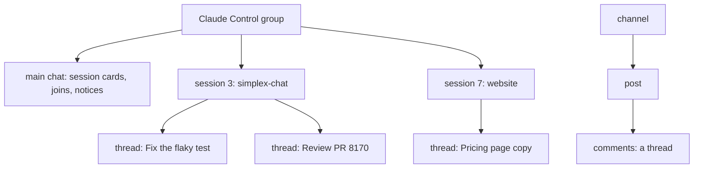
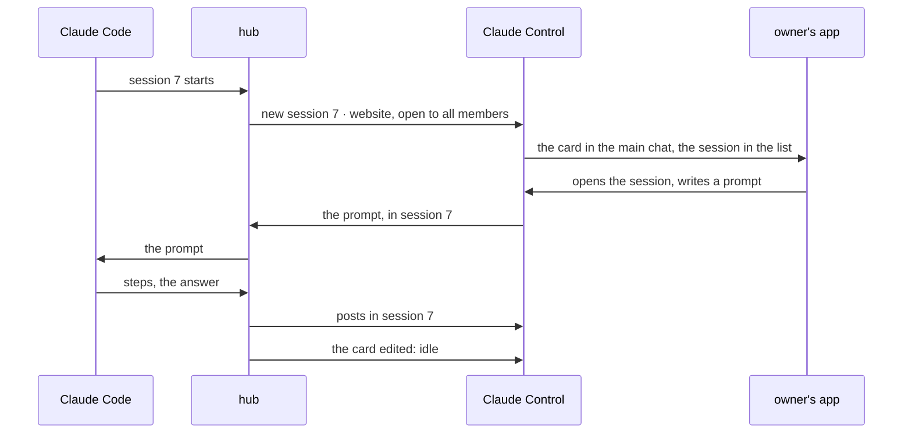
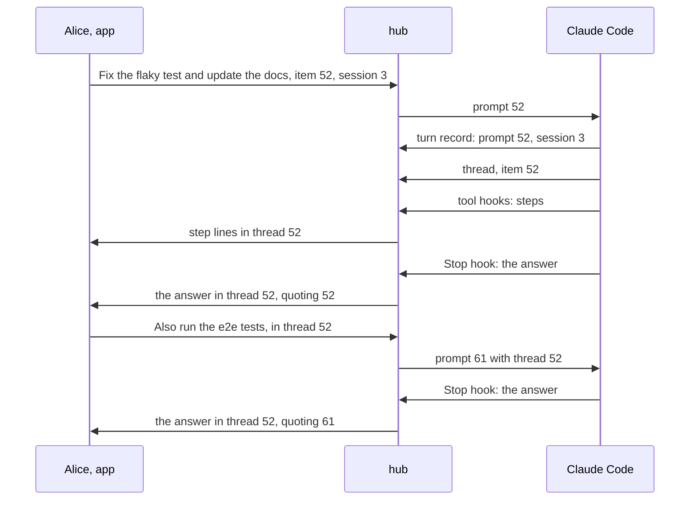
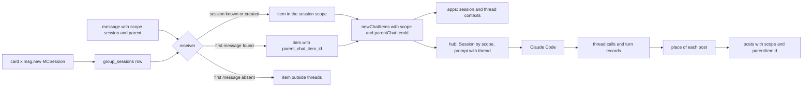
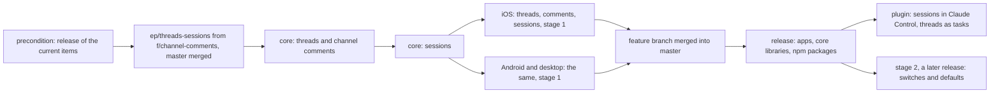

# Threads, channel comments and sessions as topics, from how agents use them

Status: third revision, 2026-11-13. The user's answers: Q1 B, Q2 A with a staged release, Q3 replaced by Claude's own use of threads, Q4 by a note (all work in this session, threads and sessions together, vertically), Q5 A. Q6, Q7 and Q8 are open.

Precondition: execution starts after the release of the current items: activity, silent messages, flat layout, agent profile, replies, reactions, allow-tool, session list, session usage, context summary and live answers.

Code references: master `8fda06295`, by file and function name. The starting point of the core: branch `f/channel-comments` of simplex-chat at `69fdc1c27` (2026-05-27), with its plans `plans/2026-04-06-channel-comments.md` (v1) and `plans/2026-04-06-channel-comments-v2.md` (v2). Plans of the items in the precondition, on their `ep/mcp-*` branches, and `plans/2026-10-13-message-priority.md` (approved). Decisions of the 0.3.0 plan are cited as "0.3.0 decision N" ([2026-11-07-mcp-claude-code-channel.md](2026-11-07-mcp-claude-code-channel.md)).

## 1. Goal

Roadmap line, `ROADMAP.md` of the plugin, "In your sessions": "Each session is a topic inside one group, not a group of its own." Proposed line, added with this plan's approval: "Claude keeps each task in its own thread of the session." The plugin's pull request removes both.

The user's words, 2026-11-13:

> we really need threads for efficent work on multiple issues, don't you think?

> they are in line with channel comments ideas

> yes, we need to ship it together with comments, it's substantial effort.

> we will enable it on receiving side first, and won't allow enabling in UI. Won't stop plugin from enabling it. So users won't be overwhelmed before the upgrade

> good question, as it's unclear what creates threads. Needs to be thought of. I think it's wrong to have users be responsible for threads, and claude should see thread as task, and deside when and how to use them contextually, not formally

> We can ship the rest up to this point, release, then do threads and sessions. To me they are related and should be planned, designed and executed together, vertically. That is we won't just design threads and sessions, but how we use them with agents.

The user's model of sessions, 2026-11-07: sessions are subgroups of a group, not supergroups: sub-conversations, potentially short-lived, open or by invitation, and referenced in the main chat.

Outcome:
- A group holds sessions: each session is a conversation of its own, listed in the group and referenced in the main chat by its card.
- A message of the main chat or of a session can have a thread: the conversation under it. Comments under channel posts are threads.
- Claude Code's sessions are sessions of the Claude Control group. Claude opens a thread for a task it takes on, and the task's posts go there.
- The core, the apps and the plugin ship this together, after one release that receives and shows it without switches in the apps.

## 2. What users see

### 2.1 Words and structure

```
word       what it is                                        who makes it
group      members, a main chat, sessions                    a person, or the plugin for Claude Control
session    a conversation inside a group: a topic             an admin or owner, or Claude for each Claude Code session
           its card in the main chat references it
thread     the conversation under one message of the main     anyone who sends; in Claude Control, Claude decides
           chat or of a session, one level deep
comments   threads under the posts of a channel              subscribers
```



### 2.2 Scenario 1: Claude Code sessions as sessions of Claude Control

Today each Claude Code session has a group of its own, and each owner gets an invitation to it in the Main group. After this plan:

```
moment                          today                                       after
Claude Code starts session 7    a group "7 · website", an invitation for    a session "7 · website" in Claude Control, its card
                                each owner, joined with a tap               in the main chat; every member sees it at once
the owner opens it              the group, from the chat list               the card, or the group's list of sessions
Claude works                    prompts, steps, cards, answers in the       the same posts in the session
                                session's group
the session's state             one list message in the Main group          the card: 🟠 7 · website: working
                                (session list plan)
model, effort, usage            the group's description, a line per turn    the card's second line; the line per turn in the session
Claude Code ends                the group stays                             the card: ⚪ 7 · website: not running
claude --resume                 the same group                              the same session
chat list                       one chat per session                        one chat, Claude Control, with the unread of its sessions
```

The card of a session, edited by Claude, in the state lines of the session list plan:
```
🟠 7 · website: working
opus · effort high
```

The group's list of sessions, in its info and above its main chat:
```
🔵 6 · docs: waiting for you, 1 approval       2 new
🟠 7 · website: working                        5 new
🟢 3 · simplex-chat: idle
⚪ 2 · openclaw: not running
```



### 2.3 Scenario 2: Claude's tasks as threads

Threads are Claude's tasks. Alice writes in session 3: "Fix the flaky test in ChatRelays and update the docs." Claude judges it a task of several steps and opens its thread under her message. Its step lines and its answer appear in that thread. In the session, her message shows `@ 7 replies, 7 new`. Alice replies in the thread, and Claude's next answer stays there.

Where Claude's posts go: to the place of the last event below, during a turn.
```
event                                          place of the posts that follow
a turn starts with a member's message          its thread, or the session outside threads
a turn starts without one                      the session outside threads: a terminal prompt, a prompt of Claude Code
Claude calls thread                            the thread it names, a new thread under a message, a new task's
                                               thread, or the session outside threads
a member's message reaches the running turn    its thread, or the session outside threads
```

The posts that follow these events: Claude's texts and live answer (`ep/mcp-live-answers`), step lines, notes, tool-use and action cards, `reply` posts, the end line of the turn (`ep/mcp-session-usage`). The answer quotes the prompt of its turn (0.3.0 decision 39) when that prompt is in the answer's place.

A member's message in a thread reaches Claude with the thread's first message as its reply when it quotes no other:
```
<channel source="plugin:simplex:simplex" from="Alice" item="61" reply_to="52" reply_to_from="Alice" thread="52">
> Fix the flaky test in ChatRelays and update the docs.
Also run the e2e tests.
</channel>
```

Channel instructions, after `ep/mcp-replies`; its last sentence is replaced:

Before: `... Your final answer of each turn reaches them in that group; reply sends them a file.`

After: `... Threads of this session are tasks. For a task that needs more than a short answer, call thread: under the member's prompt, or with a title when no prompt starts it. Your texts, steps, cards, reply posts and final answer go to the place of the last message you received, or to the place thread chose after it. A message in a thread has thread, the ID of the thread's first message, and is passed as a reply to that message when it replies to no other.`

New tool `thread`:
```
input    item      Item ID of a message of this session: a member's prompt, a thread's first message, or a post of yours.
                   A message inside a thread means its thread.
         title     Title of a new task, up to 200 characters: posted as a new message of the session, and its thread opened.
                   Without item and title: the session outside threads.
output   thread    Item ID of the thread's first message; absent outside threads.
errors   give item or title, not both.
         item: this session has no message N.
         item: message N can't have a thread.
         Threads are off in this session's group.
```
Its description: `Chooses where your posts of this turn go: the thread of a task, or the session outside threads. Your texts, steps, cards, reply posts and final answer go there, until you call thread again or a member's message reaches you.`

The `reply` tool takes `file`, `text` or both, and posts to that place: `Sends a file, with text as its caption, or a text message, to the place of your posts of this turn (see thread). Your final answer of each turn reaches them without this tool.` A turn that answers two tasks posts the first answer with `reply`, calls `thread`, and ends with the second.



A background task of thread 52 ends later. Its note is posted when the turn starts, before Claude acts, so it is in the session outside threads; Claude calls `thread` with item 52, and its answer goes to thread 52 without a quote.

### 2.4 Scenario 3: a person in one session only

Today an admin of a session's group adds a person to that group alone (0.3.0 trust model, rule 7). Q7 decides how this works when sessions are topics. With Q7 A: an admin adds a person to one session in the session's info; the person joins Claude Control as a member of that session only. That member sees the session's card and the session, and nothing else of the group.

### 2.5 Scenario 4: Claude in other chats

Claude reads and writes threads in groups and channels it has joined with `connect`:
- A message in a thread has `thread`, the item ID of the thread's first message, in the results of `receive`, `send` and `connect`. A comment under a channel post has the post's item ID.
- `send` takes `thread`, to post in that thread. A `reply_to` of a message inside a thread posts in its thread.
- A message in a session of another group has `session`, the session's title, and the chat reference of the session, such as `#15(_session:4)`, which `send` takes.

Business chats are groups, so they get sessions with this plan. Q6 asks whether sessions also come to direct chats, for agents that serve people in them.

### 2.6 In the apps

Stage 1, the release after the merge. Threads, comments and sessions appear where the plugin, a bot or the API turned them on:
```
place                          after
under a message with replies   1 reply / 5 replies / 5 replies, 2 new / @ 5 replies, 2 new
                               (@ while a reply to you or a mention waits after your last message)
tap on that line               the thread opens: the first message on top, then the replies, and the composer
item menu of a message         Reply in thread, after Reply, while threads are on
session card                   its title and state lines; a tap opens the session
group info                     Sessions: each session with its card's first line and its new messages
session view                   title: the session's title, subtitle: the group's name; a thread opens from it
chat list                      unread of the main chat, the sessions and the threads
main chat scroll button        unread of the main chat
channel post                   comments N, as v2 describes; the comments view
group preferences              no row for threads, sessions or comments
```

Stage 2, a later release, adds the preference rows and the actions that create:
```
group preferences              Threads: "Members can reply in threads." / "Threads are prohibited."
                               Sessions: "Admins can create sessions." / "Sessions are prohibited." (its role decides who)
channel preferences            Comments, as v2
group info                     New session
new group, new channel         threads on; comments on
```

With the message-priority pull request, the `@` sign becomes the bell when the waiting reply is important (`plans/2026-10-13-message-priority.md`, section 1).

Members with older apps see replies in threads as messages of the main chat, without the message they are under. They receive no messages of sessions (decision 30); the card of a session shows them its title as a message.

## 3. Questions for the user

Answered on 2026-11-13:
- Q1 B: threads ship together with channel comments.
- Q2 A, staged: stage 1 receives and shows, without switches in the apps; the plugin turns its features on. Stage 2 adds the switches and the defaults. Decisions 41 and 42 apply it to sessions and comments too.
- Q3: Claude decides when a task gets a thread; members are not responsible for threads.
- Q4: all work is done by this session's agents; threads and sessions are planned and executed together, vertically, from how agents use them, after the release of the current items.
- Q5 A: comments follow the stages of threads.

Q6. Do sessions also come to direct chats in this plan?
- A, recommended: yes. A person talking to an agent, as with the vendors of the agent catalogue, starts a new session for each conversation, and the agent keeps the context per session; Claude gets the same with its peers. Business chats are groups, so they get sessions from the group design, and their preference is already on (`defaultBusinessGroupPrefs`). Direct chats need `scope` in direct messages, a session table per contact and the contact's preference `SessionsPreference`. Cost: about 300 more lines of Haskell, 200 per app platform, and `session` in the plugin's tools for contacts.
- B: groups and business chats now, direct chats in a later plan. A direct chat keeps one conversation.

Q7. Can a person be a member of one session only?
- A, recommended: yes. A member of a session only receives the session's card and messages, and no message of the main chat or of other sessions; the core delivers to them as it delivers to a member pending approval, who receives only the support scope (`getGroupRecipients`). The plugin keeps the people an admin adds to one session today (0.3.0 trust model, rule 7). Cost: a member flag, the delivery rule, the history rule, and "Add to session" in the apps.
- B: sessions are open to every member of the group. A person who should see one session only gets a group of their own: that Claude Code session stays a group, as in 0.3.0.
- C: sessions open to a subset of members, without members of one session only. Outsiders join the whole group.

Q8. Do the session cards replace the session list message of the approved session list plan?
- A, recommended: yes. Each card shows its session's state lines, edited by Claude, and the apps list the sessions with their unread in the group's info. The list message would repeat the cards. The list message stays for sessions that keep their own group, and while any member's app has no sessions.
- B: both. The list message stays in the main chat, and the cards show only the titles.

## 4. Decisions

Facts:
1. The wire field of threads exists. `MsgContainer` in `Protocol.hs` has `parent :: Maybe MsgRef`, and its JSON is derived, so the field is optional on the wire. `MsgRef` is `{msgId?, sentAt, sent, memberId?}`.
2. Every released app shows a message with `parent` as a message of the main chat. `newGroupContentMessage` in `Library/Subscriber.hs` does not read `parent`. Versions before #6808 (`ac6f8b76a`, 2026-04-15) parse it as `MCComment` and use its content as of any message; they parse `quote` first, so a message with both keeps only the quote there.
3. The channel comments branch: comments in channels only (`useRelays'`); the parent in `MsgContainer`, not in `MsgScope`; the migration `M20260516_channel_comments` adds `parent_chat_item_id` with `ON DELETE CASCADE`, `comments_total` and `comments_disabled`, and two indexes; `parentChatItemId`, `commentsTotal` and `commentsDisabled` in `CIMeta`; `/_send #N parent=ID` inside `SendRef`, and `/_get chat #N parent=ID`; a flat thread; a missing parent drops the message; comments are not unread; the role `GRCommenter`; `commentsVersion`; iOS work up to `fad148440`; Android and desktop deferred (v2, sections 1 and 9). Its base `92e9640e4` is 799 commits behind master `97bbbd9ac`; 8 of the core files it changes differ on master by 6,405 added and 2,554 removed lines since then.
4. The preferences exist and are hidden. `Types/Preferences.hs`: `CommentsGroupPreference {enable, duration}`, `SessionsGroupPreference {enable, role}` and the contact's `SessionsPreference {allow}`, all off by default (`defaultGroupPrefs`), except sessions in business chats (`defaultBusinessGroupPrefs`). `allGroupFeatures`, `groupFeatureInChannel` and `groupFeatureInRegularGroup` leave comments and sessions out. These lists decide the feature items of a group and of its preference changes (`groupFeatures`, `createGroupFeatureItems_` and `createGroupFeatureChangedItems` in `Library/Internal.hs`), the CLI views (`View.hs`) and the CLI's `/set` (`updateGroupProfileByName_` in `Library/Commands.hs`). `/_group_profile` sets any preference. The apps' `GroupFeature` (`ChatTypes.swift`, `SimpleXAPI.kt`) has neither case. No RFC defines sessions; #5360 reserved the preference.
5. Group chat scopes hold member support only: `GroupChatScope` and `GroupChatScopeInfo` in `Messages.hs`, `MsgScope = MSMember` in `Protocol.hs`, parsed by its tag. A scope decides the recipients (`getGroupRecipients` in `Library/Internal.hs`, which filters them by a compatible chat version), the delivery job (`infoToDeliveryContext` in `Delivery.hs`), the receiver's scope (`mkGetMessageChatScope`), the stored scope (`createNewChatItem_` in `Store/Messages.hs`), the chat reference (`gcScopeP` in `chatCommandP`, `ChatRef.cmdString` in TypeScript) and the CLI's `(support)` (`groupScopeInfoStr` in `View.hs`). A member pending approval receives only the support scope.
6. The main chat's queries filter `group_scope_tag IS NULL` in `Store/Messages.hs`: `findGroupChatPreviews_` (the last item and the unread counts of the chat list), `getChatContentTypes`, `getChatItemIDs` (item pages), `queryUnreadGroupItems` (the first unread, last viewed and unread counts of a chat), `updateGroupChatItemsRead` and `getGroupUnreadTimedItems`.
7. A quote's `MsgRef` in a group is built by `quoteData` in `prepareGroupMsg` (`Library/Internal.hs`): the item's shared ID and time, `sent`, and the author's member ID, the user's own membership for a sent item. `getGroupMemberCIBySharedMsgId` (`Store/Messages.hs`) finds an item by its author's member ID and its shared ID, own items included.
8. Reactions and mentions are attached to each loaded group item in `groupCIWithReactions`.
9. History for a new member is the last 100 items with `include_in_history`, of the main chat only (`getGroupHistoryItems`, `sendHistory`); a signed item is forwarded as its stored bytes, an unsigned one is encoded again by `prepareGroupMsg`.
10. `CIMeta.userMention` is true for a message that mentions the user or replies to the user's message; the approved priority plan adds important messages (its section 5).
11. The API docs describe `SendRef` as `ChatRef` (`bots/src/API/TypeInfo.hs`), so the generated `APISendMessages.cmdString` sends `ChatRef.cmdString(sendRef)`; a scope in `ChatRef` reaches every command that takes a chat. The Node.js library's `apiSendMessages` takes a `ChatRef` with its scope; `apiSendTextReply` replies in the replied item's chat; `apiGetChat` takes any pagination, `around` included, and an `around` page holds the item itself (`getGroupChatAround'`).
12. Both apps open member support chats in a secondary context by the scope: iOS `SecondaryItemsModelFilter.groupChatScopeContext`, `getCIItemsModel` and `SecondaryChatView`; Kotlin `SecondaryContextFilter.GroupChatScopeContext` and `ChatsContext`. They list support chats in `MemberSupportView` (iOS, Kotlin).
13. The plugin: one group per session (`Hub.createSessionGroup`, `Hub.session`), owners invited at its start (`Hub.session`, `Hub.inviteOwner`), `/join N` (`Hub.join`), rights posts (`Session.announceRights`); every group item without a scope is a message of the main chat (`isGroupMessage` in `control.ts`); posts by `apiSendMessages` (`Session.post`, `Control.postMessage`); command replies by `apiSendTextReply` (`Control.onMessage`); turn records with the hook's start time and the matched prompt (`Session.turn`, `Session.turnQuote`); `reply` sends files only (`replyTool`, `AgentTools.reply`). Per-session data is in the group's custom data (`SessionGroupData`).
14. Claude Code adds a prompt that arrives during a turn to that turn (`ep/mcp-harness-notes`, fact 3); such a prompt adds a turn record when it matches a pushed prompt (decision 18 there). A channel meta key consists of letters, digits and `_` (`ep/mcp-replies`, decision 2).
15. The plugin's end-to-end tests run the core libraries pinned in `release.ts` of the Node.js library.

Choices, the model:

16. A session is a scope of a group: a conversation with its own messages, members and unread counts, referenced by its card in the main chat. A thread is the conversation under one message, of the main chat or of a session, one level deep. A channel's comments are the threads of its posts. Scope and thread are independent: a message has at most one of each.
17. Threads take the comments design of `f/channel-comments`: the wire field `parent`, the column `parent_chat_item_id`, the `CIMeta` fields and `/_get chat #N parent=ID` (fact 3).
18. Sessions are a new scope kind, next to member support, so every path that takes a scope takes them (fact 5). They are in regular groups and business chats; channels have comments.

Choices, threads in the core:

19. In a regular group, a thread's first message is a content message of the main chat or of a session, sent or received, with a shared ID, not deleted, not a report and not itself in a thread. A message in a thread has the scope of its first message. Channels keep the branch's rule: a channel post.
20. A message in a thread is `x.msg.new` with `parent`, built by `quoteData`'s rules (fact 7). Updates, deletions and reactions address an item by its shared ID, unchanged.
21. A receiver in a regular group finds the first message by `getGroupMemberCIBySharedMsgId`. When it is absent, deleted or outside the history a new member received, the item is stored outside threads, as every released app stores it (fact 2), so nothing is lost. Channels keep the branch's rule: a missing parent drops the message, against a relay that forges parents (v2, section 7.2).
22. Sending in a thread needs `GRCommenter` or above (the branch's `memberCanComment`); in a regular group, every member who sends has it. A quote in a thread must be its first message or one of its items (the branch's `quotedItemInCommentSection`). A send that quotes an item of a thread, without `parent`, is sent in that thread, so bots, `apiSendTextReply` and the plugin's command replies stay in it unchanged.
23. Thread items leave the item pages, last item, content types, first unread and last viewed of their scope's view (fact 6). In regular groups they count as unread; in channels they do not, as in the branch.
24. The summary of a first message: `replies` is the branch's `commentsTotal`; in regular groups `ChatItem.thread` adds `{unread, unreadMentions, awaitsReply}`, read in `groupCIWithReactions` by one grouped query, as reactions are read (fact 8). `awaitsReply` is true when a received attention item (fact 10) of the thread is newer than the user's last sent item in it.
25. API: `/_get chat <chatRef> parent=<itemId> <pagination>`; `/_send <chatRef> parent=<itemId> json [...]` with `parentItemId` as a field of `APISendMessages`, outside `SendRef`, so `SendRef` stays `ChatRef` in the API docs (fact 11).
26. History carries `parent` (`prepareGroupMsg` gets the first message's item ID; `sendHistory` passes it). Deleting a first message's row deletes its thread by the cascade, after every row-deleting path deletes the files of the thread's items.

Choices, sessions in the core:

27. A session is created by its card: `x.msg.new` in the main chat with the content `MCSession {text}`, from a member allowed by the `sessions` preference and its role. The first line of `text` is the session's title in lists; more lines follow it on the card. Older apps parse an unknown content type with its text (`MCUnknown`), so they show it. The session's ID on the wire is the card's shared ID. The card's author edits it (`x.msg.update`). A card deleted for everyone closes the session; its messages stay.
28. A message of a session is `x.msg.new` with `scope: {type: "session", msgId}` (`MsgScope.MSSession`). Updates, deletions and reactions carry the scope as they carry the member support scope.
29. Stored: a table `group_sessions` (the group, the card's shared ID and item, the title, closed, members' access, custom data), a table `group_session_members` for Q7 A, and `chat_items.group_scope_tag = 'session'` with a new column `group_scope_group_session_id`. `GroupChatScope.GCSSession {groupSessionId}`, `GroupChatScopeInfo.GCSISession {groupSession}`, chat reference `#G(_session:ID)`.
30. One chat protocol version for comments, threads and sessions: master's next version. `getGroupRecipients` sends a session's messages to the current members, or to the session's members by Q7 A, with that version; older apps receive none (fact 5). A receiver finds the session by the card's shared ID; a message of an unknown session creates it without a title, which its card fills.
31. Unread: `ChatStats.unreadOutsideMain`, the unread items of threads and sessions, part of `unreadCount`, 0 when absent from JSON. The chat list counts them; the main chat's scroll button shows `unreadCount - unreadOutsideMain`. `APIGetGroupSessions` returns each session with its card, last item and unread counts.
32. API: `APICreateGroupSession {groupId, title}`, `APIUpdateGroupSession {groupId, groupSessionId, title, closed}`, `APIGetGroupSessions`, `APISetGroupSessionCustomData`; messages, pages, reads and deletions of a session take the chat reference with its scope.
33. History for a new member covers the main chat and the sessions it can see, the last 100 items across them, cards first by time.
34. Q7 A: a member of one session is a group member with `memberSessionOnly`; the main chat's recipients and history leave them out, as they leave out a member pending approval (fact 5); sessions they belong to include them. An admin adds them with `APIAddGroupSessionMember`, an invitation through a connection of the inviter, as `/_add` invites members today.
35. The CLI prints a message of a session as `#team (session website) alice> TEXT`, as `(support)` (fact 5), and a message in a thread as `#team (thread) alice> TEXT`.

Choices, channel comments:

36. Channel comments are completed as v2 plans them (sections 4 and 6): the receive check `memberCanComment`, the scope conditions of `getGroupNavInfo_`, reactions on comments, the remaining tests.
37. Comments follow the stages (Q5 A): v2 decision 7, "comments on at channel creation", moves to stage 2.

Choices, stages:

38. Stage 1 core: comments, the preference of threads in groups, and sessions stay outside the group lists (fact 4), so turning them on creates no feature item and the CLI's `/set` refuses it; `/_group_profile` turns them on. `APINewGroup` and `APINewPublicGroup` leave new groups and channels without threads, sessions and comments.
39. Stage 1 apps: they show threads, comments and sessions, send in them, open threads from the item menu, and list sessions, wherever these are on. They have no preference rows and no action that creates a session; "Add to session" exists with Q7 A, because the plugin's sessions need it.
40. Stage 2: the lists include comments and sessions, the CLI gets `/set threads`, `/set sessions` and `/set comments`, `APINewGroup` turns threads on and `APINewPublicGroup` comments on when the profile lacks them, and the apps add the rows and "New session".
41. Sessions follow the stages by the user's note on Q2: no new content kind appears before most apps show it.
42. Comments follow them by Q5 A.

Choices, the apps:

43. Sessions open in the existing scope context (fact 12): `groupChatScopeContext` with `GCSISession`. Threads open in a context for the first message, the branch's iOS `groupChannelMsgContext` and its Kotlin counterpart; a thread opens from the main chat, from a session and from a channel. Each context takes new items by its scope and `parentChatItemId`; the main chat shows neither.
44. The list of sessions is a view of the group's info, as `MemberSupportView`, and a row above the main chat while the group has sessions. The session card shows its title and state lines, and its unread.
45. The thread line under a first message is drawn under its reactions, in the classic and the flat layouts. On a new item the apps update the summary, the session's counts and `unreadOutsideMain` in memory, and reads in a context subtract from them.
46. "Reply in thread" is in the item menu of a first message while threads are on and the user's role sends. Members may start threads; nobody has to.

Choices, the plugin, on master after the release:

47. Claude Control gets `sessions` on, with the role owner, and `comments` on. A new Claude Code session is a session of Claude Control (`APICreateGroupSession`, title `N · NAME`). The plugin creates a session when every human member's app has the version of decision 30; otherwise a group, as 0.3.0, and Claude posts once in the main chat: `NAME's app shows no sessions; update SimpleX to see them.`
48. A session that already has a group, by `session.json`, keeps it, also after `claude --resume`. The plugin moves no existing group.
49. The hub binds a `Session` to Claude Control and its session's scope: its posts, `Control` and the turn's routing use the chat reference with the scope. Per-session data moves to the session's custom data (`APISetGroupSessionCustomData`), as `SessionGroupData` is in the group's custom data today.
50. Rights: every member of Claude Control sees every session (0.3.0 trust model, rule 1); approvals and commands come from its admins and owners, prompts from its members whose role sends (rules 3 to 5). Owner invitations at a session's start and `/join N` are not used for sessions. With Q7 A, a member of one session has the rights of their role in that session.
51. The card shows the session's state lines of the session list plan and its description line (model, effort) of `ep/mcp-session-usage`. With Q8 A, the list message is posted only while Claude Control has sessions with groups of their own or members whose apps show no sessions.
52. Threads are Claude's tasks: Claude decides when a task gets a thread, by the channel instructions of section 2.3. The hub creates no thread by itself.
53. The tool `thread` (section 2.3): with `item`, the hub checks the message by decision 19, in this session, and records the place, its thread when the message is inside one; the first post there creates the thread. With `title`, the hub posts the title in the session and records its thread. Without either, the place is the session outside threads.
54. The place of a post is the place of the newest event before it, by time: a turn record, whose place is its prompt's thread or the session outside threads, or a `thread` call. Hook records use the hook's start time `at`; a `thread` call uses the service's receive time, both milliseconds since the epoch on one computer. Calls older than the last answer are dropped with its turn records.
55. The answer keeps its quote only when the quoted prompt is in its place. A quote in another place would move the post (decision 22), so it is dropped.
56. The opening live message of `ep/mcp-live-answers` is posted at the prompt, in the prompt's place. When the place changes before the opening message is filled, the hub deletes it and posts in the new place.
57. `Session.onMessage` takes `thread` from `parentChatItemId`. A message in a thread without a quote gets the `replyTo` of the first message, read by `apiGetChat` with `around` the first message and count 0, in the queued delivery, so the order of prompts stays (0.3.0 decision 45). The prompt line gets `thread?: number`, written as the meta key `thread` (fact 14); the protocol version stays 1.
58. `reply` takes `file`, `text` or both, and posts to the place of decision 54. A text without a file must fit one message (`fitsMessage`). It returns `{item}`.
59. Tools in other chats (section 2.5): `thread` in a message of the results and in `send`'s input; a session's chat reference in `chat` of results and inputs, and its title in `session`.

## 5. Design

Options for sessions:
```
option                                   cost
A. a scope, created by its card          a scope kind at the sites of fact 5; a card content type; members' delivery
   (chosen)                              and history rules; the apps' scope contexts take it; older apps receive none
B. a thread under a card                 one level of threads is taken: tasks inside a session have no thread;
                                         no members of one session; no state of its own
C. a group per session, linked           connections between every two members per session; joins per session;
   from the parent group                 what 0.3.0 does, so not "inside one group"
D. sessions by their own events          an event kind per change; older apps ignore them and show no title
```

Options for who opens threads in Claude Control:
```
option                                   who decides               cost
T1. Claude names the place of its posts  Claude, by the task       one tool, one record kind, instructions; the hub routes
    with thread (chosen)                                           every post of the turn
T2. Claude names a thread per post       Claude, per post          steps, notes, cards and the answer have no place to follow
T3. the hub opens a thread per prompt    the hub, by a rule        short answers get threads too: the user asks for
                                                                   contextual use
T4. members open threads                 members                   the user: members are not responsible for threads
```

Options for the place of a post during a turn:
```
option                                       cost
P1. the newest event: prompt or thread call  one lookup per post; a member's message moves the posts to its place
    (chosen)
P2. the turn's first prompt                  the answer's quote crosses threads and is dropped, or 0.3.0 decision 39 changes
P3. the place stays across turns             a background task's notification lands in the last task's thread, also
                                             when Claude moved on
```

Options for the wire of threads:
```
option                                 older apps                                  wire
A. parent in x.msg.new (chosen)        a message outside threads                   + parent, about 80 bytes
B. a MsgScope kind per thread          the unknown scope fails the message's parse  + scope
C. replies as threads                  replies, as today                           a quote copies the quoted text into every reply
```

Options for the summary of a first message:
```
option                                       cost
S1. comments_total for replies, the rest     the total channels need: subscribers lack comments outside their history;
    read at load (chosen)                    unread exists in groups only, read as reactions are read
S2. every count read at load                 a second source of the total beside comments_total
S3. every count kept in columns              an update at every read, insertion, deletion and member removal
```

Options for the thread of a send in the API:
```
option                                       cost for clients
A1. parentItemId of APISendMessages (chosen) one optional field in the generated types
A2. parent in SendRef, as the branch         SendRef needs its own API type: every client's sendRef changes
```

Data flow:


Changes, the core, on the feature branch:
```
file                                    function or type                change
Protocol.hs                             MsgScope, MsgContent            MSSession {msgId}; MCSession {text}
Messages.hs                             GroupChatScope, ...Info, Tag    GCSSession, GCSISession, "session"
                                        ChatItem, ChatStats             thread summary; unreadOutsideMain
Controller.hs                           commands                        APISendMessages.parentItemId; session commands of decision 32
Library/Commands.hs                     chatCommandP, gcScopeP          parent=; (_session:ID); session commands; stage 2 /set
                                        sendGroupContentMessages_       decisions 19, 22, 25; the scope's recipients
                                        APINewGroup, APINewPublicGroup  stage 2 defaults
Library/Internal.hs                     getGroupRecipients              session recipients by version and Q7
                                        mkGetMessageChatScope           MSSession, the session found or created
                                        prepareGroupMsg, sendHistory    parent; history of decision 33
                                        prohibitedGroupContent          threads, sessions by their preferences
Library/Subscriber.hs                   newGroupContentMessage          decisions 21, 27, 28; card updates by groupMessageUpdate
Delivery.hs                             DeliveryJobScope,               a session job scope
                                        infoToDeliveryContext
Store/Messages.hs                       createNewChatItem_, queries     the session scope column; decisions 23, 31
                                        groupCIWithReactions            thread summary
Store/Groups.hs                         new                             group_sessions, group_session_members
Store/SQLite|Postgres/Migrations        the branch's and a new one      sessions tables and column
View.hs                                 groupScopeInfoStr               (session TITLE), (thread)
docs/protocol, bots API, TS, Python     generated and written           parent, scope session, MCSession, commands
tests                                   Groups.hs, ProtocolTests.hs     section 7
```

Changes, the apps, on the feature branch: types (`ChatTypes.swift`, `SimpleXAPI.kt`) with the session scope, the content `session`, the thread summary and the counters; the API functions; the scope and thread contexts (`ChatModel.swift`, `ChatModel.kt`); the session card, the thread line and "Reply in thread" (`ChatView.swift`, `ChatItemView.kt`, the flat rows); the sessions list (as `MemberSupportView`); the session and thread views (as `SecondaryChatView`, `MemberSupportChatView`); "Add to session" with Q7 A; the comments of v2, section 5; strings; specs. Stage 2: the preference rows and "New session".

Changes, the plugin, after the release:
```
file                 function                        change
src/hub.ts           Hub.session, createSessionGroup  a session of Claude Control by decision 47; groups of decision 48 kept
                     Session                         bound to a chat reference with a scope; data in the session's custom data
                     Session.onMessage, deliver      thread and its replyTo (decision 57)
                     Session.placeOf, setPlace       new: decisions 53, 54
                     Session.turn, answer, post,     every post to placeOf; the quote by decision 55; the opening message by 56
                     step, note posts
                     Hub.join, inviteOwner,          not used for sessions (decision 50)
                     announceRights
                     the list of the session list    the cards of decision 51
                     plan
src/main-group.ts    Claude Control                  sessions and comments on; the notice of decision 47
src/control.ts       Control, isGroupMessage,        the session scope; the place of posts
                     isControlEvent, postMessage
src/session.ts       channelInstructions,            section 2.3; meta thread
                     channelNotification
src/tools.ts         threadTool, replyTool,          section 2.3; thread and session in results and send (section 2.5)
                     messageSchema, send
src/messages.ts      toMessage                       thread, session
src/protocol.ts      AttachLine.prompt               + thread?: number
nodejs src/api.ts    apiSendMessages                 + parentItemId; session commands
```

```
placeOf(at):
  events = turn records before at: (at, thread of the record's item, or the session outside threads)
         + thread calls before at: (at, the chosen place)
  the newest event's place; none: the session outside threads
thread call {item?, title?} at time t:
  title: post the title in the session as Claude; place = its item
  item: checked by decision 19; place = its thread when it is inside one, else item
  neither: place = the session outside threads
post(parts, quote, place):
  every part sent to the session's chat reference with parentItemId = place; the first with the quote when decision 55 keeps it
  refused as threads off: the same parts outside threads, without the quote
on an answer at a: turn records and thread calls before a are dropped
```

## 6. Compatibility

- Older apps and bots: a reply in a thread is a message outside threads (fact 2); a session's card is a text message; messages of sessions do not reach them (decision 30).
- Stage 1 apps: they show threads, comments and sessions where an owner, a bot or the plugin turned them on; their users cannot turn them on.
- Older forwarding members: versions before #6808 keep `parent` without a quote and drop it with a quote. Messages of sessions are forwarded only to members with the version of decision 30.
- A new member's history: a reply whose first message is outside the 100 items is shown outside threads (decision 21).
- Remote desktop: an older controller ignores the new fields and scope kinds; a newer controller reads `unreadOutsideMain` as 0 from an older host.
- Downgrade: the migrations drop the columns and tables; replies return to their scope's view, and messages of sessions are lost from view.
- Plugin: sessions with groups keep them (decision 48); members with older apps keep the group per session (decision 47). An older session server drops `thread`, and its Claude has no `thread` tool. Plugin data folders: per-session data moves to the session's custom data at the session's creation; older sessions keep theirs in the group.
- Claude Code: 2.1.316 to 2.1.322 write meta keys by the same rule (fact 14).

## 7. Acceptance and tests

Done when:
```
#   criterion                                                                       checked by
1   a reply in a thread of the main chat or of a session is stored in its thread at  core: Groups.hs "threads"
    every member, also through a forwarding member
2   a session is created by its card, receives messages, edits its title, closes     core: Groups.hs "sessions"
3   a session's messages reach its members with the version, not older members       core: "sessions"
4   with Q7 A, a member of one session receives that session only                    core: "sessions"
5   the views exclude threads; unread counts include threads and sessions            core
6   the thread summary and the sessions list have their counts                       core
7   a reply whose first message is absent is shown outside threads                   core
8   history: threads, sessions and cards in order for a new member                   core
9   stage 1: turning features on creates no feature item; /set refuses them          core
10  /_send parent= and #G(_session:N) work; both fail to parse on master              core
11  channel comments: v2, section 6                                                  core
12  the apps show sessions, threads and comments, send and read in them, without     ios-sim, desktop-linux, android-emu; Kotlin
    switches                                                                          desktop tests of the contexts and counters
13  a Claude Code session is a session of Claude Control, with its card and states   plugin unit: sessions; e2e service
14  a member's message in a thread reaches Claude with thread and its reply line     plugin unit: sessions, session
15  each post of a turn goes to the place of the newest event before it              plugin unit: sessions
16  thread opens, moves and returns; reply posts text to the place                   plugin unit: tools, sessions; e2e mcp
17  a member with an older app keeps groups per session and gets the notice           plugin unit: sessions
18  tools read and write threads and sessions in other chats                         plugin unit: messages, tools; e2e mcp
19  a real session: Claude opens a thread for a task in its session, and a reply     TESTING check
    there continues it
```

Core tests in `tests/ChatTests/Groups.hs`: `describe "threads"` (criteria 1, 5 to 8, 10; `testThreadSend` fails on master), `describe "sessions"` (2 to 4, 6, 8, 10), `describe "stages"` (9), the branch's `describe "channel comments"` (11); `tests/ProtocolTests.hs` for `parent`, `MSSession` and `MCSession`. The reduced build runs them with `TESTS='/SimpleX chat client/group tests/'`.

App tests: the three app test workflows, with a test backend that creates a session through the API, replies in a thread and comments in a channel; Kotlin desktop tests of the contexts and of the counters.

Plugin tests (`npm test`, `npm run test:e2e`, with the released core libraries): `sessions.test.ts` for decisions 47 to 57 (the first test of a thread prompt fails on master: no `thread`); `tools.test.ts` for `thread`, `reply` and the fields of section 2.5; `session.test.ts` for the meta key and the instructions; `messages.test.ts` for `thread` and `session` in results; the e2e mirroring test with a session, a thread call and a reply in the thread.

## 8. Docs to change

- The core: `docs/protocol/simplex-chat.md` and its schema (`parent`, the session scope, `MCSession`); a new RFC, `docs/rfcs/2026-11-NN-sessions.md`, for sessions; `bots/api` generated; `bots/README.md`, a section on threads, sessions and the stages.
- The apps: `apps/ios/spec`, `apps/multiplatform/spec`; v2's documents for comments.
- The plugin: `README.md` (sessions in Claude Control, tasks in threads); `REFERENCE.md` (sessions, the places of posts, `thread`, `reply`, the fields of section 2.5, the notice for older apps); `spec/api.md`, `spec/architecture.md`, `spec/flows.md`; `TESTING.md`; `ROADMAP.md`, the lines of section 1 removed.

## 9. Conflict areas

Execution starts after the release of the precondition's items, so they are on master by then. The places where this plan changes their work:
```
item                  their work                                     change here
session list          one list message in the Main group             the cards of decision 51 (Q8)
session usage         the description line, the end line per turn    the card's second line; the end line follows the place
live answers          the opening message, live texts                decision 56; texts follow the place
activity              step lines                                     they follow the place
harness notes         notes                                          notes of mid-turn prompts follow the place
context summary       its line                                       it follows the place
allow-tool, 0.3.0     tool-use cards, mode cards, rights posts       cards follow the place; rights by decision 50
flat layout           flat rows                                      the thread line and the session card in flat rows
silent messages       priority, unreadSilent                         the counters of decision 31 next to unreadSilent
f/channel-comments    the core and iOS work                          the feature branch starts from it
```

## 10. Execution and estimate

All parts are built by this session's agents. The feature branch `ep/threads-sessions` starts from `f/channel-comments`, merges master, and receives the pull requests below; it merges into master by a merge commit when both apps show threads, comments and sessions. The release follows, then the plugin's pull request on master. Stage 2 comes in a later release.



```
part                                              size                                         work
a  feature branch from f/channel-comments,        conflicts in the 8 core files of fact 3       3-5 days
   master merged
b  core: channel comments completed, threads in   about 700 Haskell, 750 test lines             6 days
   groups and sessions' scopes
c  core: sessions                                 about 900 Haskell, 600 test lines, the RFC    7 days
d  iOS: threads, comments, sessions, stage 1      about 1,100 Swift                             7 days
e  Android and desktop: the same                  about 1,100 Kotlin                            7 days
   the merge into master; the release
f  plugin                                         about 500 TypeScript, 600 test lines          4 days
g  stage 2                                        about 150 lines per platform, 60 Haskell      2 days
Q6 A adds about 300 Haskell, 200 per app platform and 80 plugin lines: about 4 days. Q7 A is included above.
```
