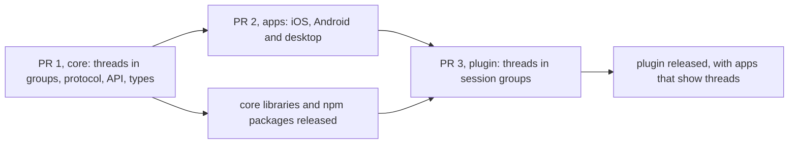
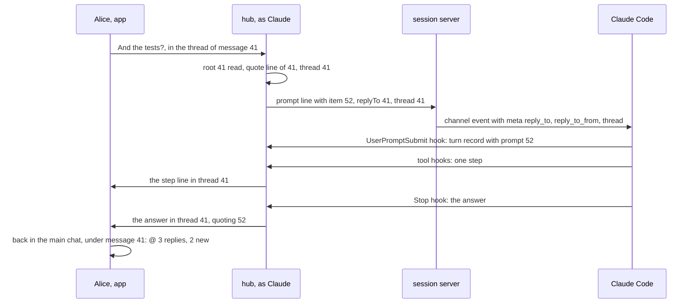
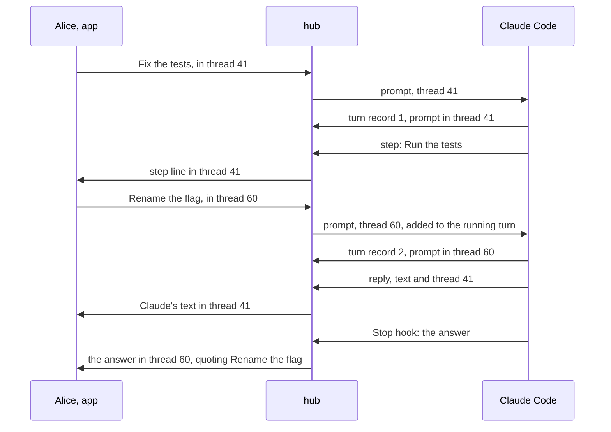
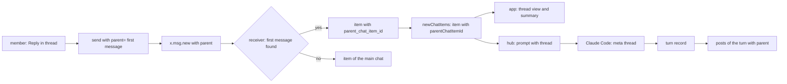

# Threads in groups: the core, the apps and the Claude Code plugin

Status: draft for the user's review. Code references: master `97bbbd9ac` (`@simplex-chat/mcp` 0.3.0 with #8157). The channel comments design: branch `f/channel-comments` of simplex-chat at `69fdc1c27` (2026-05-27), plans `plans/2026-04-06-channel-comments.md` (v1) and `plans/2026-04-06-channel-comments-v2.md` (v2) on that branch. Claude Code references: version 2.1.322, as cited by the replies plan. Plans of other items: `ep/mcp-replies` (approved), `ep/mcp-reactions`, `ep/mcp-activity`, `ep/mcp-silent-messages`, `ep/mcp-flat-sessions`, and `plans/2026-10-13-message-priority.md` (approved). Decisions of the 0.3.0 plan are cited as "0.3.0 decision N" ([2026-11-07-mcp-claude-code-channel.md](2026-11-07-mcp-claude-code-channel.md)).

This item is three pull requests, merged in this order:



## 1. Goal

`ROADMAP.md` of the plugin has no line for threads. Proposed line, in "In your sessions", added with this plan's approval: "Work on several issues in one session, each in its own thread." PR 3 removes it.

The user's words, 2026-11-13, in the session group of this work:

> we really need threads for efficent work on multiple issues, don't you think?

> they are in line with channel comments ideas

> do you think agents will be able to effectively use threads in one session?

> no, it makes no sense, I am not that fast. Ok, we'll just see if threads work without batching.

Outcome:
- In a group, a member replies in a thread under any message of the main chat. The thread's messages leave the main chat; the message shows how many replies its thread has and how many are new.
- Threads use the wire field and the local model of the channel comments design, so channel comments reuse them.
- In a session group, a member's message in a thread reaches Claude with the thread's ID. Claude's answer, step lines, notes and cards of that turn appear in the thread.
- Claude posts in any thread, and starts one under any message, with `reply`.

## 2. What users see

### 2.1 In the apps, in any group with threads on

```
place                        before                          after
item menu of a message       Reply, Forward, ...             Reply, Reply in thread, Forward, ...
under a message with replies -                               1 reply
                                                             5 replies
                                                             5 replies, 2 new
                                                             @ 5 replies, 2 new     (a reply to you or a mention waits after your last message)
tap on that line             -                               the thread opens
thread view                  -                               title: Thread, subtitle: the group's name
                                                             first item: the message the thread is under
                                                             then the replies, oldest first, and the composer
reply inside a thread        -                               quotes the first message or a reply of this thread
group preferences            no row                          Threads
                                                               on:  Members can reply in threads.
                                                               off: Threads are prohibited.
composer of a thread,        -                               disabled, with "Threads are prohibited."
threads off
chat list                    unread: main chat               unread: main chat and threads
                             preview: last message           preview: last message of the main chat
main chat scroll button      unread of the chat              unread of the main chat
notifications                as now                          a reply in a thread notifies as a message of the group
```

With the message-priority pull request (priority 1, "important"), the `@` sign becomes the bell when the waiting reply is important, as in the chat list (`plans/2026-10-13-message-priority.md`, section 1).

Members with older apps see each reply in a thread as an ordinary message of the main chat, without the message it is under. They cannot reply in threads.

### 2.2 In a session group of the plugin

Alice opens the thread under Claude's answer 41, "Fixed: the build passes.", and writes "And the tests?". Claude reads:

```
<channel source="plugin:simplex:simplex" from="Alice" item="52" reply_to="41" reply_to_from="Claude" thread="41">
> Fixed: the build passes.
And the tests?
</channel>
```

In a thread, a message that quotes no other message is passed as a reply to the thread's first message. A message that quotes a reply of the thread keeps that quote, by the rules of `ep/mcp-replies`, and has `thread`.

Where Claude's posts go:
```
post                                          place
answer of a turn                              the thread of the prompt it quotes (0.3.0 decision 39: the newest
                                              prompt of the group in the turn), or the main chat
step lines, notes, tool-use and action cards  the thread of the newest prompt of the group in the running turn,
                                              or the main chat
reply with thread                             that thread, or a new thread under that message
reply without thread                          the main chat
User's prompts typed in the terminal          the main chat
rights posts, replies to / commands           the main chat; a reply to a command sent in a thread is in that thread
```

Channel instructions, after `ep/mcp-replies`; the last sentence changes and two sentences are added:

Before: `... Your final answer of each turn reaches them in that group; reply sends them a file.`

After: `... A message in a thread has thread, the ID of the thread's first message, and is passed as a reply to that message when it replies to no other. Your final answer of each turn reaches the thread of the last message you received in that turn, or the group outside threads. reply sends a file or a text to the group, or to a thread with thread; thread can also be any message of the group outside threads, to start a thread under it.`

The `reply` tool:
```
input    file      Path of the file on this computer. Optional now.
         text      Caption of the file, or the text of a message without a file.
         thread    Item ID of a thread's first message, or of a message of the group outside threads, to start a thread under it.
output   item      Item ID of the sent message.
errors   reply: give file, text or both.
         thread: the group of this session has no message N outside threads.
         Threads are off in the group of this session; its owners can turn them on in the group's preferences.
         text: too long for a message; shorten it.
```

Its description: `Sends a file, with text as its caption, or a text message to the members of the SimpleX group of this session. With thread, it is sent in that thread. Your final answer of each turn reaches them without this tool.` The second line of 0.3.0 about the preference for files and media stays.



A turn that takes prompts of two threads. Claude Code adds a prompt that arrives during a turn to that turn (`ep/mcp-harness-notes`, fact 3):



## 3. Questions for the user

Q1. Threads are the channel comments design applied to groups. Who builds the core part?
- A, recommended: this item. PR 1 implements threads in groups on master with the comments design of `f/channel-comments`: the wire field `parent`, the column `parent_chat_item_id`, `parent=` in `/_send` and `/_get chat`, and `parentChatItemId` of items. The channel-only parts stay with the channel comments work, which then reuses this mechanism: the commenter role, per-post `commentsDisabled`, the close-after time, relay forwarding rules and the channel default. spaced4ndy reviews PR 1. Cost: PR 1, section 10.
- B: the channel comments branch is completed first, then groups. Its base `92e9640e4` is 799 commits behind master; 8 of the core files it changes differ on master by 6,405 added and 2,554 removed lines since then. Threads in session groups wait for it.
- C: a separate mechanism, a group chat scope per thread. The user asked for threads "in line with channel comments"; two mechanisms would serve one concept.

Q2. Which groups have threads?
- A, recommended: groups created with this release, and session groups. The core turns the preference on when a new group's profile lacks it; an owner turns it on in an existing group. Members with older apps see replies in threads as messages of the main chat. Cost: one line in `APINewGroup`; the default of a group without the preference stays off, so channels are unchanged.
- B: every group, existing ones included, until an owner turns threads off. The default of an absent preference then depends on the group's type, so the 10 call sites of `mergeGroupPreferences` get it; members with older apps in every group start seeing replies without their context.
- C: every group, without a preference. Owners cannot stop threads; the apps have no row for them.

Q3. Where does Claude answer a prompt sent in the main chat of a session group?
- A, recommended: in the main chat, as now. A member opens a thread to work on a side issue; Claude starts one with `reply` and `thread`, for example under its post about a pull request.
- B: in a new thread under the prompt. The main chat lists the prompts with their replies' counts, and every follow-up is written in a thread. Cost: one rule in the hub; each follow-up needs the thread opened.

## 4. Decisions

Facts:
1. The wire field exists. `MsgContainer` has `parent :: Maybe MsgRef` ([Protocol.hs:704](../src/Simplex/Chat/Protocol.hs#L704)), and its JSON is derived, so the field is optional on the wire ([:926](../src/Simplex/Chat/Protocol.hs#L926)). `MsgRef` is `{msgId?, sentAt, sent, memberId?}` ([:236-241](../src/Simplex/Chat/Protocol.hs#L236-L241)). `mcComment` builds it ([:738-739](../src/Simplex/Chat/Protocol.hs#L738-L739)) and has no caller.
2. Every released app shows a message with `parent` as a message of the main chat. Master ignores the field: `newGroupContentMessage` does not read it ([Subscriber.hs:2240](../src/Simplex/Chat/Library/Subscriber.hs#L2240)). Versions before #6808 (`ac6f8b76a`, 2026-04-15) parse it as `MCComment` and use its content as of any message (`ac6f8b76a^:src/Simplex/Chat/Protocol.hs:636-645`, `:838-841`). They parse `quote` first, so a message with both keeps only the quote there.
3. The channel comments design (v1, v2, `69fdc1c27`): the parent in `MsgContainer`, not in `MsgScope`; a column `chat_items.parent_chat_item_id` with `ON DELETE CASCADE`; `parentChatItemId` in `CIMeta`; `/_get chat #N parent=ID` and `/_send #N parent=ID`; a flat thread; channels only (`useRelays'`); comments are not unread. v2, decision 4, keeps `ChatInfo.GroupChat` and `ChatRef` unchanged.
4. The preference exists and is hidden. `GFComments` and `CommentsGroupPreference {enable, duration}` ([Types/Preferences.hs:217](../src/Simplex/Chat/Types/Preferences.hs#L217), [:769-774](../src/Simplex/Chat/Types/Preferences.hs#L769-L774)), off by default ([:583](../src/Simplex/Chat/Types/Preferences.hs#L583)), outside both feature lists ([:278-281](../src/Simplex/Chat/Types/Preferences.hs#L278-L281), [:313](../src/Simplex/Chat/Types/Preferences.hs#L313), [:334](../src/Simplex/Chat/Types/Preferences.hs#L334)). The apps' `GroupFeature` has no such case ([ChatTypes.swift:1379-1390](../apps/ios/SimpleXChat/ChatTypes.swift#L1379-L1390), [SimpleXAPI.kt:6184-6195](../apps/multiplatform/common/src/commonMain/kotlin/chat/simplex/common/model/SimpleXAPI.kt#L6184-L6195)); their texts depend on the group type ([ChatTypes.swift:1570-1575](../apps/ios/SimpleXChat/ChatTypes.swift#L1570-L1575)).
5. Group chat scopes hold member support only ([Messages.hs:119](../src/Simplex/Chat/Messages.hs#L119)). The main chat's queries filter `group_scope_tag IS NULL` at [Store/Messages.hs:914](../src/Simplex/Chat/Store/Messages.hs#L914) (last item), [:927](../src/Simplex/Chat/Store/Messages.hs#L927) (unread counts of the chat list), [:1231](../src/Simplex/Chat/Store/Messages.hs#L1231) (content types), [:1542](../src/Simplex/Chat/Store/Messages.hs#L1542) (item pages), [:1764](../src/Simplex/Chat/Store/Messages.hs#L1764) (first unread, last viewed, unread counts of the chat), [:2106](../src/Simplex/Chat/Store/Messages.hs#L2106) (mark the chat read) and [:2163](../src/Simplex/Chat/Store/Messages.hs#L2163) (unread timed items).
6. A quote's `MsgRef` in a group is built by `quoteData`: the item's shared ID and time, `sent`, and the author's member ID, the user's own membership for a sent item, none for an item sent as the channel ([Internal.hs:221-241](../src/Simplex/Chat/Library/Internal.hs#L221-L241)). `getGroupMemberCIBySharedMsgId` finds an item by the author's member ID and shared ID, own items included ([Store/Messages.hs:3076-3091](../src/Simplex/Chat/Store/Messages.hs#L3076-L3091)).
7. Reactions and mentions are attached to each loaded group item in `groupCIWithReactions` ([Store/Messages.hs:2772-2780](../src/Simplex/Chat/Store/Messages.hs#L2772-L2780)).
8. History for a new member takes the last 100 items with `include_in_history` ([Internal.hs:1423](../src/Simplex/Chat/Library/Internal.hs#L1423), [Store/Messages.hs:3747-3770](../src/Simplex/Chat/Store/Messages.hs#L3747-L3770)), oldest first. A signed item is forwarded as its stored bytes; an unsigned one is encoded again by `prepareGroupMsg` with its quote ([Internal.hs:1550-1558](../src/Simplex/Chat/Library/Internal.hs#L1550-L1558)).
9. `userMention` is true for a message that mentions the user or replies to the user's message ([Messages.hs:522](../src/Simplex/Chat/Messages.hs#L522)). The approved priority plan makes an important item an attention item too (its section 5).
10. `/_send` takes `SendRef` and `/_get chat` takes `ChatRef` ([Commands.hs:6755](../src/Simplex/Chat/Library/Commands.hs#L6755), [:6759](../src/Simplex/Chat/Library/Commands.hs#L6759), [:7258-7266](../src/Simplex/Chat/Library/Commands.hs#L7258-L7266)). The API docs describe `SendRef` as `ChatRef` ([bots/src/API/TypeInfo.hs:188](../bots/src/API/TypeInfo.hs#L188)), so the generated TypeScript sends `ChatRef.cmdString(sendRef)` ([commands.ts:105-118](../packages/simplex-chat-client/types/typescript/src/commands.ts#L105-L118)).
11. The Node.js library's `apiSendTextReply` sends into the replied item's chat with its quote ([api.ts:479-481](../packages/simplex-chat-nodejs/src/api.ts#L479-L481)); `apiGetChat` takes any pagination, `around` included ([api.ts:956-961](../packages/simplex-chat-nodejs/src/api.ts#L956-L961)). An `around` page holds the item itself ([Store/Messages.hs:1687-1695](../src/Simplex/Chat/Store/Messages.hs#L1687-L1695)).
12. Both apps open member support chats in a secondary context: iOS `SecondaryItemsModelFilter` and `getCIItemsModel` ([ChatModel.swift:58-60](../apps/ios/Shared/Model/ChatModel.swift#L58-L60), [:750-772](../apps/ios/Shared/Model/ChatModel.swift#L750-L772)), `SecondaryChatView` ([SecondaryChatView.swift:12](../apps/ios/Shared/Views/Chat/Group/SecondaryChatView.swift#L12)); Kotlin `SecondaryContextFilter` and `ChatsContext` ([ChatModel.kt:3914-3917](../apps/multiplatform/common/src/commonMain/kotlin/chat/simplex/common/model/ChatModel.kt#L3914-L3917), [:425](../apps/multiplatform/common/src/commonMain/kotlin/chat/simplex/common/model/ChatModel.kt#L425)), `MemberSupportChatView.kt:160`. Reactions are drawn under the item ([ChatView.swift:2282](../apps/ios/Shared/Views/Chat/ChatView.swift#L2282), [ChatItemView.kt:147](../apps/multiplatform/common/src/commonMain/kotlin/chat/simplex/common/views/chat/item/ChatItemView.kt#L147)); "Reply" is in the item menu ([ChatView.swift:2529](../apps/ios/Shared/Views/Chat/ChatView.swift#L2529), [ChatItemView.kt:414](../apps/multiplatform/common/src/commonMain/kotlin/chat/simplex/common/views/chat/item/ChatItemView.kt#L414)).
13. The plugin takes every group item without a scope as a message of the main chat ([control.ts:652-654](../packages/simplex-chat-mcp/src/control.ts#L652-L654), [hub.ts:153-160](../packages/simplex-chat-mcp/src/hub.ts#L153-L160)). It posts with `apiSendMessages` to the group ([hub.ts:290-296](../packages/simplex-chat-mcp/src/hub.ts#L290-L296), [control.ts:516-519](../packages/simplex-chat-mcp/src/control.ts#L516-L519), [user.ts:31](../packages/simplex-chat-mcp/src/user.ts#L31)), answers commands with `apiSendTextReply` ([control.ts:224](../packages/simplex-chat-mcp/src/control.ts#L224)), and keeps turn records with the matched prompt's item ([hub.ts:180-186](../packages/simplex-chat-mcp/src/hub.ts#L180-L186), [:267-276](../packages/simplex-chat-mcp/src/hub.ts#L267-L276)). `reply` sends files only ([tools.ts:462-480](../packages/simplex-chat-mcp/src/tools.ts#L462-L480), [:713-724](../packages/simplex-chat-mcp/src/tools.ts#L713-L724)).
14. A channel meta key consists of letters, digits and `_` (decision 2 of `ep/mcp-replies`), so `thread` reaches Claude.
15. The plugin's end-to-end tests run the core libraries pinned in `release.ts`, `core-7.1.3.0` ([scripts/ci/README.md:140-145](../scripts/ci/README.md#L140-L145), [release.ts:3](../packages/simplex-chat-nodejs/src/release.ts#L3)).

Choices, PR 1, core:

16. Q1 A. PR 1 is a new branch from master; it takes the names and the column of the channel comments design (fact 3).
17. A thread is the conversation under one message of a group's main chat, its first message. A first message is a content message of the main chat, sent or received, with a shared ID, not deleted, not a report and not itself in a thread. A thread has one level.
18. A message in a thread is `x.msg.new` with `parent`, the `MsgRef` of the first message built by `quoteData`'s rules (fact 6). Updates, deletions and reactions are unchanged: they address an item by its shared ID. The chat protocol version is unchanged, because every version parses `parent` (fact 2).
19. A receiver in a regular group finds the first message by `getGroupMemberCIBySharedMsgId` with `parent.memberId` and `parent.msgId`, and stores the item with `parent_chat_item_id` when that message is a first message by decision 17. When the first message is absent, deleted or outside the history a new member received, the item is stored in the main chat, as today, so a reply is never lost. In a member support scope and in channels, `parent` is ignored as today; channel comments add channels.
20. Q2 A. In regular groups, `GFComments` is shown and set: `groupFeatureInRegularGroup GFComments = True`. `APINewGroup` sets `comments` on when the new profile lacks it. A received message in a thread while the preference is off is stored as `CIRcvGroupFeatureRejected GFComments` by `prohibitedGroupContent`; a send is refused with `feature not allowed Comments`. Sending in a thread needs the role that sends in the main chat (`memberCanSend`, [Subscriber.hs:1732-1740](../src/Simplex/Chat/Library/Subscriber.hs#L1732-L1740)). CLI: `/set threads #<group> on|off`.
21. Migration `M2026MMDD_threads`, SQLite and Postgres: `chat_items.parent_chat_item_id INTEGER REFERENCES chat_items ON DELETE CASCADE` and the index `idx_chat_items_parent_item_ts (user_id, group_id, parent_chat_item_id, item_ts)`, as in the channel comments design. The down migration drops them, and the items of threads return to the main chat.
22. The main chat's item pages, last item, content types, first unread item and last viewed item add `parent_chat_item_id IS NULL` (fact 5: `:914`, `:1231`, `:1542`, and `:1764` for the first unread and last viewed items). `queryUnreadGroupItems` also serves the chat's unread counts ([Store/Messages.hs:1743-1747](../src/Simplex/Chat/Store/Messages.hs#L1743-L1747)), so the condition is passed by its callers. The unread counts, "mark the chat read" and unread timed items keep threads (`:927`, `:1764` for the counts, `:2106`, `:2163`), so a new reply in a thread shows in the chat list.
23. `ChatStats.unreadInThreads`, the unread items of threads, a part of `unreadCount`, 0 when absent from JSON. It is computed with the chat list's counts and with `getGroupUnreadCount_`.
24. `CIMeta.parentChatItemId`, the first message of the item's thread, absent outside threads.
25. `ChatItem.thread`, present on a first message with replies: `{replies, unread, unreadMentions, awaitsReply}`. `awaitsReply` is true when a received attention item (fact 9) of the thread is newer than the user's last sent item in it. `groupCIWithReactions` reads it with one grouped query over the item's thread, as it reads reactions (fact 7).
26. Thread pages: `getChatItemIDs` gets an arm for `parent_chat_item_id = ?`. API: `/_get chat #<groupId> parent=<itemId> <pagination>`, `APIGetChat.parentItemId`. The `Chat` of the response has the group's chat info, unchanged, and the thread's items.
27. Sending: `/_send #<groupId> parent=<itemId> json [...]`, `APISendMessages.parentItemId`, a field of the command, so `SendRef` stays `ChatRef` in the API docs (fact 10). The send is refused unless the group is regular, the scope is absent, the item is a first message by decision 17 and threads are on. A quote in such a send must be the first message or an item of its thread.
28. A send that quotes an item of a thread, without `parent`, is sent in that thread. So replies of bots, `apiSendTextReply` (fact 11) and the plugin's command replies stay in the thread without a change in their code.
29. History: items of threads stay in history (`includeInHistory` reads the scope only, [Store/Messages.hs:642-645](../src/Simplex/Chat/Store/Messages.hs#L642-L645)). `prepareGroupMsg` gets the first message's item ID and builds `parent`; `sendHistory` passes `parentChatItemId` of the item. Items are sent oldest first, so a first message within the 100 items precedes its replies (fact 8).
30. Deleting a first message's row deletes its thread by the cascade. Every path that deletes rows of group items deletes the files of their threads' items first. A deletion that only marks the first message deleted keeps its thread.
31. Events are unchanged in shape: `newChatItems` of a reply in a thread has the group's chat info and the item with `parentChatItemId`. No event updates the first message's `thread` summary; apps update it in memory (decision 35).
32. Docs and types: `parent` of `x.msg.new` in `docs/protocol/simplex-chat.md` and its schema; the bots API docs and the TypeScript and Python types are generated by `tests/APIDocs.hs`, as the priority plan states (its section 11).

Choices, PR 2, apps:

33. A third secondary filter on both platforms, `threadContext(root)`: Kotlin `SecondaryContextFilter.ThreadContext`, iOS `SecondaryItemsModelFilter.threadContext`. It loads `/_get chat #N parent=ID` and takes new items whose `parentChatItemId` is the root's ID (fact 12). The main context does not show items with `parentChatItemId`.
34. The line under a first message (section 2.1) is drawn under its reactions, in the classic and the flat layouts. A tap opens the thread view, the first message on top.
35. On a new item of a thread, the apps add 1 to the root's `replies`, and for a received item 1 to `unread`, `unreadMentions` when it is an attention item, `unreadCount` and `unreadInThreads` of the chat. `awaitsReply` becomes true for a received attention item and false for a sent item. Items read in the thread view subtract from the root's and the chat's counts.
36. "Reply in thread" is in the item menu of a first message by decision 17 while threads are on and the user's role sends. It opens the thread view with the composer focused.
37. The preference row "Threads" is in the group preferences of regular groups, with the texts of section 2.1. Channels keep their own work.
38. The main chat's scroll button shows `unreadCount - unreadInThreads`; the chat list shows `unreadCount`.

Choices, PR 3, plugin:

39. Session groups are created with `comments` on ([hub.ts:484](../packages/simplex-chat-mcp/src/hub.ts#L484)). At its load, a session group whose preferences lack `comments` gets it on: an absent value was never set by an owner (0.3.0 decision 90).
40. `Session.onMessage` takes `thread = meta.parentChatItemId`. In a thread, a message without a quote gets the `replyTo` of the first message, read by `apiGetChat` with `around` the first message and count 0 (fact 11), in the queued delivery, so the order of prompts stays (0.3.0 decision 45). The quote line and `replyTo` are those of `ep/mcp-replies`.
41. The prompt line gets `thread?: number`; the session server writes it as the meta key `thread` (fact 14). The protocol version stays 1: an older session server drops the field, and its Claude gets the quote line.
42. A post of a turn goes to the thread of the newest turn record whose hook started before it: the answer through its quoted prompt (0.3.0 decision 39), steps, notes, tool-use and action cards. A record without an item, as for a terminal prompt or Claude Code's own prompt, means the main chat. The thread of the prompt that started the turn would not serve the answer: the answer quotes the newest prompt, and a quote stays in its own thread (decision 27).
43. `Session.post` and `Control.postMessage` send every part with `parentItemId`: the Node.js library's `apiSendMessages` gets an optional `parentItemId`. `Control` gets the thread from a `thread()` callback in its session options, next to `approves`, so its cards and their notes follow decision 42.
44. A thread post refused by the threads preference, turned off during the turn, is posted in the main chat without its quote.
45. `reply` takes `file`, `text` or both, and an optional `thread` (section 2.2). A text without a file must fit one message, measured by `fitsMessage`. It returns `{item}`, so Claude can start a thread under its own message later.
46. `featureOff` names `Threads` for the core's feature name `Comments`, in the error of `reply`.
47. `User`'s prompts, rights posts, the session's start and the Main group are unchanged: the main chat.

## 5. Design

Options for the wire:
```
option                                 producer                  consumers                        older apps                         wire
A. parent in x.msg.new (chosen)        MsgRef of the first msg   resolve it, store the link       a message of the main chat         + parent, about 80 bytes
B. a new MsgScope kind                 scope field               scope handling, recipients       the unknown scope fails the        + scope
                                                                                                   message's parse
C. replies as threads                  none                      follow quote chains              replies, as today                  a quote copies the quoted text into
                                                                                                                                     every reply, up to a whole message
D. a group per thread                  a group, invitations      one more chat per thread         chats of their own                 connections per member
```
B fails the messages at older apps: `MsgScope` has one constructor, parsed by its tag ([Protocol.hs:229-232](../src/Simplex/Chat/Protocol.hs#L229-L232)). C keeps every reply in the main chat, which threads exist to empty, and its quotes copy the first message's text (`quoteContent`, [Internal.hs:373-399](../src/Simplex/Chat/Library/Internal.hs#L373-L399)). D costs connections and invitations per thread. A is the channel comments design (fact 3).

Options for the local model:
```
option                                       cost
L1. a column and a parameter (chosen)        the main chat's 4 query sites of decision 22; the channel comments design
L2. a group chat scope for threads           a thread arm at each of the 66 matches of the member support scope;
                                             the scope's recipients, wire scope and counters do not apply to threads;
                                             unread counts of the chat would exclude threads
```

Options for the thread summary of a first message:
```
option                                       cost
S1. computed at load (chosen)                one grouped query per loaded item, as reactions; always exact
S2. counters kept in columns                 an update at every insert, deletion, moderation and member removal,
                                             as v1 and v2 maintain comments_total
```

Options for the API of a thread:
```
option                                       cost for clients
P1. parent= in /_send and /_get chat         one optional field per command in the generated types
    (chosen)
P2. parent in SendRef                        SendRef needs its own API type: every client's sendRef changes
P3. parent per composed message              one batch could span threads; reading a thread needs P1 anyway
```

Options for the plugin's routing:
```
option                                       cost
R1. thread of the newest turn record         one lookup per post; the answer keeps 0.3.0 decision 39
    (chosen)
R2. thread of the turn's first prompt        the answer's quote crosses threads, refused by decision 27,
                                             or 0.3.0 decision 39 changes
R3. Claude names the thread of every post    tokens on every turn; posts of the hub have no thread
```

Data flow:


Changes, PR 1:
```
file                                    function or type             change
Messages.hs                             CIMeta                       + parentChatItemId
                                        ChatItem                     + thread :: Maybe CIThread
                                        CIThread                     new: replies, unread, unreadMentions, awaitsReply
                                        ChatStats                    + unreadInThreads, 0 when absent
Controller.hs                           APISendMessages, APIGetChat  + parentItemId
Library/Commands.hs                     parsers                      parent= in /_send and /_get chat; /set threads
                                        APINewGroup                  comments on when absent (decision 20)
                                        sendGroupContentMessages_    the checks of decision 27; the quote rule of decision 28
Library/Internal.hs                     prepareGroupMsg              + first message's item ID: parent by quoteData's rules
                                        prohibitedGroupContent       GFComments when parent is set and threads are off
                                        sendHistory                  passes parentChatItemId
                                        saveSndChatItems,            + parent item ID
                                        saveRcvChatItem'
Library/Subscriber.hs                   newGroupContentMessage       resolve parent (decision 19)
Store/Messages.hs                       createNewChatItem_           writes parent_chat_item_id
                                        getChatItemIDs, getGroupChat thread arm and parameter
                                        queries of decision 22       parent_chat_item_id IS NULL
                                        groupCIWithReactions         thread summary
                                        chat list counts,            unreadInThreads
                                        getGroupUnreadCount_
                                        row readers                  parent_chat_item_id
                                        deletion paths               files of threads' items
Store/SQLite|Postgres/Migrations        M2026MMDD_threads            column, index
Types/Preferences.hs                    groupFeatureInRegularGroup   GFComments True
View.hs                                 groupScopeInfoStr callers    "#team (thread) alice> TEXT", as "(support)" (View.hs:3159-3163)
docs/protocol                           x.msg.new                    parent
bots API docs, TS and Python types      generated
tests/ChatTests/Groups.hs               describe "threads"           section 7
```

Changes, PR 2:
```
platform     file                               change
iOS          SimpleXChat/ChatTypes.swift         CIMeta.parentChatItemId, ChatItem.thread, ChatStats.unreadInThreads,
                                                 GroupFeature.comments with the texts of section 2.1
             Shared/Model/AppAPITypes.swift,     apiGetChat and apiSendMessages with parentItemId
             SimpleXAPI.swift
             Shared/Model/ChatModel.swift        SecondaryItemsModelFilter.threadContext; getCIItemsModel;
                                                 loadSecondaryChat; counters of decisions 35 and 38
             Shared/Views/Chat/ChatView.swift    thread line under reactions; "Reply in thread"
             Shared/Views/Chat/Group/            ThreadChatToolbar, as MemberSupportChatToolbar
             Views/Chat/ComposeMessage/          parent of a send in the thread context; disabled composer
             ComposeView.swift
             flat rows                           thread line, as in ep/mcp-flat-sessions' rows
Kotlin       model/ChatModel.kt                  SecondaryContextFilter.ThreadContext; ChatsContext routing; counters
             model/SimpleXAPI.kt                 types, API functions, GroupFeature.Comments
             views/chat/item/ChatItemView.kt     thread line; "Reply in thread"
             views/chat/ChatView.kt,             thread view in the secondary context; composer with parent
             ComposeView.kt
             views/chat/group/                   ThreadChatView, as MemberSupportChatView
             GroupPreferences
             moko-resources strings              texts of section 2.1
both         spec folders                        the changed functions
```

Changes, PR 3:
```
file                         function                 change
src/protocol.ts              AttachLine.prompt        + thread?: number
src/hub.ts                   Session.onMessage,       thread; replyTo of the first message (decision 40)
                             prompt, deliver
                             Session.turn, answer,    thread of the newest turn record (decision 42)
                             post, step, note posts
                             Session.threadOf(at)     new: the thread of the newest turn record started before at
                             createSessionGroup       comments on
                             Hub.session              comments on when absent (decision 39)
src/control.ts               postMessage              parentItemId from the session option thread()
src/session.ts               channelInstructions      section 2.2
                             channelNotification      meta thread
src/tools.ts                 replyTool, reply         file optional, text, thread (section 2.2)
                             featureOff               Threads for Comments
packages/simplex-chat-nodejs apiSendMessages          + parentItemId, optional (released with PR 1's libraries)
src/api.ts
```

```
threadOf(at):
  record = the newest turn record with at below the given at
  record and record.item: record.item.meta.parentChatItemId, absent outside threads
  otherwise: absent
post(parts, quote, thread):
  every part sent with parentItemId = thread; the first with the quote, as 0.3.0
  refused as Comments off: the same parts, without thread and quote
```

## 6. Compatibility

- Older apps and bots: they show a reply in a thread as a message of the main chat (fact 2). They send no `parent`.
- Older forwarding members and hosts: a member who forwards to members without a connection encodes an unsigned message again from its parsed form. Master keeps `parent`. Versions before #6808 keep `parent` without a quote and drop it with a quote, so such a reply reaches that member's receivers as a reply in the main chat.
- A new member's history: a reply whose first message is outside the 100 items is shown in the main chat (decision 19).
- Remote desktop: an older controller ignores the new fields; a newer controller reads `unreadInThreads` as 0 and the others as absent from an older host.
- Downgrade: the column is dropped, and replies return to the main chat.
- Channels: unchanged until channel comments; `parent` is ignored there (decision 19).
- Plugin: an older session server drops `thread` (decision 41). A newer session server stops an older service ([client.ts:37-40](../packages/simplex-chat-mcp/src/client.ts#L37-L40)). Session groups of 0.3.x get threads at their first load (decision 39). Data folders: nothing new is stored.
- Claude Code: 2.1.316 to 2.1.322 write meta keys by the same rule (fact 14).

## 7. Acceptance and tests

Done when:
```
#   criterion                                                                       checked by
1   a reply in a thread is stored in the thread at every member, by direct           core: Groups.hs "threads"
    connection and by a forwarding member
2   the main chat's pages, last item, content types and first unread exclude          core
    replies; unread counts include them; unreadInThreads counts them
3   the first message carries replies, unread, unreadMentions, awaitsReply            core
4   /_get chat parent= returns the thread; /_send parent= sends in it                 core; fails on master: parent= does not parse
5   a send quoting a reply of a thread goes to the thread                            core
6   a reply whose first message is absent is shown in the main chat                   core
7   threads off: the receiver stores a rejected item; the send is refused            core
8   a new member gets the replies in history, in their thread                         core
9   an older app shows the reply in the main chat                                     fact 2; a manual check with the released 7.1 app
10  deleting a first message's row deletes its thread and their files                 core
11  the apps show the thread line, open the thread, send and read in it               ios-sim, desktop-linux, android-emu; Kotlin
                                                                                      desktop test of the context routing
12  a member's message in a thread reaches Claude with thread, reply_to and the       plugin unit: sessions, session; e2e service
    quote line of the first message
13  the answer, steps, notes and cards of a turn go to the thread of the newest        plugin unit: sessions
    turn record; a terminal prompt's turn posts in the main chat
14  reply with text and thread posts in the thread, and starts one under a message    plugin unit: tools; e2e mcp
15  session groups have threads on, new and existing                                  plugin unit: sessions
16  a real session: two threads, answers in each                                      TESTING check
```

Core tests, `tests/ChatTests/Groups.hs`, `describe "threads"`: `testThreadSend` (criteria 1, 3, 4; it fails on master), `testThreadMainChat` (2), `testThreadQuoteRule` (5), `testThreadMissingRoot` (6), `testThreadPrefOff` (7), `testThreadHistory` (8), `testThreadDeleteRoot` (10). `tests/ProtocolTests.hs`: `x.msg.new` with `parent` encoded and decoded, with and without `quote`. The reduced build runs them with `TESTS='/SimpleX chat client/group tests/threads/'` (scripts/ci/README.md, "core").

App tests: the three app test workflows, with a test backend member that replies in a thread; a Kotlin desktop test of `ThreadContext` routing and of the counters of decision 35.

Plugin tests, `npm test` and `npm run test:e2e`, against the released core libraries:
- `sessions.test.ts`, "session channel": "passes a member's message in a thread to the session with thread and the quote line of the first message, and a reply in a thread with its own quote" (fails on master: no `thread`); "posts the answer, the steps, the notes and the cards of a turn in the thread of its newest prompt, and in the main chat for a terminal prompt's turn"; "posts in the main chat without the quote when threads are turned off during the turn"; "creates session groups with threads on and turns them on at the load of a group without the preference".
- `session.test.ts`: "passes thread as a meta key and describes threads in the channel instructions".
- `tools.test.ts`: "reply sends a text, a file, or both, to the group or a thread, and refuses a missing message and a call without file and text".
- e2e `service.test.ts`: the mirroring test adds a prompt in a thread and expects the answer in it; `mcp.test.ts`: `reply` with text and thread.

## 8. Docs to change

- PR 1: `docs/protocol/simplex-chat.md` and `docs/protocol/simplex-chat.schema.json` (`parent`); `bots/api` generated; `bots/README.md`, a section on threads: `parent=` of `/_send` and `/_get chat`, the quote rule.
- PR 2: `apps/ios/spec` and `apps/multiplatform/spec`, the changed functions.
- PR 3: `README.md`, step 4: `Reply in a thread to keep issues apart; Claude answers in the thread.`; `REFERENCE.md`, "Prompts and answers": threads, the meta key, where posts go, `reply` with `thread`; `spec/api.md` (the prompt line, `reply`), `spec/architecture.md` (`threadOf`, `post`), `spec/flows.md` (a turn in a thread, a turn with two threads); `TESTING.md` (tests, the real-session check); `ROADMAP.md`, the line of section 1 removed.

## 9. Conflict areas with the other items

```
file or area                                   where                                         items
src/Simplex/Chat/Protocol.hs, Messages.hs      MsgContainer, CIMeta, ChatStats               mcp-silent-messages (priority), message priority
Library/Internal.hs                            prepareGroupMsg parameters, sendHistory       mcp-silent-messages (priority parameter)
Store/Messages.hs, migrations                  createNewChatItem_, the migration order       mcp-silent-messages (item_priority)
core files of f/channel-comments               all of PR 1                                   channel comments: rebased on PR 1 (Q1 A)
apps: ChatView, ChatItemView, flat rows        the line under reactions                      mcp-flat-sessions, mcp-agent-profile
apps: CIMeta, ChatStats, counters              unread counters                               mcp-silent-messages Q4 B (unreadSilent)
packages/simplex-chat-nodejs, types            apiSendMessages, generated types              mcp-silent-messages (priority)
src/hub.ts                                     onMessage, prompt, deliver                    mcp-replies (replyTo), mcp-reactions (Prompt)
src/hub.ts                                     turn, answer, post, step, notes               mcp-activity (priority, live steps), mcp-harness-notes
src/hub.ts                                     createSessionGroup                            mcp-flat-sessions
src/session.ts                                 channelInstructions, channelNotification      mcp-replies, mcp-reactions
src/protocol.ts                                AttachLine.prompt                             mcp-replies, mcp-reactions
src/tools.ts                                   replyTool, reply                              none known
src/control.ts                                 postMessage, session options                  none known
REFERENCE, spec, TESTING, ROADMAP              "Prompts and answers", flows, checks          every plugin item
```

## 10. Estimate

```
part                       source lines                         test lines        work
PR 1, core                 about 600 Haskell, generated types   about 450         5 days with two review rounds
PR 2, apps                 about 450 Swift, 450 Kotlin          workflows, 100    5 days
release                    core libraries, npm packages         -                 per docs/contributing/RELEASES.md
PR 3, plugin               about 150                            about 280         2 days
docs                       about 120 lines of text              -                 within the PRs
```
