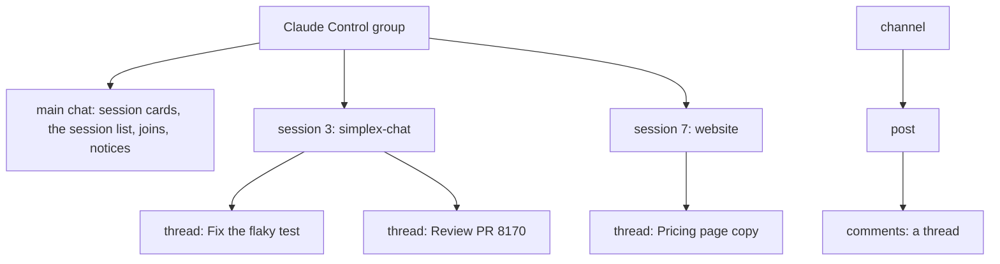
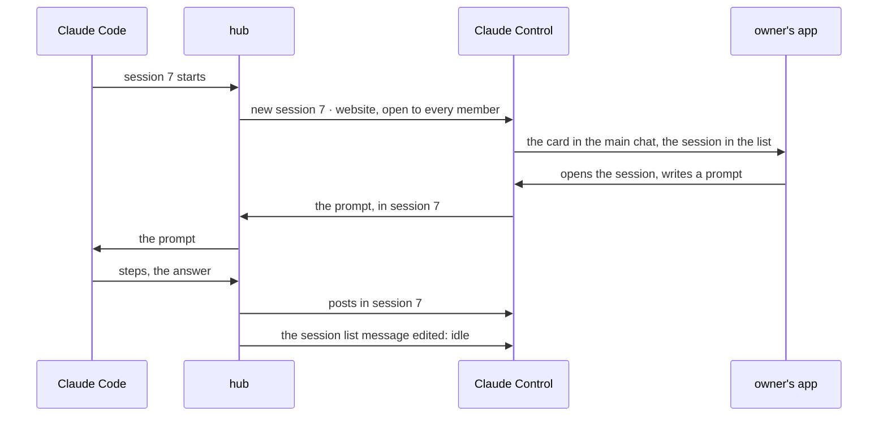
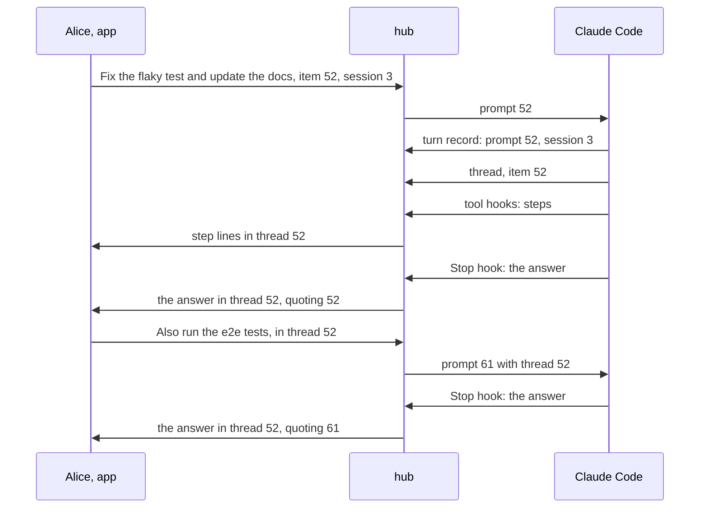
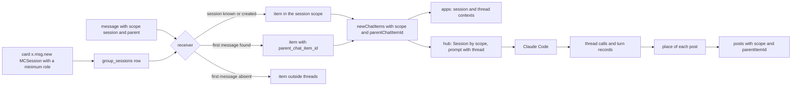
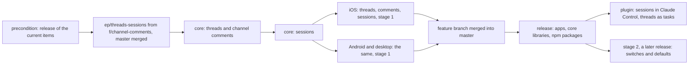

# Threads, channel comments and sessions as topics, from how agents use them

Status: fifth revision, 2026-11-13. The user's answers: Q1 B, Q2 A with a staged release, Q3 replaced by Claude's own use of threads, Q4 by a note (all work in this session, threads and sessions together, vertically), Q5 A, Q6 B, Q7 by a note (access to a session by role only), Q8 B for now, Q9 B (a member's role in Claude Control carries into sessions), Q10 A. No question is open. Section 6 maps Claude Code sessions and subagents onto sessions and threads, for the user's later decision.

Precondition: execution starts after the release of the current items: activity, silent messages, flat layout, agent profile, replies, reactions, allow-tool, session list, session usage, context summary and live answers.

Code references: master `8fda06295`, by file and function name. The starting point of the core: branch `f/channel-comments` of simplex-chat at `69fdc1c27` (2026-05-27), with its plans `plans/2026-04-06-channel-comments.md` (v1) and `plans/2026-04-06-channel-comments-v2.md` (v2). Claude Code: version 2.1.322, its binary in `~/.local/share/claude/versions/`. Steward: `/code/steward`, its plans `plans/2026-10-09-orchestrator-design.md` and `plans/2026-10-10-platform-vision.md`, and the draft `plans-subagent-chats.patch` (`plans/2026-10-12-subagent-chats.md`). Plans of the items in the precondition, on their `ep/mcp-*` branches, and `plans/2026-10-13-message-priority.md` (approved). Decisions of the 0.3.0 plan are cited as "0.3.0 decision N" ([2026-11-07-mcp-claude-code-channel.md](2026-11-07-mcp-claude-code-channel.md)).

## 1. Goal

Roadmap line, `ROADMAP.md` of the plugin, "In your sessions": "Each session is a topic inside one group, not a group of its own." Proposed line, added with this plan's approval: "Claude keeps each task in its own thread of the session." The plugin's pull request removes both.

The user's words, 2026-11-13:

> we really need threads for efficent work on multiple issues, don't you think?

> they are in line with channel comments ideas

> yes, we need to ship it together with comments, it's substantial effort.

> we will enable it on receiving side first, and won't allow enabling in UI. Won't stop plugin from enabling it. So users won't be overwhelmed before the upgrade

> good question, as it's unclear what creates threads. Needs to be thought of. I think it's wrong to have users be responsible for threads, and claude should see thread as task, and deside when and how to use them contextually, not formally

> We can ship the rest up to this point, release, then do threads and sessions. To me they are related and should be planned, designed and executed together, vertically. That is we won't just design threads and sessions, but how we use them with agents.

> I don't think sessions are needed in DMs tbh, user-agent interaction seems to be group activity, and threads are not particularly useful in DMs. Chat scopes exist only in groups as machinery, adding them to contacts is a lot of work to no gain.

> access to session can only be role-based, it's in the plan. Which means we can't have roster per session, but we can limit some sessions to moderators or to admin.

> session is a feature any group can use - it's a persistent substructure attached to a group that is long term. Threads are attached per message and are short term. That suggests that we should use sessions for subagents. I think we considered it during steward planning - could we expose subagents sessions as "sessions"?

Outcome:
- A group holds sessions: each session is a long-term conversation of its own, listed in the group, referenced in the main chat by its card, and open to the members of a minimum role.
- A message of the main chat or of a session can have a thread: the short-term conversation under it. Comments under channel posts are threads.
- Claude Code's sessions are sessions of the Claude Control group. Claude opens a thread for a task it takes on, and the task's posts go there.
- The core, the apps and the plugin ship this together, after one release that receives and shows it without switches in the apps.

## 2. What users see

### 2.1 Words and structure

```
word       what it is                                         who makes it
group      members, a main chat, sessions                     a person, or the plugin for Claude Control
session    a long-term conversation inside a group: a topic   members of the role set by the group's sessions preference;
           open to the members of its minimum role             Claude for each Claude Code session
           its card in the main chat references it
thread     the short-term conversation under one message of   anyone who sends; in Claude Control, Claude decides
           the main chat or of a session, one level deep
comments   threads under the posts of a channel               subscribers
```



### 2.2 Scenario 1: Claude Code sessions as sessions of Claude Control

Today each Claude Code session has a group of its own, and each owner gets an invitation to it in Claude Control. After this plan:

```
moment                          today                                       after
Claude Code starts session 7    a group "7 · website", an invitation for    a session "7 · website" in Claude Control, its card
                                each owner, joined with a tap               in the main chat; every member sees it at once
the owner opens it              the group, from the chat list               the card, or the group's list of sessions
Claude works                    prompts, steps, cards, answers in the       the same posts in the session
                                session's group
rights in a session             admin by /join N, owners as owners          the member's role in Claude Control (Q9 B)
the session's state             the list message of the session list plan   the same list message (Q8 B, for now)
model, effort, usage            the group's description, a line per turn    the card's second line; the line per turn in the session
Claude Code ends                the group stays                             the session stays, listed as not running
claude --resume                 the same group                              the same session
chat list                       one chat per session                        one chat, Claude Control, with the unread of its sessions
```

The card of a session, edited by Claude:
```
7 · website
opus · effort high
```

Claude Control's texts follow the roles (Q9 B). Before, in `main-group.ts`, and after:
```
text                 before                                                      after
greeting             I'm Claude. Each Claude Code session has its own group,     I'm Claude. Each Claude Code session is a session of this
                     and you get its invitation here. /sessions lists the        group: open it from its card or from the group's list of
                     sessions; /join N joins the group of session N.             sessions. /join N joins a session that has a group of its own.
welcome              Everyone in this group can join the groups of your Claude   Every member of this group works in your Claude Code
                     Code sessions, prompt Claude and approve what it does.      sessions with their role here: members prompt Claude;
                     Invite only people you trust with that.                     admins and owners also send its commands and approve what
                                                                                 it does. Invite only people you trust with that.
short description    Everyone in this group can join the groups of your Claude   Every member of this group works in your Claude Code
                     Code sessions, prompt Claude and approve what it does.      sessions with their role here.
join post            NAME joined. They can join the group of any Claude Code     NAME joined as ROLE. and the rights of the role:
                     session here, prompt Claude and approve its actions.
                       owner, admin                                              They prompt Claude in every session, send its commands
                                                                                 and approve its actions.
                       moderator, member, author                                 They prompt Claude in every session; commands and
                                                                                 approvals need the role admin or owner.
                       observer                                                  They read every session and can't send.
```

The group's list of sessions, in its info and above its main chat, with each session's new messages:
```
6 · docs                2 new
7 · website             5 new
3 · simplex-chat
```



### 2.3 Scenario 2: Claude's tasks as threads

Threads are Claude's tasks. Alice writes in session 3: "Fix the flaky test in ChatRelays and update the docs." Claude judges it a task of several steps and opens its thread under her message. Its step lines and its answer appear in that thread. In the session, her message shows `@ 7 replies, 7 new`. Alice replies in the thread, and Claude's next answer stays there.

Where Claude's posts go: to the place of the last event below, during a turn.
```
event                                          place of the posts that follow
a turn starts with a member's message          its thread, or the session outside threads
a turn starts without one                      the session outside threads: a terminal prompt, a prompt of Claude Code
Claude calls thread                            the thread it names, a new thread under a message, a new task's
                                               thread, or the session outside threads
a member's message reaches the running turn    its thread, or the session outside threads
```

The posts that follow these events: Claude's texts and live answer (`ep/mcp-live-answers`), step lines, notes, tool-use and action cards, `reply` posts, the end line of the turn (`ep/mcp-session-usage`). The answer quotes the prompt of its turn (0.3.0 decision 39) when that prompt is in the answer's place.

A member's message in a thread reaches Claude with the thread's first message as its reply when it quotes no other:
```
<channel source="plugin:simplex:simplex" from="Alice" item="61" reply_to="52" reply_to_from="Alice" thread="52">
> Fix the flaky test in ChatRelays and update the docs.
Also run the e2e tests.
</channel>
```

Channel instructions, after `ep/mcp-replies`; its last sentence is replaced:

Before: `... Your final answer of each turn reaches them in that group; reply sends them a file.`

After: `... Threads of this session are tasks. For a task that needs more than a short answer, call thread: under the member's prompt, or with a title when no prompt starts it. Your texts, steps, cards, reply posts and final answer go to the place of the last message you received, or to the place thread chose after it. A message in a thread has thread, the ID of the thread's first message, and is passed as a reply to that message when it replies to no other.`

New tool `thread`:
```
input    item      Item ID of a message of this session: a member's prompt, a thread's first message, or a post of yours.
                   A message inside a thread means its thread.
         title     Title of a new task, up to 200 characters: posted as a new message of the session, and its thread opened.
                   Without item and title: the session outside threads.
output   thread    Item ID of the thread's first message; absent outside threads.
errors   give item or title, not both.
         item: this session has no message N.
         item: message N can't have a thread.
         Threads are off in this session's group.
```
Its description: `Chooses where your posts of this turn go: the thread of a task, or the session outside threads. Your texts, steps, cards, reply posts and final answer go there, until you call thread again or a member's message reaches you.`

The `reply` tool takes `file`, `text` or both, and posts to that place: `Sends a file, with text as its caption, or a text message, to the place of your posts of this turn (see thread). Your final answer of each turn reaches them without this tool.` A turn that answers two tasks posts the first answer with `reply`, calls `thread`, and ends with the second.



A background task of thread 52 ends later. Its note is posted when the turn starts, before Claude acts, so it is in the session outside threads; Claude calls `thread` with item 52, and its answer goes to thread 52 without a quote.

### 2.4 Scenario 3: access by role, and people outside Claude Control

A session is open to the members of its minimum role and above. A group's owner can limit a session to moderators, to admins or to owners; there is no list of members per session. A member below that role does not receive the session's card or its messages (Q10 A).

The plugin creates every Claude Code session open to every member of Claude Control (0.3.0 trust model, rule 1). Today an admin of a session's group can add a person to that group alone (rule 7). A Claude Code session that should take a person from outside Claude Control keeps a group of its own:
- A session that has a group keeps it, also after `claude --resume`.
- An admin or owner sends `/group` in a session. Claude creates a group for it, as 0.3.0 does, invites the owners of Claude Control to it, and continues the session there; the session in Claude Control keeps its messages, and its card gets the line `Continues in its own group.` In that group, admins add people as in 0.3.0.

### 2.5 Scenario 4: Claude in other chats

Claude reads and writes threads in groups and channels it has joined with `connect`:
- A message in a thread has `thread`, the item ID of the thread's first message, in the results of `receive`, `send` and `connect`. A comment under a channel post has the post's item ID.
- `send` takes `thread`, to post in that thread. A `reply_to` of a message inside a thread posts in its thread.
- A message in a session of another group has `session`, the session's title, and the chat reference of the session, such as `#15(_session:4)`, which `send` takes.

Business chats are groups, so they get sessions with this plan. Direct chats get neither sessions nor threads (Q6 B).

### 2.6 In the apps

Stage 1, the release after the merge. Threads, comments and sessions appear where the plugin, a bot or the API turned them on:
```
place                          after
under a message with replies   1 reply / 5 replies / 5 replies, 2 new / @ 5 replies, 2 new
                               (@ while a reply to you or a mention waits after your last message)
tap on that line               the thread opens: the first message on top, then the replies, and the composer
item menu of a message         Reply in thread, after Reply, while threads are on
session card                   its lines; a tap opens the session
group info                     Sessions: each session the member's role opens, with its new messages
session view                   title: the session's first line, subtitle: the group's name; a thread opens from it
chat list                      unread of the main chat, the sessions and the threads
main chat scroll button        unread of the main chat
channel post                   comments N, as v2 describes; the comments view
group preferences              no row for threads, sessions or comments
```

Stage 2, a later release, adds the preference rows and the actions that create:
```
group preferences              Threads: "Members can reply in threads." / "Threads are prohibited."
                               Sessions: "Admins can create sessions." / "Sessions are prohibited." (its role decides who)
channel preferences            Comments, as v2
group info                     New session, with the minimum role
new group, new channel         threads on; comments on
```

With the message-priority pull request, the `@` sign becomes the bell when the waiting reply is important (`plans/2026-10-13-message-priority.md`, section 1).

Members with older apps see replies in threads as messages of the main chat, without the message they are under. They receive no messages of sessions (decision 37); the card of a session shows them its text as a message.

## 3. Questions for the user

Answered on 2026-11-13:
- Q1 B: threads ship together with channel comments.
- Q2 A, staged: stage 1 receives and shows, without switches in the apps; the plugin turns its features on. Stage 2 adds the switches and the defaults. Decisions 46 and 47 apply it to sessions and comments.
- Q3: Claude decides when a task gets a thread; members are not responsible for threads.
- Q4: all work is done by this session's agents; threads and sessions are planned and executed together, vertically, from how agents use them, after the release of the current items.
- Q5 A: comments follow the stages of threads.
- Q6 B: no sessions in direct chats.
- Q7, the user's note: access to a session is by role only, with no list of members per session (decision 35).
- Q8 B for now: the session list message stays, and the cards show the titles; the user decides later, with section 6.

- Q9 B: a member's role in Claude Control is their role in its sessions, and in the groups of sessions they join (decision 55). The user's note: "I think it's reasonable to keep roles in the hub for sessions - e.g., if I added somebody to hub as member, he would join to sessions as member. If as admin - as admin. etc. Role is decided by inviter, so there is no problem carrying it over."
- Q10 A: a member below a session's minimum role sees neither its card nor the session in the list (decision 35).

No question is open.

## 4. Decisions

Facts:
1. The wire field of threads exists. `MsgContainer` in `Protocol.hs` has `parent :: Maybe MsgRef`, and its JSON is derived, so the field is optional on the wire. `MsgRef` is `{msgId?, sentAt, sent, memberId?}`.
2. Every released app shows a message with `parent` as a message of the main chat. `newGroupContentMessage` in `Library/Subscriber.hs` does not read `parent`. Versions before #6808 (`ac6f8b76a`, 2026-04-15) parse it as `MCComment` and use its content as of any message; they parse `quote` first, so a message with both keeps only the quote there.
3. The channel comments branch: comments in channels only (`useRelays'`); the parent in `MsgContainer`, not in `MsgScope`; the migration `M20260516_channel_comments` adds `parent_chat_item_id` with `ON DELETE CASCADE`, `comments_total` and `comments_disabled`, and two indexes; `parentChatItemId`, `commentsTotal` and `commentsDisabled` in `CIMeta`; `/_send #N parent=ID` inside `SendRef`, and `/_get chat #N parent=ID`; a flat thread; a missing parent drops the message; comments are not unread; the role `GRCommenter`; `commentsVersion`; iOS work up to `fad148440`, with `SecondaryItemsModelFilter.groupChannelMsgContext`; Android and desktop deferred (v2, sections 1 and 9). Its base `92e9640e4` is 799 commits behind master `97bbbd9ac`; 8 of the core files it changes differ on master by 6,405 added and 2,554 removed lines since then.
4. The preferences exist and are hidden. `Types/Preferences.hs`: `CommentsGroupPreference {enable, duration}` and `SessionsGroupPreference {enable, role}`, off by default (`defaultGroupPrefs`), except sessions in business chats (`defaultBusinessGroupPrefs`). `allGroupFeatures`, `groupFeatureInChannel` and `groupFeatureInRegularGroup` leave comments and sessions out. These lists decide the feature items of a group and of its preference changes (`groupFeatures`, `createGroupFeatureItems_` and `createGroupFeatureChangedItems` in `Library/Internal.hs`), the CLI views (`View.hs`) and the CLI's `/set` (`updateGroupProfileByName_` in `Library/Commands.hs`). `/_group_profile` sets any preference. The apps' `GroupFeature` (`ChatTypes.swift`, `SimpleXAPI.kt`) has neither case. No RFC defines sessions; #5360 reserved the preference.
5. Group chat scopes hold member support only: `GroupChatScope` and `GroupChatScopeInfo` in `Messages.hs`, `MsgScope = MSMember` in `Protocol.hs`, parsed by its tag. A scope decides the recipients (`getGroupRecipients` in `Library/Internal.hs`, which filters them by a compatible chat version and, for support, by role), the delivery job (`infoToDeliveryContext` in `Delivery.hs`), the receiver's scope (`mkGetMessageChatScope`), the stored scope (`createNewChatItem_` in `Store/Messages.hs`), the chat reference (`gcScopeP` in `chatCommandP`, `ChatRef.cmdString` in TypeScript) and the CLI's `(support)` (`groupScopeInfoStr` in `View.hs`).
6. The main chat's queries filter `group_scope_tag IS NULL` in `Store/Messages.hs`: `findGroupChatPreviews_` (the last item and the unread counts of the chat list), `getChatContentTypes`, `getChatItemIDs` (item pages), `queryUnreadGroupItems` (the first unread, last viewed and unread counts of a chat), `updateGroupChatItemsRead` and `getGroupUnreadTimedItems`.
7. A quote's `MsgRef` in a group is built by `quoteData` in `prepareGroupMsg` (`Library/Internal.hs`): the item's shared ID and time, `sent`, and the author's member ID, the user's own membership for a sent item. `getGroupMemberCIBySharedMsgId` (`Store/Messages.hs`) finds an item by its author's member ID and its shared ID, own items included.
8. Reactions and mentions are attached to each loaded group item in `groupCIWithReactions`.
9. History for a new member is the last 100 items with `include_in_history`, of the main chat only (`getGroupHistoryItems`, `sendHistory`); a signed item is forwarded as its stored bytes, an unsigned one is encoded again by `prepareGroupMsg`.
10. `CIMeta.userMention` is true for a message that mentions the user or replies to the user's message; the approved priority plan adds important messages (its section 5).
11. The API docs describe `SendRef` as `ChatRef` (`bots/src/API/TypeInfo.hs`), so the generated `APISendMessages.cmdString` sends `ChatRef.cmdString(sendRef)`; a scope in `ChatRef` reaches every command that takes a chat. The Node.js library's `apiSendMessages` takes a `ChatRef` with its scope; `apiSendTextReply` replies in the replied item's chat; `apiGetChat` takes any pagination, `around` included, and an `around` page holds the item itself (`getGroupChatAround'`).
12. Both apps open member support chats in a secondary context by the scope: iOS `SecondaryItemsModelFilter.groupChatScopeContext`, `getCIItemsModel` and `SecondaryChatView`; Kotlin `SecondaryContextFilter.GroupChatScopeContext` and `ChatsContext`. They list support chats in `MemberSupportView` (iOS, Kotlin).
13. The plugin: one group per session (`Hub.createSessionGroup`, `Hub.session`), owners invited at its start (`Hub.session`, `Hub.inviteOwner`), `/join N` as admin or owner (`Hub.join`), rights posts (`Session.announceRights`); Claude Control's link gives the role member, and its first joiner becomes an owner (`MainGroup.openLink`, `MainGroup.ownerJoined` in `main-group.ts`); every group item without a scope is a message of the main chat (`isGroupMessage` in `control.ts`); posts by `apiSendMessages` (`Session.post`, `Control.postMessage`); command replies by `apiSendTextReply` (`Control.onMessage`); turn records with the hook's start time and the matched prompt (`Session.turn`, `Session.turnQuote`); `reply` sends files only (`replyTool`, `AgentTools.reply`). Per-session data is in the group's custom data (`SessionGroupData`).
14. Claude Code adds a prompt that arrives during a turn to that turn (`ep/mcp-harness-notes`, fact 3); such a prompt adds a turn record when it matches a pushed prompt (decision 18 there). A channel meta key consists of letters, digits and `_` (`ep/mcp-replies`, decision 2).
15. The plugin's end-to-end tests run the core libraries pinned in `release.ts` of the Node.js library.
16. Claude Code 2.1.322 reports subagents to hooks. `SubagentStart` has `agent_id` and `agent_type`; `SubagentStop` has `agent_id`, `agent_type`, `agent_transcript_path`, `last_assistant_message` and `background_tasks`. A subagent's tool hooks carry its `agent_id` and `agent_type` (`ep/mcp-activity`, fact 1). The `Agent` tool's input has `description`, `name`, `prompt`, `subagent_type` and `run_in_background`; its result for a background subagent is `async_launched` with `agentId`. `TeammateIdle` has `teammate_name` and `team_name`; `TaskCreated` and `TaskCompleted` have `task_id`, `task_subject`, `task_description`, `teammate_name` and `team_name`. `MessageDisplay`, which `ep/mcp-live-answers` uses, has `turn_id`, `message_id`, `index`, `final` and `delta`, and no `agent_id`. A background subagent's report reaches the main conversation as a prompt of origin `peer` (`ep/mcp-harness-notes`, fact 9).
17. Claude Code records each subagent in `subagents/agent-ID.meta.json` and `agent-ID.jsonl` of the session: `agentType`, `description`, `name`, `toolUseId`, `parentAgentId`, `spawnDepth`, `requestShape` (foreground or background), `taskKind`, `teamName`, `finished`. This session (`420d62b8`) has 139 subagents: 118 named background teammates, living a median of 225 minutes (90th percentile 35 hours), and 21 others, 16 foreground and 5 background without a name, living a median of 2 minutes (90th percentile 50 minutes); 21 of them at depth 1.
18. The task list is rare: of 70 main transcripts on this machine, one uses `TaskCreate`, 20 times.
19. Steward's design for subagents (`orchestrator-design.md`, "Subagents"; `platform-vision.md`; the draft subagent chats plan): each subagent is an agent profile with the role observer in the session's group, and posts its run text and reports in its own chat with admins, the member support scope; a person's message there reaches the parent Claude as a relay, `<relay to="NAME">`, forwarded by `SendMessage`; a running foreground subagent receives no message (its check 8). Each observer member costs a connection with every member and a copy of every main-chat message; delivery receipts stop at 20 members.

Choices, the model:

20. A session is a scope of a group: a long-term conversation with its own messages and unread counts, open to the members of its minimum role, referenced by its card in the main chat. A thread is the short-term conversation under one message, of the main chat or of a session, one level deep. A channel's comments are the threads of its posts. Scope and thread are independent: a message has at most one of each.
21. Threads take the comments design of `f/channel-comments`: the wire field `parent`, the column `parent_chat_item_id`, the `CIMeta` fields and `/_get chat #N parent=ID` (fact 3).
22. Sessions are a new scope kind, next to member support, so every path that takes a scope takes them (fact 5). They are in regular groups and business chats; channels have comments; direct chats have neither (Q6 B).

Choices, threads in the core:

23. In a regular group, a thread's first message is a content message of the main chat or of a session, sent or received, with a shared ID, not deleted, not a report and not itself in a thread. A message in a thread has the scope of its first message. Channels keep the branch's rule: a channel post.
24. A message in a thread is `x.msg.new` with `parent`, built by `quoteData`'s rules (fact 7). Updates, deletions and reactions address an item by its shared ID, unchanged.
25. A receiver in a regular group finds the first message by `getGroupMemberCIBySharedMsgId`. When it is absent, deleted or outside the history a new member received, the item is stored outside threads, as every released app stores it (fact 2), so nothing is lost. Channels keep the branch's rule: a missing parent drops the message, against a relay that forges parents (v2, section 7.2).
26. Sending in a thread needs `GRCommenter` or above (the branch's `memberCanComment`); in a regular group, every member who sends has it. A quote in a thread must be its first message or one of its items (the branch's `quotedItemInCommentSection`). A send that quotes an item of a thread, without `parent`, is sent in that thread, so bots, `apiSendTextReply` and the plugin's command replies stay in it unchanged.
27. Thread items leave the item pages, last item, content types, first unread and last viewed of their scope's view (fact 6). In regular groups they count as unread; in channels they do not, as in the branch.
28. The summary of a first message: `replies` is the branch's `commentsTotal`; in regular groups `ChatItem.thread` adds `{unread, unreadMentions, awaitsReply}`, read in `groupCIWithReactions` by one grouped query, as reactions are read (fact 8). `awaitsReply` is true when a received attention item (fact 10) of the thread is newer than the user's last sent item in it.
29. API: `/_get chat <chatRef> parent=<itemId> <pagination>`; `/_send <chatRef> parent=<itemId> json [...]` with `parentItemId` as a field of `APISendMessages`, outside `SendRef`, so `SendRef` stays `ChatRef` in the API docs (fact 11).
30. History carries `parent` (`prepareGroupMsg` gets the first message's item ID; `sendHistory` passes it). Deleting a first message's row deletes its thread by the cascade, after every row-deleting path deletes the files of the thread's items.

Choices, sessions in the core:

31. A session is created by its card: `x.msg.new` in the main chat with the content `MCSession {text, minRole}`, from a member whose role the `sessions` preference allows to create sessions. The first line of `text` is the session's title in lists; more lines follow it on the card. Older apps parse an unknown content type with its text (`MCUnknown`), so they show it. The session's ID on the wire is the card's shared ID. The card's author edits it (`x.msg.update`). A card deleted for everyone closes the session; its messages stay.
32. A message of a session is `x.msg.new` with `scope: {type: "session", msgId}` (`MsgScope.MSSession`). Updates, deletions and reactions carry the scope as they carry the member support scope.
33. Stored: a table `group_sessions` (the group, the card's shared ID and item, the title, the minimum role, closed, custom data) and `chat_items.group_scope_tag = 'session'` with a new column `group_scope_group_session_id`. `GroupChatScope.GCSSession {groupSessionId}`, `GroupChatScopeInfo.GCSISession {groupSession}`, chat reference `#G(_session:ID)`.
34. A session's minimum role is one of the group's roles: `member` opens it to every member who sends, `moderator`, `admin` or `owner` limits it. Observers read sessions open to `member` and do not send there, as in the main chat.
35. Access is by role only (Q7): `getGroupRecipients` sends a session's card and messages to the current members whose role is at or above its minimum role, with the version of decision 37 (Q10 A). A receiver accepts a message of a session from a member of that role. A member whose role rises to a session's minimum role gets its card and its last 100 items, as history; one whose role falls below receives no more of it and keeps what they have.
36. The CLI prints a message of a session as `#team (session website) alice> TEXT`, as `(support)` (fact 5), and a message in a thread as `#team (thread) alice> TEXT`.
37. One chat protocol version for comments, threads and sessions: master's next version. Older apps receive no messages of sessions (fact 5). A receiver finds the session by the card's shared ID; a message of an unknown session creates it without a title, which its card fills.
38. Unread: `ChatStats.unreadOutsideMain`, the unread items of threads and sessions, part of `unreadCount`, 0 when absent from JSON. The chat list counts them; the main chat's scroll button shows `unreadCount - unreadOutsideMain`. `APIGetGroupSessions` returns each session the member's role opens, with its card, last item and unread counts.
39. API: `APICreateGroupSession {groupId, title, minRole}`, `APIUpdateGroupSession {groupId, groupSessionId, title, minRole, closed}`, `APIGetGroupSessions`, `APISetGroupSessionCustomData`; messages, pages, reads and deletions of a session take the chat reference with its scope.
40. History for a new member covers the main chat and the sessions its role opens, the last 100 items across them, cards first by time.

Choices, channel comments:

41. Channel comments are completed as v2 plans them (sections 4 and 6): the receive check `memberCanComment`, the scope conditions of `getGroupNavInfo_`, reactions on comments, the remaining tests.
42. Comments follow the stages (Q5 A): v2 decision 7, "comments on at channel creation", moves to stage 2.

Choices, stages:

43. Stage 1 core: comments, the preference of threads in groups, and sessions stay outside the group lists (fact 4), so turning them on creates no feature item and the CLI's `/set` refuses it; `/_group_profile` turns them on. `APINewGroup` and `APINewPublicGroup` leave new groups and channels without threads, sessions and comments.
44. Stage 1 apps: they show threads, comments and sessions, send in them, open threads from the item menu, and list the sessions the member's role opens, wherever these are on. They have no preference rows and no action that creates a session.
45. Stage 2: the lists include comments and sessions, the CLI gets `/set threads`, `/set sessions` and `/set comments`, `APINewGroup` turns threads on and `APINewPublicGroup` comments on when the profile lacks them, and the apps add the rows and "New session" with its minimum role.
46. Sessions follow the stages by the user's note on Q2: no new content kind appears before most apps show it.
47. Comments follow them by Q5 A.

Choices, the apps:

48. Sessions open in the existing scope context (fact 12): `groupChatScopeContext` with `GCSISession`. Threads open in a context for the first message, the branch's iOS `groupChannelMsgContext` and its Kotlin counterpart; a thread opens from the main chat, from a session and from a channel. Each context takes new items by its scope and `parentChatItemId`; the main chat shows neither.
49. The list of sessions is a view of the group's info, as `MemberSupportView`, and a row above the main chat while the group has sessions the member's role opens. The session card shows its lines and its unread.
50. The thread line under a first message is drawn under its reactions, in the classic and the flat layouts. On a new item the apps update the summary, the session's counts and `unreadOutsideMain` in memory, and reads in a context subtract from them.
51. "Reply in thread" is in the item menu of a first message while threads are on and the user's role sends. Members may start threads; nobody has to.

Choices, the plugin, on master after the release:

52. Claude Control gets `sessions` on, with the role owner, and `comments` on. A new Claude Code session is a session of Claude Control (`APICreateGroupSession`, title `N · NAME`, minimum role `member`). The plugin creates a session when every human member's app has the version of decision 37; otherwise a group, as 0.3.0, and Claude posts once in the main chat: `NAME's app shows no sessions; update SimpleX to see them.`
53. A session that already has a group, by `session.json`, keeps it, also after `claude --resume`. The plugin moves no existing group.
54. The hub binds a `Session` to Claude Control and its session's scope: its posts, `Control` and the turn's routing use the chat reference with the scope. Per-session data moves to the session's custom data (`APISetGroupSessionCustomData`), as `SessionGroupData` is in the group's custom data today.
55. Rights in a session follow the member's role in Claude Control, as its inviter set it (Q9 B; 0.3.0 premise 1 and rules 3 to 5): admins and owners prompt, send commands and approve; moderators, members and authors prompt; observers read. Owner invitations at a session's start and `/join N` are not used for sessions of Claude Control. A session with a group of its own (decisions 52, 53, 56) gets its owners invited as owners at its start, and `/join N` invites a member with their role in Claude Control. This replaces the role admin of 0.3.0 decision 85 and rule 6 of its trust model. Claude Control's texts are those of section 2.2.
56. A person outside Claude Control joins one Claude Code session through a group of its own (0.3.0 rule 7): sessions with groups keep them (decision 53), and `/group` from an admin or owner in a session moves it to a new group (section 2.4). `/group` is a command of the session's `Control`, answered only to admins and owners, as the other commands (0.3.0 decision 91).
57. Q8 B for now: the hub keeps the session list message of the session list plan, and the card shows the title and the description line (model, effort) of `ep/mcp-session-usage`.
58. Threads are Claude's tasks: Claude decides when a task gets a thread, by the channel instructions of section 2.3. The hub creates no thread by itself.
59. The tool `thread` (section 2.3): with `item`, the hub checks the message by decision 23, in this session, and records the place, its thread when the message is inside one; the first post there creates the thread. With `title`, the hub posts the title in the session and records its thread. Without either, the place is the session outside threads.
60. The place of a post is the place of the newest event before it, by time: a turn record, whose place is its prompt's thread or the session outside threads, or a `thread` call. Hook records use the hook's start time `at`; a `thread` call uses the service's receive time, both milliseconds since the epoch on one computer. Calls older than the last answer are dropped with its turn records.
61. The answer keeps its quote only when the quoted prompt is in its place. A quote in another place would move the post (decision 26), so it is dropped.
62. The opening live message of `ep/mcp-live-answers` is posted at the prompt, in the prompt's place. When the place changes before the opening message is filled, the hub deletes it and posts in the new place.
63. `Session.onMessage` takes `thread` from `parentChatItemId`. A message in a thread without a quote gets the `replyTo` of the first message, read by `apiGetChat` with `around` the first message and count 0, in the queued delivery, so the order of prompts stays (0.3.0 decision 45). The prompt line gets `thread?: number`, written as the meta key `thread` (fact 14); the protocol version stays 1.
64. `reply` takes `file`, `text` or both, and posts to the place of decision 60. A text without a file must fit one message (`fitsMessage`). It returns `{item}`.
65. Tools in other chats (section 2.5): `thread` in a message of the results and in `send`'s input; a session's chat reference in `chat` of results and inputs, and its title in `session`.

## 5. Design

Options for sessions:
```
option                                   cost
A. a scope, created by its card          a scope kind at the sites of fact 5; a card content type; recipients and
   (chosen)                              history by role; the apps' scope contexts take it; older apps receive none
B. a thread under a card                 one level of threads is taken: tasks inside a session have no thread;
                                         no role of its own; no list
C. a group per session, linked           connections between every two members per session; joins per session;
   from the parent group                 what 0.3.0 does, so not "inside one group"
D. sessions by their own events          an event kind per change; older apps ignore them and show no title
```

Access to a session: by its minimum role (chosen, Q7). A list of members per session is excluded by the user's note on Q7.

Options for who opens threads in Claude Control:
```
option                                   who decides               cost
T1. Claude names the place of its posts  Claude, by the task       one tool, one record kind, instructions; the hub routes
    with thread (chosen)                                           every post of the turn
T2. Claude names a thread per post       Claude, per post          steps, notes, cards and the answer have no place to follow
T3. the hub opens a thread per prompt    the hub, by a rule        short answers get threads too: the user asks for
                                                                   contextual use
T4. members open threads                 members                   the user: members are not responsible for threads
T5. a thread per task of Claude Code's   Claude Code's task list   TaskCreated and TaskCompleted hooks (fact 16); the list
    task list                                                      is rarely used (fact 18)
```

Options for the place of a post during a turn:
```
option                                       cost
P1. the newest event: prompt or thread call  one lookup per post; a member's message moves the posts to its place
    (chosen)
P2. the turn's first prompt                  the answer's quote crosses threads and is dropped, or 0.3.0 decision 39 changes
P3. the place stays across turns             a background task's notification lands in the last task's thread, also
                                             when Claude moved on
```

Options for the wire of threads:
```
option                                 older apps                                  wire
A. parent in x.msg.new (chosen)        a message outside threads                   + parent, about 80 bytes
B. a MsgScope kind per thread          the unknown scope fails the message's parse  + scope
C. replies as threads                  replies, as today                           a quote copies the quoted text into every reply
```

Options for the summary of a first message:
```
option                                       cost
S1. comments_total for replies, the rest     the total channels need: subscribers lack comments outside their history;
    read at load (chosen)                    unread exists in groups only, read as reactions are read
S2. every count read at load                 a second source of the total beside comments_total
S3. every count kept in columns              an update at every read, insertion, deletion and member removal
```

Options for the thread of a send in the API:
```
option                                       cost for clients
A1. parentItemId of APISendMessages (chosen) one optional field in the generated types
A2. parent in SendRef, as the branch         SendRef needs its own API type: every client's sendRef changes
```

Data flow:


Changes, the core, on the feature branch:
```
file                                    function or type                change
Protocol.hs                             MsgScope, MsgContent            MSSession {msgId}; MCSession {text, minRole}
Messages.hs                             GroupChatScope, ...Info, Tag    GCSSession, GCSISession, "session"
                                        ChatItem, ChatStats             thread summary; unreadOutsideMain
Controller.hs                           commands                        APISendMessages.parentItemId; session commands of decision 39
Library/Commands.hs                     chatCommandP, gcScopeP          parent=; (_session:ID); session commands; stage 2 /set
                                        sendGroupContentMessages_       decisions 23, 26, 29; the scope's recipients
                                        member role changes             the session history of decision 35
                                        APINewGroup, APINewPublicGroup  stage 2 defaults
Library/Internal.hs                     getGroupRecipients              session recipients by role and version
                                        mkGetMessageChatScope           MSSession, the session found or created, the role check
                                        prepareGroupMsg, sendHistory    parent; history of decisions 35 and 40
                                        prohibitedGroupContent          threads, sessions by their preferences
Library/Subscriber.hs                   newGroupContentMessage          decisions 25, 31, 32; card updates by groupMessageUpdate;
                                        member role events              the session history of decision 35
Delivery.hs                             DeliveryJobScope,               a session job scope
                                        infoToDeliveryContext
Store/Messages.hs                       createNewChatItem_, queries     the session scope column; decisions 27, 38
                                        groupCIWithReactions            thread summary
Store/Groups.hs                         new                             group_sessions
Store/SQLite|Postgres/Migrations        the branch's and a new one      the sessions table and column
View.hs                                 groupScopeInfoStr               (session TITLE), (thread)
docs/protocol, bots API, TS, Python     generated and written           parent, scope session, MCSession, commands
tests                                   Groups.hs, ProtocolTests.hs     section 8
```

Changes, the apps, on the feature branch: types (`ChatTypes.swift`, `SimpleXAPI.kt`) with the session scope, the content `session`, the thread summary and the counters; the API functions; the scope and thread contexts (`ChatModel.swift`, `ChatModel.kt`); the session card, the thread line and "Reply in thread" (`ChatView.swift`, `ChatItemView.kt`, the flat rows); the sessions list (as `MemberSupportView`); the session and thread views (as `SecondaryChatView`, `MemberSupportChatView`); the comments of v2, section 5; strings; specs. Stage 2: the preference rows and "New session" with its minimum role.

Changes, the plugin, after the release:
```
file                 function                        change
src/hub.ts           Hub.session, createSessionGroup  a session of Claude Control by decision 52; groups of decision 53 kept
                     Session                         bound to a chat reference with a scope; data in the session's custom data
                     Session.onMessage, deliver      thread and its replyTo (decision 63)
                     Session.placeOf, setPlace       new: decisions 59, 60
                     Session.turn, answer, post,     every post to placeOf; the quote by decision 61; the opening message by 62
                     step, note posts
                     Hub.join, inviteOwner,          sessions with groups only; /join N with the member's role (decision 55)
                     announceRights
src/main-group.ts    MainGroup                       sessions and comments on; the texts of section 2.2; the notice of decision 52
src/control.ts       Control, isGroupMessage,        the session scope; the place of posts; /group (decision 56)
                     isControlEvent, postMessage
src/session.ts       channelInstructions,            section 2.3; meta thread
                     channelNotification
src/tools.ts         threadTool, replyTool,          section 2.3; thread and session in results and send (section 2.5)
                     messageSchema, send
src/messages.ts      toMessage                       thread, session
src/protocol.ts      AttachLine.prompt               + thread?: number
nodejs src/api.ts    apiSendMessages                 + parentItemId; session commands
```

```
placeOf(at):
  events = turn records before at: (at, thread of the record's item, or the session outside threads)
         + thread calls before at: (at, the chosen place)
  the newest event's place; none: the session outside threads
thread call {item?, title?} at time t:
  title: post the title in the session as Claude; place = its item
  item: checked by decision 23; place = its thread when it is inside one, else item
  neither: place = the session outside threads
post(parts, quote, place):
  every part sent to the session's chat reference with parentItemId = place; the first with the quote when decision 61 keeps it
  refused as threads off: the same parts outside threads, without the quote
on an answer at a: turn records and thread calls before a are dropped
```

## 6. Claude Code sessions and their subagents: mapping options

No decision: the user decides later. This section maps Claude Code's structure onto sessions and threads, by the user's model: a session is a long-term substructure of a group, and a thread is a short-term conversation under one message.

What Claude Code has (facts 16 to 18):
```
unit                          lifetime in this session (fact 17)        hooks and records
Claude Code session            hours to days                             SessionStart, Stop, session.json of the plugin
named background teammate      median 225 min, 90th percentile 35 h,    SubagentStart, SubagentStop, TeammateIdle;
                               many runs, resumed by SendMessage         meta.json with name, teamName; 118 in this session
foreground or unnamed agent    median 2 min, 90th percentile 50 min     SubagentStart, SubagentStop, tool hooks with agent_id;
                                                                         meta.json with description, parentAgentId; 21
a task Claude takes on         as long as the work                       the thread tool of this plan; the task list is rare
                                                                         (fact 18)
```

Options:
```
option  Claude Code session        named teammate             short subagent             a task
M1      session of Claude Control  thread under its Agent     thread under its Agent     thread
                                   step line                  step line
M2      group of its own (0.3.0)   session of that group      thread in the session that thread
                                                              started it
M3      session of Claude Control  session of Claude Control  thread in the session that thread
                                   too, titled with its       started it
                                   parent's session
M4      session of Claude Control  sub-session of its         thread                     thread
                                   session
M5      session of Claude Control  no structure: notes only   no structure: notes only   thread
                                   (today)                    (today)
```

Trade-offs:
```
option  fits the user's model                     cost and limits
M1      no for teammates: a 35-hour teammate is   one level of threads: a subagent started inside a task's thread has no
        a short-term thread                       thread of its own; no core change beyond this plan
M2      yes: long-term subagents are sessions,    the roadmap line "a topic inside one group" is dropped; a group per
        short ones threads                        Claude Code session, as today
M3      yes, within one group                     the list of Claude Control grows by every teammate: 118 in this session;
                                                  the parent shows only in the title; closing ended teammates is needed
M4      yes, with a tree                          sessions nest: a parent session in the core, a tree in the apps' lists;
                                                  the largest core change
M5      threads only for tasks                    nothing shows what subagents do, except notes; no core change
```

Dimensions every option shares:
- Who posts a subagent's work: Claude, with the subagent's name in each line, costs nothing more. A profile per subagent, as steward's design (fact 19), shows each subagent as a member, at the cost of a connection with every member and a copy of every main-chat message per subagent profile, and delivery receipts stop at 20 members.
- What the plugin posts for a subagent: its tool steps from tool hooks with `agent_id`, which `ep/mcp-activity` skips today; its report from `SubagentStop`'s `last_assistant_message`, or its transcript `agent_transcript_path`. `MessageDisplay` names no agent, so a subagent's text cannot be told from the main conversation's text there (fact 16).
- A member's message to a subagent: it reaches the parent Claude, which forwards it with `SendMessage`, as steward's relay; a running foreground subagent receives nothing until it ends (fact 19).
- Resumption: a teammate resumed by `SendMessage` keeps its `agent_id`, so its session or thread continues.

## 7. Compatibility

- Older apps and bots: a reply in a thread is a message outside threads (fact 2); a session's card is a text message; messages of sessions do not reach them (decision 37).
- Stage 1 apps: they show threads, comments and sessions where an owner, a bot or the plugin turned them on; their users cannot turn them on.
- Older forwarding members: versions before #6808 keep `parent` without a quote and drop it with a quote. Messages of sessions are forwarded only to members with the version of decision 37 and the session's role.
- A new member's history: a reply whose first message is outside the 100 items is shown outside threads (decision 25).
- Remote desktop: an older controller ignores the new fields and scope kinds; a newer controller reads `unreadOutsideMain` as 0 from an older host.
- Downgrade: the migrations drop the columns and the table; replies return to their scope's view, and messages of sessions are lost from view.
- Plugin: sessions with groups keep them (decision 53); members with older apps keep the group per session (decision 52). An older session server drops `thread`, and its Claude has no `thread` tool. Plugin data folders: per-session data moves to the session's custom data at the session's creation; older sessions keep theirs in the group.
- Claude Code: 2.1.316 to 2.1.322 write meta keys by the same rule (fact 14).

## 8. Acceptance and tests

Done when:
```
#   criterion                                                                       checked by
1   a reply in a thread of the main chat or of a session is stored in its thread at  core: Groups.hs "threads"
    every member, also through a forwarding member
2   a session is created by its card, receives messages, edits its title, closes     core: Groups.hs "sessions"
3   a session's card and messages reach the members of its role with the version,    core: "sessions"
    not older or lower members; a role change gives or stops them
4   the views exclude threads; unread counts include threads and sessions            core
5   the thread summary and the sessions list have their counts                       core
6   a reply whose first message is absent is shown outside threads                   core
7   history: threads, sessions and cards in order for a new member                   core
8   stage 1: turning features on creates no feature item; /set refuses them          core
9   /_send parent= and #G(_session:N) work; both fail to parse on master              core
10  channel comments: v2, section 6                                                  core
11  the apps show sessions, threads and comments, send and read in them, without     ios-sim, desktop-linux, android-emu; Kotlin
    switches                                                                          desktop tests of the contexts and counters
12  a Claude Code session is a session of Claude Control, with its card              plugin unit: sessions; e2e service
13  a member's message in a thread reaches Claude with thread and its reply line     plugin unit: sessions, session
14  each post of a turn goes to the place of the newest event before it              plugin unit: sessions
15  thread opens, moves and returns; reply posts text to the place                   plugin unit: tools, sessions; e2e mcp
16  a member with an older app keeps groups per session and gets the notice;         plugin unit: sessions
    /group moves a session to its own group; /join N invites with the member's
    role in Claude Control; the join post names the role and its rights
17  tools read and write threads and sessions in other chats                         plugin unit: messages, tools; e2e mcp
18  a real session: Claude opens a thread for a task in its session, and a reply     TESTING check
    there continues it
```

Core tests in `tests/ChatTests/Groups.hs`: `describe "threads"` (criteria 1, 4 to 7, 9; `testThreadSend` fails on master), `describe "sessions"` (2, 3, 5, 7, 9), `describe "stages"` (8), the branch's `describe "channel comments"` (10); `tests/ProtocolTests.hs` for `parent`, `MSSession` and `MCSession`. The reduced build runs them with `TESTS='/SimpleX chat client/group tests/'`.

App tests: the three app test workflows, with a test backend that creates a session through the API, replies in a thread and comments in a channel; Kotlin desktop tests of the contexts and of the counters.

Plugin tests (`npm test`, `npm run test:e2e`, with the released core libraries): `sessions.test.ts` for decisions 52 to 63 (the first test of a thread prompt fails on master: no `thread`); `tools.test.ts` for `thread`, `reply` and the fields of section 2.5; `session.test.ts` for the meta key and the instructions; `messages.test.ts` for `thread` and `session` in results; the e2e mirroring test with a session, a thread call and a reply in the thread.

## 9. Docs to change

- The core: `docs/protocol/simplex-chat.md` and its schema (`parent`, the session scope, `MCSession`); a new RFC, `docs/rfcs/2026-11-NN-sessions.md`, for sessions; `bots/api` generated; `bots/README.md`, a section on threads, sessions and the stages.
- The apps: `apps/ios/spec`, `apps/multiplatform/spec`; v2's documents for comments.
- The plugin: `README.md` (sessions in Claude Control, tasks in threads); `REFERENCE.md` (sessions, roles, `/group`, the places of posts, `thread`, `reply`, the fields of section 2.5, the notice for older apps); `spec/api.md`, `spec/architecture.md`, `spec/flows.md`; `TESTING.md`; `ROADMAP.md`, the lines of section 1 removed.

## 10. Conflict areas

Execution starts after the release of the precondition's items, so they are on master by then. The places where this plan changes their work:
```
item                  their work                                     change here
session list          one list message in the Main group             kept for now (Q8 B); its session lines name sessions
session usage         the description line, the end line per turn    the card's second line; the end line follows the place
live answers          the opening message, live texts                decision 62; texts follow the place
activity              step lines, none for subagents                 they follow the place; subagents by section 6, later
harness notes         notes                                          notes of mid-turn prompts follow the place
context summary       its line                                       it follows the place
allow-tool, 0.3.0     tool-use cards, mode cards, rights posts       cards follow the place; rights by decision 55
0.3.0 trust model     /join N as admin (decision 85, rule 6)         the member's role in Claude Control (Q9 B)
flat layout           flat rows                                      the thread line and the session card in flat rows
silent messages       priority, unreadSilent                         the counters of decision 38 next to unreadSilent
f/channel-comments    the core and iOS work                          the feature branch starts from it
```

## 11. Execution and estimate

All parts are built by this session's agents. The feature branch `ep/threads-sessions` starts from `f/channel-comments`, merges master, and receives the pull requests below; it merges into master by a merge commit when both apps show threads, comments and sessions. The release follows, then the plugin's pull request on master. Stage 2 comes in a later release. The mapping of section 6, once the user decides it, is a later plan.



```
part                                              size                                         work
a  feature branch from f/channel-comments,        conflicts in the 8 core files of fact 3       3-5 days
   master merged
b  core: channel comments completed, threads      about 700 Haskell, 750 test lines             6 days
c  core: sessions, access by role                 about 750 Haskell, 500 test lines, the RFC    6 days
d  iOS: threads, comments, sessions, stage 1      about 1,000 Swift                             6 days
e  Android and desktop: the same                  about 1,000 Kotlin                            6 days
   the merge into master; the release
f  plugin                                         about 550 TypeScript, 650 test lines          4 days
g  stage 2                                        about 150 lines per platform, 60 Haskell      2 days
```
