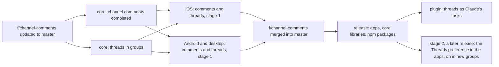
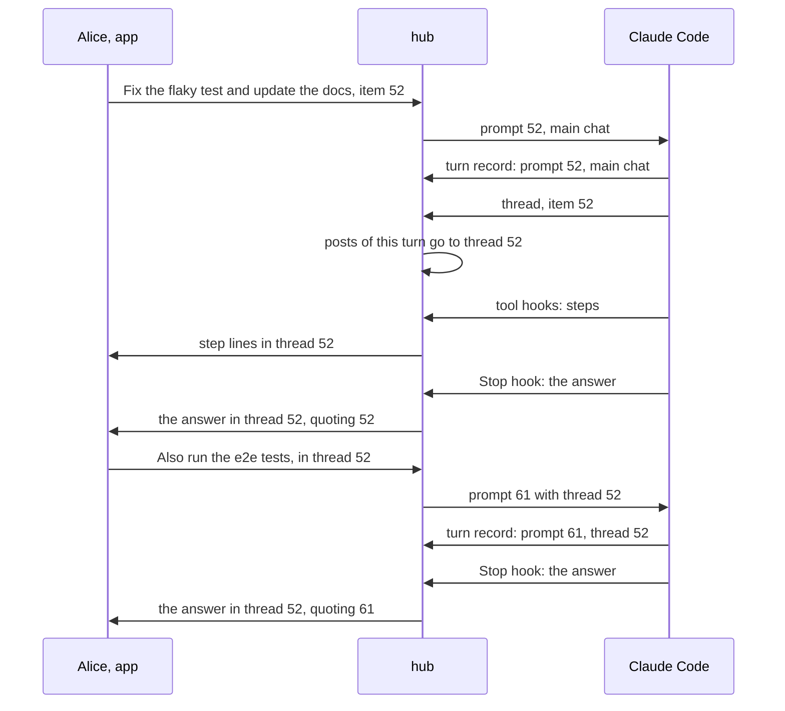
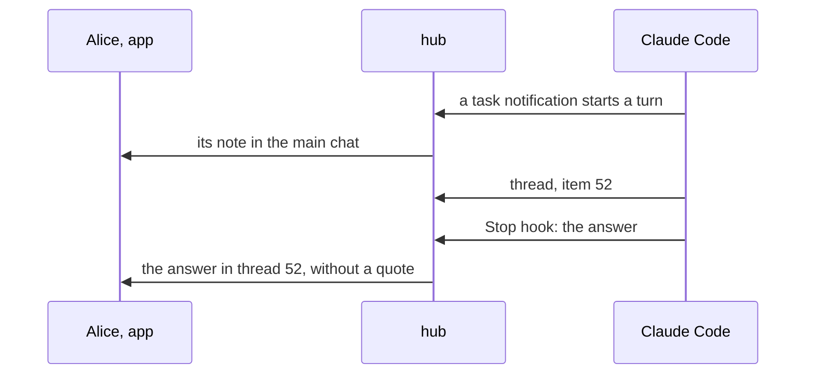
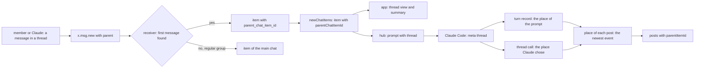

# Threads in groups, with channel comments: the core, the apps and the Claude Code plugin

Status: revised after the user's answers of 2026-11-13: Q1 B, Q2 A with a staged release, and Q3 replaced by Claude's own use of threads. Q4 and Q5 are open. Code references: master `97bbbd9ac` (`@simplex-chat/mcp` 0.3.0 with #8157). The channel comments work: branch `f/channel-comments` of simplex-chat at `69fdc1c27` (2026-05-27), plans `plans/2026-04-06-channel-comments.md` (v1) and `plans/2026-04-06-channel-comments-v2.md` (v2) on that branch. Plans of other items: `ep/mcp-replies` (approved), `ep/mcp-reactions`, `ep/mcp-activity`, `ep/mcp-silent-messages`, `ep/mcp-flat-sessions`, and `plans/2026-10-13-message-priority.md` (approved). Decisions of the 0.3.0 plan are cited as "0.3.0 decision N" ([2026-11-07-mcp-claude-code-channel.md](2026-11-07-mcp-claude-code-channel.md)).

Threads in groups and comments in channels are one core effort, in the feature branch `f/channel-comments`. Its pull requests merge into that branch; the branch merges into master once the apps show both. The plugin follows the release:



## 1. Goal

`ROADMAP.md` of the plugin has no line for threads. Proposed line, in "In your sessions", added with this plan's approval: "Claude keeps each task in its own thread of the session's group." The plugin's pull request removes it.

The user's words, 2026-11-13:

> we really need threads for efficent work on multiple issues, don't you think?

> they are in line with channel comments ideas

> yes, we need to ship it together with comments, it's substantial effort.

> we will enable it on receiving side first, and won't allow enabling in UI. Won't stop plugin from enabling it. So users won't be overwhelmed before the upgrade

> good question, as it's unclear what creates threads. Needs to be thought of. I think it's wrong to have users be responsible for threads, and claude should see thread as task, and deside when and how to use them contextually, not formally

Outcome:
- Threads in groups and comments in channels are one mechanism of the core, released together.
- Stage 1: apps show threads and replies in them; they offer no preference to turn threads on. The plugin turns threads on in session groups.
- Stage 2, a later release: the Threads preference in the apps, and threads on in new groups.
- Claude decides when a task gets a thread. It opens the thread, and the task's step lines, notes, cards and answers go there. Members reply in threads, and Claude follows.

## 2. What users see

### 2.1 In the apps

Stage 1, in a group with threads on, which only the plugin or the API turns on:
```
place                        before                          after
under a message with replies -                               1 reply
                                                             5 replies
                                                             5 replies, 2 new
                                                             @ 5 replies, 2 new     (a reply to you or a mention waits after your last message)
tap on that line             -                               the thread opens
thread view                  -                               title: Thread, subtitle: the group's name
                                                             first item: the message the thread is under
                                                             then the replies, oldest first, and the composer
item menu of a message       Reply, Forward, ...             Reply, Reply in thread, Forward, ...
reply inside a thread        -                               quotes the first message or a reply of this thread
chat list                    unread: main chat               unread: main chat and threads
                             preview: last message           preview: last message of the main chat
main chat scroll button      unread of the chat              unread of the main chat
notifications                as now                          a reply in a thread notifies as a message of the group
group preferences            -                               no row for threads
```

Stage 2 adds:
```
group preferences            -                               Threads
                                                               on:  Members can reply in threads.
                                                               off: Threads are prohibited.
composer of a thread,        -                               disabled, with "Threads are prohibited."
threads off
new group                    threads off                     threads on
```

Channel comments, in the same release, are shown as v2 describes them (`comments N` under a post, a comments view). Q5 asks whether their stages follow the stages of threads.

With the message-priority pull request, the `@` sign becomes the bell when the waiting reply is important, as in the chat list (`plans/2026-10-13-message-priority.md`, section 1).

Members with older apps see each reply in a thread as an ordinary message of the main chat, without the message it is under.

### 2.2 In a session group of the plugin

Threads are Claude's tasks. Alice writes in the main chat: "Fix the flaky test in ChatRelays and update the docs." Claude judges it a task of several steps, and opens its thread under her message. Its step lines and its answer appear in that thread. In the main chat, her message shows `@ 7 replies, 7 new`. Alice opens the thread and replies there; her reply reaches Claude in that thread, and Claude's next answer stays there.

Where Claude's posts go: to the place of the last event below, during a turn.
```
event                                          place of the posts that follow
a turn starts with a member's message          its thread, or the main chat
a turn starts without one                      the main chat: a terminal prompt, a prompt of Claude Code
Claude calls thread                            the thread it names, a new thread under a message, a new task's
                                               thread, or the main chat
a member's message reaches the running turn    its thread, or the main chat
```

The posts that follow these events: step lines, notes of prompts added to a running turn, tool-use and action cards, `reply` posts and the final answer. The note of a prompt of Claude Code that starts a turn is posted before Claude acts, so it is in the main chat. `User`'s terminal prompts, rights posts and replies to `/` commands outside threads are in the main chat. A reply to a `/` command sent in a thread is in that thread.

The answer quotes the prompt of its turn (0.3.0 decision 39) when that prompt is in the answer's place: the first message or a reply of the thread, or a message of the main chat for the main chat. Otherwise the answer has no quote.

A member's message in a thread reaches Claude with the thread's first message as its reply when it quotes no other:
```
<channel source="plugin:simplex:simplex" from="Alice" item="61" reply_to="52" reply_to_from="Alice" thread="52">
> Fix the flaky test in ChatRelays and update the docs.
Also run the e2e tests.
</channel>
```

Channel instructions, after `ep/mcp-replies`; its last sentence is replaced:

Before: `... Your final answer of each turn reaches them in that group; reply sends them a file.`

After: `... Threads of the group are tasks. For a task that needs more than a short answer, call thread: under the member's prompt, or with a title when no prompt in the group starts it. Your step lines, cards, reply posts and final answer go to the place of the last message you received, or to the place thread chose after it. A message in a thread has thread, the ID of the thread's first message, and is passed as a reply to that message when it replies to no other.`

New tool `thread`:
```
input    item      Item ID of a message of the group: a member's prompt, a thread's first message, or a post of yours.
                   A message inside a thread means its thread.
         title     Title of a new task, up to 200 characters: posted as a new message of the group, and its thread opened.
                   Without item and title: the group outside threads.
output   thread    Item ID of the thread's first message; absent outside threads.
errors   give item or title, not both.
         item: the group of this session has no message N.
         item: message N can't have a thread.
         Threads are off in the group of this session.
```
Its description: `Chooses where your posts of this turn go: the thread of a task, or the group outside threads. Your step lines, cards, reply posts and final answer go there, until you call thread again or a member's message reaches you.`

The `reply` tool:
```
input    file      Path of the file on this computer. Optional now.
         text      Caption of the file, or the text of a message without a file.
output   item      Item ID of the sent message.
errors   reply: give file, text or both.
         text: too long for a message; shorten it.
```
Its description: `Sends a file, with text as its caption, or a text message, to the place of your posts of this turn (see thread). Your final answer of each turn reaches them without this tool.` The second line of 0.3.0 about the preference for files and media stays. A turn that answers two tasks posts the first answer with `reply`, calls `thread`, and ends with the second.



A background task of thread 52 ends later:


## 3. Questions for the user

Answered on 2026-11-13:
- Q1 B: threads ship together with channel comments, one core effort. Section 10 lists its parts; the user assigns them (Q4).
- Q2 A, staged: stage 1 receives and shows threads, with no preference in the apps; the plugin turns threads on in session groups. Stage 2 adds the preference and turns threads on in new groups.
- Q3, replaced: Claude decides when a task gets a thread (section 2.2, decisions 41-49).

Q4. Who builds each part of section 10?
- A, recommended: the core team owns the parts it started: the branch's update to master (a), the completion of channel comments (b) and iOS (d). This item's agents build threads in the core (c), the Android and desktop app (e) and the plugin (f). spaced4ndy reviews (c); (c) waits for (a).
- B: the core team builds every part of the core and apps; this item's agents build the plugin (f) after the release.
- C: this item's agents build every part, and the core team reviews.

Q5. Do channel comments follow the stages of threads?
- A, recommended: yes. In stage 1, apps show comments of channels whose owners turned them on through the API, and channel owners get no switch; stage 2 adds the switch, and new channels get comments on. One rule for both: no new content kind appears before most apps show it. Cost: v2 decision 7, "comments on at channel creation", moves to stage 2.
- B: no. New channels get comments on at creation in stage 1, as v2 decision 7 states, and channel owners get the switch. Subscribers with older apps see comments as posts of the channel.

## 4. Decisions

Facts:
1. The wire field exists. `MsgContainer` has `parent :: Maybe MsgRef` ([Protocol.hs:704](../src/Simplex/Chat/Protocol.hs#L704)), and its JSON is derived, so the field is optional on the wire ([:926](../src/Simplex/Chat/Protocol.hs#L926)). `MsgRef` is `{msgId?, sentAt, sent, memberId?}` ([:236-241](../src/Simplex/Chat/Protocol.hs#L236-L241)).
2. Every released app shows a message with `parent` as a message of the main chat. Master ignores the field: `newGroupContentMessage` does not read it ([Subscriber.hs:2240](../src/Simplex/Chat/Library/Subscriber.hs#L2240)). Versions before #6808 (`ac6f8b76a`, 2026-04-15) parse it as `MCComment` and use its content as of any message (`ac6f8b76a^:src/Simplex/Chat/Protocol.hs:636-645`, `:838-841`). They parse `quote` first, so a message with both keeps only the quote there.
3. The channel comments branch: comments in channels only (`useRelays'`); the parent in `MsgContainer`, not in `MsgScope`; the migration `M20260516_channel_comments` adds `parent_chat_item_id` with `ON DELETE CASCADE`, `comments_total` and `comments_disabled`, and two indexes; `parentChatItemId`, `commentsTotal` and `commentsDisabled` in `CIMeta`; `/_send #N parent=ID` inside `SendRef`, and `/_get chat #N parent=ID`; a flat thread; a missing parent drops the message; comments are not unread; the role `GRCommenter`; `commentsVersion`; iOS work in commits up to `fad148440` (2026-05-25); Android and desktop deferred (v2, sections 1 and 9). Its base `92e9640e4` is 799 commits behind master; 8 of the core files it changes differ on master by 6,405 added and 2,554 removed lines since then.
4. The preference exists and is hidden. `GFComments` and `CommentsGroupPreference {enable, duration}` ([Types/Preferences.hs:217](../src/Simplex/Chat/Types/Preferences.hs#L217), [:769-774](../src/Simplex/Chat/Types/Preferences.hs#L769-L774)), off by default ([:583](../src/Simplex/Chat/Types/Preferences.hs#L583)), outside both feature lists ([:278-281](../src/Simplex/Chat/Types/Preferences.hs#L278-L281), [:313](../src/Simplex/Chat/Types/Preferences.hs#L313), [:334](../src/Simplex/Chat/Types/Preferences.hs#L334)). The lists decide the feature items of a group and of its preference changes (`groupFeatures`, [Internal.hs:3326-3346](../src/Simplex/Chat/Library/Internal.hs#L3326-L3346)), the CLI views ([View.hs:2141](../src/Simplex/Chat/View.hs#L2141), [:2173](../src/Simplex/Chat/View.hs#L2173)) and the CLI's `/set` ([Commands.hs:4301-4308](../src/Simplex/Chat/Library/Commands.hs#L4301-L4308)). `/_group_profile` sets any preference. The apps' `GroupFeature` has no such case ([ChatTypes.swift:1379-1390](../apps/ios/SimpleXChat/ChatTypes.swift#L1379-L1390), [SimpleXAPI.kt:6184-6195](../apps/multiplatform/common/src/commonMain/kotlin/chat/simplex/common/model/SimpleXAPI.kt#L6184-L6195)); their texts depend on the group type ([ChatTypes.swift:1570-1575](../apps/ios/SimpleXChat/ChatTypes.swift#L1570-L1575)). The TypeScript `GroupPreferences` has `comments` ([types.ts:3221](../packages/simplex-chat-client/types/typescript/src/types.ts#L3221)).
5. The main chat's queries filter `group_scope_tag IS NULL` at [Store/Messages.hs:914](../src/Simplex/Chat/Store/Messages.hs#L914) (last item), [:927](../src/Simplex/Chat/Store/Messages.hs#L927) (unread counts of the chat list), [:1231](../src/Simplex/Chat/Store/Messages.hs#L1231) (content types), [:1542](../src/Simplex/Chat/Store/Messages.hs#L1542) (item pages), [:1764](../src/Simplex/Chat/Store/Messages.hs#L1764) (first unread, last viewed, unread counts of the chat), [:2106](../src/Simplex/Chat/Store/Messages.hs#L2106) (mark the chat read) and [:2163](../src/Simplex/Chat/Store/Messages.hs#L2163) (unread timed items).
6. A quote's `MsgRef` in a group is built by `quoteData`: the item's shared ID and time, `sent`, and the author's member ID, the user's own membership for a sent item, none for an item sent as the channel ([Internal.hs:221-241](../src/Simplex/Chat/Library/Internal.hs#L221-L241)). `getGroupMemberCIBySharedMsgId` finds an item by the author's member ID and shared ID, own items included ([Store/Messages.hs:3076-3091](../src/Simplex/Chat/Store/Messages.hs#L3076-L3091)).
7. Reactions and mentions are attached to each loaded group item in `groupCIWithReactions` ([Store/Messages.hs:2772-2780](../src/Simplex/Chat/Store/Messages.hs#L2772-L2780)).
8. History for a new member takes the last 100 items with `include_in_history` ([Internal.hs:1423](../src/Simplex/Chat/Library/Internal.hs#L1423), [Store/Messages.hs:3747-3770](../src/Simplex/Chat/Store/Messages.hs#L3747-L3770)), oldest first. A signed item is forwarded as its stored bytes; an unsigned one is encoded again by `prepareGroupMsg` with its quote ([Internal.hs:1550-1558](../src/Simplex/Chat/Library/Internal.hs#L1550-L1558)).
9. `userMention` is true for a message that mentions the user or replies to the user's message ([Messages.hs:522](../src/Simplex/Chat/Messages.hs#L522)). The approved priority plan makes an important item an attention item too (its section 5).
10. The API docs describe `SendRef` as `ChatRef` ([bots/src/API/TypeInfo.hs:188](../bots/src/API/TypeInfo.hs#L188)), so the generated TypeScript sends `ChatRef.cmdString(sendRef)` ([commands.ts:105-118](../packages/simplex-chat-client/types/typescript/src/commands.ts#L105-L118)); master parses `/_send` and `/_get chat` at [Commands.hs:6755](../src/Simplex/Chat/Library/Commands.hs#L6755), [:6759](../src/Simplex/Chat/Library/Commands.hs#L6759), [:7258-7266](../src/Simplex/Chat/Library/Commands.hs#L7258-L7266).
11. The Node.js library's `apiSendTextReply` sends into the replied item's chat with its quote ([api.ts:479-481](../packages/simplex-chat-nodejs/src/api.ts#L479-L481)); `apiGetChat` takes any pagination, `around` included ([api.ts:956-961](../packages/simplex-chat-nodejs/src/api.ts#L956-L961)). An `around` page holds the item itself ([Store/Messages.hs:1687-1695](../src/Simplex/Chat/Store/Messages.hs#L1687-L1695)).
12. Both apps open member support chats in a secondary context: iOS `SecondaryItemsModelFilter` and `getCIItemsModel` ([ChatModel.swift:58-60](../apps/ios/Shared/Model/ChatModel.swift#L58-L60), [:750-772](../apps/ios/Shared/Model/ChatModel.swift#L750-L772)), `SecondaryChatView` ([SecondaryChatView.swift:12](../apps/ios/Shared/Views/Chat/Group/SecondaryChatView.swift#L12)); Kotlin `SecondaryContextFilter` and `ChatsContext` ([ChatModel.kt:3914-3917](../apps/multiplatform/common/src/commonMain/kotlin/chat/simplex/common/model/ChatModel.kt#L3914-L3917), [:425](../apps/multiplatform/common/src/commonMain/kotlin/chat/simplex/common/model/ChatModel.kt#L425)), `MemberSupportChatView.kt:160`. Reactions are drawn under the item ([ChatView.swift:2282](../apps/ios/Shared/Views/Chat/ChatView.swift#L2282), [ChatItemView.kt:147](../apps/multiplatform/common/src/commonMain/kotlin/chat/simplex/common/views/chat/item/ChatItemView.kt#L147)); "Reply" is in the item menu ([ChatView.swift:2529](../apps/ios/Shared/Views/Chat/ChatView.swift#L2529), [ChatItemView.kt:414](../apps/multiplatform/common/src/commonMain/kotlin/chat/simplex/common/views/chat/item/ChatItemView.kt#L414)).
13. The plugin takes every group item without a scope as a message of the main chat ([control.ts:652-654](../packages/simplex-chat-mcp/src/control.ts#L652-L654), [hub.ts:153-160](../packages/simplex-chat-mcp/src/hub.ts#L153-L160)). It posts with `apiSendMessages` ([hub.ts:290-296](../packages/simplex-chat-mcp/src/hub.ts#L290-L296), [control.ts:516-519](../packages/simplex-chat-mcp/src/control.ts#L516-L519), [user.ts:31](../packages/simplex-chat-mcp/src/user.ts#L31)), answers commands with `apiSendTextReply` ([control.ts:224](../packages/simplex-chat-mcp/src/control.ts#L224)), and keeps turn records with the hook's start time and the matched prompt's item ([hub.ts:180-186](../packages/simplex-chat-mcp/src/hub.ts#L180-L186), [:267-276](../packages/simplex-chat-mcp/src/hub.ts#L267-L276)). `reply` sends files only ([tools.ts:462-480](../packages/simplex-chat-mcp/src/tools.ts#L462-L480), [:713-724](../packages/simplex-chat-mcp/src/tools.ts#L713-L724)).
14. A channel meta key consists of letters, digits and `_` (decision 2 of `ep/mcp-replies`), so `thread` reaches Claude.
15. The plugin's end-to-end tests run the core libraries pinned in `release.ts`, `core-7.1.3.0` ([scripts/ci/README.md:140-145](../scripts/ci/README.md#L140-L145), [release.ts:3](../packages/simplex-chat-nodejs/src/release.ts#L3)).
16. Claude Code adds a prompt that arrives during a turn to that turn (fact 3 of `ep/mcp-harness-notes`), and such a prompt adds a turn record when it matches a pushed prompt (decision 18 there).

Choices, the core, in `f/channel-comments`:

17. Q1 B. Every core and app pull request of this effort targets `f/channel-comments`; the branch merges into master by a merge commit once both apps show threads and comments. Threads in groups take the branch's wire field, column, migration, `CIMeta` fields and commands (fact 3).
18. A thread is the conversation under one message of a group's main chat, its first message. In a regular group, a first message is a content message of the main chat, sent or received, with a shared ID, not deleted, not a report and not itself in a thread. A thread has one level. Channels keep the branch's rule: a channel post.
19. A message in a thread is `x.msg.new` with `parent`, the `MsgRef` of the first message built by `quoteData`'s rules (fact 6). Updates, deletions and reactions are unchanged: they address an item by its shared ID.
20. A receiver in a regular group finds the first message by `getGroupMemberCIBySharedMsgId` with `parent.memberId` and `parent.msgId`, and stores the item with `parent_chat_item_id` when that message is a first message by decision 18. When the first message is absent, deleted or outside the history a new member received, the item is stored in the main chat, as every released app stores it (fact 2), so a reply is never lost. Channels keep the branch's rule: a missing parent drops the message, against a relay that forges parents (v2, section 7.2).
21. The preference `comments` governs threads in regular groups. A received message in a thread while it is off is stored as `CIRcvGroupFeatureRejected GFComments` by `prohibitedGroupContent`; a send is refused with `feature not allowed Comments`. Sending in a thread needs the role `GRCommenter` or above, the branch's `memberCanComment`; in a regular group, every member who sends in the main chat has it.
22. Stage 1: `GFComments` stays outside the regular group list (fact 4), so turning threads on creates no feature item, and the CLI's `/set` refuses it; `/_group_profile` sets it, as the plugin and the tests do. `APINewGroup` leaves new groups without threads.
23. Stage 2, a later release: `groupFeatureInRegularGroup GFComments = True`, `/set threads #<group> on|off`, and `APINewGroup` turns `comments` on when the new profile lacks it (Q2 A). The default of a group without the preference stays off.
24. The main chat's item pages, last item, content types, first unread item and last viewed item exclude thread items, as in the branch (fact 5: `:914`, `:1231`, `:1542`, and `:1764` for the first unread and last viewed items). In regular groups the unread counts, "mark the chat read" and unread timed items keep them (`:927`, `:1764` for the counts, `:2106`, `:2163`), so a new reply in a thread shows in the chat list. Channels keep the branch's rule: comments are not unread.
25. `ChatStats.unreadInThreads`, the unread items of threads, a part of `unreadCount`, 0 when absent from JSON.
26. The summary of a first message: `replies` is the branch's `commentsTotal`, kept by its inserts and deletions. In regular groups, `ChatItem.thread` adds `{unread, unreadMentions, awaitsReply}`, read by `groupCIWithReactions` with one grouped query over the item's thread, as reactions are read (fact 7). `awaitsReply` is true when a received attention item (fact 9) of the thread is newer than the user's last sent item in it.
27. API: `/_get chat #<groupId> parent=<itemId> <pagination>`, as in the branch. `/_send #<groupId> parent=<itemId> json [...]` is a field of `APISendMessages`, `parentItemId`, outside `SendRef`, so `SendRef` stays `ChatRef` in the API docs (fact 10). The branch puts `parent` in `SendRef`; its update to master changes that. The send is refused unless the item is a first message by decision 18 and threads are on. A quote in such a send must be the first message or an item of its thread, as the branch's `quotedItemInCommentSection` checks.
28. A send that quotes an item of a thread, without `parent`, is sent in that thread. So replies of bots, `apiSendTextReply` (fact 11) and the plugin's command replies stay in the thread without a change in their code.
29. History: items of threads stay in history, as in the branch. `prepareGroupMsg` gets the first message's item ID and builds `parent`; `sendHistory` passes the item's `parentChatItemId`. Items are sent oldest first, so a first message within the 100 items precedes its replies (fact 8).
30. Deleting a first message's row deletes its thread by the cascade. Every path that deletes rows of group items deletes the files of their threads' items first. A deletion that only marks the first message deleted keeps its thread.
31. Events keep their shape: `newChatItems` of a reply in a thread has the group's chat info and the item with `parentChatItemId`. Apps update the first message's summary in memory (decision 35).
32. The CLI prints a reply in a thread as `#team (thread) alice> TEXT`, as a member support message is printed with `(support)` ([View.hs:3159-3163](../src/Simplex/Chat/View.hs#L3159-L3163)).
33. Docs and types: `parent` of `x.msg.new` in `docs/protocol/simplex-chat.md` and its schema; the bots API docs and the TypeScript and Python types, generated by `tests/APIDocs.hs` (the priority plan, section 11).

Choices, the apps, in `f/channel-comments`:

34. One secondary filter serves threads and comments on both platforms: iOS `SecondaryItemsModelFilter.groupChannelMsgContext` of the branch's iOS work (v2, section 5.2), and its Kotlin counterpart in `SecondaryContextFilter`. It loads `/_get chat #N parent=ID` and takes new items whose `parentChatItemId` is the root's ID (fact 12). The main context does not show items with `parentChatItemId`.
35. On a new item of a thread, the apps add 1 to the root's `replies`. For a received item in a regular group they also add 1 to the root's `unread`, to `unreadMentions` for an attention item, and to the chat's `unreadCount` and `unreadInThreads`. `awaitsReply` becomes true for a received attention item and false for a sent item. Items read in the thread view subtract from the root's and the chat's counts.
36. The line under a first message (section 2.1) is drawn under its reactions, in the classic and the flat layouts. A tap opens the thread view, the first message on top.
37. "Reply in thread" is in the item menu of a first message by decision 18 while threads are on and the user's role sends. Members may start threads; nobody has to.
38. The main chat's scroll button shows `unreadCount - unreadInThreads`; the chat list shows `unreadCount`.
39. Stage 1 apps have no preference row; they read `comments` of the group's preferences to show the composer of a thread. Stage 2 adds the row "Threads" with the texts of section 2.1.

Choices, the plugin, on master after the release:

40. Session groups are created with `comments` on ([hub.ts:484](../packages/simplex-chat-mcp/src/hub.ts#L484)). At its load, a session group whose preferences lack `comments` gets it on: an absent value was never set by an owner (0.3.0 decision 90).
41. Threads are Claude's tasks: Claude decides when a task gets a thread, by the channel instructions of section 2.2. The hub creates no thread by itself.
42. The tool `thread` names the place of the turn's posts (section 2.2). With `item`, the hub checks the message, takes its thread when it is inside one, and records the place; the first post there creates the thread. With `title`, the hub posts the title in the main chat as Claude and records its thread. Without either, the place is the main chat.
43. The place of a post is the place of the newest event before it, by time: a turn record, whose place is its prompt's thread or the main chat (a record without an item means the main chat), or a `thread` call. Hook records use the hook's start time `at`; a `thread` call uses the service's receive time, both milliseconds since the epoch on one computer. Calls older than the last answer are dropped with its turn records.
44. Posts that follow decision 43: the answer, step lines, notes of prompts added to a running turn, `reply` posts, and the cards and notes of `Control`, which gets the place from a `place()` callback in its session options, next to `approves`.
45. The answer keeps its quote (0.3.0 decision 39) only when the quoted prompt is in its place: the first message or a reply of the thread, or a message of the main chat for the main chat. A quote in another place would move the post (decision 28), so it is dropped.
46. `Session.onMessage` takes `thread = meta.parentChatItemId`. In a thread, a message without a quote gets the `replyTo` of the first message, read by `apiGetChat` with `around` the first message and count 0 (fact 11), in the queued delivery, so the order of prompts stays (0.3.0 decision 45). The quote line and `replyTo` are those of `ep/mcp-replies`.
47. The prompt line gets `thread?: number`; the session server writes it as the meta key `thread` (fact 14). The protocol version stays 1: an older session server drops the field, and its Claude gets the quote line.
48. `Session.post` and `Control.postMessage` send every part with `parentItemId`: the Node.js library's `apiSendMessages` gets an optional `parentItemId`. A thread post refused because threads were turned off during the turn is posted in the main chat without its quote.
49. `reply` takes `file`, `text` or both, and posts to the place of decision 43. A text without a file must fit one message, measured by `fitsMessage`. It returns `{item}`.
50. `User`'s prompts, rights posts, the session's start and the Main group are unchanged: the main chat.

## 5. Design

Options for who opens threads in a session group:
```
option                                   who decides               cost
T1. Claude names the place of its posts  Claude, by the task       one tool, one record kind, instructions; the hub routes
    with thread (chosen)                                           every post of the turn
T2. Claude names a thread per post       Claude, per post          a thread field in reply only: steps, notes, cards and the
                                                                   answer have no place to follow
T3. the hub opens a thread per prompt    the hub, by a rule        every prompt gets a thread, short answers too: the user's
                                                                   note asks for contextual use
T4. members open threads                 members                   the user's note: users are not responsible for threads
```
T1 serves the user's note: Claude uses threads as tasks, and every post of the task follows. Members' own replies in threads keep working, as events of decision 43.

Options for the place of a post during a turn:
```
option                                       cost
P1. the newest event: prompt or thread call  one lookup per post; a member's message moves the posts to its place
    (chosen)
P2. the turn's first prompt                  the answer's quote crosses threads, so it is dropped, or 0.3.0 decision 39
                                             changes
P3. the place stays across turns             a background task's notification lands in the last task's thread, also
                                             when Claude moved on
```

Options for the wire:
```
option                                 producer                  consumers                        older apps                         wire
A. parent in x.msg.new (chosen)        MsgRef of the first msg   resolve it, store the link       a message of the main chat         + parent, about 80 bytes
B. a new MsgScope kind                 scope field               scope handling, recipients       the unknown scope fails the        + scope
                                                                                                   message's parse
C. replies as threads                  none                      follow quote chains              replies, as today                  a quote copies the quoted text into
                                                                                                                                     every reply, up to a whole message
```
B fails the messages at older apps: `MsgScope` has one constructor, parsed by its tag ([Protocol.hs:229-232](../src/Simplex/Chat/Protocol.hs#L229-L232)). C keeps every reply in the main chat, which threads exist to empty, and its quotes copy the first message's text (`quoteContent`, [Internal.hs:373-399](../src/Simplex/Chat/Library/Internal.hs#L373-L399)). A is the branch's design.

Options for the summary of a first message:
```
option                                       cost
S1. the branch's comments_total for replies, the count channels need: subscribers lack comments outside their history,
    unread and awaitsReply read at load      and the owner sends the total. Unread exists in groups only, read as reactions
    (chosen)                                 are read
S2. every count read at load                 a second source of the total beside comments_total
S3. every count kept in columns              an update at every read, insertion, deletion and member removal
```

Options for the thread of a send in the API:
```
option                                       cost for clients
A1. parentItemId of APISendMessages          one optional field in the generated types
    (chosen)
A2. parent in SendRef, as the branch         SendRef needs its own API type: every client's sendRef changes
A3. parent per composed message              one batch could span threads; reading a thread needs parent= anyway
```

Data flow:


Changes, the core, in `f/channel-comments` after its update to master:
```
file                                    function or type             change for threads in regular groups
Messages.hs                             ChatItem                     + thread :: Maybe CIThread {unread, unreadMentions, awaitsReply}
                                        ChatStats                    + unreadInThreads, 0 when absent
                                        ChannelMsgInfo               covers first messages of groups too
Controller.hs                           APISendMessages              + parentItemId, in place of the branch's SendRef field
Library/Commands.hs                     sendGroupContentMessages_    regular groups: decisions 18, 21, 27; the quote rule of 28
Library/Internal.hs                     prepareGroupMsg              parent by quoteData's rules for a group's first message
                                        prohibitedGroupContent       GFComments in regular groups
                                        sendHistory                  passes parentChatItemId
Library/Subscriber.hs                   newGroupContentMessage       regular groups: decision 20
Store/Messages.hs                       queries of decision 24       thread items counted as unread in regular groups
                                        groupCIWithReactions         thread summary
                                        chat list counts,            unreadInThreads
                                        getGroupUnreadCount_
                                        deletion paths               files of threads' items
View.hs                                 groupScopeInfoStr callers    "(thread)"
docs/protocol                           x.msg.new                    parent
bots API docs, TS and Python types      generated
tests/ChatTests/Groups.hs               describe "threads"           section 7
stage 2: Types/Preferences.hs,          groupFeatureInRegularGroup,  GFComments in the regular group list, /set threads,
Commands.hs                             APINewGroup                  threads on in new groups
```

Changes, the apps, in `f/channel-comments`:
```
platform     file                               change for threads; comments as v2, section 5
iOS          SimpleXChat/ChatTypes.swift         ChatItem.thread, ChatStats.unreadInThreads, GroupFeature.comments
             Shared/Model/AppAPITypes.swift,     apiGetChat and apiSendMessages with parentItemId
             SimpleXAPI.swift
             Shared/Model/ChatModel.swift        the shared filter; getCIItemsModel; loadSecondaryChat; decisions 35, 38
             Shared/Views/Chat/ChatView.swift    the thread line under reactions; "Reply in thread"
             Shared/Views/Chat/Group/            the thread toolbar, as MemberSupportChatToolbar
             ComposeView.swift                   parent of a send in the thread view
             flat rows                           the thread line, in the rows of ep/mcp-flat-sessions
Kotlin       model/ChatModel.kt                  the shared filter in SecondaryContextFilter; ChatsContext routing; counters
             model/SimpleXAPI.kt                 types, API functions, GroupFeature.Comments
             views/chat/item/ChatItemView.kt     the thread line; "Reply in thread"
             views/chat/ChatView.kt,             the thread view in the secondary context; composer with parent
             ComposeView.kt
             views/chat/group/                   the thread and comments view, as MemberSupportChatView
             moko-resources strings              texts of section 2.1
both         spec folders                        the changed functions
stage 2      group preferences views             the row "Threads"
```

Changes, the plugin:
```
file                         function                 change
src/protocol.ts              AttachLine.prompt        + thread?: number
src/hub.ts                   Session.onMessage,       thread; replyTo of the first message (decision 46)
                             prompt, deliver
                             Session.placeOf(at)      new: decision 43
                             Session.setPlace         new: the record of a thread call (decision 42)
                             Session.turn, answer,    every post to placeOf; the answer's quote by decision 45
                             post, step, note posts
                             createSessionGroup       comments on
                             Hub.session              comments on when absent (decision 40)
src/control.ts               postMessage              parentItemId from the session option place()
src/session.ts               channelInstructions      section 2.2
                             channelNotification      meta thread
src/tools.ts                 threadTool, thread       new (section 2.2)
                             replyTool, reply         file optional, text; the place of decision 43
packages/simplex-chat-nodejs apiSendMessages          + parentItemId, optional, released with the core
src/api.ts
```

```
placeOf(at):
  events = turn records with at below the given at: (at, thread of record.item, or main chat)
         + thread calls with at below the given at: (at, chosen thread, or main chat)
  the newest event's place; none: the main chat
thread call {item?, title?} at time t:
  title: post title in the main chat as Claude; place = its item
  item: the message checked by decision 18; place = its thread when it is inside one, else item
  neither: place = the main chat
  calls += (t, place)
post(parts, quote, place):
  every part sent with parentItemId = place; the first with the quote when decision 45 keeps it
  refused as Comments off: the same parts, in the main chat, without the quote
on an answer at a:   turn records and thread calls with at below a are dropped
```

## 6. Compatibility

- Older apps and bots: they show a reply in a thread as a message of the main chat (fact 2). They send no `parent`.
- Stage 1 apps: they show threads in every group where an owner or a bot turned them on through the API; their users cannot turn threads on.
- Older forwarding members and hosts: a member who forwards to members without a connection encodes an unsigned message again from its parsed form. Master keeps `parent`. Versions before #6808 keep `parent` without a quote and drop it with a quote, so such a reply reaches that member's receivers as a reply in the main chat.
- A new member's history: a reply whose first message is outside the 100 items is shown in the main chat (decision 20).
- Remote desktop: an older controller ignores the new fields; a newer controller reads `unreadInThreads` as 0 and the others as absent from an older host.
- Downgrade: the branch's down migration drops the columns, and replies return to the main chat.
- Plugin: an older session server drops `thread` (decision 47), and its Claude has no `thread` tool. A newer session server stops an older service ([client.ts:37-40](../packages/simplex-chat-mcp/src/client.ts#L37-L40)). Session groups of 0.3.x get threads at their first load (decision 40). Data folders: nothing new is stored.
- Claude Code: 2.1.316 to 2.1.322 write meta keys by the same rule (fact 14).

## 7. Acceptance and tests

Done when:
```
#   criterion                                                                       checked by
1   a reply in a thread of a regular group is stored in the thread at every member,  core: Groups.hs "threads"
    by direct connection and by a forwarding member
2   the main chat's pages, last item, content types and first unread exclude          core
    replies; unread counts include them; unreadInThreads counts them
3   the first message has replies, unread, unreadMentions and awaitsReply             core
4   /_get chat parent= returns the thread; /_send parent= sends in it                 core; fails on master: parent= does not parse
5   a send quoting a reply of a thread goes to the thread                            core
6   a reply whose first message is absent is shown in the main chat                   core
7   threads off: the receiver stores a rejected item; the send is refused            core
8   a new member gets the replies in history, in their thread                         core
9   stage 1: turning threads on creates no feature item; /set refuses it             core
10  deleting a first message's row deletes its thread and their files                 core
11  channel comments: v2, section 6, passes                                           core
12  an older app shows the reply in the main chat                                     fact 2; a manual check with the released 7.1 app
13  the apps show the thread line, open the thread, send and read in it, without     ios-sim, desktop-linux, android-emu; Kotlin
    a preference row                                                                  desktop test of the thread context routing
14  a member's message in a thread reaches Claude with thread, reply_to and the       plugin unit: sessions, session; e2e service
    quote line of the first message
15  each post of a turn goes to the place of the newest event before it              plugin unit: sessions
16  thread opens a thread under a prompt, under a title, moves to an existing         plugin unit: tools, sessions; e2e mcp
    thread and back to the main chat; reply posts text to the place
17  the answer drops its quote outside the quoted prompt's place                     plugin unit: sessions
18  session groups have threads on, new and existing                                  plugin unit: sessions
19  a real session: Claude opens a thread for a task, and a reply there continues it  TESTING check
```

Core tests, `tests/ChatTests/Groups.hs`, `describe "threads"`: `testThreadSend` (criteria 1, 3, 4; it fails on master), `testThreadMainChat` (2), `testThreadQuoteRule` (5), `testThreadMissingRoot` (6), `testThreadPrefOff` (7), `testThreadHistory` (8), `testThreadStage1` (9), `testThreadDeleteRoot` (10), with `/_group_profile` turning threads on. The branch's `describe "channel comments"` (11). `tests/ProtocolTests.hs`: `x.msg.new` with `parent`, with and without `quote`. The reduced build runs them with `TESTS='/SimpleX chat client/group tests/'` (scripts/ci/README.md, "core").

App tests: the three app test workflows, with a test backend member that replies in a thread and a relay with comments; a Kotlin desktop test of the thread context and of the counters of decision 35.

Plugin tests, `npm test` and `npm run test:e2e`, against the released core libraries:
- `sessions.test.ts`, "session channel": "passes a member's message in a thread to the session with thread and the quote line of the first message, and a reply in a thread with its own quote" (fails on master: no `thread`); "posts the steps, notes, cards and the answer of a turn to the place of the newest prompt or thread call before each"; "drops the answer's quote outside the quoted prompt's place"; "posts in the main chat without the quote when threads are turned off during the turn"; "creates session groups with threads on and turns them on at the load of a group without the preference".
- `tools.test.ts`: "thread opens a thread under a message, under a new title, moves to an existing thread and back to the main chat, and refuses a missing message, a message that can't have a thread and both fields"; "reply sends a text, a file, or both, to the place of the turn".
- `session.test.ts`: "passes thread as a meta key and describes threads as tasks in the channel instructions".
- e2e `service.test.ts`: the mirroring test adds a thread call and expects a step and the answer in the thread; `mcp.test.ts`: `thread` and `reply`.

## 8. Docs to change

- The core: `docs/protocol/simplex-chat.md` and `docs/protocol/simplex-chat.schema.json` (`parent`); `bots/api` generated; `bots/README.md`, a section on threads and comments: `parent=` of `/_send` and `/_get chat`, the quote rule, the stages.
- The apps: `apps/ios/spec` and `apps/multiplatform/spec`, the changed functions; the v2 documents for comments.
- The plugin: `README.md`, step 4: `Claude keeps each task in its own thread; reply there to continue it.`; `REFERENCE.md`, "Prompts and answers": threads as tasks, the meta key, the places of posts, `thread` and `reply`; `spec/api.md` (the prompt line, the tools), `spec/architecture.md` (`placeOf`, `post`), `spec/flows.md` (a task in a thread, a background task's turn); `TESTING.md` (tests, the real-session check); `ROADMAP.md`, the line of section 1 removed.

## 9. Conflict areas with the other items

```
file or area                                   where                                         items
f/channel-comments, all core and app files     the whole effort                              channel comments (the core team)
src/Simplex/Chat/Protocol.hs, Messages.hs      MsgContainer, CIMeta, ChatStats               mcp-silent-messages (priority), message priority
Library/Internal.hs                            prepareGroupMsg parameters, sendHistory       mcp-silent-messages (priority parameter)
Store/Messages.hs, migrations                  createNewChatItem_, the migration order       mcp-silent-messages (item_priority)
apps: ChatView, ChatItemView, flat rows        the line under reactions                      mcp-flat-sessions, mcp-agent-profile
apps: CIMeta, ChatStats, counters              unread counters                               mcp-silent-messages Q4 B (unreadSilent)
packages/simplex-chat-nodejs, types            apiSendMessages, generated types              mcp-silent-messages (priority)
src/hub.ts                                     onMessage, prompt, deliver                    mcp-replies (replyTo), mcp-reactions (Prompt)
src/hub.ts                                     turn, answer, post, step, notes               mcp-activity (priority, live steps), mcp-harness-notes
src/hub.ts                                     createSessionGroup                            mcp-flat-sessions
src/session.ts                                 channelInstructions, channelNotification      mcp-replies, mcp-reactions
src/protocol.ts                                AttachLine.prompt                             mcp-replies, mcp-reactions
src/tools.ts                                   threadTool, replyTool                         none known
src/control.ts                                 postMessage, session options                  none known
REFERENCE, spec, TESTING, ROADMAP              "Prompts and answers", flows, checks          every plugin item
```

## 10. Parts and estimate

```
part                                              size                                      work      owner (Q4 A)
a  f/channel-comments updated to master           conflicts in the 8 core files of fact 3   3-5 days  core team
b  channel comments completed: v2, sections 4, 6  about 300 Haskell, 400 test lines          3 days    core team
c  threads in regular groups, in the core         about 400 Haskell, 350 test lines          4 days    this item, after a
d  iOS: comments and threads, stage 1             about 700 Swift, workflow scenario         5 days    core team
e  Android and desktop: comments and threads,     about 700 Kotlin, workflow scenario        5 days    this item
   stage 1
   f/channel-comments merged; release of the apps, the core libraries and the npm packages
f  plugin: threads as Claude's tasks              about 200 TypeScript, 320 test lines       2 days    this item
g  stage 2: the preference row, threads on in     about 60 lines per platform, 20 Haskell    1 day     the owner of d and e
   new groups, comments by Q5
```
