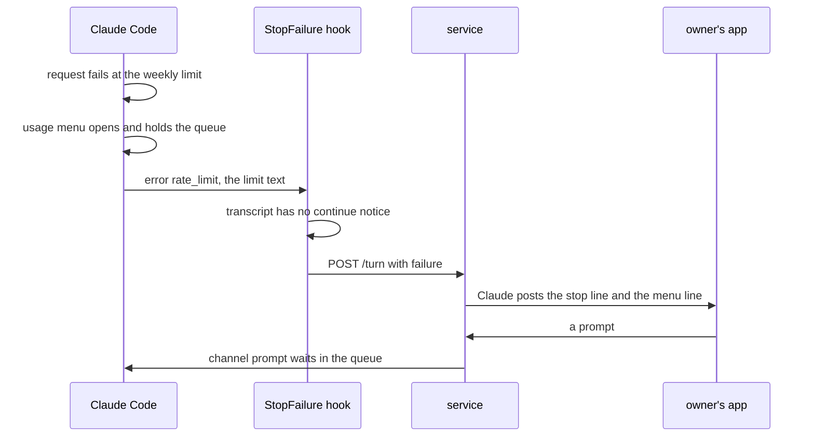
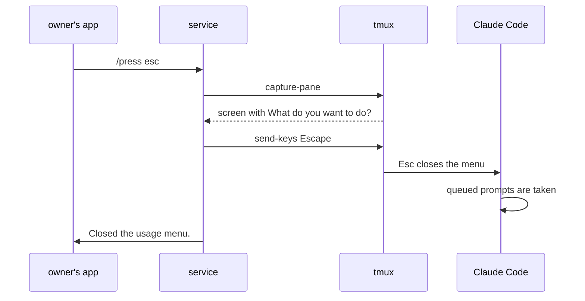
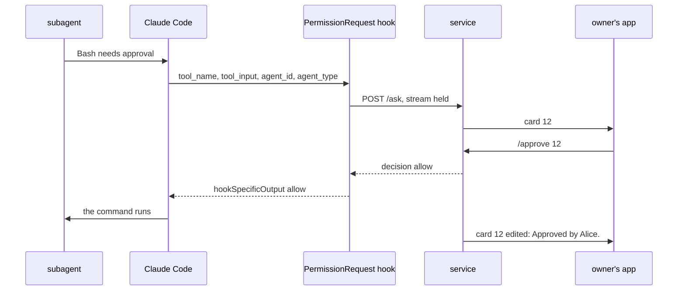
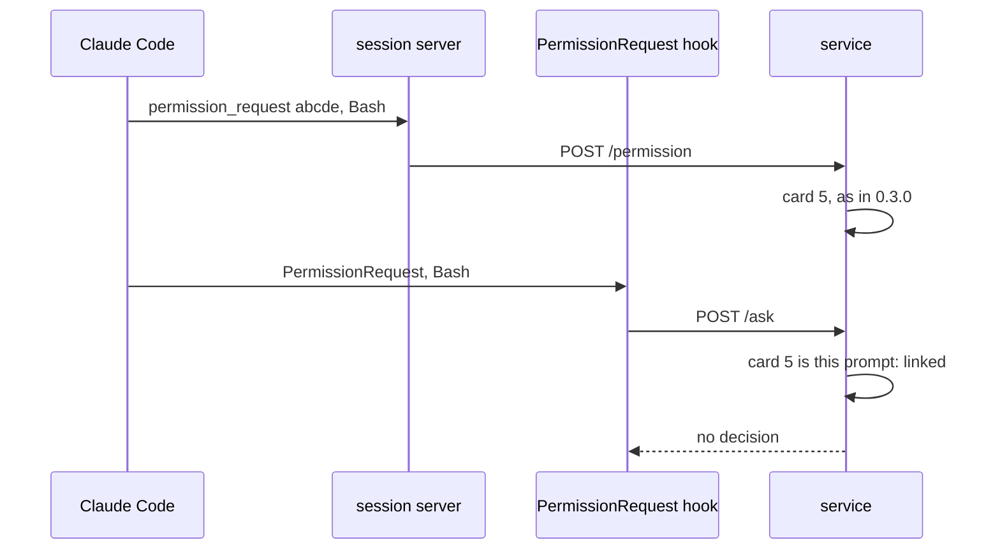
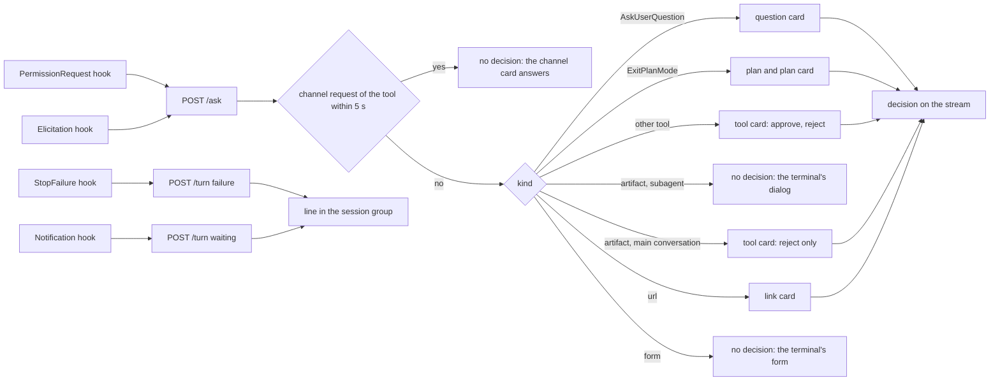
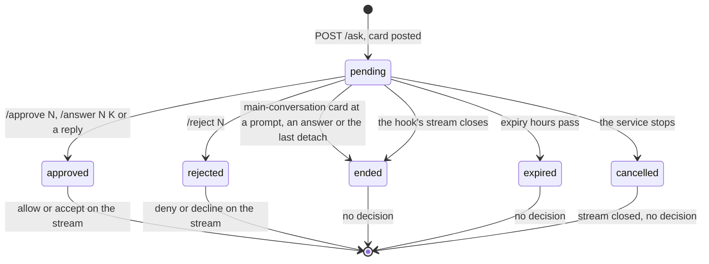

# SimpleX MCP: a session that waits in Claude Code, shown and answered in its group

Status: plan for review. Code references: master `8fda06295` (`@simplex-chat/mcp` 0.3.0 with #8157, #8162 and #8163), cited by file and function. Claude Code references: the binaries 2.1.322 and 2.1.323 at the byte offsets given (both cases below ran on 2.1.322), the official docs (hooks, channels-reference), quoted, and Claude Code's CHANGELOG. Transcripts of this machine:
- T1: the lead session of `/code/raiselaunch/research/openclaw`, 2026-11-12 21:37 to 2026-11-13 16:28 UTC, with the plugin's channel.
- T2: a session of `/code/simplex-chat-6`, 2026-11-13 00:50 to 16:25 UTC, with the plugin's channel.

Plans of other items, on their `ep/` branches: `mcp-allow-tool`, `mcp-decisions`, `mcp-session-list`, `mcp-session-usage`, `mcp-activity`, `mcp-secrets`.

Two pull requests:
- PR 1, the plugin without terminal keys: every waiting state that Claude Code reports to plugins is posted in the session's group, and every one that a hook can answer is answered there.
- PR 2, after Q1: the plugin presses keys in Claude Code's terminal through tmux, for the dialogs that no API answers.

## 1. Goal

Proposed roadmap line, first in "In your sessions" of `ROADMAP.md`, removed by PR 1: "When a session waits for you in Claude Code, its group says what it waits for, and you answer there."

The user's words, 2026-11-13, in the plugin's session group:

> this is by the way a big problem. If you hit the limit, and I pay for overage or reset the allowance as now, the terminal session stays stuck and it cannot be unstuck from the chat. Is it fixable somehow?
> Another blocker I hit was when claude asked "these document was made by somebody else (referring to artefact I think), can I access" I also didn't get tool approval in chat and session remained stuck until I logged in into CLI. Is it fixable?
> My priority is to do everything possible without ever getting to CLI other than the initial start, and we already have some limitations here by not being able to run commands, but at least we should prioritize resolving all resolvable issues before we get to chat core changes

Outcome:
- Every state in which a session waits for a person is posted in its group with what to do.
- Every prompt that a Claude Code hook can answer is a card in the group: prompts of subagents and teammates, Claude's questions, plan approvals and MCP link requests.
- With PR 2, a prompt that only a key in the terminal answers gets that key from the group, when Claude Code runs in tmux.

### 1.1 The user's two cases

Case 1, the usage limit (T1, Claude Code 2.1.322):
- At 14:16:06 the request failed with `You've hit your weekly limit · resets Nov 18, 3am (UTC)`. The reset was more than 24 hours away, so Claude Code did not arm its automatic continue (fact 10). Without it, Claude Code opens its usage menu, `What do you want to do?`, by itself when it has options to offer (fact 8).
- While such a menu is open, Claude Code takes no queued message (fact 9). In T1, task notifications queued from 14:16:44 to 14:24:20 stayed in the queue, and a message from the group, queued at 16:20:57, was taken at 16:24:43. The terminal was in use then: T2's prompt was answered there at 16:24:21.
- The plugin posted nothing: a turn that ends in an API error runs the StopFailure hook, not the Stop hook (fact 12), and the plugin has no StopFailure hook.
- On 2026-11-12 the same limit, with its reset 3 hours away, armed the automatic continue instead (`Usage limit reached · continuing automatically at 1am · esc to cancel`). Queued messages kept running, and a message from the group at 22:18:49 started a turn at once.
- Fixable from the plugin in part. With PR 1 the group learns of it at once. The menu closes only by a key in the terminal; PR 2 presses Esc through tmux. Claude Code could also skip the menu while a channel is attached, as it does while Remote Control is on (fact 8).

Case 2, the artifact (T2, Claude Code 2.1.322):
- At 00:52:27 Claude called the Artifact tool to read an artifact created outside the user's organization. Claude Code asked `"TITLE" was made by someone else. Let Claude read it?` (fact 6). The answer came from the terminal at 16:24:21, 55,914 s later, with `permissionDecision` `{decision: accept, source: user_temporary, reasonCode: safetyCheck}`.
- Claude Code marks this consent prompt for its terminal only, so the channel relay never gets it (facts 2 and 6). Three messages from the group, queued at 07:02, 09:15 and 16:21, joined the turn only after that answer, at 16:24:22.
- Fixable from the plugin in part. A PermissionRequest hook gets this prompt, so with PR 1 the group gets a card at once, and `/reject` there ends the wait. Claude Code refuses a hook's approval of a read from outside the organization (fact 6), so approval from the group needs a key in the terminal (PR 2, Q1 A) or a change in Claude Code.

### 1.2 Where a session waits

| # | State | What Claude Code shows | How the plugin learns of it | What answers it without a key | This plan | Change in Claude Code that would solve it |
|---|---|---|---|---|---|---|
| 1 | Usage limit; reset more than 24 hours away, or automatic continue off (case 1) | menu `What do you want to do?`: stop and wait, usage credits, upgrade, a saved reset; it holds queued messages | StopFailure `rate_limit`, without the continue notice in the transcript; the menu itself only from the screen (PR 2) | nothing | PR 1: ⛔ line. PR 2: Esc | no menu while a channel is attached, as with Remote Control |
| 2 | Usage limit; reset within 24 hours | notice `Usage limit reached · continuing automatically at TIME`; queued messages run and fail while the limit holds | StopFailure `rate_limit` with the notice; Notification `quota_auto_resume_stale` and `quota_auto_resume_disabled` | a message from the group, once the limit is lifted | PR 1: ⛔ line, 🔄 line | none |
| 3 | Login refused | the error `Please run /login` | StopFailure `authentication_failed` | `claude auth login` in another terminal on this computer: the session reads the stored login at its next refusal | PR 1: ⛔ line | login from a channel |
| 4 | Another API error that ends the turn | the error; the session is idle | StopFailure with the error type | a message from the group | PR 1: ⛔ line | none |
| 5 | Tool prompt of the main conversation, also one that a hook asks for | the dialog | channel `permission_request` | the card's verdict (0.3.0) | unchanged; the new hook links to it | none |
| 6 | Tool prompt of a subagent or an in-process teammate | the dialog, after the hooks return | PermissionRequest hook with `agent_id` | the hook's allow or deny | PR 1: card | relay to channels |
| 7 | Consent prompt kept for the terminal: someone else's artifact (case 2), artifact database, design writes, some safety checks | the dialog, such as `"TITLE" was made by someone else. Let Claude read it?` | PermissionRequest hook; Notification `permission_prompt` | the hook's deny; Claude Code refuses the hook's allow of a read from outside the organization | PR 1: card with `/reject`. PR 2: approval by key (Q1 A) | relay with its wording |
| 8 | Prompt for the person only: auto mode's classifier handed the call over, an artifact's access change | the dialog | Notification `permission_prompt` | nothing: Claude Code runs no hook | PR 1: ⏸️ line. PR 2: keys | relay with its wording |
| 9 | Claude's question, AskUserQuestion | the question dialog | PermissionRequest hook | the hook's allow with `answers`, or deny with a message | PR 1: question card | none |
| 10 | Plan approval, ExitPlanMode | the plan dialog | PermissionRequest hook | the hook's allow with the input, or deny with feedback | PR 1: plan card | none |
| 11 | MCP server asks to open a link | a dialog with the link; it holds queued messages | Elicitation hook with `url`; Notification `elicitation_url_dialog` | the hook's accept or decline | PR 1: link card | none |
| 12 | MCP server asks to fill a form | the form | Elicitation hook; Notification `elicitation_dialog` | the hook's accept with field values | PR 1: ⏸️ line | none |
| 13 | Sandboxed command asks for network access | a dialog for the host; it holds queued messages | Notification `permission_prompt` | nothing: no PermissionRequest hook | PR 1: ⏸️ line. PR 2: keys | relay |
| 14 | Session paused: a model needs usage credits, or a refusal offers a fallback model | `Session paused` dialogs | Notification `permission_prompt` | nothing | PR 1: ⏸️ line. PR 2: keys | relay |
| 15 | The plugin's own tools in mode `host` | Claude Code's prompt, by design of mode `host` | Notification `permission_prompt` | nothing | PR 1: ⏸️ line | none |
| 16 | Start: workspace trust, development channels warning, new MCP servers of a project | dialogs at the start | none | the person who starts Claude Code | unchanged | none |
| 17 | A command that a person opened in the terminal, such as `/model` | its menu; it holds queued messages | Claude Code's session record, read by `mcp-session-list` | nothing | unchanged | none |

## 2. What users see

### 2.1 Lines of PR 1

Claude posts each line in the session's group, without a quote. The first line of Claude Code's own text is cut at 200 characters with `…`.

```
event                                  line
turn ends at a usage limit, automatic  ⛔ Claude Code stopped: You've hit your weekly limit · resets Nov 18, 3am (UTC)
continue not armed                     When Claude Code shows its usage menu in its terminal, it holds messages from this group until someone closes the menu there.
turn ends at a usage limit, automatic  ⛔ Claude Code stopped: You've hit your session limit · resets 6pm (UTC)
continue armed                         Claude Code continues by itself at the reset. When the limit is lifted earlier, send a message here.
turn ends at a refused login           ⛔ Claude Code stopped: Please run /login · API Error: 401 …
                                       Sign in again in a terminal on this computer, with /login in Claude Code or with claude auth login, then send a message here.
turn ends at another API error         ⛔ Claude Code stopped: API Error: Repeated 529 Overloaded errors
                                       Send a message here to try again.
a dialog without a card waits          ⏸️ Claude Code waits in its terminal: Session paused
the usage limit has reset, while       🔄 The usage limit has reset. Send a message here to continue.
Claude Code waits for a key
automatic continue turned off          ⛔ Claude Code will not continue by itself after the usage limit. Send a message here when the limit has reset.
```

Rules:
```
⛔ line          once per failure text; the same text again before the next answer posts nothing
⏸️ line          for a Notification of kind permission_prompt, worker_permission_prompt, elicitation_dialog,
                elicitation_url_dialog or agent_needs_input; its text is the notification's message;
                nothing when a card of the session was posted in the 30 s before
🔄 line          for quota_auto_resume_stale
⛔ line          for quota_auto_resume_disabled, the last line of the table above
```

### 2.2 Cards of PR 1

A card of a subagent's or an in-process teammate's tool prompt:
```
Claude: Subagent `reviewer` asks to use `Bash`: `Run the unit tests`
        `npm test`
        /approve 12 or /reject 12
```

A card of an Artifact tool's prompt, or of WebFetch reading an artifact, in the main conversation (row 7):
```
Claude: I want to use `Artifact`, and Claude Code takes its approval only in its terminal:
        `action: read`
        `url: https://claude.ai/artifact/…`
        Approve it there, or /reject 13 here.
```

A question of Claude, one question with one choice:
```
Claude: ❓ Which library should we use for dates?
        1. date-fns: Small modular functions /answer 14 1
        2. Luxon: Immutable time zones /answer 14 2
        Reply to this message to answer in your own words, or /reject 14.
```

Several questions, a multiple choice, a text or a number question:
```
Claude: ❓ Claude Code asks 2 questions:
        1. Which framework?
           React: Component library
           Vue: Progressive framework
        2. Which features should we enable? (any of them)
           Auth
           Billing
        Reply to this message with your answers, or /reject 14.
```

A plan: Claude posts the plan's text, then the card as a reply to its first part:
```
Claude: 📋 Claude Code asks to approve this plan.
        /approve 15 to start, or reply to this message to keep planning with your changes; /reject 15
```

A link of an MCP server:
```
Claude: 🔗 MCP server `tracker` asks you to open: https://tracker.example/oauth/…
        Sign in to continue.
        Open it, then /approve 16, or /reject 16 to decline.
```

The app shows each command as one tap, as on every card. Card outcomes:
```
card        command or reply of an admin or owner           Claude Code gets                         last line of the card
tool use    /approve N                                      allow                                    Approved by Alice.
tool use    /reject N                                       deny: Alice rejected this in the         Rejected by Alice.
                                                            SimpleX group.
question    /answer N K                                     allow with answers {question: label K}   Answered by Alice: date-fns.
question    a reply to the card                             allow with answers {each question: text} Answered by Alice in a reply.
question    /reject N                                       deny: Alice declined to answer in the    Rejected by Alice.
                                                            SimpleX group.
plan        /approve N                                      allow with the plan as asked             Approved by Alice.
plan        a reply to the card                             deny: Keep planning. Alice wrote in the  Answered by Alice in a reply.
                                                            SimpleX group: TEXT
plan        /reject N                                       deny: Alice rejected the plan in the     Rejected by Alice.
                                                            SimpleX group.
link        /approve N                                      accept                                   Approved by Alice.
link        /reject N                                       decline                                  Rejected by Alice.
any         none until the card ends: a card of the main    nothing                                  Ended. or Expired.
            conversation at its next prompt, answer or
            the last detach; any card at its expiry
```

A reply of a member below admin is a prompt to Claude, as in 0.3.0. A reply to a card that is no longer pending is a prompt too.

### 2.3 Before and after

```
moment                                         0.3.0                                   PR 1
a turn ends at a usage limit                   nothing                                  ⛔ line with what to do
a turn ends at another API error               nothing                                  ⛔ line
a subagent's or teammate's tool prompt         nothing; the terminal's dialog           card; the terminal's dialog after the card (Q2 A)
Claude's question                              nothing                                  question card; the terminal's dialog too
plan approval                                  nothing                                  the plan and its card; the terminal's dialog too
someone else's artifact                        nothing                                  card with /reject
MCP link request                               nothing                                  link card; the terminal's dialog after the card
sandbox, Session paused, person-only prompts   nothing                                  ⏸️ line
Claude Code started without the channel flag   no cards                                 cards from the hook for tool prompts
```

The terminal is unchanged, apart from Q2 and MCP links: Claude Code runs their hooks before it shows the dialog, so the dialog shows only after the card ends.

### 2.4 Sequences

Case 1 with PR 1:


Case 1 with PR 2 and tmux (Q1 A):


A subagent's tool prompt:


A tool prompt that the channel relays, as in 0.3.0, with the hook linked to it:


## 3. Questions for the user

Q1. May the plugin press keys in Claude Code's terminal for dialogs that no API answers?
- A, recommended: yes, through tmux, for every dialog it recognizes on the screen, consent prompts included. A card of a consent prompt then has the dialog's own words, read from the screen, and `/approve N` presses its Yes key. The usage menu gets `/press esc`, and a ⏸️ line gets the dialog's options. Users start Claude Code inside tmux, for example `tmux new -s claude`, then `claude ...`; tmux also keeps Claude Code running when the terminal closes. Cost: PR 2, about 150 source and 150 test lines. It goes past Claude Code's rule that only the person at its terminal approves a read from outside the organization (fact 6). The person approving here is an admin or owner of the group, whom the trust model already lets approve any tool use (0.3.0 trust model, rule 3).
- B: keys only for dialogs without consent: the usage menu, `Session paused` and the sandbox prompt. Consent prompts get `/reject` from the group and approval in the terminal. Cost: PR 2 without the consent recognizers, about 110 source lines.
- C: no keys. The group shows what waits and what to do, and the rest waits for Claude Code to change (section 5.4). Cost: none beyond PR 1. Case 1 then needs the terminal.

Q2. Should a prompt of a subagent or an in-process teammate wait for its card?
- A, recommended: yes, until the card is decided or expires. Claude Code runs the hooks of these prompts before it shows the dialog (fact 4), so the terminal shows the dialog only after the card ends. A background subagent, which Claude Code refuses at once today, waits for its card. Cost: none.
- B: the hook waits 5 minutes, then leaves the prompt to the terminal, and the card ends with `Answer it in the terminal.` A background subagent is refused after 5 minutes. A prompt that nobody answers within 5 minutes then needs the terminal.

Q3. How should Anthropic learn of the changes of section 5.4?
- A, recommended: privately, with the request to list the plugin's channel. Cost: one message.
- B: public issues in `anthropics/claude-code`. Other channel users can add their cases; the plugin's limits become public.
- C: not now.

## 4. Decisions

Facts:
1. Claude Code sends `notifications/claude/channel/permission_request` from one place, the dialog of a tool prompt of the main conversation: `method:Jds` occurs once in 2.1.323, at 335050699; `Jds` is defined at 324352581. The docs: "Relay covers tool-use approvals like `Bash`, `Write`, and `Edit`. Project trust and MCP server consent dialogs don't relay; those only appear in the local terminal." (channels-reference, "Relay permission prompts").
2. That function skips the relay for a prompt marked `localDisplayOnly`, `denialLimitFallback`, `autoDenyWindow` or `oneTimeAnswersOnly`, and for remote execution (2.1.322 at 320826486, 2.1.323 at 335047253). It skips it also for a tool that requires the person's interaction, and for a prompt with `askRequiresUserInteraction` (2.1.322 at 320826658, 2.1.323 at 335047394 and the check at 335050272). AskUserQuestion returns true from `requiresUserInteraction` (2.1.323 at 318367557), and ExitPlanMode does too, outside a teammate (`vc()`, 317835964).
3. In the main conversation, the same function starts the PermissionRequest hooks beside the dialog, unless the prompt is for the person only (2.1.323 at 335052453), and applies the first answer. `runHooks` passes the hooks the tool call's abort signal (335042339), so a hook keeps running after the terminal allows the call.
4. A prompt of an in-process teammate or a subagent shown in the terminal takes another path: Claude Code runs the PermissionRequest hooks first, then shows the dialog without any relay (`ilr`, then `mlr` without relay callbacks: 2.1.323 at 335012320 and 335077732; 2.1.322 at 320856834). `ilr` runs no hook for a prompt for the person only. Where no prompt can be shown, as in a background subagent, Claude Code runs the hooks and denies the call without a decision (2.1.323 at 312306336). The docs: "PermissionRequest hooks run only when Claude Code is about to ask you for permission, or when it would otherwise auto-deny a call that can't prompt."
5. A hook answers with `decision.behavior` `allow` or `deny`, inside `hookSpecificOutput`. "`AskUserQuestion` and `ExitPlanMode` [need this field]" (`updatedInput`); "For `AskUserQuestion`, echo back the original `questions` array and add an [`answers`] object mapping each question's text to the chosen answer"; for ExitPlanMode "Claude Code injects the plan content and file path before passing the input to hooks" (hooks docs). `runHooks` ignores an allow without `updatedInput` for such a tool (335042339). The hook gets `tool_name`, `tool_input`, `permission_suggestions` and, for an MCP tool, `mcp_server`, "but without `tool_use_id`" (2.1.322 at 296949420, 2.1.323 at 312840610, hooks docs), and `agent_id` and `agent_type` inside a subagent or an in-process teammate (hooks docs, "Common input fields").
6. The consent prompts of the Artifact tool are `{behavior: "ask", ..., suppressAlwaysAllowRule: true, localDisplayOnly: true}`, and those of an access change are also `personOnly` (2.1.322 at 307840123, 2.1.323 at 323779698). A read of someone else's artifact asks `"TITLE" was made by someone else. Let Claude read it?` (2.1.322 at 307836002), with `This artifact was created outside your organization.` for an outside one. For a read of a public artifact from outside the organization, Claude Code answers a hook's allow with "a PermissionRequest hook answered the permission prompt in the user's place; only the user's own approval allows this read" (2.1.322 at 307834123, 2.1.323 at 323773397). WebFetch of someone else's artifact asks with `localDisplayOnly: true` too (2.1.323 at 311491033). The literal `localDisplayOnly:!0` occurs 30 times in 2.1.323, among them the artifact database, design writes and safety checks.
7. Auto mode's classifier hands a call to the person with `askRequiresUserInteraction: true, personOnly: true, hooksMayAllow: false` (2.1.323 at 312320679).
8. When a turn ends at a limit for which Claude Code has options to offer, such as usage credits, an upgrade or an automatic continue (the error row's condition, 2.1.323 at 336344400), it opens `/rate-limit-options` by itself: `openRateLimitOptions` submits it once per limit, unless the automatic continue is armed or `Qa()` is true (2.1.322 at 324233028, 2.1.323 at 339177278). `Qa()` is true while Remote Control is on, in a background session and in a teammate (`mc()||Kt()||Dp()!==void 0`, 302693532). The menu's title is `What do you want to do?`; its options include `Stop and wait for limit to reset`, `Add funds to continue with usage credits` and `Upgrade your plan`; Esc closes it (2.1.323, 352146057 to 352158776).
9. A local command's dialog holds the queue unless opened otherwise (`holdsQueue:xe=!0`, 2.1.323 at 337728352), and the queue processor takes nothing while one holds it (`W7t`, 325515287; its checks at 339283444). The dialogs `managed_settings_security`, `sandbox_network_access` and `mcp_url_elicitation` hold it as well (339281440). The docs: "Events queue into the session and are processed in order." (channels-reference, "Notification format").
10. The automatic continue is armed only for a reset within 24 hours (`DQt=86400000`, 2.1.323 at 310882540). Armed, Claude Code writes the notice `Usage limit reached · continuing automatically at 1am · esc to cancel` to the transcript (T1, 2026-11-12 21:38:12.309, 5 ms after the error entry). Its notifications are `quota_auto_resume_fired`, `quota_auto_resume_stale` and `quota_auto_resume_disabled` (2.1.323 at 299024918).
11. The error of a limit is an assistant entry of the transcript with `isApiErrorMessage: true`, `error: "rate_limit"`, `apiError: "usage_limit_reached"`, model `<synthetic>` and the text `You've hit your weekly limit · resets …` (T1).
12. StopFailure runs "When the turn ends due to an API error", with `error`, `error_details` and `last_assistant_message`; its matcher values are `rate_limit`, `overloaded`, `authentication_failed`, `oauth_org_not_allowed`, `account_on_hold`, `billing_error`, `invalid_request`, `model_not_found`, `server_error`, `max_output_tokens`, `cloud_credential_error` and `unknown` (hooks docs). Claude Code fills `last_assistant_message` with the error entry's text (2.1.323 at 312831949). The Stop hook "Does not run if the stoppage occurred due to a user interrupt. API errors fire [StopFailure] instead." (hooks docs, "Stop").
13. A dialog with a notification sends it after 6 s without typing (`FNn=6000`, 2.1.323 at 307289215; `CIe` at 339055766), with the type `permission_prompt` when the dialog names none (339063652). The texts: tool prompts `Claude needs your permission` (337910106), the sandbox `A sandboxed command needs network access` (337911752), the plan `Claude Code needs your approval for the plan` (337913198), the paused sessions `Session paused` (337913430, 337913564). A local command's dialog, such as the usage menu, has no notification (337910558). Notification hooks get `message`, an optional `title` and `notification_type`, and "can't block or modify notifications" (hooks docs).
14. The Elicitation hook gets `mcp_server_name`, `message`, `mode`, `url`, `elicitation_id` and `requested_schema` (2.1.323 at 312820852). Claude Code shows the dialog after the hook returns: an `action` `accept`, `decline` or `cancel` is sent to the server "and no dialog appears"; "No output, with exit code 0" leaves the request to the dialog; "For a URL-mode request, a hook that returns `accept` skips the dialog, so the URL never opens." (hooks docs, "Elicitation output").
15. On a refused login, Claude Code reads the stored login again and takes it when its token differs from the refused one (`FY`, 2.1.323 at 302338058; `tengu_oauth_401_recovered_from_keychain` at 302341346). `claude auth login` signs in from a terminal (2.1.323 at 320616122).
16. A command hook's `timeout` has no maximum in the settings schema (`timeout:E().positive().optional()`, 2.1.323 at 299125730); the default is 600 s (hooks docs).
17. StopFailure came in Claude Code 2.1.78, the Elicitation hooks in 2.1.76 and the channel's permission relay in 2.1.81 (CHANGELOG). Since 2.1.300 Claude Code drops unknown keys of a hook's `updatedInput` (CHANGELOG). The plugin needs 2.1.214 or later (`REFERENCE.md`, "Claude Code plugin").
18. Claude Code's relay masks credentials and folds whitespace in `description` and `input_preview` (channels-reference, "Permission request fields"). A hook gets the input as Claude produced it.
19. In 0.3.0 the session server relays `permission_request` with `ServiceLink.permission` to `POST /permission`, and `Session.permission` posts the card in mode `requests` (`session.ts`, `startSession`; `hub.ts`, `Session.permission`). `Session.turn` ends pending tool cards at a prompt that is not mid-turn and at an answer, and `Service.onAttach` ends them at the last detach (`hub.ts`, `endPermissions`; `service.ts`, `onAttach`). `hooks/hooks.json` has SessionStart, PreToolUse, UserPromptSubmit, Stop and PostModelSwitch.
20. AskUserQuestion is among the tools of T1's model requests on 2026-11-13, with the channel on (`api-request-shape` at 12:06:14). In T2 a question of Claude, on 2026-11-10, was rejected in the terminal (`permissionDecision` `user_reject`).
21. Claude Code has the setting `askUserQuestionTimeout`, `60s`, `5m`, `10m` or `never`: "Idle time before Claude's questions in the terminal auto-continue with any answers selected so far" (2.1.323 at 299380757).

Choices:

22. PR 1 posts lines from two new hooks, StopFailure and Notification, through the hook command `hook turn` and `POST /turn`, as the other turn events (facts 12 and 13).
23. The StopFailure hook reads the transcript's tail for the continue notice after the error entry, up to 20 times, 100 ms apart, as `answerModel` reads the answer. With the notice, the line is the armed one (fact 10). Without it, the line names the menu with "When", since the menu opens only when Claude Code has options to offer (fact 8).
24. A ⛔ line is posted once per failure text: a turn that fails with the same text before an answer was posted posts nothing. In T1 four teammate messages failed with the same limit text within 64 s.
25. A ⏸️ line is posted unless a card of the session was posted in the 30 s before. A dialog's notification comes after 6 s (fact 13), and its card within a second.
26. PR 1 adds a PermissionRequest hook, `hook ask`, with a timeout of 86,400 s (fact 16). It prints nothing, at once, in a run that is not interactive and for the plugin's own tools. Otherwise it sends `POST /ask` and holds the stream until the service ends it, as `/call` holds its stream; with no decision on the stream it prints nothing.
27. For a prompt without `agent_id`, the service waits up to 3 s for a channel request of the same tool, created up to 5 s before and not yet linked. A found one is this prompt (facts 1 and 3): the hook gets no decision, and the channel card stays as in 0.3.0.
28. Other prompts get a card. AskUserQuestion gets a question card and ExitPlanMode a plan card. A prompt of an Artifact tool, or of WebFetch for a `claude.ai` artifact URL, gets a card with `/reject` only in the main conversation, where the dialog is open beside it; in a subagent it gets no decision at once, so its dialog shows (fact 6). Every other prompt gets a card with `/approve` and `/reject`, also a prompt of the main conversation when the channel is off.
29. The card's preview of the tool's input: the command for Bash and PowerShell, the file path for Read, Write, Edit and NotebookEdit, and otherwise a line `key: value` per top-level field, fitted to the card as the channel's preview is (`Control.refusal`). The first line uses `tool_input.description` when it is a string. The plugin shows the input as the terminal shows it, without the relay's masking (fact 18).
30. A question card gives one tap per option only for one question of one choice. Otherwise the members answer by a reply. A reply answers every question of the card with its text.
31. A plan card follows the plan's text, posted by Claude in parts as an answer is (`hub.ts`, `textParts`). The approval returns the input unchanged, with no `updatedPermissions`. TESTING checks the permission mode that follows.
32. An Elicitation hook, `hook ask` too, gives a link card for `mode` `url`. The person opens the link from the card, since the hook's accept skips the terminal's dialog (fact 14). For a form the hook prints nothing at once, so the terminal shows the form, and the Notification hook posts its ⏸️ line.
33. Cards of the main conversation end as the channel's cards do: at the next prompt that is not mid-turn, at an answer and at the last detach (fact 19). The terminal may have answered them (fact 3); the end closes the hook's stream, and the hook exits without a decision. Cards with `agent_id` end only at their decision, their expiry, the end of the hook's stream or a stop of the service (fact 4, Q2 A).
34. Admins and owners decide the cards, as every card (0.3.0 trust model, rule 3). A reply to a pending question or plan card is an answer when its sender is an admin or owner; otherwise it is a prompt, as in 0.3.0.
35. The protocol version stays 1. `TurnRequest` gets the optional `failure` and `waiting`, and `POST /ask` is a new route; a service of 0.3.0 does not run with these hooks, as the hook restarts an older service (`client.ts`, `ServiceClient.ensureService`).
36. PR 2 (Q1) uses tmux. The SessionStart hook sends `TMUX` and `TMUX_PANE` when both are set. The service reads the screen with `tmux capture-pane -p` and presses a key with `tmux send-keys`, only after the screen before the key matches a known dialog, and reads it again after the key to report the result.

## 5. Design

### 5.1 Options

Where the plugin learns that a session waits:
```
option                                   cost                                               coverage
H. hooks: StopFailure, Notification,     one command hook per event; PermissionRequest      every state of section 1.2 that Claude Code
   PermissionRequest, Elicitation        and Elicitation hold a process per pending card    reports, and answers through the hooks
   (chosen)
R. Claude Code's session record          a poll of an internal file every 2 s;              "waiting" and a kind; the dialog's words and
   (mcp-session-list)                    already read by that item                          an answer are absent
X. the transcript                        a watch of a large file                            errors and queued messages; dialogs are absent
```
R serves the Main group's list of `mcp-session-list`; it gives neither the words of a dialog nor its answer. X misses every dialog.

How the plugin answers the prompts that the channel misses:
```
option                                   cost                                               coverage
P1. PermissionRequest command hook,      a node process per pending card; a long-held       subagents, teammates, questions, plans and
    held until decided (chosen)          stream, as /call                                   consent prompts (reject); also without the
                                                                                            channel flag
P2. PermissionRequest hook of type       a tool listed to Claude that creates cards, and    the same
    mcp_tool, held in the session server an MCP call held in the session server
P3. PreToolUse hook for AskUserQuestion  runs before Claude Code's own checks               questions and plans only
    and ExitPlanMode
P4. askUserQuestionTimeout (fact 21)     a setting the person adds                          Claude goes on without an answer
P5. the hook replaces the channel relay  rewrite of the 0.3.0 relay; previews without       the same as P1
                                         Claude Code's masking (fact 18)
```
P2 lists a tool that Claude could call to post cards. P3 and P4 cover a part only. P5 rewrites a working path and loses the masking for the prompts the channel relays.

How the plugin presses a key (PR 2, Q1):
```
option                                   cost                                               who it serves
K1. tmux send-keys and capture-pane      no dependency of the plugin; the person starts     Claude Code in tmux, on Linux, macOS and WSL
    (chosen)                             Claude Code in tmux
K2. the plugin's own launcher with a     node-pty, a native module, built for each          any terminal, through the launcher
    pseudo-terminal                      platform in the bundled package; raw input,
                                         resizes and signals relayed by the plugin
K3. Remote Control on                    the session is sent to claude.ai                   no usage menu (fact 8); the rest unchanged
```
K2 costs native builds in a package that installs nothing after unpacking (`REFERENCE.md`, "Claude Code plugin"). K3 sends the session to Anthropic's app, which the plugin replaces.

### 5.2 Changes of PR 1

```
file                  function or type                 change
hooks/hooks.json      PermissionRequest, Elicitation   + command hook "hook ask", timeout 86400
                      StopFailure                      + command hook "hook turn", async
                      Notification                     + matcher permission_prompt|worker_permission_prompt|elicitation_dialog|
                                                         elicitation_url_dialog|agent_needs_input|quota_auto_resume_stale|
                                                         quota_auto_resume_disabled; command hook "hook turn", async
src/cli.ts            pluginCommands, main             + "hook ask"; prints its output only when it is not empty
src/hook.ts           TurnInput                        + error, notification_type, message
                      turn                             StopFailure: failure {error, text, autoContinue}; Notification: waiting {kind, text}
                      continueArmed                    new: the continue notice after the error entry in the tail (decision 23)
                      ask                              new: the request of decision 26; the hook output of its decision
                      hookOutput                       new: PermissionRequest and Elicitation output from a decision
src/protocol.ts       TurnRequest                      + failure?, waiting?
                      AskRequest, AskLine              new
src/service.ts        routes                           + "POST /ask": streamed as "POST /call"; counted as a call of the entry
                      SessionLike                      + ask(request, signal)
src/hub.ts            Session.turn                     failure: the ⛔ line, decision 24; waiting: the ⏸️, 🔄 or ⛔ line, decision 25
                      Session.ask                      new: link (decision 27), the card, the decision of section 2.2
                      Session.permission               records the channel request for linking
                      Session.onMessage                a reply of an approver to a pending question or plan card answers it
                      Session.endPermissions           also question, plan and link cards; skips cards with agent_id
src/actions.ts        PermissionAction                 input: requestId optional, + agent?, terminalOnly?
                      QuestionAction, PlanAction,      new tools: question, plan, link
                      LinkAction
                      Actions.answer                   new: records the option or the reply, then approves
src/control.ts        requestLines, commandsLine       the cards of section 2.2
                      ownerRequest, ownerCommand       + answer N K
                      cardText                         + Answered by NAME: LABEL. and Answered by NAME in a reply.
src/tools.ts          perform                          question, plan and link perform nothing
```

Hook `ask`:
```
on PermissionRequest or Elicitation input:
  not interactive, or a tool mcp__plugin_simplex_simplex__*:       print nothing
  POST /ask {id, pid, at, agent, tool, input, server, message, mode, url, fields}
  stream ends with {decision}:                                     print the hook output of decision
  stream ends without one, or fails:                               print nothing
```

Service and hub:
```
on POST /ask:                          the session's entry; calls++ while the stream is open
Session.ask(request):
  PermissionRequest, no agent:         wait up to 3 s for an unlinked channel request of the tool, created <= 5 s ago
                                       found: link it, return no decision
  AskUserQuestion:                     question card
  ExitPlanMode:                        post the plan in parts, then the plan card as a reply to its first part
  Elicitation, mode url:               link card
  Elicitation, form:                   return no decision
  Artifact tool or artifact WebFetch:  no agent: tool card with reject only, terminalOnly; with agent: no decision
  any other tool:                      tool card with approve and reject
  wait for the card's state:
    performing, done                   allow, with updatedInput for a question or a plan; accept for a link
    rejected                           deny with the message of section 2.2; decline for a link
    expired, ended, failed, a stop     no decision
on a reply to a pending question or plan card by an approver:   Actions.answer(card, text)
on /answer N K by an approver:         question card N, one question of one choice, K an option: Actions.answer(card, K)
```



A hook's card:


### 5.3 Changes of PR 2 (Q1)

```
file                  function or type                 change
src/hook.ts           sessionStart                     + terminal {tmux socket, pane} from TMUX and TMUX_PANE
src/protocol.ts       TitleRequest                     + terminal?
src/terminal.ts       new: Terminal                    screen(): capture-pane -p, 2 s timeout; press(key): send-keys
                      dialogOf(screen)                 the usage menu, a consent prompt, Session paused, the sandbox prompt, a
                                                       generic numbered dialog; its words and options; nothing otherwise
src/hub.ts            Session                          + terminal; the ⛔ menu line and the ⏸️ line get /press commands
src/control.ts        ownerRequest                     + press esc, press K
                      requestLines                     a terminalOnly card gets the dialog's words and /approve N (Q1 A)
```

Keys:
```
/press esc       screen shows the usage menu or another dialog: Escape; reply Closed the usage menu. or the new screen's dialog
/press K         screen shows a dialog with option K: the key K; the reply names the option pressed
/approve N       terminalOnly card N, screen shows its dialog: the key of the option Yes; the card shows Approved by NAME.
otherwise        reply: Claude Code shows no dialog now. or Claude Code runs outside tmux; answer in its terminal.
```

### 5.4 Changes that need Claude Code

1. The usage menu: not opened by itself while a channel is attached, as `Qa()` does for Remote Control (fact 8), or a channel prompt taken while it is open.
2. Prompts marked `localDisplayOnly` (fact 6): relayed to channels with their words, and a channel's verdict taken as the person's.
3. Prompts of subagents and in-process teammates: relayed to channels (fact 4).
4. `tool_use_id`, or the channel's `request_id`, in the PermissionRequest hook's input, so a hook links to the relayed prompt without timing (decision 27).
5. Login from a channel: the login URL sent to the channel, and the code taken from it.
6. Prompts for the person only (fact 7), the sandbox prompt and `Session paused`: relayed to channels with their options.

## 6. Compatibility

- Older SimpleX apps: lines and cards are text with command links, as in 0.3.0.
- Older Claude Code: every hook of PR 1 exists since 2.1.78 at the latest (fact 17). A notification type that an older version lacks posts no line. Since 2.1.300 Claude Code drops unknown keys of a hook's `updatedInput` (fact 17); the plugin sends only the tool's own fields.
- Claude Code started without the channel flag: tool prompts get cards from the hook; messages of the group reach no session, as in 0.3.0.
- Older plugin data folders: nothing new is stored. Cards are actions in memory, as the channel's cards.
- `serve`: unchanged; it has no hooks.

## 7. Acceptance and tests

Done when:
```
#   criterion                                                                                     PR  checked by
1   a turn that ends at a limit posts the menu line, or the armed line after the continue notice  1   unit: hook, sessions
2   a turn that ends at a refused login or another API error posts its line; a repeat posts nothing 1  unit: sessions
3   a notification posts the ⏸️ line, also stale and disabled; a recent card suppresses it        1   unit: sessions
4   a subagent's prompt gets a card; /approve and /reject give allow and deny                     1   unit: sessions; e2e
5   a prompt of the main conversation with a channel request of its tool within 5 s gets no card 1   unit: sessions; e2e
6   an Artifact prompt of the main conversation gets a reject-only card; /reject gives deny       1   unit: sessions
7   AskUserQuestion: /answer and a reply give allow with answers; /reject gives deny              1   unit: sessions, hook
8   ExitPlanMode: the plan, its card; /approve gives allow with the input; a reply gives deny     1   unit: sessions, hook
9   Elicitation: a link card gives accept or decline; a form returns at once                      1   unit: sessions, hook
10  main-conversation cards end at a prompt, an answer and the last detach; agent cards do not    1   unit: sessions
11  the hook prints nothing in a run that is not interactive, for the plugin's tools, on failure  1   unit: hook
12  hooks.json has the four hooks                                                                 1   unit: plugin
13  real session: a subagent's Bash, a question, a plan and an outside artifact                   1   TESTING check
14  /press esc closes the usage menu read from a captured screen; no dialog presses nothing        2   unit: terminal
15  real session in tmux: the usage menu from /rate-limit-options closes by /press esc            2   TESTING check
```

The test that fails on master: `sessions.test.ts`, "posts what Claude Code waits for when a turn ends at a usage limit, with the menu or the automatic continue": master's `Session.turn` ignores `failure`, so no line is posted. Its fixture is the error entry and the notice of T1, with their texts only.

Tests:
- `test/unit/hook.test.ts`: StopFailure and Notification inputs give `failure` and `waiting`; the continue notice in the tail sets `autoContinue`; `ask` prints the PermissionRequest and Elicitation outputs for each decision, and nothing in the cases of criterion 11.
- `test/unit/sessions.test.ts`: criteria 1 to 10, in "session channel".
- `test/unit/cards.test.ts`: the cards of section 2.2, with names and inputs that need code spans.
- `test/unit/plugin.test.ts`: the hooks of `hooks.json`.
- `test/e2e/service.test.ts`: a hook's `POST /ask` without `agent` after a channel request of the same tool gets no decision and no second card; with `agent` the owner gets the card, sends `/approve N`, and the stream gets `allow`.
- PR 2: `test/unit/terminal.test.ts`: `dialogOf` over screens captured from Claude Code 2.1.322 and 2.1.323 in tmux; `press` runs only after a match.
- Run: `npm test --prefix packages/simplex-chat-mcp` and the end-to-end tests as TESTING.md states, in the reduced build of CI. No app changes, so no app test workflows.
- TESTING.md, checks of a real session: ask a subagent for a Bash command that is not allowed, and approve its card; let Claude ask a question, and answer by a tap and by a reply; approve a plan in the group, and note the permission mode after it; let Claude read an artifact from outside the organization, and reject it in the group. PR 2: open `/rate-limit-options` in tmux and close it with `/press esc`.

## 8. Docs to change

- `README.md`: what the group shows and answers when Claude Code waits, in step 4.
- `REFERENCE.md`: "Tool use": the hook's cards, the reject-only card, questions, plans and links. A new section "When Claude Code waits": the lines of section 2.1 and the rows of section 1.2. "Plugin recovery": a usage limit and a refused login. The parts table: the four hooks. "Claude Code plugin": tool prompts get cards also without the channel flag. PR 2: tmux and `/press`.
- `ROADMAP.md`: the line of section 1, added with this plan's approval and removed by PR 1.
- `spec/api.md`: 4.3, the cards, lines and commands; 4.6, `POST /ask` and the new fields of `/turn`; 4.8, the hooks.
- `spec/architecture.md`: the hook `ask`, `Session.ask`, the new actions and their state machine.
- `spec/flows.md`: new flows: a limit, a subagent's prompt, a question, a plan, a link.
- `TESTING.md`: the tests and the real-session checks.

## 9. Conflict areas with the other items

```
file or area                              where                                              items
hooks/hooks.json                          the hooks list                                     mcp-activity, mcp-allow-tool (PreToolUse "*")
src/hook.ts                               turn, TurnInput                                    mcp-activity, mcp-session-usage
src/protocol.ts                           TurnRequest, AttachLine                            mcp-activity, mcp-allow-tool, mcp-replies,
                                                                                             mcp-decisions
src/hub.ts                                Session.turn, Session.permission, endPermissions,  mcp-activity, mcp-allow-tool, mcp-replies,
                                          Session.onMessage                                  mcp-reactions, mcp-decisions, mcp-threads
src/control.ts                            ownerRequest, ownerCommand, requestLines,          mcp-allow-tool (/approve N all),
                                          commandsLine, cardText                             mcp-decisions (/decide, /dismiss)
src/actions.ts                            Action, PermissionAction                           mcp-allow-tool (toolApproved)
src/service.ts                            routes, SessionLike, onAttach                      mcp-allow-tool, mcp-activity
test/unit/sessions.test.ts, plugin.test,  session channel, hooks test, /call tests           every plugin item
test/e2e/service.test.ts
REFERENCE.md, spec/*, TESTING.md          Tool use, Plugin recovery, 4.3, 4.6, 4.8, flows    every plugin item
ROADMAP.md                                "In your sessions"                                 every plugin item
```

With `mcp-decisions`, Claude's own `ask` cards and Claude Code's AskUserQuestion cards both take replies as answers; whichever lands second keeps one form of option commands for both. With `mcp-session-list`, a session with a pending card or a ⏸️ state shows `waiting for you` in the Main group's list, from Claude Code's record.

## 10. Estimate

```
part                                                  source lines   test lines
PR 1  hook.ts, cli.ts, hooks.json                     110            120
PR 1  hub.ts, service.ts, protocol.ts                 140            220
PR 1  actions.ts, control.ts, tools.ts                80             90
PR 1  docs                                            about 140 lines of text
PR 2  terminal.ts, hub.ts, control.ts, hook.ts        150            150, with captured screens
```
PR 1: about two and a half working days, with two review rounds. PR 2: about one and a half days, with the real-session checks in tmux.
