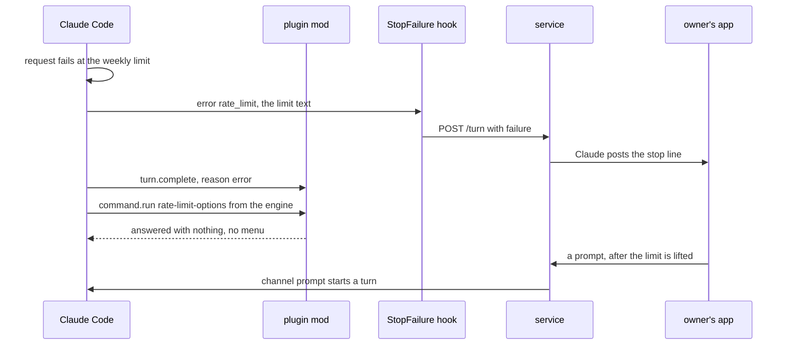
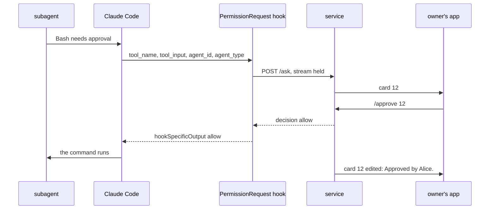
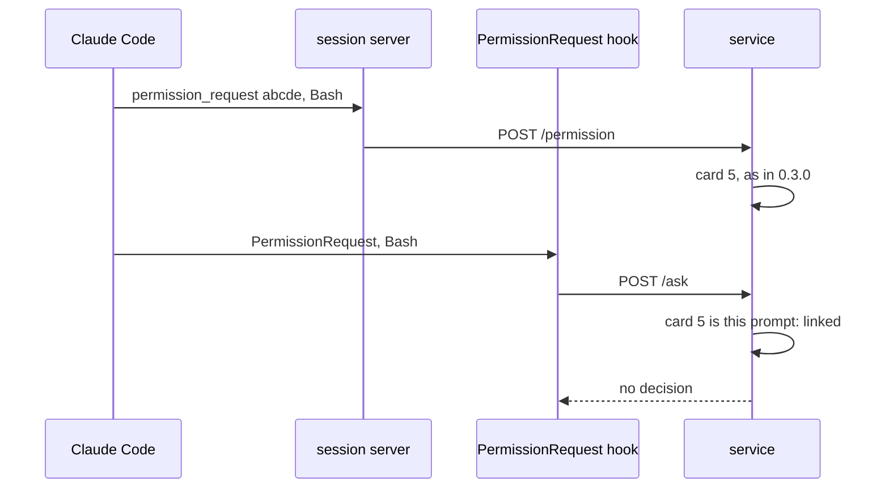
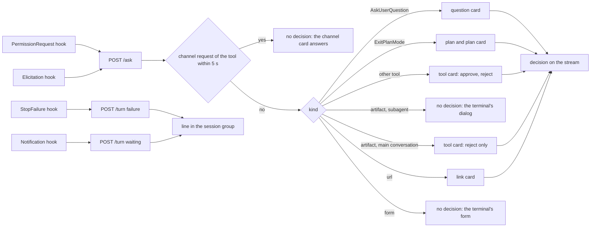
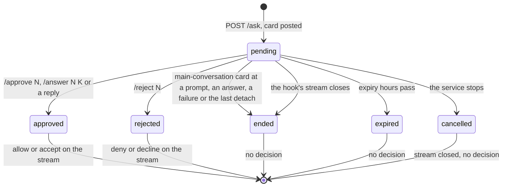
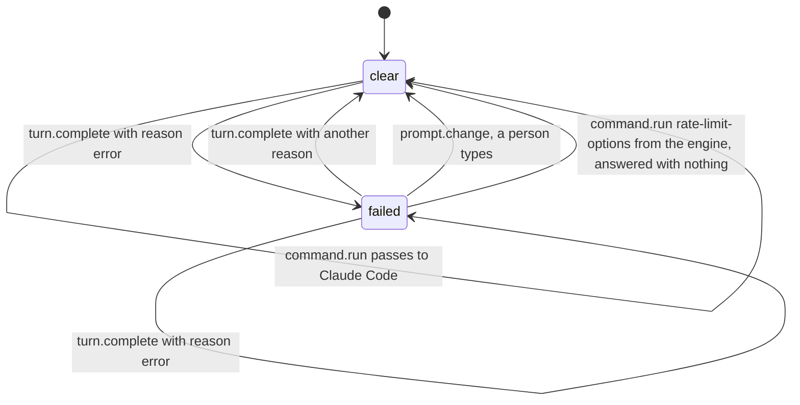
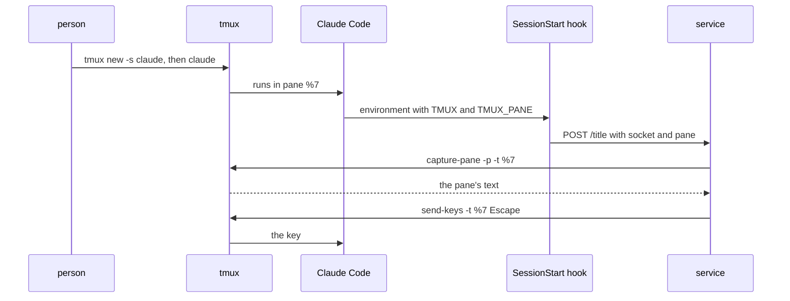

# SimpleX MCP: a session that waits in Claude Code, shown and answered in its group

Status: plan for review, revision 2. Code references: master `975cc700a` (`@simplex-chat/mcp` 0.3.0 with #8168, #8174 and #8176), cited by file and function. Claude Code references: the binaries 2.1.322 and 2.1.323 at the byte offsets given, the official docs, quoted, and Claude Code's CHANGELOG.

Real runs of 2026-11-13, cited as `run NAME HH:MM:SS` in UTC: Claude Code 2.1.323 in a pseudo-terminal of 160 columns, against a local fake Anthropic API, with a scratch configuration folder and settings hooks that log their input and the variables `TMUX` and `TMUX_PANE`.
```
run           what it does
limit         a weekly limit 3 days away with a background task, then a refused login
limit_near    a 5-hour limit 1 hour away with a background task
prompts       a Bash prompt of the main conversation, a subagent's prompt, a background subagent's prompt
question      AskUserQuestion answered by a hook, then left to the terminal
denyinstead   permissions.denyInsteadOfPrompting on: a prompt answered by a hook, then one without a decision
mod_submit    a mod calls $.prompt.submit while the usage menu is open
mod_block     a mod answers the usage menu that Claude Code opens by itself; also on 2.1.303
```

Transcripts of this machine:
- T1: the lead session of `/code/raiselaunch/research/openclaw`, 2026-11-12 21:37 to 2026-11-13 16:28 UTC, with the plugin's channel.
- T2: a session of `/code/simplex-chat-6`, 2026-11-13 00:50 to 16:25 UTC, with the plugin's channel.

Plans of other items, on their `ep/` branches: `mcp-allow-tool`, `mcp-decisions`, `mcp-session-list`, `mcp-session-usage`, `mcp-live-answers`, `mcp-context-summary`, `mcp-threads`, `mcp-secrets`.

The user's answers to revision 1:
- Q1, keys through tmux: not chosen. The user asked which events reach the plugin in each state, which options answer a state without tmux, and how tmux would work. Section 1.2 has the events, section 5.1 the options and section 5.5 the tmux mechanics. Q4 replaces Q1.
- Q2: A. Prompts of subagents and teammates wait for their cards.
- Q3: C, with the note "a better question is how do we list channel. Once listed, we can ask." Section 5.6 has the listing process, and Q6 asks for the route.

Two pull requests:
- PR 1, hooks: every waiting state that Claude Code reports to plugins is posted in the session's group, and every one that a hook can answer is answered there.
- PR 2, a mod in the plugin (Q4): Claude Code no longer opens its usage menu by itself, so the session takes messages from the group at a usage limit.

## 1. Goal

Proposed roadmap line, first in "In your sessions" of `ROADMAP.md`, removed by PR 1: "When a session waits for you in Claude Code, its group says what it waits for, and you answer there."

The user's words, 2026-11-13, in the plugin's session group:

> this is by the way a big problem. If you hit the limit, and I pay for overage or reset the allowance as now, the terminal session stays stuck and it cannot be unstuck from the chat. Is it fixable somehow?
> Another blocker I hit was when claude asked "these document was made by somebody else (referring to artefact I think), can I access" I also didn't get tool approval in chat and session remained stuck until I logged in into CLI. Is it fixable?
> My priority is to do everything possible without ever getting to CLI other than the initial start, and we already have some limitations here by not being able to run commands, but at least we should prioritize resolving all resolvable issues before we get to chat core changes

Outcome:
- Every state in which a session waits for a person is posted in its group with what to do.
- Every prompt that a Claude Code hook can answer is a card in the group: prompts of subagents and teammates, Claude's questions, plan approvals and MCP link requests.
- At a usage limit, messages from the group reach the session without a key in the terminal (PR 2).

### 1.1 The user's two cases

Case 1, the usage limit (T1, Claude Code 2.1.322):
- At 14:16:06 the request failed with `You've hit your weekly limit · resets Nov 18, 3am (UTC)`. The reset was more than 24 hours away, so Claude Code did not arm its automatic continue (fact 10). Without it, Claude Code opens its usage menu, `What do you want to do?`, by itself when it has options to offer (fact 8).
- While such a menu is open, Claude Code takes no queued message (fact 9). In T1, task notifications queued from 14:16:44 to 14:24:20 stayed in the queue, and a message from the group, queued at 16:20:57, was taken at 16:24:43. The terminal was in use then: T2's prompt was answered there at 16:24:21.
- The plugin posted nothing: a turn that ends in an API error runs the StopFailure hook, not the Stop hook (fact 12), and the plugin has no StopFailure hook.
- On 2026-11-12 the same limit, with its reset 3 hours away, armed the automatic continue instead (`Usage limit reached · continuing automatically at 1am · esc to cancel`). Queued messages kept running, and a message from the group at 22:18:49 started a turn at once.
- Reproduced in run limit: the menu opened at 21:35:53. A background task ended 15 s later, and its notification started a turn only at Esc, 21:36:26.
- Fixable from the plugin. With PR 1 the group learns of it at once. With PR 2 the menu does not open by itself: in run mod_block the notification started its turn 15 s after the limit, at 22:21:49, without a key. A message from the group then starts a turn at once, and the turn succeeds once the limit is lifted.

Case 2, the artifact (T2, Claude Code 2.1.322):
- At 00:52:27 Claude called the Artifact tool to read an artifact created outside the user's organization. Claude Code asked `"TITLE" was made by someone else. Let Claude read it?` (fact 6). The answer came from the terminal at 16:24:21, 55,914 s later, with `permissionDecision` `{decision: accept, source: user_temporary, reasonCode: safetyCheck}`.
- Claude Code marks this consent prompt for its terminal only, so the channel relay never gets it (facts 2 and 6). Three messages from the group, queued at 07:02, 09:15 and 16:21, joined the turn only after that answer, at 16:24:22.
- Fixable from the plugin in part. A PermissionRequest hook gets this prompt, so with PR 1 the group gets a card at once, and `/reject` there ends the wait. Claude Code refuses a hook's approval of a read of a public artifact from outside the organization (fact 6). Approval of such a read needs the terminal or a change in Claude Code (section 5.4).

### 1.2 What the plugin receives in each state

Sources: the settings hooks of the plugin's `hooks.json`, the channel's notifications, the mod's events (PR 2) and Claude Code's files: the transcript and the session record `$CLAUDE_CONFIG_DIR/sessions/PID.json` (fact 21). The status line is left out: Claude Code does not run it while the usage menu is open (run limit: no run from 21:34:49 to 21:36:26).

| # | State | Claude Code shows | The plugin receives | The group shows | The group answers |
|---|---|---|---|---|---|
| 1 | Usage limit; reset more than 24 hours away, or automatic continue off (case 1) | menu `What do you want to do?`; it holds queued messages | StopFailure `rate_limit`, `last_assistant_message` `You've hit your weekly limit · resets Nov 16, 9:35pm (UTC)` (run limit 21:35:53); record `waiting`, `dialog open` (21:35:53.474); no Notification (fact 13). Mod: `turn.complete` with reason `error`, then `command.run` `rate-limit-options` from the engine 0.11 s later; `session.measure` with `seven_day` at 100 % (run mod_block 22:21:34) | PR 1: ⛔ line | PR 2: the mod keeps the menu closed, and a message starts a turn |
| 2 | Usage limit; reset within 24 hours | notice `Usage limit reached · continuing automatically at TIME`; the queue runs | StopFailure `rate_limit` (run limit_near 21:39:04); the notice in the transcript; Notification `quota_auto_resume_stale` or `quota_auto_resume_disabled` (fact 10) | PR 1: ⛔ line, 🔄 line | a message, once the limit is lifted |
| 3 | Login refused | `Please run /login · API Error: 401 …` | StopFailure `authentication_failed` with that text (run limit 21:36:37) | PR 1: ⛔ line | nothing. `claude auth login` in another terminal works: the session reads the stored login at its next refusal (fact 15) |
| 4 | Another API error that ends the turn | the error; the session is idle | StopFailure with the error type (fact 12) | PR 1: ⛔ line | a message |
| 5 | Tool prompt of the main conversation | the dialog | channel `permission_request`; PermissionRequest hook at once, beside the dialog (run prompts 21:45:54); Notification `permission_prompt`, `Claude needs your permission`, 6.3 s later (21:46:00); record `waiting`, `permission prompt` | card (0.3.0); the hook links to it | allow or deny (0.3.0) |
| 6 | Tool prompt of a subagent or an in-process teammate | the dialog `Bash command · from the general-purpose agent`, after the hooks return | PermissionRequest hook with `agent_id` and `agent_type`, before any dialog (run prompts 21:46:22 and 21:46:44); Notification 6.3 s after the dialog opens (21:46:50) | PR 1: card | PR 1: allow or deny. The hook's allow ran the command (21:46:32) |
| 7 | Consent prompt kept for the terminal: someone else's artifact (case 2), artifact database, design writes, some safety checks | the dialog, such as `"TITLE" was made by someone else. Let Claude read it?` | PermissionRequest hook (fact 3); Notification `permission_prompt`. Not run: it needs a claude.ai artifact | PR 1: card with `/reject` | PR 1: deny. Claude Code refuses the hook's allow of a public artifact from outside the organization (fact 6) |
| 8 | Prompt for the person only: auto mode's classifier handed the call over, an artifact's access change | the dialog | Notification `permission_prompt`; record `permission prompt`; no hook (fact 7) | PR 1: ⏸️ line | nothing |
| 9 | Claude's question, AskUserQuestion | the question dialog, also while the hook runs | PermissionRequest hook with `questions` (run question 22:09:56); Notification 6.5 s later when the hook gives no decision (22:10:16); record `waiting`, `input needed` (22:10:19) | PR 1: question card | PR 1: allow with `answers`. Claude got `Your questions have been answered: "Which color?"="Blue"`, and the dialog closed (22:09:59) |
| 10 | Plan approval, ExitPlanMode | the plan dialog | PermissionRequest hook (fact 5); Notification `Claude Code needs your approval for the plan` (fact 13). Not run | PR 1: plan card | PR 1: allow, or deny with feedback |
| 11 | MCP server asks to open a link | a dialog with the link; it holds queued messages | Elicitation hook with `url` (fact 14); Notification `elicitation_url_dialog`; record `input needed` (fact 21). Not run | PR 1: link card | PR 1: accept or decline |
| 12 | MCP server asks to fill a form | the form | Elicitation hook; Notification `elicitation_dialog`. Not run | PR 1: ⏸️ line | nothing in this plan; a hook can accept with values |
| 13 | Sandboxed command asks for network access | a dialog for the host; it holds queued messages | Notification `A sandboxed command needs network access`; record `sandbox request` (fact 21) | PR 1: ⏸️ line | nothing |
| 14 | Session paused: a model needs usage credits, or a refusal offers a fallback model | `Session paused` dialogs | Notification `Session paused`; record `dialog open` (fact 21) | PR 1: ⏸️ line | nothing |
| 15 | The plugin's own tools in mode `host` | Claude Code's prompt, by design of mode `host` | Notification `permission_prompt` | PR 1: ⏸️ line | nothing, by design |
| 16 | Start: workspace trust, development channels warning, new MCP servers of a project | dialogs at the start | no hook event names these dialogs; mods load after the trust dialog (fact 23) | nothing | nothing |
| 17 | A command that a person opened in the terminal, such as `/model` | its menu; it holds queued messages | record `waiting`, `dialog open`, as for the usage menu, which Claude Code opens through the same submit of a command (facts 8 and 21) | nothing | nothing |

## 2. What users see

### 2.1 Lines of PR 1

Claude posts each line in the session's group, without a quote. The first line of Claude Code's own text is cut at 200 characters with `…`.

```
event                                  line
turn ends at a usage limit, automatic  ⛔ Claude Code stopped: You've hit your weekly limit · resets Nov 18, 3am (UTC)
continue not armed                     Send a message here when the limit is lifted.
  and the usage menu is open           Claude Code shows its usage menu in its terminal. It holds messages from this group until
                                       someone closes the menu there.
turn ends at a usage limit, automatic  ⛔ Claude Code stopped: You've hit your session limit · resets 6pm (UTC)
continue armed                         Claude Code continues by itself at the reset. When the limit is lifted earlier, send a message here.
turn ends at a refused login           ⛔ Claude Code stopped: Please run /login · API Error: 401 …
                                       Sign in again in a terminal on this computer, with /login in Claude Code or with claude auth login, then send a message here.
turn ends at another API error         ⛔ Claude Code stopped: API Error: Repeated 529 Overloaded errors
                                       Send a message here to try again.
a dialog without a card waits          ⏸️ Claude Code waits in its terminal: Session paused
the usage limit has reset, while       🔄 The usage limit has reset. Send a message here to continue.
Claude Code waits for a key
automatic continue turned off          ⛔ Claude Code will not continue by itself after the usage limit. Send a message here when the limit has reset.
```

Rules:
```
⛔ line          once per failure text; the same text again before the next answer posts nothing
menu sentence   when Claude Code's session record shows waitingFor "dialog open" 1 s after the failure
⏸️ line          for a Notification of kind permission_prompt, worker_permission_prompt, elicitation_dialog,
                elicitation_url_dialog or agent_needs_input; its text is the notification's message;
                nothing when a card of the session was posted in the 30 s before
🔄 line          for quota_auto_resume_stale
⛔ line          for quota_auto_resume_disabled, the last line of the table above
```

### 2.2 Cards of PR 1

A card of a subagent's or an in-process teammate's tool prompt:
```
Claude: Subagent `reviewer` asks to use `Bash`: `Run the unit tests`
        `npm test`
        /approve 12 or /reject 12
```

A card of an Artifact tool's prompt, or of WebFetch reading an artifact, in the main conversation (row 7):
```
Claude: I want to use `Artifact`, and Claude Code takes its approval only in its terminal:
        `action: read`
        `url: https://claude.ai/artifact/…`
        Approve it there, or /reject 13 here.
```

A question of Claude, one question with one choice:
```
Claude: ❓ Which library should we use for dates?
        1. date-fns: Small modular functions /answer 14 1
        2. Luxon: Immutable time zones /answer 14 2
        Reply to this message to answer in your own words, or /reject 14.
```

Several questions, a multiple choice, a text or a number question:
```
Claude: ❓ Claude Code asks 2 questions:
        1. Which framework?
           React: Component library
           Vue: Progressive framework
        2. Which features should we enable? (any of them)
           Auth
           Billing
        Reply to this message with your answers, or /reject 14.
```

A plan: Claude posts the plan's text, then the card as a reply to its first part:
```
Claude: 📋 Claude Code asks to approve this plan.
        /approve 15 to start, or reply to this message to keep planning with your changes; /reject 15
```

A link of an MCP server:
```
Claude: 🔗 MCP server `tracker` asks you to open: https://tracker.example/oauth/…
        Sign in to continue.
        Open it, then /approve 16, or /reject 16 to decline.
```

The app shows each command as one tap, as on every card. Card outcomes:
```
card        command or reply of an admin or owner           Claude Code gets                         last line of the card
tool use    /approve N                                      allow                                    Approved by Alice.
tool use    /reject N                                       deny: Alice rejected this in the         Rejected by Alice.
                                                            SimpleX group.
question    /answer N K                                     allow with answers {question: label K}   Answered by Alice: date-fns.
question    a reply to the card                             allow with answers {each question: text} Answered by Alice in a reply.
question    /reject N                                       deny: Alice declined to answer in the    Rejected by Alice.
                                                            SimpleX group.
plan        /approve N                                      allow with the plan as asked             Approved by Alice.
plan        a reply to the card                             deny: Keep planning. Alice wrote in the  Answered by Alice in a reply.
                                                            SimpleX group: TEXT
plan        /reject N                                       deny: Alice rejected the plan in the     Rejected by Alice.
                                                            SimpleX group.
link        /approve N                                      accept                                   Approved by Alice.
link        /reject N                                       decline                                  Rejected by Alice.
any         none until the card ends: a card of the main    nothing                                  Ended. or Expired.
            conversation at its next prompt, answer or
            the last detach; any card at its expiry
```

A reply of a member below admin is a prompt to Claude, as in 0.3.0. A reply to a card that is no longer pending is a prompt too.

### 2.3 What PR 2 changes

PR 2 posts nothing. At a usage limit, Claude Code's terminal shows the error without the menu. A person at the terminal opens the menu with `/rate-limit-options`.

### 2.4 Before and after

```
moment                                         0.3.0                                   PR 1 and PR 2
a turn ends at a usage limit                   nothing; the menu holds the group's      ⛔ line; no menu; the next message runs
                                               messages
a turn ends at another API error               nothing                                  ⛔ line
a subagent's or teammate's tool prompt         nothing; the terminal's dialog           card; the terminal's dialog after the card (Q2 A)
Claude's question                              nothing                                  question card; the terminal's dialog too
plan approval                                  nothing                                  the plan and its card; the terminal's dialog too
someone else's artifact                        nothing                                  card with /reject
MCP link request                               nothing                                  link card; the terminal's dialog after the card
sandbox, Session paused, person-only prompts   nothing                                  ⏸️ line
Claude Code started without the channel flag   no cards                                 cards from the hook for tool prompts
```

The terminal is unchanged, apart from the usage menu, Q2 and MCP links: Claude Code runs the hooks of subagents' prompts and MCP links before it shows the dialog, so the dialog shows only after the card ends.

### 2.5 Sequences

Case 1 with PR 1 and PR 2:


A subagent's tool prompt:


A tool prompt that the channel relays, as in 0.3.0, with the hook linked to it:


## 3. Questions for the user

Q4. May the plugin include a mod that keeps Claude Code from opening its usage menu by itself?
- A, recommended: yes. A mod is code of a plugin that runs inside Claude Code, in a worker thread that installed mods share (mods docs); the plugin's hooks run as separate processes. The mod answers only the menu that Claude Code opens right after a failed turn, so queued messages keep running. A person at the terminal still opens the menu with `/rate-limit-options` (fact 24). Cost: PR 2, about 40 source and 60 test lines. Claude Code 2.1.287 or later runs mods, and an organization's `allowManagedModsOnly` stops them; the ⛔ line then names the menu.
- B: no mod. The ⛔ line says that the menu holds messages until someone closes it in the terminal.
- C: keys through tmux (section 5.5).

Q5. Should the plugin's docs offer `permissions.denyInsteadOfPrompting` for sessions answered only from the group?
- A, recommended: yes, as an option in "When Claude Code waits", with its cost. With it no tool prompt waits in the terminal: the plugin's PermissionRequest hook holds a prompt for its card, and a prompt without a decision is denied at once (fact 25). Claude Code then leaves out AskUserQuestion, EnterPlanMode and ExitPlanMode, and denies prompts for the person only. Only the person sets it: its scope is user or managed settings.
- B: no. The docs describe the default only.

Q6. How should the plugin get onto Claude Code's channel allowlist, so that users start it without `--dangerously-load-development-channels`?
- A, recommended: through an Anthropic partner contact, the only route that the docs name, with the requests of section 5.4 in the same message. The allowlist is a list of plugin and marketplace pairs that Anthropic serves to Claude Code; today it holds only Anthropic's four channel plugins (fact 26). Cost: an Anthropic contact; the decision is Anthropic's.
- B: deliver the group's prompts through the mod's `$.prompt.submit` instead of a channel, as a separate roadmap item; it needs no listing. `$.prompt.submit` started a turn in an interactive session (fact 24). How the mod would receive messages from the service is not established. The channel relay of tool prompts goes away, and PR 1's hook cards replace it.

Anthropic's directory, `claude.ai/directory/manage`, lists a plugin for installs from claude.ai. It does not put a plugin on the channel allowlist (section 5.6).

## 4. Decisions

Facts:
1. Claude Code sends `notifications/claude/channel/permission_request` from one place, the dialog of a tool prompt of the main conversation: `method:Jds` occurs once in 2.1.323, at 335050699; `Jds` is defined at 324352581. The docs: "Relay covers tool-use approvals like `Bash`, `Write`, and `Edit`. Project trust and MCP server consent dialogs don't relay; those only appear in the local terminal." (channels-reference, "Relay permission prompts").
2. That function skips the relay for a prompt marked `localDisplayOnly`, `denialLimitFallback`, `autoDenyWindow` or `oneTimeAnswersOnly`, and for remote execution (2.1.322 at 320826486, 2.1.323 at 335047253). It skips it also for a tool that requires the person's interaction, and for a prompt with `askRequiresUserInteraction` (2.1.322 at 320826658, 2.1.323 at 335047394 and the check at 335050272). AskUserQuestion returns true from `requiresUserInteraction` (2.1.323 at 318367557), and ExitPlanMode does too, outside a teammate (`vc()`, 317835964).
3. In the main conversation, the same function starts the PermissionRequest hooks beside the dialog, unless the prompt is for the person only (2.1.323 at 335052453), and applies the first answer. `runHooks` passes the hooks the tool call's abort signal (335042339), so a hook keeps running after the terminal allows the call. In run prompts the hook started 0.13 s after Claude's Bash call (21:45:54), and the dialog stayed open after the hook returned without a decision. In run question the question dialog showed while the hook ran, and the hook's answer closed it (22:09:56 to 22:09:59).
4. A prompt of an in-process teammate or a subagent takes another path: Claude Code runs the PermissionRequest hooks first, then shows the dialog without any relay (`ilr`, then `mlr` without relay callbacks: 2.1.323 at 335012320 and 335077732; 2.1.322 at 320856834). `ilr` runs no hook for a prompt for the person only. In 2.1.323 the Agent tool started both subagents of run prompts in the background (`Async agent launched`). The hook of a subagent's Bash held the call for 10 s, and its allow ran the command (21:46:22 to 21:46:32). A background subagent's prompt without a decision opened `Bash command · from the general-purpose agent` in the terminal (21:46:44 to 21:46:58). Only where no prompt can be shown, Claude Code runs the hooks and denies the call without a decision (`xue`, 2.1.323 at 312306336). The docs: "PermissionRequest hooks run only when Claude Code is about to ask you for permission, or when it would otherwise auto-deny a call that can't prompt."
5. A hook answers with `decision.behavior` `allow` or `deny`, inside `hookSpecificOutput`. "`AskUserQuestion` and `ExitPlanMode` [need this field]" (`updatedInput`); "For `AskUserQuestion`, echo back the original `questions` array and add an [`answers`] object mapping each question's text to the chosen answer"; for ExitPlanMode "Claude Code injects the plan content and file path before passing the input to hooks" (hooks docs). `runHooks` ignores an allow without `updatedInput` for such a tool (335042339). The hook gets `tool_name`, `tool_input`, `permission_suggestions` and, for an MCP tool, `mcp_server`, "but without `tool_use_id`" (2.1.322 at 296949420, 2.1.323 at 312840610, hooks docs), and `agent_id` and `agent_type` inside a subagent or an in-process teammate (hooks docs, "Common input fields"; run prompts).
6. The consent prompts of the Artifact tool are `{behavior: "ask", ..., suppressAlwaysAllowRule: true, localDisplayOnly: true}`, and those of an access change are also `personOnly` (2.1.322 at 307840123, 2.1.323 at 323779698). A read of someone else's artifact asks `"TITLE" was made by someone else. Let Claude read it?` (2.1.322 at 307836002), with `This artifact was created outside your organization.` for an outside one. For a read of a public artifact from outside the organization, Claude Code answers a hook's allow with "a PermissionRequest hook answered the permission prompt in the user's place; only the user's own approval allows this read" (2.1.322 at 307834123, 2.1.323 at 323773397). For a session where nobody can answer the prompt, 2.1.323 has a denial of a read of an artifact the user does not own: "needs a person's yes, and no one can answer the prompt in this session" (323772777). WebFetch of someone else's artifact asks with `localDisplayOnly: true` too (2.1.323 at 311491033). The literal `localDisplayOnly:!0` occurs 30 times in 2.1.323, among them the artifact database, design writes and safety checks.
7. Auto mode's classifier hands a call to the person with `askRequiresUserInteraction: true, personOnly: true, hooksMayAllow: false` (2.1.323 at 312320679).
8. When a turn ends at a limit for which Claude Code has options to offer, such as usage credits, an upgrade or an automatic continue (the error row's condition, 2.1.323 at 336344400), it opens `/rate-limit-options` by itself: `openRateLimitOptions` submits it once per limit type and reset, unless the automatic continue is armed (`Hoo`) or `Qa()` is true (2.1.322 at 324233028, 2.1.323 at 339177278). `Qa()` is true while Remote Control is on, in a background session and in a teammate (`mc()||Kt()||Dp()!==void 0`, 302693532). The menu's title is `What do you want to do?`; its options include `Stop and wait for limit to reset`, `Add funds to continue with usage credits` and `Upgrade your plan`; Esc closes it (2.1.323, 352146057 to 352158776).
9. A local command's dialog holds the queue unless opened otherwise (`holdsQueue:xe=!0`, 2.1.323 at 337728352), and the queue processor takes nothing while one holds it (`W7t`, 325515287; its checks at 339283444). The dialogs `managed_settings_security`, `sandbox_network_access` and `mcp_url_elicitation` hold it as well (339281440). Run limit showed the hold: section 1.1.
10. The automatic continue is armed only for a reset within 24 hours (`DQt=86400000`, 2.1.323 at 310882540). Armed, Claude Code writes the notice `Usage limit reached · continuing automatically at 1am · esc to cancel` to the transcript (T1, 2026-11-12 21:38:12.309, 5 ms after the error entry). Its notifications are `quota_auto_resume_fired`, `quota_auto_resume_stale` and `quota_auto_resume_disabled` (2.1.323 at 299024918). In run limit_near the notification of a background task started its turn 15 s after the limit, without a key (21:39:19).
11. The error of a limit is an assistant entry of the transcript with `isApiErrorMessage: true`, `error: "rate_limit"`, `apiError: "usage_limit_reached"`, model `<synthetic>` and the text `You've hit your weekly limit · resets …` (T1).
12. StopFailure runs "When the turn ends due to an API error", with `error`, `error_details` and `last_assistant_message`; its matcher values are `rate_limit`, `overloaded`, `authentication_failed`, `oauth_org_not_allowed`, `account_on_hold`, `billing_error`, `invalid_request`, `model_not_found`, `server_error`, `max_output_tokens`, `cloud_credential_error` and `unknown` (hooks docs). Claude Code fills `last_assistant_message` with the error entry's text (2.1.323 at 312831949; runs limit and limit_near). The Stop hook "Does not run if the stoppage occurred due to a user interrupt. API errors fire [StopFailure] instead." (hooks docs, "Stop").
13. A dialog with a notification sends it after 6 s without typing (`FNn=6000`, 2.1.323 at 307289215; `CIe` at 339055766), with the type `permission_prompt` when the dialog names none (339063652). The texts: tool prompts `Claude needs your permission` (337910106), the sandbox `A sandboxed command needs network access` (337911752), the plan `Claude Code needs your approval for the plan` (337913198), the paused sessions `Session paused` (337913430, 337913564). A local command's dialog, such as the usage menu, has no notification (337910558; run limit). Notification hooks get `message`, an optional `title` and `notification_type`, and "can't block or modify notifications" (hooks docs).
14. The Elicitation hook gets `mcp_server_name`, `message`, `mode`, `url`, `elicitation_id` and `requested_schema` (2.1.323 at 312820852). Claude Code shows the dialog after the hook returns: an `action` `accept`, `decline` or `cancel` is sent to the server "and no dialog appears"; "No output, with exit code 0" leaves the request to the dialog; "For a URL-mode request, a hook that returns `accept` skips the dialog, so the URL never opens." (hooks docs, "Elicitation output").
15. On a refused login, Claude Code reads the stored login again and takes it when its token differs from the refused one (`FY`, 2.1.323 at 302338058; `tengu_oauth_401_recovered_from_keychain` at 302341346). `claude auth login` signs in from a terminal (2.1.323 at 320616122).
16. A command hook's `timeout` has no maximum in the settings schema (`timeout:E().positive().optional()`, 2.1.323 at 299125730); the default is 600 s (hooks docs).
17. StopFailure came in Claude Code 2.1.78, the Elicitation hooks in 2.1.76 and the channel's permission relay in 2.1.81 (CHANGELOG). Since 2.1.300 Claude Code drops unknown keys of a hook's `updatedInput` (CHANGELOG). The plugin needs 2.1.214 or later (`REFERENCE.md`, "Claude Code plugin").
18. Claude Code's relay masks credentials and folds whitespace in `description` and `input_preview` (channels-reference, "Permission request fields"). A hook gets the input as Claude produced it.
19. On master the session server relays `permission_request` with `ServiceLink.permission` to `POST /permission`, and `Session.permission` posts the card in mode `requests` (`session.ts`, `startSession`; `hub.ts`, `Session.permission`). `Session.turn` ends pending tool cards and live step lines at a prompt that is not mid-turn and at an answer, and `Service.onAttach` ends them at the last detach (`hub.ts`, `endPermissions`, `endSteps`; `service.ts`, `onAttach`). `hooks/hooks.json` has SessionStart, PreToolUse for the plugin's tools and for step lines, PostToolUse, PostToolUseFailure, UserPromptSubmit, Stop and PostModelSwitch. `turn` sends `last_assistant_message` as `answer` for every event it gets (`hook.ts`, `turn`), so StopFailure through an unchanged `turn` would post the error as an answer.
20. AskUserQuestion is among the tools of T1's model requests on 2026-11-13, with the channel on (`api-request-shape` at 12:06:14). In T2 a question of Claude, on 2026-11-10, was rejected in the terminal (`permissionDecision` `user_reject`).
21. Claude Code writes `status` and `waitingFor` to its session record, `$CLAUDE_CONFIG_DIR/sessions/PID.json`, by default `~/.claude/sessions/PID.json` (`mcp-session-list`, its fact 3; runs). `waitingFor` is `input needed` for questions and MCP requests, `sandbox request` for the sandbox prompt, `dialog open` for many other dialogs, `Session paused` among them, and `permission prompt` for a dialog without a value of its own (2.1.323, 337910656 to 337915349). Runs: `dialog open` with the usage menu, written at 21:35:53.474, 31 ms after the StopFailure hook started (run limit), `permission prompt` with a Bash prompt (run prompts 21:46:04), `input needed` with a question (run question 22:10:19), and `shell` after a limit whose menu the mod answered (run mod_block 22:21:41).
22. Claude Code has the setting `askUserQuestionTimeout`, `60s`, `5m`, `10m` or `never`: "Idle time before Claude's questions in the terminal auto-continue with any answers selected so far" (2.1.323 at 299380757).
23. Mods. "A mod installs as a plugin, from a marketplace" (mods overview). `hooks/hooks.json` names the hooks module under `modules` and "Can also hold settings hooks under `hooks`" (mods reference, "Files"). "Mods are on by default. In the terminal, use Claude Code v2.1.287 or later." (mods overview). A `command.run` hook that returns without calling `next` answers the command, and "To print nothing ... return `{}`" (mods API docs). "A mod can restyle much of Claude Code's interface, but not the permission prompt." (mods overview). A hook's own time is 10 s at most, "not counting time inside `next` or a mods API call" (mods reference, "Limits"). The built-in guard skips a user's hooks on `classic.*`, `prompt.compose`, `prompt.section`, `prompt.context`, `prompt.attachment`, `skill.prompt`, `attribution.text`, `session.compact`, `settings.read` and some `session.append` rows (mods admin); `command.run`, `turn.complete` and `prompt.change` are not among them. An organization's `allowManagedModsOnly` stops every mod a user installs. "In an interactive session in a directory the user hasn't trusted yet, no mod loads until they answer the trust prompt." (mods admin).
24. Runs of a mod. Claude Code's own opening of the menu reached the mod as `command.run` `rate-limit-options` from `{plugin: engine}`, 0.11 s after `turn.complete` with reason `error`, with no `prompt.change` between (run mod_block 22:21:34.445 and 22:21:34.554; on 2.1.303 at 22:18:29.127 and 22:18:29.231). A typed `/rate-limit-options` came 1 ms after `prompt.change` with `origin.kind` `clear` (22:22:07.959 and 22:22:07.960). The mod answered the first with `{}` and passed the second on: no menu opened after the limit, the background task's notification started its turn without a key (22:21:49), and the typed command opened the menu (22:22:14). The plugin's settings hooks in the same `hooks.json`, UserPromptSubmit and StopFailure, ran beside the module (22:21:33 and 22:21:34). `$.prompt.submit`, called while the menu was open, resolved only after Esc closed it, and its prompt then ran (run mod_submit 21:59:46 to 21:59:52).
25. `permissions.denyInsteadOfPrompting`: "Claude Code denies a tool call that would otherwise wait on a prompt, and the turn continues. Requires Claude Code v2.1.319 or later." "To allow most calls that would otherwise prompt, answer from a `PermissionRequest` hook." Its scope: "User or managed, and `--settings`. A repository can't set it for you." With it "Claude Code leaves out `AskUserQuestion`, `EnterPlanMode`, and `ExitPlanMode`" (settings reference). Run denyinstead: no dialog opened; the hook's allow after 4 s ran the command (21:48:42 to 21:48:46); without a decision the call was denied at once with `Permission for this tool use was denied. It requires approval, and this session has no approval surface` (21:48:55). AskUserQuestion was absent from the tools sent to the API, and present in run prompts. Prompts for the person only skip the hooks and are denied (`xue`, 2.1.323 at 312306336).
26. The channel allowlist is the remote value `tengu_harbor_ledger`, a list of `{marketplace, plugin}` pairs; a channel registers when its `name@marketplace` is in the list (`Dio` and `dOn`, 2.1.323 at 319359580), or in the organization's `allowedChannelPlugins`. The value cached on this machine on 2026-11-13 holds `discord`, `telegram`, `fakechat` and `imessage` of `claude-plugins-official`. Sources of section 5.6.
27. Every hook got `TMUX` and `TMUX_PANE` from Claude Code's environment, with the values the run had set (every hook of every run).

Choices:

28. PR 1 posts lines from two new hooks, StopFailure and Notification, through the hook command `hook turn` and `POST /turn`, as the other turn events (facts 12 and 13). `turn` sends `failure` for StopFailure, and no `answer` (fact 19).
29. The StopFailure hook reads the transcript's tail for the continue notice after the error entry, up to 20 times, 100 ms apart, as `answerModel` reads the answer. With the notice, the line is the armed one (fact 10). Without it, the hook reads Claude Code's session record once, 1 s after the failure, and adds the menu sentence when `waitingFor` is `dialog open` (fact 21).
30. A ⛔ line is posted once per failure text: a turn that fails with the same text before an answer was posted posts nothing. In T1 four teammate messages failed with the same limit text within 64 s.
31. A ⏸️ line is posted unless a card of the session was posted in the 30 s before. A dialog's notification comes after 6 s (fact 13), and its card within a second.
32. PR 1 adds a PermissionRequest hook, `hook ask`, with a timeout of 86,400 s (fact 16). It prints nothing, at once, in a run that is not interactive and for the plugin's own tools. Otherwise it sends `POST /ask` and holds the stream until the service ends it, as `/call` holds its stream; with no decision on the stream it prints nothing.
33. For a prompt without `agent_id`, the service waits up to 3 s for a channel request of the same tool, created up to 5 s before and not yet linked. A found one is this prompt (facts 1 and 3): the hook gets no decision, and the channel card stays as in 0.3.0. With `denyInsteadOfPrompting` no relay comes (fact 25), so the card follows after these 3 s.
34. Other prompts get a card. AskUserQuestion gets a question card and ExitPlanMode a plan card. A prompt of an Artifact tool, or of WebFetch for a `claude.ai` artifact URL, gets a card with `/reject` only in the main conversation, where the dialog is open beside it; in a subagent it gets no decision at once, so its dialog shows (fact 6). Every other prompt gets a card with `/approve` and `/reject`, also a prompt of the main conversation when the channel is off.
35. The card's preview of the tool's input: the command for Bash and PowerShell, the file path for Read, Write, Edit and NotebookEdit, and otherwise a line `key: value` per top-level field, fitted to the card as the channel's preview is (`Control.refusal`). The first line uses `tool_input.description` when it is a string. The plugin shows the input as the terminal shows it, without the relay's masking (fact 18).
36. A question card gives one tap per option only for one question of one choice. Otherwise the members answer by a reply. A reply answers every question of the card with its text.
37. A plan card follows the plan's text, posted by Claude in parts as an answer is (`hub.ts`, `textParts`). The approval returns the input unchanged, with no `updatedPermissions`. TESTING checks the permission mode that follows.
38. An Elicitation hook, `hook ask` too, gives a link card for `mode` `url`. The person opens the link from the card, since the hook's accept skips the terminal's dialog (fact 14). For a form the hook prints nothing at once, so the terminal shows the form, and the Notification hook posts its ⏸️ line.
39. Cards of the main conversation end as the channel's cards do: at the next prompt that is not mid-turn, at an answer and at the last detach (fact 19). The terminal may have answered them (fact 3); the end closes the hook's stream, and the hook exits without a decision. Cards with `agent_id` end only at their decision, their expiry, the end of the hook's stream or a stop of the service (fact 4, Q2 A). A failure ends cards and step lines as an answer does.
40. Admins and owners decide the cards, as every card (0.3.0 trust model, rule 3). A reply to a pending question or plan card is an answer when its sender is an admin or owner; otherwise it is a prompt, as in 0.3.0.
41. The protocol version stays 1. `TurnRequest` gets the optional `failure` and `waiting`, and `POST /ask` is a new route; a service of 0.3.0 does not run with these hooks, as the hook restarts an older service (`client.ts`, `ServiceClient.ensureService`).
42. PR 2 (Q4 A) adds the hooks module `hooks/usage-menu.mjs`, named in `hooks/hooks.json` under `modules`. After a `turn.complete` with reason `error`, and before any `prompt.change`, a `command.run` of `rate-limit-options` from the engine gets `{}`. Every other command passes to `next`. The module makes no call of the mods API and keeps no state beyond one flag (fact 24).
43. With Q5 A, `REFERENCE.md` describes `permissions.denyInsteadOfPrompting` as an option, with its cost. The plugin's code does not change for it (fact 25, decision 33).

## 5. Design

### 5.1 Options

Where the plugin learns that a session waits:
```
option                                   cost                                               coverage
H. hooks: StopFailure, Notification,     one command hook per event; PermissionRequest      every state of section 1.2 that Claude Code
   PermissionRequest, Elicitation        and Elicitation hold a process per pending card    reports, and answers through the hooks
   (chosen)
M. mod events: turn.complete,            a hooks module that runs inside Claude Code        the failure and the menu's opening; no dialog
   command.run, session.measure                                                             words, no prompt contents
   (PR 2, for the menu only)
R. Claude Code's session record          a poll of an internal file; read once by the       "waiting" and a kind; the dialog's words and
   (mcp-session-list)                    StopFailure hook (decision 29)                     an answer are absent
X. the transcript                        a watch of a large file                            errors and queued messages; dialogs are absent
S. the status line's input               a command run at Claude Code's redraws             rate limits; no run while the menu is open
```

Every option that answers a state from the group, other than tmux:
```
option                                   it can                                             it cannot
O1. channel permission relay (0.3.0)     allow or deny tool prompts of the main             prompts marked for the terminal, prompts of
                                         conversation                                       subagents, questions, plans, MCP requests,
                                                                                            menus (facts 1, 2, 4)
O2. PermissionRequest hook (PR 1)        allow or deny every prompt that runs hooks: the    prompts for the person only (no hook), the
                                         main conversation beside the dialog, subagents     approval of a public artifact from outside
                                         and teammates before it, questions with answers,   the organization, dialogs other than tool
                                         plans (facts 3 to 5, runs prompts and question)    prompts (facts 6, 7)
O3. Elicitation hook (PR 1)              accept, decline or cancel an MCP request, with     anything else
                                         form values (fact 14)
O4. PreToolUse hook (mcp-allow-tool)     allow, deny or ask before Claude Code's own        know whether a prompt would follow; an ask rule
                                         checks                                             still prompts after its allow (permissions docs)
O5. mod hooks (PR 2)                     answer Claude Code's own opening of the usage      change or close a permission prompt or another
                                         menu (fact 24); approve or deny with tool.check    open dialog (fact 23); deliver a prompt while a
                                         before a prompt; submit a prompt with              dialog holds the queue (fact 24); run where an
                                         $.prompt.submit                                    organization sets allowManagedModsOnly
O6. settings                             denyInsteadOfPrompting: no tool prompt waits       be set by a plugin: denyInsteadOfPrompting is
                                         (fact 25); autoContinueAtUsageLimit: continue at   a user or managed setting; autoContinue covers
                                         a reset within 24 hours (fact 10);                 a reset within 24 hours only
                                         askUserQuestionTimeout: questions continue
                                         (fact 22)
O7. Remote Control                       prompts and approvals from Anthropic's app; no     keep the session out of claude.ai, the role of
                                         usage menu (fact 8)                                this plugin
O8. background session, claude --bg      no usage menu (fact 8); Claude Code writes a       an answer from outside was not found; not run
                                         "needs" text per blocked dialog to its job
                                         record (`at`, 2.1.323 at 335543082)
O9. Agent SDK or claude -p with          answer every tool prompt from code                 serve a person's terminal session: the plugin
    canUseTool or --permission-prompt-                                                      would host a session without a terminal
    tool
O10. session messaging socket            deliver a message from another session; Claude     answer a dialog; a message can itself wait for
     (record messagingSocketPath)        Code takes it as a prompt (hook.ts, noteOf,        the person's approval: "A message from another
                                         origin peer)                                       session needs your approval" (2.1.323 at
                                                                                            337913662)
O11. changes in Claude Code              every state (section 5.4)                          happen without Anthropic
```

How the plugin keeps the usage menu from holding the queue (Q4):
```
option                                   cost                                               result
M1. the mod answers the menu's opening   a hooks module of about 40 lines; Claude Code      the menu never opens by itself; a typed
    (chosen, Q4 A)                       2.1.287 or later                                   /rate-limit-options opens it
M2. the ⛔ line only (Q4 B)               none                                               a person closes the menu in the terminal
M3. tmux keys (Q4 C)                     section 5.5                                        Esc from the group closes the menu
M4. Remote Control or a background       the session runs in Anthropic's app or as a        no menu (fact 8); the rest of the session's
    session                              background job                                     use changes
```

### 5.2 Changes of PR 1

```
file                  function or type                 change
hooks/hooks.json      PermissionRequest, Elicitation   + command hook "hook ask", timeout 86400
                      StopFailure                      + command hook "hook turn", async
                      Notification                     + matcher permission_prompt|worker_permission_prompt|elicitation_dialog|
                                                         elicitation_url_dialog|agent_needs_input|quota_auto_resume_stale|
                                                         quota_auto_resume_disabled; command hook "hook turn", async
src/cli.ts            pluginCommands, helpText, main   + "hook ask"; prints its output only when it is not empty
src/hook.ts           TurnInput                        + error, notification_type, message
                      turn                             StopFailure: failure {error, text, autoContinue, menu}, no answer;
                                                       Notification: waiting {kind, text}
                      continueArmed                    new: the continue notice after the error entry in the tail (decision 29)
                      menuOpen                         new: the session record's waitingFor, 1 s after the failure (decision 29)
                      ask                              new: the request of decision 32; the hook output of its decision
                      hookOutput                       new: PermissionRequest and Elicitation output from a decision
src/protocol.ts       TurnRequest                      + failure?, waiting?
                      AskRequest, AskLine              new
src/service.ts        routes                           + "POST /ask": streamed as "POST /call"; counted as a call of the entry
                      SessionLike                      + ask(request, signal)
src/hub.ts            Session.turn                     failure: the ⛔ line, decision 30, and the ends of decision 39;
                                                       waiting: the ⏸️, 🔄 or ⛔ line, decision 31
                      Session.ask                      new: link (decision 33), the card, the decision of section 2.2
                      Session.permission               records the channel request for linking
                      Session.onMessage                a reply of an approver to a pending question or plan card answers it
                      Session.endPermissions           also question, plan and link cards; skips cards with agent_id
src/actions.ts        PermissionAction                 input: requestId optional, + agent?, terminalOnly?
                      QuestionAction, PlanAction,      new tools: question, plan, link
                      LinkAction
                      Actions.answer                   new: records the option or the reply, then approves
src/control.ts        requestLines, commandsLine       the cards of section 2.2
                      ownerRequest, ownerCommand       + answer N K
                      cardText                         + Answered by NAME: LABEL. and Answered by NAME in a reply.
src/tools.ts          perform                          question, plan and link perform nothing
```

Each new declaration gets its `// spec:` pointer to a new anchor (`test/unit/spec.test.ts`).

Hook `ask`:
```
on PermissionRequest or Elicitation input:
  not interactive, or a tool mcp__plugin_simplex_simplex__*:       print nothing
  POST /ask {id, pid, at, agent, tool, input, server, message, mode, url, fields}
  stream ends with {decision}:                                     print the hook output of decision
  stream ends without one, or fails:                               print nothing
```

Hook `turn`, the new events:
```
StopFailure:
  text = first line of last_assistant_message
  autoContinue = continueArmed(transcript)
  menu = not autoContinue and menuOpen(CLAUDE_PID) after 1 s
  POST /turn {id, pid, at, failure: {error, text, autoContinue, menu}}
Notification:
  POST /turn {id, pid, at, waiting: {kind: notification_type, text: message}}
```

Service and hub:
```
on POST /ask:                          the session's entry; calls++ while the stream is open
Session.ask(request):
  PermissionRequest, no agent:         wait up to 3 s for an unlinked channel request of the tool, created <= 5 s ago
                                       found: link it, return no decision
  AskUserQuestion:                     question card
  ExitPlanMode:                        post the plan in parts, then the plan card as a reply to its first part
  Elicitation, mode url:               link card
  Elicitation, form:                   return no decision
  Artifact tool or artifact WebFetch:  no agent: tool card with reject only, terminalOnly; with agent: no decision
  any other tool:                      tool card with approve and reject
  wait for the card's state:
    performing, done                   allow, with updatedInput for a question or a plan; accept for a link
    rejected                           deny with the message of section 2.2; decline for a link
    expired, ended, failed, a stop     no decision
on a reply to a pending question or plan card by an approver:   Actions.answer(card, text)
on /answer N K by an approver:         question card N, one question of one choice, K an option: Actions.answer(card, K)
```



A hook's card:


### 5.3 Changes of PR 2 (Q4 A)

```
file                    function or type        change
hooks/hooks.json        modules                 + ["./usage-menu.mjs"]
hooks/usage-menu.mjs    new: register           hooks on turn.complete, prompt.change and command.run, decision 42
```

The module:
```
failed = false
on turn.complete:                              failed = (reason is "error"); next
on prompt.change:                              failed = false; next
on command.run of rate-limit-options:
  from the engine, and failed:                 failed = false; return {}
  otherwise:                                   next
```



### 5.4 Changes that need Claude Code

1. The usage menu: not opened by itself while a channel is attached, as `Qa()` does for Remote Control (fact 8), or a channel prompt taken while it is open. PR 2 covers this where mods load.
2. Prompts marked `localDisplayOnly` (fact 6): relayed to channels with their words, and a channel's verdict taken as the person's.
3. Prompts of subagents and in-process teammates: relayed to channels (fact 4).
4. `tool_use_id`, or the channel's `request_id`, in the PermissionRequest hook's input, so a hook links to the relayed prompt without timing (decision 33).
5. Login from a channel: the login URL sent to the channel, and the code taken from it.
6. Prompts for the person only (fact 7), the sandbox prompt and `Session paused`: relayed to channels with their options.

### 5.5 How tmux keys would work, for comparison

The person starts Claude Code inside tmux, for example `tmux new -s claude`, then `claude ...` in that window. A plugin cannot put tmux around a Claude Code that already runs. Claude Code passes its environment to its hooks, so every hook gets `TMUX`, which holds the tmux server's socket path, and `TMUX_PANE`, the pane's ID such as `%7` (fact 27). The SessionStart hook sends both to the service with `POST /title`. To read a dialog, the service runs `tmux -S SOCKET capture-pane -p -t %7`, which prints the pane's text, and matches the dialog's words. To press a key, it runs `tmux -S SOCKET send-keys -t %7 Escape`, or `1` and `Enter`, then reads the pane again to report the result. Without tmux around Claude Code, the plugin has no pane to read or press. The plugin then depends on tmux's command line and on the words of Claude Code's dialogs.



### 5.6 Listing the channel

How a channel gets on the allowlist, with sources:
- The allowlist: "During the preview, `--channels` only accepts plugins from an Anthropic-maintained allowlist, or from your organization's allowlist if an admin has set `allowedChannelPlugins`. The channel plugins in claude-plugins-official are the default approved set." (https://code.claude.com/docs/en/channels, "Research preview").
- Own marketplaces: "A channel published to your own marketplace still needs `--dangerously-load-development-channels` to run, since it isn't on the approved allowlist. The default allowlist is the channel plugins in `claude-plugins-official`. The community marketplace is not on the channel allowlist." (https://code.claude.com/docs/en/channels-reference, "Package as a plugin").
- The route: "If you are working with an Anthropic partner contact, reach out to them to coordinate an official-marketplace listing. On Team and Enterprise plans, an admin can instead include your plugin in the organization's own `allowedChannelPlugins` list, which replaces the default Anthropic allowlist." (the same section).
- The official marketplace: "Anthropic's official marketplace, `claude-plugins-official`, doesn't take submissions through the directory portal. If you work with an Anthropic partner contact, ask them about an official-marketplace listing." (https://code.claude.com/docs/en/plugins/publish, "Submit to Anthropic's directory").
- The directory: submissions go to `claude.ai/directory/manage`, need a paid claude.ai plan and pass `claude plugin validate --strict` and the portal's review; a plugin installed from it loads as `<name>@synced` (the same page). `anthropics/claude-plugins-official`, README: "Submit it at claude.ai/directory/manage. Plugins accepted there are served across Claude products. Pull requests to this repository are not monitored." Its `external_plugins` folder holds "Third-party plugins added before submissions moved to claude.ai/directory/manage, and Anthropic's channel plugins (Discord, fakechat, iMessage and Telegram)".
- The mechanism: fact 26. Anthropic adds a `{marketplace, plugin}` pair to a remote list; Claude Code needs no new version for it.

So the plugin gets listed when Anthropic adds `simplex@simplex-chat`, or a listing in `claude-plugins-official`, to that list. Organizations on Team and Enterprise plans can add `simplex@simplex-chat` to `allowedChannelPlugins` today, as `REFERENCE.md` states.

## 6. Compatibility

- Older SimpleX apps: lines and cards are text with command links, as in 0.3.0.
- Older Claude Code: every hook of PR 1 exists since 2.1.78 at the latest (fact 17). A notification type that an older version lacks posts no line. Since 2.1.300 Claude Code drops unknown keys of a hook's `updatedInput` (fact 17); the plugin sends only the tool's own fields.
- PR 2: Claude Code 2.1.287 or later runs the module (fact 23); 2.1.303 and 2.1.323 ran it (fact 24). Whether 2.1.214 to 2.1.286 still run the settings hooks of a `hooks.json` with `modules` was not run here. TESTING checks it with 2.1.214 before PR 2 is merged; if that version refuses the file, PR 2 raises the plugin's minimum to 2.1.287.
- An organization with `allowManagedModsOnly`: the module does not run, the menu opens, and the ⛔ line names it (decision 29).
- Claude Code started without the channel flag: tool prompts get cards from the hook; messages of the group reach no session, as in 0.3.0.
- Older plugin data folders: nothing new is stored. Cards are actions in memory, as the channel's cards.
- `serve`: unchanged; it has no hooks.

## 7. Acceptance and tests

Done when:
```
#   criterion                                                                                     PR  checked by
1   a turn that ends at a limit posts the ⛔ line, the armed line after the continue notice, and   1   unit: hook, sessions
    the menu sentence when the record shows dialog open
2   a turn that ends at a refused login or another API error posts its line; a repeat posts nothing 1  unit: sessions
3   a notification posts the ⏸️ line, also stale and disabled; a recent card suppresses it        1   unit: sessions
4   a subagent's prompt gets a card; /approve and /reject give allow and deny                     1   unit: sessions; e2e
5   a prompt of the main conversation with a channel request of its tool within 5 s gets no card 1   unit: sessions; e2e
6   an Artifact prompt of the main conversation gets a reject-only card; /reject gives deny       1   unit: sessions
7   AskUserQuestion: /answer and a reply give allow with answers; /reject gives deny              1   unit: sessions, hook
8   ExitPlanMode: the plan, its card; /approve gives allow with the input; a reply gives deny     1   unit: sessions, hook
9   Elicitation: a link card gives accept or decline; a form returns at once                      1   unit: sessions, hook
10  main-conversation cards end at a prompt, an answer, a failure and the last detach; agent      1   unit: sessions
    cards do not
11  the hook prints nothing in a run that is not interactive, for the plugin's tools, on failure  1   unit: hook
12  hooks.json has the four hooks                                                                 1   unit: plugin
13  real session: a subagent's Bash, a question, a plan and an outside artifact                   1   TESTING check
14  the module answers rate-limit-options after a failed turn with {}, passes it after a          2   unit: usage-menu
    prompt.change, and passes every other command
15  hooks.json names the module under modules                                                    2   unit: plugin
16  real session at a usage limit: no menu; a message from the group starts a turn; a typed       2   TESTING check
    /rate-limit-options opens the menu; Claude Code 2.1.214 runs the settings hooks
```

The test that fails on master: `sessions.test.ts`, "posts what Claude Code waits for when a turn ends at a usage limit, with the menu or the automatic continue": master's `Session.turn` ignores `failure`, so no line is posted. Its fixture is the error entry and the notice of T1, with their texts only.

Tests:
- `test/unit/hook.test.ts`: StopFailure and Notification inputs give `failure` and `waiting`, and StopFailure gives no `answer`; the continue notice in the tail sets `autoContinue`; a record with `dialog open` sets `menu`; `ask` prints the PermissionRequest and Elicitation outputs for each decision, and nothing in the cases of criterion 11.
- `test/unit/sessions.test.ts`: criteria 1 to 10, in "session channel".
- `test/unit/cards.test.ts`: the cards of section 2.2, with names and inputs that need code spans.
- `test/unit/plugin.test.ts`: the hooks and the module of `hooks.json`.
- `test/unit/usage-menu.test.ts` (PR 2): runs node on a small ES module that imports `hooks/usage-menu.mjs`, registers its hooks with a fake `on`, and plays the event orders of run mod_block. It runs node as the test of `plugin/allow.js` does.
- `test/e2e/service.test.ts`: a hook's `POST /ask` without `agent` after a channel request of the same tool gets no decision and no second card; with `agent` the owner gets the card, sends `/approve N`, and the stream gets `allow`.
- Run: `npm test --prefix packages/simplex-chat-mcp` and the end-to-end tests as TESTING.md states, in the reduced build of CI. No app changes, so no app test workflows.
- TESTING.md, checks of a real session: ask a subagent for a Bash command that is not allowed, and approve its card; let Claude ask a question, and answer by a tap and by a reply; approve a plan in the group, and note the permission mode after it; let Claude read an artifact from outside the organization, and reject it in the group. PR 2: reach a usage limit, or use a local fake API as run mod_block did, and check criterion 16.

## 8. Docs to change

- `README.md`: what the group shows and answers when Claude Code waits, in step 4.
- `REFERENCE.md`: "Tool use": the hook's cards, the reject-only card, questions, plans and links. A new section "When Claude Code waits": the lines of section 2.1, the rows of section 1.2, the usage menu with PR 2, and `permissions.denyInsteadOfPrompting` with its cost (Q5 A). "Plugin recovery": a usage limit and a refused login. The parts table: the four hooks and the module. "Claude Code plugin": tool prompts get cards also without the channel flag; mods and `allowManagedModsOnly`; the listing of section 5.6.
- `ROADMAP.md`: the line of section 1, added with this plan's approval and removed by PR 1.
- `spec/api.md`: the cards, lines and commands; `POST /ask` and the new fields of `/turn`; the hooks and the module of `hooks.json`.
- `spec/architecture.md`: the hook `ask`, `continueArmed`, `menuOpen`, `Session.ask`, the new actions and their state machine; the module and its state machine.
- `spec/flows.md`: new flows: a limit, a subagent's prompt, a question, a plan, a link.
- `TESTING.md`: the tests and the real-session checks.

## 9. Conflict areas with the other items

```
file or area                              where                                              items
hooks/hooks.json                          the hooks list; modules                            mcp-live-answers (MessageDisplay),
                                                                                             mcp-context-summary (PostCompact),
                                                                                             mcp-secrets (FileChanged), mcp-allow-tool
src/hook.ts                               turn, TurnInput                                    mcp-context-summary, mcp-session-usage,
                                                                                             mcp-live-answers
src/protocol.ts                           TurnRequest                                        mcp-live-answers (text), mcp-session-usage
                                                                                             (usage, switched), mcp-allow-tool
src/hub.ts                                Session.turn, Session.permission, endPermissions,  mcp-live-answers, mcp-session-usage,
                                          Session.onMessage                                  mcp-allow-tool, mcp-decisions, mcp-threads,
                                                                                             mcp-secrets
src/control.ts                            ownerRequest, ownerCommand, requestLines,          mcp-allow-tool (/approve N all),
                                          commandsLine, cardText                             mcp-decisions (/decide, /dismiss), mcp-secrets
src/actions.ts                            Action, PermissionAction                           mcp-allow-tool (toolApproved)
src/service.ts                            routes, SessionLike, onAttach                      mcp-allow-tool
src/cli.ts                                pluginCommands, helpText                           mcp-context-summary
test/unit/sessions.test.ts, plugin.test,  session channel, hooks test, /call tests           every plugin item
test/e2e/service.test.ts
REFERENCE.md, spec/*, TESTING.md          Tool use, Plugin recovery, api, flows              every plugin item
ROADMAP.md                                "In your sessions"                                 every plugin item
```

With `mcp-decisions`, Claude's own `ask` cards and Claude Code's AskUserQuestion cards both take replies as answers; whichever lands second keeps one form of option commands for both. With `mcp-session-list`, both items read Claude Code's session record; whichever lands second shares the reader.

## 10. Estimate

```
part                                                  source lines   test lines
PR 1  hook.ts, cli.ts, hooks.json                     130            140
PR 1  hub.ts, service.ts, protocol.ts                 140            220
PR 1  actions.ts, control.ts, tools.ts                80             90
PR 1  docs                                            about 150 lines of text
PR 2  hooks/usage-menu.mjs, hooks.json                40             60
PR 2  docs                                            about 30 lines of text
```
PR 1: about two and a half working days, with two review rounds. PR 2: about half a day, with the real-session check.
