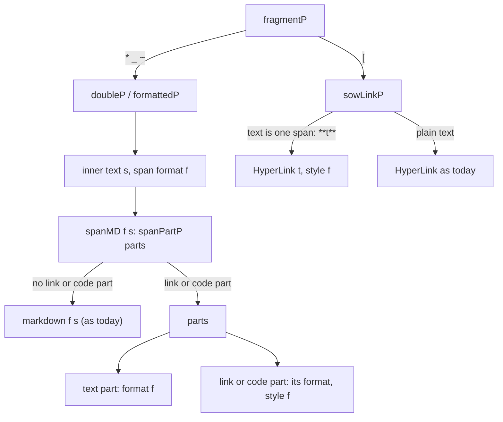
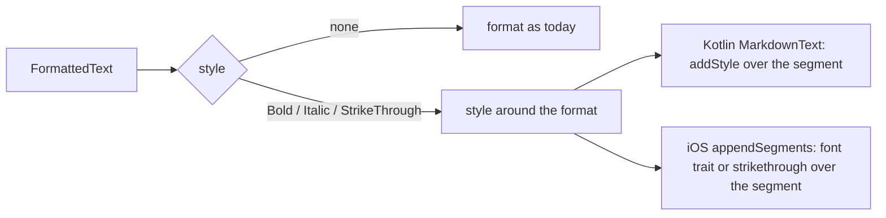

# Links inside bold, italic and strike-through

## Problem

`doubleP` and `formattedP` in `Markdown.hs` return the span's inner text as one segment and do not parse it again. A link inside a bold, italic or strike-through span stays styled source text. `sowLinkP` rejects link text with punctuation, so `[**t**](u)` is not a link either.

Parses on master, from the parser code:

| Source | Parse | Display |
|---|---|---|
| `**[t](u)**` | `Bold "[t](u)"` | bold source text |
| `*[t](u)*` | `Bold {singleStar} "[t](u)"` | italic source text |
| `_[t](u)_` | `Italic "[t](u)"` | italic source text |
| `~~[t](u)~~` | `StrikeThrough "[t](u)"` | struck source text |
| `**see [t](u) now**` | `Bold "see [t](u) now"` | bold source text |
| `[**t**](u)` | `"[**t**]("`, `Uri "u"`, `")"` | source text, the URL alone clickable |
| `**https://x.com**` | `Bold "https://x.com"` | bold text, not clickable |
| `` **`x`** `` | `Bold "`x`"` | bold text with backticks |
| `- **[t](u)**` | list mark, `Bold "[t](u)"` | as in a paragraph |
| `## [t](u)` | heading, `HyperLink` | bold link, works |
| `**Note:** [t](u)` | `Bold "Note:"`, `HyperLink` | works |

`[**t**](u)` falls to `wordP`: `linkAfterParen` finds the URL after `(`. List items and quotes parse their lines with `inlineLines`, so they behave as paragraphs.

## Options

| Option | Display | Cost |
|---|---|---|
| A: the link keeps the style | bold link | 4 h |
| B: the link drops the style | plain link | 1 h |
| C: general nesting | any combination | 12+ h |

- A: parser, one optional JSON field, Kotlin and iOS rendering.
- B: parser only. A segment has one format, so it holds the link. B covers only a span that is the whole link: `**[t](u)**`, `**url**` and `[**t**](u)`. The segment text keeps the source, so `markdownText` stays exact.
- C: a list of formats per segment, a recursive parser, and both renderers rebuilt around format stacks.

Recommendation: A.

## Questions

1. Does a link keep its bold, italic or strike-through? Recommended: yes (A).
2. Does A cover links inside a longer span, `**see [t](u) now**`? Recommended: yes, included in the 4 h.
3. Does A cover code inside a span, `` **`x`** ``? Recommended: yes, 0.3 h.

## Design (A)

### Wire

```
FormattedText
  format :: Maybe Format
  text :: Text
  style :: Maybe Format
```

- `style` is `Bold`, `Italic` or `StrikeThrough`.
- `style` is set only on link and code segments inside a span.
- `defaultJSON` omits `Nothing`, so every other segment is encoded as today.

`**see [t](u) now**`:

```json
[
  {"format": {"type": "bold", "singleStar": false}, "text": "see "},
  {"format": {"type": "hyperLink", "showText": "t", "linkUri": "u"}, "text": "[t](u)", "style": {"type": "bold", "singleStar": false}},
  {"format": {"type": "bold", "singleStar": false}, "text": " now"}
]
```

### Compatibility

- Messages carry text. Each core parses it on receipt and on load (`parsedCIContent` in `Store/Messages.hs`), so history shows the fix after an upgrade.
- The core and the UI ship together.
- Remote desktop accepts hosts and controllers from 7.1.0.16 (`minRemoteHostVersion`, `minRemoteCtrlVersion`). An older app ignores `style`: Kotlin `json` has `ignoreUnknownKeys = true`, and Swift `Decodable` skips unknown keys. It shows a plain clickable link.
- A new `Format` constructor fails in an older Kotlin app: `Format` is a sealed class without a default deserializer. A field avoids this.
- TypeScript client types and `bots/api/TYPES.md` get `style?: Format`.
- Bold links count in `hasLinks`. New messages with them are stored with `has_link = 1`, so the links filter of a chat shows them. History keeps its stored flag.
- `prohibitedSimplexLinks` already checks the raw text with `hasObfuscatedSimplexLink`, so its result does not change.

### Parser



- `spanMD` parses the inner text with `spanPartP` into `sowLinkP`, `autolinkP`, `codeSpanP` and words through `wordMD`. It parses no bold, italic or strike-through, so nesting stays one level.
- `sowLinkP` removes one span around the link text (`**t**`, `__t__`, `*t*`, `_t_`, `~~t~~`, `~t~`) with `linkTextStyle`. The punctuation check applies to the text inside. The segment text is `[t](u)`.
- `Markdown` gets the constructor `StyledMarkdown style format text`. `joinMarkdown` and `joinSegments` merge segments only when `format` and `style` are both equal.
- `markdownListText` replaces `T.concat . map markdownText` in `updatedMentionNames`. It wraps each run of one span once: `**see [t](u) now**`. `[**t**](u)` is written as `**[t](u)**`.

### Rendering



- Kotlin: `FormattedText.style`. `MarkdownText` adds `segmentSpanStyle` over the segment's range. `Bold {singleStar}` maps to italic, as for bold segments. Strike-through over a link combines underline and line-through.
- iOS: `FormattedText.style`. `appendSegments` adds the bold weight or the italic trait to every font in the segment's range, or sets `.strikethroughStyle`.
- Link sanitizing in the compose views keeps `style`.
- CLI (`Styled.hs`) shows the link format.
- Snapshot scenes: `ChatItemView.PreviewChatItemViewStyledLinks` (desktop) and `ClassicStyledLinks_Previews` (iOS).

### Tests

- `MarkdownTests`: each row of the table, a SimpleX link and an email inside bold, `markdownListText` round trips, `style` absent from the JSON of an unstyled segment.

## Cost (A)

| Part | Hours |
|---|---|
| Parser and tests | 1.5 |
| `style` field, JSON, `markdownListText`, constructor sites, TypeScript types | 1 |
| Kotlin | 0.5 |
| iOS | 0.5 |
| Code inside a span | 0.3 |
| Total | 4 |
