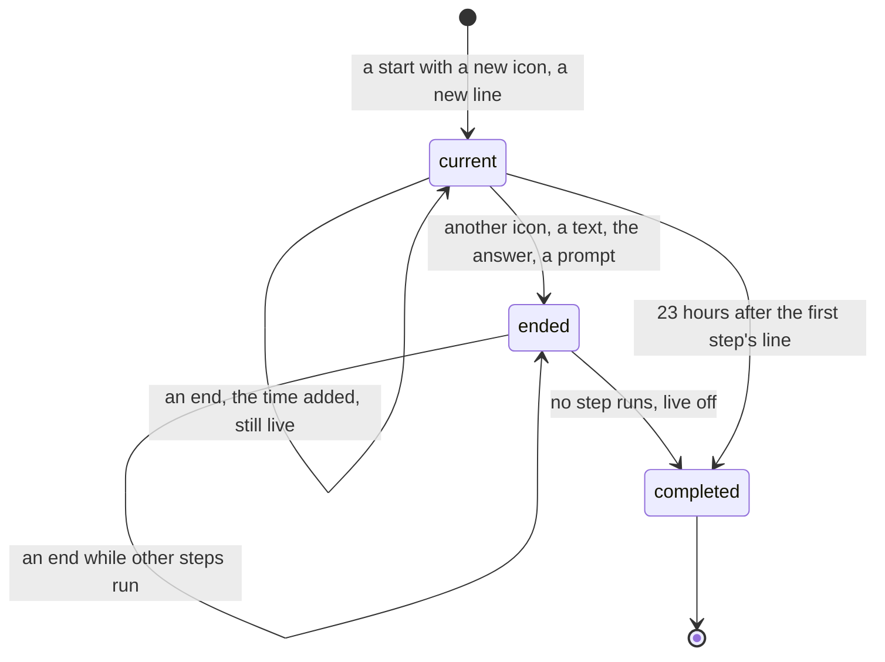

# Quieter and grouped step lines

Status: the user's rules of 2026-11-14, implemented on `ep/mcp-step-lines`, on top of `ep/mcp-session-usage` at `59ba3280b`. Changes the step lines of `plans/2026-11-12-mcp-activity.md`.

## 1. Rules

1. Icons: Edit and Write share ✏️, as `✏️ Edit PATH` and `✏️ Write PATH`. Grep, Glob and WebSearch share 🔍, as `🔍 Grep PATTERN in PATH` and `🔍 Search QUERY`.
2. A completed step has no ✅. Its time is in small print: `💻 Read how translated pages and their keys are defined !- 43 ms!`. A failure keeps ❌, an interruption ⏹️, and a launch in the background `(in background)`.
3. A step whose icon is the icon of the turn's last step line edits that line. The line shows the newest step's text, and in small print the count and the total time: `💻 TEXT !- 5 calls 2 s!`. It stays live while such steps follow each other. A step with another icon, a text of Claude's or the answer ends the group. With parallel calls, each start counts once, and each end adds its duration.

## 2. Decisions

1. The hook sends the step's text without an outcome. At the end it adds `ms`, from `duration_ms`, and `mark`: ❌, ⏹️ or `(in background)`. The hub formats the line with `stepLine`.
2. The icon is the first word of the step's text.
3. The hub keeps one current group per session: the group of the turn's last step line.
4. A start joins the current group when the icons match and the group's line was posted. Otherwise the current group ends, and the start posts a new line.
5. The first batch of a text of Claude's, an answer and a prompt that is not mid-turn end the current group.
6. An ended group's line is completed, live off, once none of its steps runs. A step that ends later in an ended group completes the line.
7. The line shows the marks of all ended steps of the group, after the newest step's text.
8. A single step's small print is its duration. A group of N steps shows `N calls` and the summed duration of its ended steps.
9. Step starts, step ends, the end of the steps and the expiry of lines run in the live posts' queue, in arrival order, with the text work.
10. A line 23 hours old by the wall clock is completed; its steps leave without being kept as finished, so a later end is posted as a new line.

## 3. Design

```
field                 type                          content
Session.stepGroup     StepGroup | undefined         the group of the turn's last step line
LiveStep.at           number                        start of the step's hook
LiveStep.sentAt       number                        wall-clock time of the send of the opening message or of the queueing
LiveStep.group        StepGroup | undefined         its group, set when the start runs in the queue
StepGroup.icon        string                        the first word of the steps' text
StepGroup.text        string                        the newest step's text
StepGroup.item        Promise<number | undefined>   the line's item ID
StepGroup.sentAt      number                        sentAt of its first step
StepGroup.count       number                        steps started in the group
StepGroup.open        number                        steps still running
StepGroup.ms          number | undefined            summed ms of the ended steps
StepGroup.marks       Set<string>                   marks of the ended steps
```

```
start(id, text):   icon = first word of text
                   current.icon = icon: current.text = text; count + 1; open + 1; update the line, live
                   else: endGroup(); current = new group, line = startLine(text), live
end(id, ms, mark): open - 1; ms added; mark added
                   group is current or open > 0: update the line, live
                   else: complete the line, live off
endGroup():        current = none; complete its line, live off, when open = 0
line:              text, marks, then small print: "N calls" when N > 1, duration(ms)
```



## 4. Tests

- `test/unit/hook.test.ts`: the icons ✏️ and 🔍, and the end of a step as `{id, text, end, ms, mark}`.
- `test/unit/sessions.test.ts`:
  - "shows a step's time in small print, keeps ❌ for a failure, ⏹️ for an interruption and (in background) for a launch, and drops ✅".
  - "groups the steps of one icon in one live line with the newest step's text, the count and the total time of the ended calls, until a step with another icon, a text of Claude's or the answer".
  - The step tests of `ep/mcp-activity` expect the time in small print and the line live until the group ends.
- `test/e2e/service.test.ts`: a second Bash use joins the line, `💻 Run the linter !- 2 calls 2.5 s!`, and the next prompt completes it, not edited.
- `TESTING.md` check 4: three Bash commands share one line; an edit and a write share one ✏️ line.
