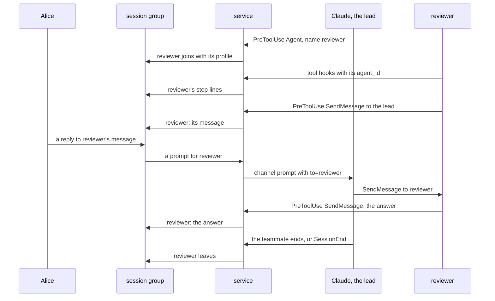
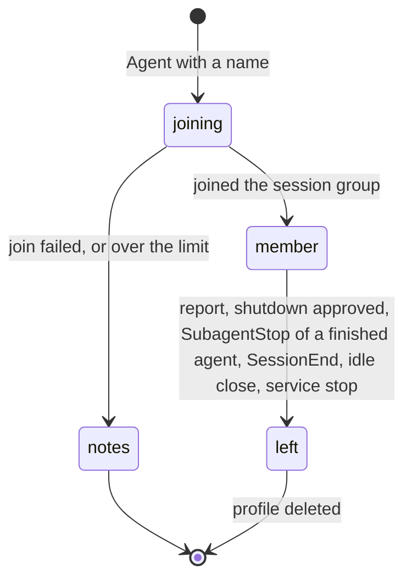

# Teammates as members of the session's group

Status: stage 1 implemented on 2026-11-14 with Q1 A and Q2 A, speculatively: profiles, messages to the lead, the final report, the leave, the cleanup and the limit. Steps come in stage 2, and addressing (Q3) in stage 3. The user answered two principles on 2026-11-14: a teammate's tool steps show under its own profile ("yes"), and people address a teammate directly by a reply or a mention ("yes, of course, that's the whole point"). Q1 to Q3 are open. Code references: master `27fd68441`, by file and function name. Claude Code: version 2.1.322, its binary in `~/.local/share/claude/versions/`, the team folder `~/.claude/teams/session-420d62b8` and the subagent records of session `420d62b8` on this machine.

## 1. Goal

The user, 2026-11-14, after hearing that teammate messages show as notes from Claude: "No, teammates should all get profiles."

Outcome:
- Each teammate of a Claude Code session is a member of the session's group, with its own agent profile: its name, the agent avatar and its task as the description.
- Its messages, its tool steps and its reports appear under its profile, in place of Claude's `✉️ Message from NAME` notes.
- A person replies to a teammate's message, or mentions it, and the message reaches that teammate.
- The teammate leaves the group when it ends.

## 2. What users see

Words: a teammate is a named agent that a session starts with the `Agent` tool in its team (`taskKind` `in_process_teammate`); it lives across many turns and talks with `SendMessage`. A subagent is an unnamed agent that hands back one report (Q1).

```
moment                                today                                          after
the lead starts teammate "reviewer"   Claude's step line: Agent: Review the diff     reviewer connected; its card: reviewer, agent,
                                                                                     "Review the diff of #8204"
reviewer runs a tool                  nothing                                        reviewer's step line in small print
reviewer sends to the lead            Claude: ✉️ Message from reviewer: SUMMARY      reviewer: the whole message
the lead sends to reviewer            Claude's step line: SendMessage                Claude: @reviewer and the message
a person replies to reviewer's        a prompt to the lead                           the message reaches reviewer through the lead;
message, or writes @reviewer                                                         reviewer's answer appears under its profile
reviewer goes idle                    nothing (idle notifications get no note)       nothing
reviewer's final report               Claude: ✉️ Message from reviewer: SUMMARY      reviewer: the report
reviewer ends, or the session ends    nothing                                        reviewer left
```

Texts:
```
profile name          the teammate's name, made valid as a display name; a second teammate with a taken name gets "-2"
profile description   the Agent call's description, at most 160 characters
peer type             agent (ChatPeerType.Agent), so the apps show the agent avatar
role in the group     member: it sends; approvals and commands stay with admins and owners
rights post           none for a teammate (Session.announceRights skips it, as it skips User)
the lead's message    @NAME TEXT, as Claude
a person's message    unchanged in the group; Claude gets it with to="NAME" and forwards it
```

The mockup: `scratchpad/roadmap/img/teammates-group.png`, a session group with Alice, Claude and the teammates reviewer and tester.



## 3. Questions for the user

Answered on 2026-11-14: steps under the teammate's profile, yes; people address a teammate directly, yes.

Q1. Which agents get a profile?
- A, recommended: named teammates only. In session `420d62b8`, 118 named teammates lived a median of 225 minutes; the 21 other subagents lived a median of 2 minutes and hand back one report, which stays Claude's `📋 Report from subagent NAME` note.
- B: every subagent. A member joins and leaves for each two-minute agent; each join connects it with every member.

Q2. How long does a teammate stay a member?
- A, recommended: until it ends or its session ends; then it leaves, and its profile is deleted. Its messages stay in the group.
- B: it stays as a member while the group exists. The member list grows with every teammate of the session.

Q3. How does a person's message reach a teammate? Claude Code delivers a message to a teammate only through the team's mailbox, which `SendMessage` writes (facts 6, 7).
- A, recommended: through the lead. The service passes the message to the lead as a channel prompt with `to="NAME"`, and the lead forwards it with `SendMessage`. It uses Claude Code's documented tools. Cost: the lead forwards it in its current turn, or in a turn of its own while it is idle.
- B: the service writes it into the teammate's mailbox file. It skips the lead. Cost: the file is Claude Code's internal storage, written under its own lock and schema checks; a write from outside can be lost or refused, and a Claude Code update can change the format.

## 4. Decisions

Facts:
1. Claude Code reports subagents to hooks: `SubagentStart` with `agent_id` and `agent_type`; `SubagentStop` with `agent_id`, `agent_type`, `agent_transcript_path` and `last_assistant_message`; `TeammateIdle` with `teammate_name` and `team_name`. A subagent's tool hooks carry its `agent_id` and `agent_type` (binary 2.1.322; `ep/mcp-activity`, fact 1). The plugin registers none of the subagent hooks (`hooks/hooks.json`) and skips tool hooks with `agent_id` (`stepOf` in `hook.ts`).
2. The `Agent` tool's input has `name`, `description`, `prompt`, `subagent_type` and `run_in_background`.
3. Each subagent has `subagents/agent-ID.meta.json` in the session's folder: `agentType`, `name`, `description`, `taskKind`, `teamName`, `color`, `toolUseId`, `spawnDepth`. For this session's teammates, `agentType` is the teammate's name, `taskKind` is `in_process_teammate` and `teamName` is `session-420d62b8`.
4. Session `420d62b8` has 118 named background teammates, living a median of 225 minutes (90th percentile 35 hours), and 21 other subagents, living a median of 2 minutes.
5. A teammate's message reaches the lead as a prompt `Another Claude session sent a message:` with `<teammate-message teammate_id="NAME" summary="...">`; the plugin posts it as Claude's note `✉️ Message from NAME: SUMMARY`, and nothing for idle notifications (`teammateNote` in `hook.ts`).
6. Teammates talk through a file mailbox: `~/.claude/teams/TEAM/inboxes/NAME.json`, a list of `{from, text, summary, timestamp, msgV, msg_id, type, read}`; `config.json` lists the team's members with `name`, `agentType`, `model`, `prompt`, `color` and `joinedAt`. Claude Code writes the mailbox through its own update with schema checks (`[TeammateMailbox] writeToMailbox`, `refused mailbox write` in the binary).
7. A message from outside a Claude Code session reaches its main conversation only: a channel notification goes to the session, and a cross-session message is delivered to the session's conversation, not to its agents (the `SendMessage` tool's description).
8. The `User` profile is a second chat core in `ROOT/_user` (`User.open`, `openCore` in `core.ts`), with peer type human; Claude's profile has peer type agent (#8179).
9. Steward runs many profiles in one chat core and switches the active user before each command, in one queue (`Profiles.asUser` in `/code/steward/src/profiles.ts`).

Facts found in stage 1:
- F1. An interactive session of Claude Code 2.1.325 on 2026-11-14, with hooks from `--settings`, showed for a teammate of its team: SubagentStart with `agent_type` equal to the teammate's name; the teammate's PreToolUse and PostToolUse of Bash and `SendMessage` with its `agent_id` and that `agent_type`; SubagentStop at the end of each of its turns, with `last_assistant_message`; TeammateIdle; and no UserPromptSubmit for its message to the lead, which reached the lead's transcript as a user entry with the turn's prompt ID. The teammate's record had `taskKind` `in_process_teammate` and no `finished`. Its approved shutdown was its PostToolUse of `SendMessage` with `type` `shutdown_response` and `approve` true.
- F2. A named agent in a `claude -p` run was a background subagent: its record had `finished: true` after its end, and its report was its `SubagentHandback` call, which reached the lead as a prompt with the origin `peer` and `handback`, before SubagentStop.

Choices:
10. A teammate is recognized at the lead's `PreToolUse` of `Agent` with a `name`; its record is `subagents/agent-ID.meta.json` (fact 3), matched by `agent_type` and `name` at `SubagentStart`.
11. The service keeps the teammates' profiles in one more chat core, `ROOT/_sessions/ID/agents`, one user per teammate, with Claude's commands for it run in one queue that switches the active user, as steward's `Profiles` (fact 9). One core for all teammates of a session, not one per teammate.
12. A teammate's profile joins the session's group as a member: Claude invites it through a contact made at its start, as `User.connect` connects `User`, and it joins at once. Its posts wait until it has joined.
13. Steps: the hook sends a step of a tool hook with `agent_id` to the service with the teammate's name, and the service posts it under the teammate's profile, as Claude's steps (`stepOf`).
14. Messages: the hook sends a teammate's delivered `PostToolUse` of `SendMessage` to `team-lead` with its `message` and `summary`, and a subagent's `SubagentHandback` as its report (F1, F2); the service posts them under the teammate's profile. The lead's prompt with the same message or report, where Claude Code runs UserPromptSubmit for it, is posted once. The lead's `SendMessage` to a teammate is posted by Claude as `@NAME TEXT`, with the teammate mentioned.
15. Claude's note `✉️ Message from NAME` is not posted for a teammate that has a profile.
16. A person's reply to a teammate's message, or a message that mentions a teammate, is a prompt for the lead with the meta key `to`, the teammate's name. The channel instructions say: "A message with to is for that teammate: forward it unchanged with SendMessage." The lead's forward is not posted again.
17. A teammate's profile leaves the group and is deleted at its report, 10 s after its approved shutdown or the `SubagentStop` of a subagent whose record has `finished: true`, at the end of its session (`SessionEnd`), at the session's idle close and at the service's stop. A service start removes the teammates that an earlier run left in the session groups.
18. Limits: at most 20 teammate members in a group at once, because each member connects with every other member and delivery receipts stop at 20 members (`smallGroupsRcptsMemLimit`, as steward's subagent plan states). A teammate over the limit keeps Claude's notes, and Claude posts `Teammate NAME has no profile: this group has 20 teammates.`



## 5. Design

Options for the profiles:
```
option                                     cost
P1. one more core, one user per teammate   one core for all teammates of a session; commands in one queue
    (chosen)
P2. one core per teammate                  a database, SMP connections and workers for each teammate
P3. teammate users in Claude's core        every tool command of Claude would switch the active user with them
```

Options for a person's message to a teammate: Q3.

Changes:
```
file                  change
hooks/hooks.json      SubagentStart, SubagentStop, TeammateIdle, SessionEnd: hook turn, async
src/hook.ts           teammate start from Agent with name; steps and SendMessage with agent_id and the name
src/protocol.ts       TurnRequest: teammate {name, description, start, end}, step and message of a teammate
src/teammates.ts      new: the core of the session's teammates, the queue of users, join, post, leave
src/hub.ts            Session: teammates; posts of teammates; prompts with to; no note for them
src/session.ts        channel instructions; meta key to
```

## 6. Compatibility

- Older apps show a teammate as a member with a profile; the agent avatar needs the apps of #8179.
- A teammate started before the update keeps Claude's notes until it ends.
- Plugin data folders: `ROOT/_sessions/ID/agents` is new; it is removed with the session's folder.

## 7. Acceptance and tests

- Unit: a teammate's start, steps, messages and end make the requests of decisions 10 to 17; a reply to a teammate's message reaches the lead with `to`; the limit of decision 18.
- End-to-end: a teammate profile joins the session group, posts a step and a message, and leaves.
- Real session (TESTING): a lead starts two teammates; their steps and messages appear under their profiles; a reply to one reaches it; both leave at the end. It also records that the tool hooks of an in-process teammate carry its `agent_id` and `agent_type`.

## 8. Docs to change

`README.md`, `REFERENCE.md` (teammates in the group, how to address them), `spec/api.md`, `spec/architecture.md`, `spec/flows.md`, `TESTING.md`; `ROADMAP.md` gets the line "- ✅ Each teammate of a session is a member of its group" when it ships.

## 9. Conflict areas

`src/hook.ts` (`stepOf`, `teammateNote`), `src/hub.ts` (`Session.turn`, `Session.post`), `hooks/hooks.json`, `src/session.ts` (`channelInstructions`): the items in flight that change the hooks, the steps and the channel instructions. The threads plan (`ep/mcp-threads`, section 6) maps subagents onto sessions and threads later; this item gives teammates profiles in today's session groups.

## 10. Estimate

About 6 hours of implementation and tests, and 2 hours of review, after Q1 to Q3.
