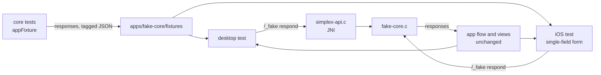

# App tests against a fake core

Repository: simplex-chat/simplex-chat.
Branch: `ep/app-tests-fake-core`.
Base: master `88767bbc3` (#8220).

The user's words:

> you must be testing on the view level, as much as possible, with mocked API. So the question that must have been answered is how to make existing views to use mocked api responses

> yes, that makes the most sense, as it injects app mock api into one place

> excellent, no e2e tests, we produce fixtures in core tests, and then use it in UI tests if UI code changed or if UI fixtures changed

## 1. Problem

The views of the apps are tested only as previews with sample data.
A change of a core response, or of a view that shows it, is checked by hand.

## 2. Solution

- Core tests record core responses as fixtures.
- A fake core implements the C interface of the core and answers with the fixtures that a test gives it.
- App tests run existing flows unchanged against the fake core, and read what users see.



## 3. Decisions

Status: draft; the experiments of section 6 settle the facts marked "exp".

### D1. The fake core

| Option | Cost |
|---|---|
| **C, one file for both apps, compiled by clang for the simulator and by cc for desktop** | about 250 lines |
| Swift for iOS and C for desktop | two implementations of one interface |
| Haskell | the iOS cross-build of the core, 30–45 min |
| The real core answering recorded commands | an end-to-end setup |

File: `apps/fake-core/fake-core.c`.

### D2. The C interface

| Function | Answer |
|---|---|
| `hs_init`<br>`hs_init_with_rtsopts` | nothing |
| `chat_migrate_init`<br>`chat_migrate_init_key` | sets the controller; the response of `chat_migrate_init` |
| `chat_close_store`<br>`chat_reopen_store` | `""` |
| `chat_send_cmd_retry`<br>`chat_send_remote_cmd_retry` | a control command, or the response of the command |
| `chat_recv_msg_wait`<br>`chat_recv_msg` | the next event, or `""` after the wait |
| `chat_parse_markdown`<br>`chat_parse_server`<br>`chat_parse_uri`<br>`chat_valid_name`<br>`chat_password_hash`<br>`chat_parse_badge_code`<br>`chat_json_length` | the response of `<function> <first argument>` |
| `chat_write_file`<br>`chat_read_file`<br>`chat_encrypt_file`<br>`chat_decrypt_file`<br>`chat_encrypt_media`<br>`chat_decrypt_media`<br>`chat_resize_image*` | unanswered |

- A response is found by the longest key that equals the request, or that is followed in it by a space.
- An unanswered request is recorded; the call returns the failure value of the real core.
- Each test ends by reading the unanswered requests, and fails naming them.

### D3. How a test gives responses

| Option | Cost |
|---|---|
| **Control commands through `chat_send_cmd_retry`** | no bindings in either app |
| Functions `chat_fake_*` | a bridging header in the iOS test target, JNI wrappers for desktop |
| Files read by the fake core | JSON parsing in C; the iOS form on disk before the app launches |

Control commands:

```
/_fake respond <key>\n<response>
/_fake event <event>
/_fake unanswered
```

### D4. The iOS form

Facts:
- `sumTypeJSON` is the single-field form only under `darwin_HOST_OS` and `swiftJSON` (simplexmq `Parsers.hs`); core tests run on Linux.
- The tagged form converts to the single-field form object by object, for the types of `sumTypeJSON`.
- Seven types that iOS decodes have a `type` key in both forms: `MsgContent`, `MsgReaction`, `MsgChatLink`, `ChatBotCommand`, `StatementEntryType`, `StatementCreditType`, `StatementDebitType`.
- Their tags are also tags of `sumTypeJSON` types (`command`, `contact`, `group`, `invitation`, `unknown`), so they are found by the key that contains them.

| Option | Cost |
|---|---|
| **One recorded set, converted by the iOS test, the keys of the seven types kept** | about 40 lines of Swift |
| Both forms written by the core tests | the same converter in Haskell, every fixture twice |
| The single-field form from a core built with `swift` | a macOS core test build, 30–45 min |

A wrong conversion fails decoding, and the test fails naming the response.

### D5. iOS: linking and launch

- `scripts/ci/ios-stub-libs.sh` compiles `fake-core.c` in place of the empty stubs.
- A new unit-test target, hosted by the app, runs in the iOS job.
- The app launches before a test gives responses; its migration call is unanswered.
- The test gives the launch fixture, then calls `resetChatCtrl()` and `initChatAndMigrate()`, the launch path of `SimpleXApp`.

| Option | Cost |
|---|---|
| **The launch repeated by the test** | no app change |
| Launch responses read by the fake core from files | as D3 |
| An argument that delays the app's launch | an app change |
| A UI test target | out of process; files on disk; about 10 s per launch |

### D6. Desktop and Android

- A Gradle task of `common` compiles `simplex-api.c` and `fake-core.c` into one JNI library.
- The test loads it with `System.load`, gives the launch fixture and calls `initChatController()`.
- App tests run in their own Test task, so that `ChatModel` state does not reach other tests.
- Android later: instrumented tests need an emulator, which runs only in `android-emu`; the shared Kotlin code is tested on desktop.

### D7. Running a flow and reading what users see

| | iOS | Desktop |
|---|---|---|
| Flow | `planAndConnect(...)` | `planAndConnect(...)` |
| Alert | the view controller of `getTopViewController()` | `AlertManager` hosted by `runComposeUiTest` |
| Read | title, message, action titles; labels and buttons of a custom alert | texts of the semantics tree, in order |

### D8. Fixtures

- File: `apps/fake-core/fixtures/<area>/<name>.json`, an object from request keys to responses.
- Written by `appFixture` in core tests, with `testGenerate`: a test fails when its file changes.
- Launch: written by a mobile test from `chatMigrateInit` and `chatSendCmd`, for the launch commands of both apps.

### D9. CI

- iOS: steps in the iOS job; desktop: the Kotlin step.
- Scopes: `apps/fake-core/**` starts the kotlin and ios scopes.
- Durations: exp.

## 4. First use: name alerts

| Fixture | Name | Local chat |
|---|---|---|
| error-expired | others' | — |
| error-available | others' | — |
| error-reserved | others' | — |
| error-not-registered | others' | — |
| plan-known-expired | others' | contact |
| plan-known-available | others' | contact |
| plan-known-reserved | others' | contact |
| plan-known-moved | others' | contact |
| plan-own-expired | own | own address |
| plan-own-available | own | own address |

Each test opens the name with `planAndConnect` and compares the alert's title, message and buttons with literal English text.

## 5. Steps

1. Fake core and its builds.
2. Core: `appFixture`, the launch fixture, the name fixtures.
3. Desktop: the Gradle task, the Test task, the name alert tests.
4. iOS: the test target, the converter, the name alert tests.
5. CI: steps, globs, scripts/ci/README.md.
6. Specs and guides of both apps.

## 6. Experiments

To be run on `ep/app-tests-exp-<n>`:
- the iOS app launches in a hosted test with the fake core;
- a desktop test calls the JNI functions of the fake core;
- both apps decode the recorded launch and name responses, and show the name alerts;
- the durations of the CI steps.
