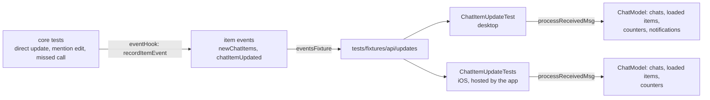

# App tests of item updates on core recordings

Repository: simplex-chat/simplex-chat.
Branch: `ep/update-event-fixtures`.
Base: `ep/update-prev-item` (#8219), master after its merge.

The user's words:

> in #8234 we added approach to UI code testing via API fixtures prepared and tested in core. I think it would fit here too. We can merge the current PR and add tests and any other fixes in the next one

## Composition

## Recording

`tests/ChatTests/Utils.hs`:

| Function | Mechanics |
|---|---|
| `recordItemEvent events evt` | appends `newChatItems` and `chatItemUpdated` to `events`, encoded as `chatRecvMsg` encodes them |
| `eventsFixture fixture events steps` | clears `events`, runs `steps`, writes `events` as one JSON array |
| `writeFixture` | creates the directory of the fixture |
| `stableJSON` | `itemTs` replaced by 1970-01-01 `itemSharedMsgId` replaced by its key |
| `rosterVersionByName cc group` | the group's `roster_version` |

The recipient of each recording has `markRead = False`, so items stay unread, as in an app before the chat is opened.

| Fixture | Core test | Events of the recipient |
|---|---|---|
| updates/direct-edit | updated item event has the previous item | new "hello" "hello" edited to "hello there" new "how are you" "hello there" edited to "hello, alice" |
| updates/direct-recreated | the same test, after the recipient deletes the item locally | new "hello again", recreated from the update |
| updates/group-mention | should send updated item with mentions added and removed by edit | new "hello" edited to mention the recipient edited without the mention |
| updates/missed-call | mark call invitation missed when the caller ends the call | new pending call the call updated to missed |

## Tests

Each test lists the chat of the first event without items, receives the events with `processReceivedMsg` and compares the model.

| Test | Fixture | Checked | Apps |
|---|---|---|---|
| edit replaces loaded item | direct-edit | the open chat has "hello there" in place of "hello"; the preview is "hello there" | both |
| update of item not loaded inserts nothing | direct-edit | the chat opened after "hello" has no loaded items after the edit; the preview changes only while the edited item is the last one | both |
| counters follow previous and new item | group-mention | unread, mentions and the profile's unread: 1 0 1, 1 1 1, 1 0 1 | both |
| recreated item is counted | direct-recreated | the preview is "hello again"; 1 0 1; Kotlin: one notification | both |
| edit in another profile does not notify | direct-edit | one notification, of "hello"; the other profile's unread is 1 | Kotlin |
| missed call does not notify | missed-call | the preview is the missed call; no notification | Kotlin |
| missed call in another profile does not notify | missed-call | no notification; the other profile's unread is 1 | Kotlin |
| response and event decode to their fields | direct-edit | the update event has `chatItemUpdate` with the previous item | Kotlin |

Notifications are checked in Kotlin only: iOS `NtfManager` has no hook.

## Missed calls

`chatItemUpdateNotify` notifies only in the active profile, when the update added the chat. Its missed call branch is removed: `notifyMessageReceived` displays nothing for `RcvCall`, whose `showNotification` is false, since #5328. The spec line of `notifyMessageReceived` states the same.

## iOS

- `singleFieldJSON` converts tagged objects except `MsgContent`, which the core encodes with `type` in both JSON forms.
- `fixtureJSON`, `singleFieldJSON` and `waitFor` are at file scope of `NameAlertsTests.swift`, shared by both test classes.
- the debounced unread collector is awaited by `assertCounts`.

## macOS failure of master

`names/plan-other-kind` recorded bob's channel with `"rosterVersion": 0` on Linux and without it on macOS. The relay serves the roster to a subscriber after the join (`serveRoster`); the subscriber sets `roster_version` when the roster is complete (`rosterCompletion`, `setGroupLiveRoster`), with no event. `joinChannelByName` waits until bob's roster version is 0, so `names/search-team` and `names/plan-other-kind` record it on every run.
