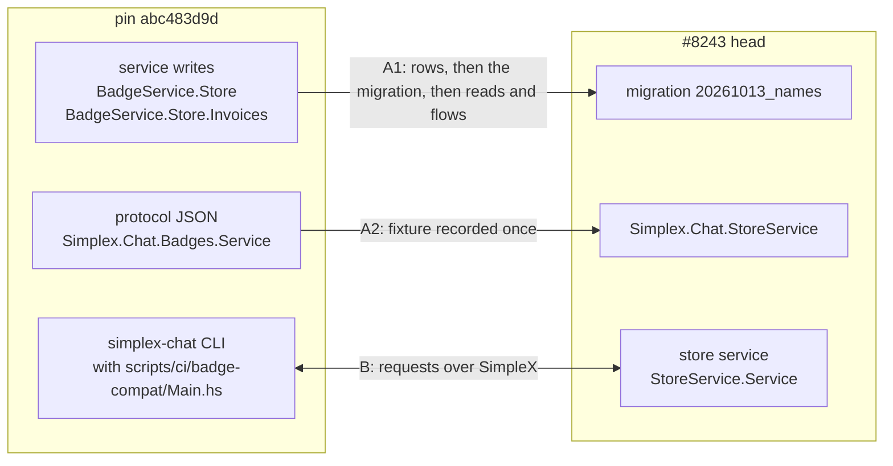
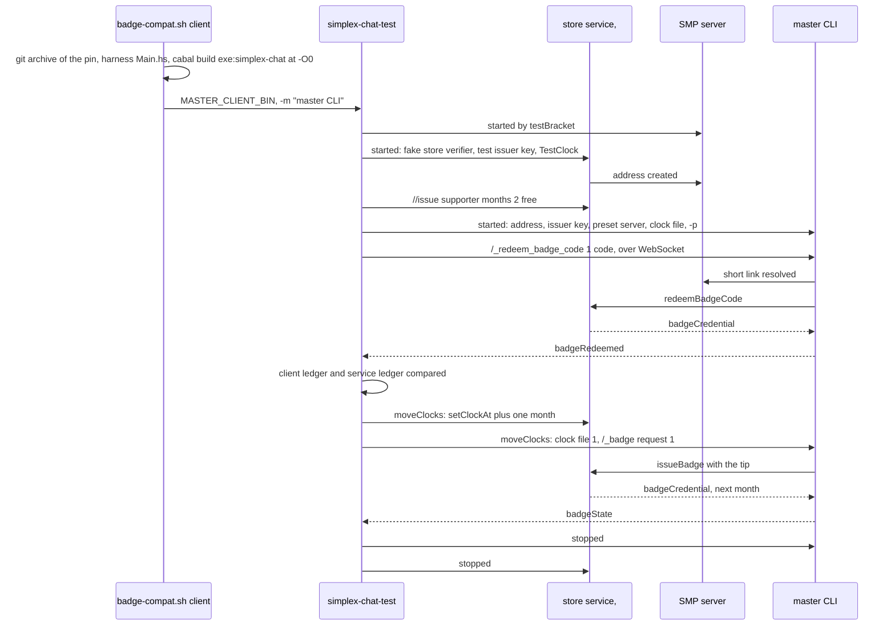

# Badge cross-version runs

Repository: simplex-chat/simplex-chat.
Branch: `ep/badge-compat-run`, on the fork only, never a pull request.
Base: `ep/names-review-fixes` (#8243).
Pin: master `abc483d9d`, the merge base of #8243.

The owner's words:

> could we maybe run cross-version badge tests somehow?

> I propose both A and B - CLI from master talking to service from 8243 (after we complete it). The opposite is not important - new clients won't talk to old service, and this branch doesn't change client anyway (other than via shared types).

> A1, A2, and B - not as tests in code, but as tests you run

The runs count on #8243's final head, after the badge reverts.

## Composition



| Part | Test | Backend |
|---|---|---|
| A1 | `Bots.StoreService.BadgeCompatTests`, "master rows" | SQLite, PostgreSQL |
| A2 | `BadgeTests`, "service protocol JSON" | - |
| B | `Bots.StoreService.BadgeCompatTests`, "master CLI" | SQLite |

## Pin

- `scripts/ci/badge-compat.sh` holds `MASTER`, the full hash of `abc483d9d`.
- `git diff v7.1.0 abc483d9d -- src/Simplex/Chat/Badges src/Simplex/Chat/Store/Badges.hs src/Simplex/Chat/PaymentService.hs src/Simplex/Chat/PaymentService` is empty.
- `git diff abc483d9d ddcdc1b50 -- src/Simplex/Chat/Badges src/Simplex/Chat/Store/Badges.hs src/Simplex/Chat/PaymentService.hs src/Simplex/Chat/PaymentService apps/simplex-badge-service` is empty.

## A1. Master's badge rows under the names migration

Module: `tests/Bots/StoreService/BadgeCompatTests.hs`.
Registered in tests/Test.hs under "SimpleX store service e2e", as `describe "master compatibility"`.

Sequence:
1. The service's chat database is created, as `withStoreServiceVerifierIO` creates it.
2. The service migrations of `storeServiceSchemaMigrations` up to `20261012_badge_subscriptions` are applied by `migrateDBSchema` with the table `sx_badge_service_migrations`, as `runStoreServiceMigrations` applies them.
3. The rows are inserted by master's statements.
4. The service is started on the database; `runStoreServiceMigrations` applies `20261013_names`.
5. Every row is read back.
6. Each flow is run on the migrated rows.

`withSeededStoreService` is `withStoreServiceVerifierIO` with the seed of steps 2 and 3 as a parameter, given the service's options and issuer key; `withStoreServiceVerifierIO` calls it with a seed that writes nothing.

Master's statements:
- the SQL text of each writer below, copied from the pin, with the pin's CPP branches for PostgreSQL;
- values of app types as literal texts of the pin's encoders, listed below;
- timestamps, integers and bytes as values of the database library;
- credentials as JSON of credentials issued with the test issuer key.

`Store`, `Store.Invoices` and `Catalog` are `BadgeService.Store`, `BadgeService.Store.Invoices` and `BadgeService.Catalog` at the pin, and `StoreService.Store` and `StoreService.Store.Invoices` on the branch.

Encoders of the literal texts, at the pin:
- `Store.Invoices.invoiceStatusText`
- `Store.Invoices.paymentStatusText`
- `Store.Invoices.itemStatusText`
- `Store.Invoices.cryptoCurrencyText`
- `Simplex.Chat.Badges.Ledger.entryTypeColumns`
- `textEncode` of `BadgeType`
- `textEncode` of `BadgeCodePaymentStatus`
- `textEncode` of `BadgePurchaseStatus`
- `textEncode` of `PaymentProvider`
- `textEncode` of `SubscriptionState`

| Table | Writer at the pin | Rows |
|---|---|---|
| badge_prices | `Store.Invoices.seedCatalog` | the prices of `Catalog.defaultCatalog` |
| badge_offers | `Store.Invoices.seedCatalog` | the offers of `Catalog.defaultCatalog` |
| badge_codes | `Store.insertBadgeCode` | free, single use, redeemed |
| badge_codes | `Store.insertBadgeCode` | paid, three uses, one redeemed |
| badge_codes | `Store.insertBadgeCode` | free, revoked by `Store.revokeCode` |
| badge_codes | `Store.Invoices.createInvoiceRows` | unpaid, of an open invoice |
| badge_codes | `Store.Invoices.markCodePaid` | paid, its deadline passed |
| badge_codes | `Store.setCodeGroupItem` | with a group item |
| invoices, badge_code_invoices | `Store.Invoices.createInvoiceRows` | btc, open |
| invoices, badge_code_invoices | `Store.Invoices.createInvoiceRows` | xmr, part paid |
| invoices, badge_code_invoices | `Store.Invoices.createInvoiceRows` | card, paid by `updateInvoiceStatus` |
| invoices, badge_code_invoices | `Store.Invoices.createInvoiceRows` | btc, expired by `expireOverdue` |
| invoices, badge_code_invoices | `Store.Invoices.createInvoiceRows` | card, cancelled by `cancelOpenInvoice` |
| payments | `Store.Invoices.upsertPayment` | the xmr part payment |
| payments | `Store.Invoices.upsertPayment` | the card payment, settled |
| payments | `Store.createStorePurchase` | google, one time |
| payments | `Store.createStorePurchase` | google subscription, with a token |
| payments | `Store.createStorePurchase` | apple subscription |
| payments | `Store.stampSubscriptionCheck`<br>`Store.setSubscriptionState` | the apple subscription, checked, cancelled |
| payments | `Store.rebindStorePayment` | the google subscription, moved |
| badge_purchases | `Store.createCodePurchase` | of the redeemed codes |
| badge_purchases | `Store.createStorePurchase` | of the store payments |
| badge_purchases | `Store.rebindStorePayment` | the moved subscription's new purchase |
| badge_purchases | `Store.setPurchaseBadgeType` | the apple purchase, legend |
| badge_ledger | `Store.appendLedgerPlan` | every credit type and every debit type |
| badge_issuances | `Store.appendLedgerPlan` | a current and a past month |
| subscription_charges | `Store.insertSubscriptionCharge` | an apple and a google charge |
| group | `Store.insertManagedGroup`<br>`Store.markOwnerBootstrapped` | one group, owner set up |

Read back after the migration:

| Table | Reader on the branch | Checked |
|---|---|---|
| badge_prices<br>badge_offers | `Store.Invoices.readCatalogRows` | every row, equal to the inserted values |
| badge_codes | `Store.getBadgeCode`<br>`Store.getCodeTracker` | every field of every code |
| invoices | `Store.Invoices.getInvoice` | every invoice, product badge |
| invoices | `Store.Invoices.getInvoiceByProviderRef` | every provider ref of badge_code_invoices |
| invoices | `Store.Invoices.unpaidRefs` | every invoice other than the paid one |
| payments | `Store.getStorePaymentCredit`<br>`Store.getPurchaseSubscription` | every store payment |
| badge_purchases | `Store.getPurchaseByKey`<br>`Store.getCodePurchaseForKey` | every purchase key |
| badge_ledger | `Store.getLedgerEntries` | every entry, equal to the inserted entries |
| badge_issuances | `Store.getCurrentIssuance` | the current credential |
| subscription_charges | `Store.getSubscriptionCharge` | both charges |
| group | `Store.getManagedGroup` | the group |
| all | `Store.badgeCounts` | the counts of the inserted rows |

Flows on the migrated rows:

| Flow | Request | Checked |
|---|---|---|
| the redeemed single-use code again, by its purchase key | `serviceCmd` redeemBadgeCode | the stored credential and statement |
| the second use of the three-use code | `serviceCmd` redeemBadgeCode | a credential; redeem_count 2 |
| the revoked code | `serviceCmd` redeemBadgeCode | code_invalid |
| the code past its deadline | `serviceCmd` redeemBadgeCode | code_expired |
| renewal of a code purchase, current month | `serviceCmd` issueBadge, the stored tip | the stored credential |
| renewal one month later, by `setClockAt` | `serviceCmd` issueBadge | a new credential and its rows |
| the google one-time payment again, by its purchase key | `serviceCmd` purchaseBadge | the stored credential |
| the moved subscription, old key | `serviceCmd` issueBadge | credential absent, subscription ended |
| the open btc invoice | `webApp` GET /api/invoice/{id} | its view |
| the open btc invoice settled | the provider's settled answer, one poller pass | status paid, its code paid |
| the part paid xmr invoice | `webApp` POST /api/invoice/{id}/cancel | funded |
| a revoke of the three-use code | `//revoke` | revoked, one use left unspent |

The web flows use `withListener` of WebTests over the service's store, with WebTests' `stubProvider` for crypto and for card invoices, as WebTests' poller tests do.

## A2. Protocol messages recorded from master

Fixture: `tests/fixtures/store-service/badge-protocol.json`.
Test: tests/BadgeTests.hs, group "service protocol JSON", item "encodes and decodes every message a released client sends or reads as master does".

The test:
- builds each message from fixed keys, codes, times, credential bytes and texts;
- writes the object of all messages by `writeFixture`, whose `testGenerate` fails on a difference;
- decodes each message of the file with the branch's types and checks that its encoding equals the file's value.

Messages, by key:

| Key | Message |
|---|---|
| redeemBadgeCode | request, version 1, purchaseKey, redeemBadgeCode |
| purchaseBadge.google | request, purchaseBadge, google payment |
| purchaseBadge.apple | request, purchaseBadge, apple payment |
| transferBadge.google | request, transferBadge, google payment |
| transferBadge.apple | request, transferBadge, apple payment |
| upgradeBadgeSubscription | request, upgradeBadgeSubscription, apple payment, balance |
| issueBadge | request, issueBadge, balance |
| badgeCredential.full | answer, credential, receipt, statement of every entry type, subscription renewing |
| badgeCredential.empty | answer, credential and receipt absent, previousEntryId |
| badgeCredential.subscription.{state} | answer for each of `SSRenewing`, `SSCancelled`, `SSBillingRetry`, `SSEnded`, `SSUnknown` |
| error.{code} | answer for each error code of the pin, and an unknown code |
| error.retryAfter | answer with message and retryAfter |

Recorded from the pin:
1. Fork branch `ep/badge-protocol-master` from `abc483d9d`, with the same test in the pin's names (`BadgeServiceRequest`, `BSC`, `BSP`, `BSE`) and the fixture file, empty. The pin's `writeFixture` writes under tests/fixtures/api, so the pin's test writes `../store-service/badge-protocol`.
2. A dispatch of build.yml with tests `/Supporter badges/service protocol JSON/` on c0ea7ff79: the test wrote the fixture and failed on the empty file (run 45064570242); the artifact `generated-files-ubuntu-22.04-ghc9.6.3` held the fixture.
3. The fixture committed as fa0b97382; a second dispatch passed on it (run 45065608414).
4. The same file committed on this branch.

## B. Master's CLI against the store service

### Client

`scripts/ci/badge-compat/Main.hs` replaces apps/simplex-chat/Main.hs of the pin's tree.
It runs `simplexChatCLI cfg (Just simplexChatServer)` with `cfg` = `terminalChatConfig` and:

| Field | Value |
|---|---|
| badgeServiceAddress | `STORE_SERVICE_ADDRESS` |
| badgePublicKeys | `BADGE_ISSUER_KEY`, the key, at every index of the pin's `badgePublicKeys` |
| shortLinkPresetServers | `SMP_PRESET_SERVER` |
| badgeCurrentTime | the current time plus the months in the file `BADGE_CLOCK_FILE`, by `addMonths` of Simplex.Chat.Badges.Ledger |
| badgeDevRequests | True |

The pin's executable depends on neither bytestring nor time: the harness decodes with text and moves the clock by `addMonths`.

Arguments of each process:
- `-d <test dir>/<name>`
- `-s <smpServerStr>`
- `-p <testPort (5 + n)>`, n the device's number
- `--user-display-name <name>`
- `--yes-migrate`

`scripts/ci/badge-compat.sh client`:
1. `git fetch -q --depth=1 origin "$MASTER"`, unless the commit is present.
2. `git archive "$MASTER"` unpacked into `$RUNNER_TEMP/badge-compat/master`, else `$TMPDIR/badge-compat/master`, else /tmp/badge-compat/master, its dist-newstyle kept.
3. The harness copied over apps/simplex-chat/Main.hs.
4. cabal.project.local of the checkout copied, when present.
5. `cabal build -j --ghc-options=-O0 exe:simplex-chat` in the tree, by `docker exec -w <tree> builder` when a container named builder runs.
6. The binary found by `cabal list-bin`, the same way.
7. `MASTER_CLIENT_BIN=<binary> <tests> -m "/SimpleX store service e2e/master compatibility/master CLI/"`, with ./simplex-chat-test as `<tests>`, else the binary of `cabal list-bin --ghc-options=-O0 simplex-chat-test`.

### Service and driver

- `describe "master CLI"` in `Bots.StoreService.BadgeCompatTests`.
- Each item is pending without `MASTER_CLIENT_BIN`.
- The SMP server is the one of `testBracket`.
- The service is started by `withStoreServiceEnv`, with the fake store's verifier of tests/Bots/StoreService/FakeStore.hs, the test issuer key and `TestClock`.
- Codes are issued by `issueCodeAs`.
- `STORE_SERVICE_ADDRESS` is the service's short link, `bsAddress`.
- `BADGE_ISSUER_KEY` is the key of `badgePublicKeys` of `bsClientCfg`.
- The clock file holds the months of the offset; `moveClocks` sets `bsClock` by `setClockAt` and writes the file, replaced by a rename.
- Master's CLI processes are started by `System.Process`, one per device.
- Commands are sent as `{"corrId": "<n>", "cmd": "<command>"}` over the CLI's WebSocket API, `runChatServer` of apps/simplex-chat/Server.hs, by the `websockets` client, added to the test suite's dependencies.
- A response is the message with its corrId; the messages without one are dropped.
- A refusal is read at `chatError.errorType.badgeRedeemError.serviceError` of the response.
- Ledgers: the client's by `/_badge ledger`, as `ReplicatedRow`s; the service's by `purchaseLedgerRows`, from the first entry of the client's.

### Flows

| # | Device, user | Commands of master's CLI | Request to the service | Service setup | Checked |
|---|---|---|---|---|---|
| B1 | A, 1 | `/_redeem_badge_code 1 <code>` | redeemBadgeCode | supporter, months 2, free | badgeRedeemed, newBadge true, supporter; the short link resolved |
| B2 | A, 1 | `/_badge ledger 1 <purchase id>` | - | B1 | the service's ledger rows: code +2, badge -1 |
| B3 | A, 1 | `/_redeem_badge_code 1 <code>` again | redeemBadgeCode | B1 | badgeRedeemed, newBadge false |
| B4 | A, 2 | `/create user alisa`, `/_redeem_badge_code 2 <valid code never issued>` | redeemBadgeCode | - | badgeRedeemError, serviceError code_invalid |
| B5 | A, 2 | `/_redeem_badge_code 2 <code of B1>` | redeemBadgeCode | B1 | serviceError code_used |
| B6 | A, 2 | `/_redeem_badge_code 2 <code>` | redeemBadgeCode | an unpaid code marked paid with a deadline in the past, as testExpiredCode marks it | serviceError code_expired |
| B7 | A, 1 | `/_badge request 1` | issueBadge, the client's tip | B1 | badgeState, paidThrough of B1, monthsLeft 1; both ledgers unchanged; one issuance |
| B8 | A, 1 | both clocks moved one month; `/_badge request 1` | issueBadge | B1 | paidThrough of B1, monthsLeft 0, issueError absent; both ledgers: badge -1 added; two issuances |
| B9 | B, 1 | `/_badge invoice 1`, `/_badge purchase 1 invoice=<id> <supporterPlay>`, `/_badge state 1` until credited | purchaseBadge, google | the fake store's Play token | badge supporter, shown; storePurchases empty; both ledgers: payment +1, badge -1; one purchase on the service |
| B10 | B, 1 | `/_badge purchase 1 <subscriptionPlay>`, `/_badge state 1` until shown | purchaseBadge, google subscription | the fake store's subscription, charged an hour ago, as testRestoreOnNewDevice charges it | badge supporter, subscription renewing; both ledgers: charge +1, badge -1 |
| B11 | C, 1 | `/_badge purchase 1 restored <subscriptionPlay>`, `/_badge state 1` until shown | transferBadge | B10 | badge on C, shown; both ledgers: charge +1, badge -1; one payment rebound; `/_badge request 1` on B: shown false, subscription ended |
| B12 | A, 1 | `/_service_request 1 <address> {"version":1,"request":{"type":"pauseBadge"}}` | pauseBadge | - | `{"code":"unsupported_version","type":"error"}` |
| B13 | A, 1 | `/_service_request 1 <address> {"version":2,"request":{"type":"getBadgeCatalog"}}` | getBadgeCatalog, version 2 | - | unsupported_version |
| B14 | A, 1 | `/_service_request 1 <address> {"version":1,"request":{"type":"redeemBadgeCode"}}` | redeemBadgeCode without its fields | - | bad_request |

- B4 runs on the second profile: the first one shows B1's badge, which the pin refuses locally as badgeActive.
- B13 names a command without fields: `storeServiceResponse` of StoreService.Service decodes the request before it compares the version, so a version-2 issueBadge without its balance answers bad_request.

Items:

| Item | Flows |
|---|---|
| "redeems codes and reads the service's refusals as master does" | B1 to B6 |
| "renews a code badge within its month and in the next" | B7, B8 |
| "credits a Play purchase handed over with its invoice" | B9 |
| "moves a Play subscription to a new device" | B10, B11 |
| "answers unsupported versions and malformed requests" | B12 to B14 |

### Sequence



## Runs

On #8243's final head:
1. `ep/badge-compat-run` updated by a merge of `ep/names-review-fixes`.
2. In its worktree, one simplex-chat-test process at a time:
   ```sh
   cabal build -j --enable-tests --ghc-options=-O0 simplex-chat-test
   "$(cabal list-bin --ghc-options=-O0 simplex-chat-test | tail -n 1)" -m "/SimpleX store service e2e/master compatibility/master rows/" -m "/Supporter badges/service protocol JSON/"
   scripts/ci/badge-compat.sh client
   ```
3. A1 on PostgreSQL: a dispatch of build.yml on the branch with base `ep/names-review-fixes` and tests `/SimpleX store service e2e/master compatibility/master rows/`; job "store service, Postgres", step "Run store tests", runs every store test on PostgreSQL, A1 among them:
   ```sh
   curl -fsS -X POST -H "Authorization: Bearer $GH_TOKEN" -H "Accept: application/vnd.github+json" \
     https://api.github.com/repos/evgeny-simplex/simplex-chat/actions/workflows/build.yml/dispatches \
     -d '{"ref": "ep/badge-compat-run", "inputs": {"tests": "/SimpleX store service e2e/master compatibility/master rows/", "base": "ep/names-review-fixes"}}'
   ```

Results on r4 at 329e75e4e, local SQLite, -O0:
- A1: 1 example, 0 failures.
- A2: master's recording equals the branch's encoding of all 36 messages, byte for byte.
- B: 5 examples, 0 failures, 17 s.

## Outside these runs

- The apps' Swift and Kotlin code: the apps run the core that the CLI runs.
- Apple's and Google's verification: the fake store's verifier answers.
- BTCPay and Stripe: their fakes answer A1.
- B on PostgreSQL: A1 runs the migrated rows on PostgreSQL.
- The production address on smp5.simplex.im, private routing and real networks: one local SMP server.
- The operators' console and group commands.
- Months of real time: one clock offset, moved by the test.
- An Apple tier change on master's CLI: the fake store's App Store transactions are dated 2026-02, and the pinned client's clock moves by whole months.
- Master's client on rows that master's service wrote: B starts on a new database; A1 sends the branch's requests.
- Master's badge page: dropped by the owner.
- The deployment's ini and image paths.
