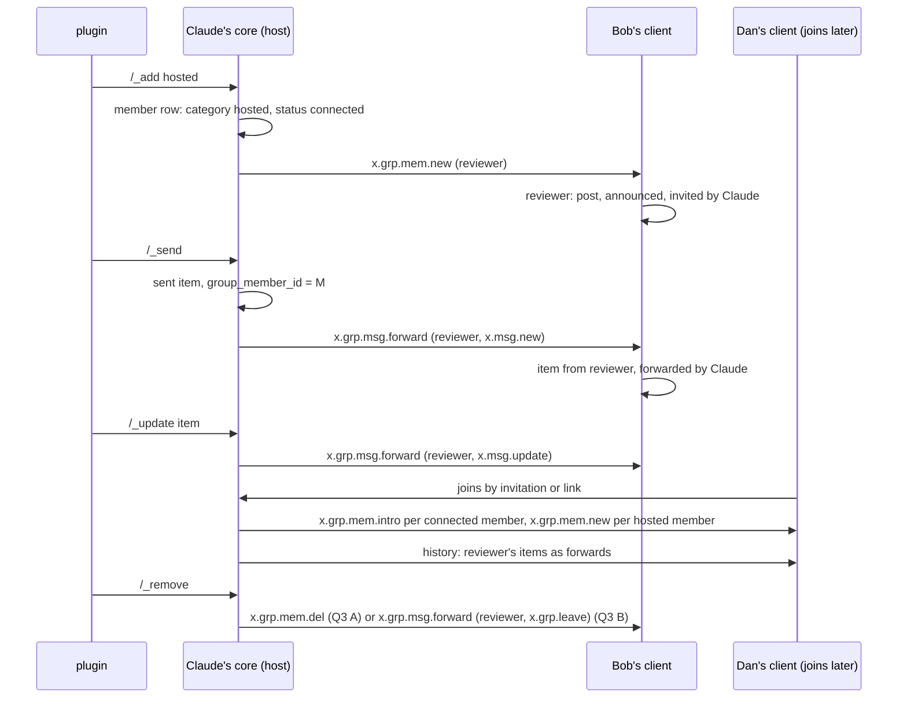
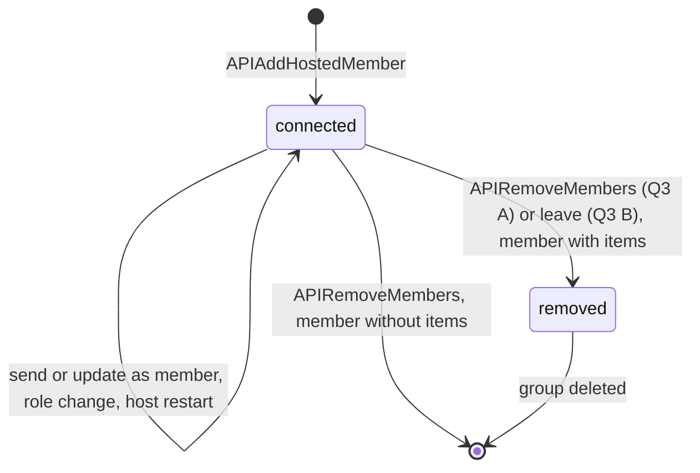
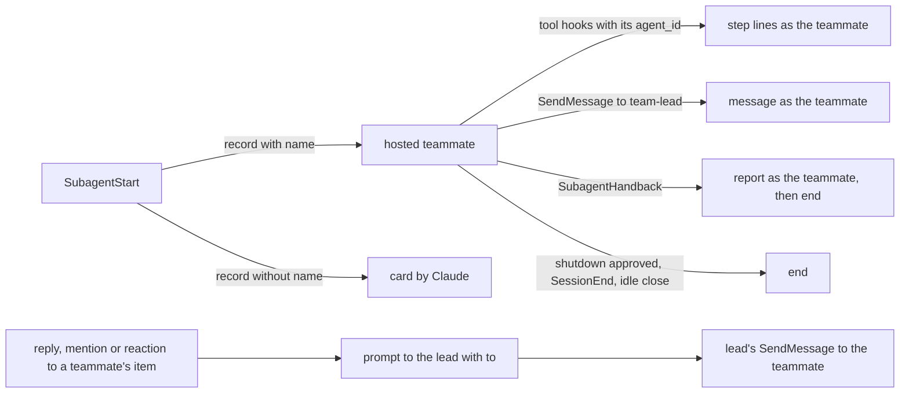

# Hosted members: teammates as group members without connections

Status: plan only. Code references: master `dbd3fd7ca`, by file and line. Decided by the maintainer on 2026-11-22: design A only, named "hosted members"; one pull request with the three plugin stages; reactions as a member are excluded. Questions Q1 to Q6 (section 9) are open. Facts about Claude Code are those recorded in `plans/2026-11-14-mcp-teammate-profiles.md` (branch `ep/mcp-teammate-profiles`, facts 1 to 9, F1 and F2).

## 1. Goal

The maintainer, 2026-11-22: "claude sends "new member" message with a flag "no connection needed", intro protocol doesn't run, all messages are "forwarded" from these members without ever creating them. Claude is host anyway, it can do it anyway, so we're not changing threat model, we're simply creating an API for it." And: "We already have "send as group", so we may as well have "send as member"."

Outcome:
- Claude's core announces each named teammate of a session as a member of the session group, with its own profile; the introduction protocol ends at the announcement (4.1).
- The teammate's messages, reports and tool steps are sent by Claude's core as forwards attributed to that member; its step lines are edited in place under its profile.
- A person replies to, mentions or reacts to a teammate's message, and the lead forwards it to that teammate.
- The teammate leaves the group when it ends.

## 2. What users see

```
moment                              today (master)                          after
the lead starts teammate reviewer   Claude's step line: 🤖 Agent: TASK       Claude added reviewer (agent avatar, TASK as bio)
reviewer runs a tool                nothing                                 reviewer's step line in small print, edited until done
reviewer sends to the lead          Claude: ✉️ Message from reviewer: …      reviewer: the whole message
the lead sends to reviewer          Claude's step line: 🔧 SendMessage       Claude: @reviewer and the message
a person replies to, mentions or    a prompt to the lead                    a prompt to the lead with to=reviewer; the lead
reacts to reviewer's message                                                forwards it; reviewer's answer is shown under reviewer
reviewer's final report             Claude: 📋 Report from subagent …        reviewer: the report
reviewer ends, or the session ends  nothing                                 reviewer left (Q3 B) or Claude removed reviewer (Q3 A)
an unnamed subagent                 Claude's 🤖 card in small print          unchanged
member list                         people, Claude, User                    also reviewer: "connecting" (Q2 A) or connected (Q2 B)
```

## 3. Design

Options:
```
option                                   cost per teammate
A. hosted members (this plan)            one member record on the host and one x.grp.mem.new to each member; each post is one message per member, as Claude's own posts
B. teammate users in Claude's core       one user, one contact, one group join, and one connection with every member; every command names or switches the user; per-session ownership of users
C. one more core per session (#8209)     as B, plus a second database and agent per session (teammates.ts of ep/mcp-teammate-steps: apiCreateActiveUser, APIAddContact, apiConnect, apiAddMember, apiJoinGroup)
```

B and C, the costs that exclude them: each teammate joins as a full member, so the introduction protocol connects it with every member (x.grp.mem.intro per member, Internal.hs:1242-1295; the joiner creates a connection per intro, Subscriber.hs:3358-3369; the existing member joins it, Subscriber.hs:3388-3423). The maintainer rejected C as bad design; B requires the ownership of users per session, which the maintainer called messy.

## 4. Protocol

Receivers run unchanged code (Q2 B adds one field). All checks below are those of the current code.

### 4.1 Announcement

The host sends `x.grp.mem.new` with the hosted member's MemberInfo to its current members:
```
x.grp.mem.new
  memberId     12 random bytes, generated by the host (createWithRandomId', Store/Groups.hs:1405)
  memberRole   the hosted member's role
  v            the host's chat version range, stored in the record (5.1) and sent by memberInfo for a hosted member (5.5)
  profile      the hosted member's profile, redacted by the group's preferences (redactedMemberProfile, Internal.hs:1368-1387)
  memberKey    omitted
  hosted       true (Q2 B only)
```

The receiver (xGrpMemNew, Subscriber.hs:3254-3335):
- checks the announcer's role: admin or higher, and not lower than the announced role (checkHostRole, Subscriber.hs:3256 and 3715-3717);
- creates the member with category post, status announced and the announcer as its inviter (Subscriber.hs:3301-3311; createNewGroupMember sets invited_by_group_member_id to the announcer, Store/Groups.hs:2498);
- saves the item "Claude added reviewer" (Subscriber.hs:3320-3330).

A member that receives x.grp.mem.new creates a connection for the announced member only on x.grp.mem.fwd (Subscriber.hs:3388-3423). The host sends x.grp.mem.fwd only on x.grp.mem.inv (Subscriber.hs:3379-3386), which is sent only by the joining member's own client (Subscriber.hs:3372-3377). For a hosted member, the introduction therefore ends at the announcement.

A forward attributed to the announced member finds this record: getCreateUnknownGMByMemberId returns it with `unknown = False` (Store/Groups.hs:1234-1235), so the receiver creates no unknown member and emits no CEvtUnknownMemberCreated (Subscriber.hs:4044-4052).

### 4.2 Messages

A message sent as a hosted member is one `x.grp.msg.forward` event from the host to each member:
```
x.grp.msg.forward    sent by the host
  memberId           the hosted member's member ID
  memberName         its display name, shortened (memberShortenedName, Internal.hs:1569-1570)
  msgTs              the host's send time
  msg                the hosted member's message
    msgId            the item's shared message ID
    event            x.msg.new | x.msg.update
msgId                omitted from the outer message
```

The JSON event is parsed by every client since chat version 4, 2023-11-18 (Protocol.hs:75, 1488-1494), in JSON batches and as a JSON element of binary batches (Protocol.hs:1040-1053). One message body is used for members of both batch modes (batchMode, Internal.hs:2892-2895).

The receiver:
- saves the outer message from the host and passes the inner one to xGrpMsgForward (Subscriber.hs:1065-1069, 1083, 1136);
- accepts the forwarder: admin or higher in groups without relays (isMemberGrpFwdRelay, Subscriber.hs:3833-3836, checked at 4038);
- accepts the author: the forwarder is the receiver's host, or the author's inviter (expectedForwarder, Subscriber.hs:4060-4064); after 4.1 both hold for the host's invitees, and the second holds for every member that received the announcement;
- accepts the unsigned inner message: `signatureOptional = not (useRelays' gInfo) || not (requiresSignature tag)` (withVerifiedMsg, Subscriber.hs:4115-4118);
- saves the item as received from the hosted member, forwarded by the host, at msgTs (processForwardedMsg, Subscriber.hs:4066-4078); deduplicates it by the inner msgId (saveGroupFwdRcvMsg, Internal.hs:3013-3029).

Signing: hosted members need no keys. Hosted sends are created without a signing key: the MsgSigning of createSndMessages is Nothing for them (Internal.hs:2404-2415), in place of groupMsgSigning (Internal.hs:2417-2429); receivers accept them unsigned (above).

Notifications: the push notification flag of the agent message is set from the inner event (hasNotification of x.msg.new, Protocol.hs:1339-1348), as for delivery jobs (Subscriber.hs:4269). Delivery receipts are not sent for x.grp.msg.forward (hasDeliveryReceipt, Protocol.hs:1355-1360; checkSendRcpt, Subscriber.hs:1154-1164), so the host's items stay "sent".

### 4.3 Updates

An update of an item sent as a hosted member is the same envelope with x.msg.update (Protocol.hs:464). The receiver applies it to the hosted member's item, live flag included (Subscriber.hs:4076-4077 → groupMessageUpdate, 2334-2425).

### 4.4 End

- Q3 A: `x.grp.mem.del` from the host, by the existing removal (APIRemoveMembers, Commands.hs:3172-3282); the receiver checks the host's role and marks the member removed (xGrpMemDel, Subscriber.hs:3759-3826).
- Q3 B: `x.grp.msg.forward` with x.grp.leave, attributed to the hosted member; the receiver marks it left (Subscriber.hs:4087 → xGrpLeave, 3843-3854; requiresSignature does not apply without relays, 4118).

### 4.5 Members who join later

- The host introduces each hosted member to a joining member with x.grp.mem.new in the batch of introductions, in place of x.grp.mem.intro (memberIntroEvt, Internal.hs:1291-1295, used by introduceMember, 1260-1289, for introduceToAll, introduceToRemaining and introduceToModerators). x.grp.mem.new from the host is accepted by its role only (Subscriber.hs:3256), whatever the joining order.
- History is sent after the introductions on the same connection (Subscriber.hs:988-992; APIAcceptMember, Commands.hs:2980-2981 and 3004-3005). The host forwards items sent as a hosted member attributed to that member (sendHistory, Internal.hs:1466-1469 → FwdMember of the hosted member).
- History items of removed hosted members are attributed to their member ID; the joining member creates them as unknown members, as for departed people today (testGroupHistoryUnknownMember, tests/ChatTests/Groups.hs:7235-7300).

### 4.6 Scope

- Groups without relays only. In channels only relays forward (isMemberGrpFwdRelay, Subscriber.hs:3835), so the owner cannot post as a member; the API refuses hosted members in channels.
- Groups with "sign messages" on mark unsigned received items as signature missing (toMsgVerified, Types/Shared.hs:169-172; signMessagesRequired, Messages.hs:425-430); the API refuses hosted members there (Q6).

### 4.7 Older clients

- Clients since version 4 parse x.grp.mem.new and x.grp.msg.forward; the receiver checks above are those of the current code, and older app releases are checked by hand (section 8).
- Receivers show the hosted member with status announced: "connecting" in member lists (ChatTypes.swift:3743 and 3763; ChatModel.kt:3306 and 3324). Q2 B changes this for new clients only.
- Members invited by another admin: that admin's client introduces the hosted member with x.grp.mem.intro (it is current, shouldIntroduce, Internal.hs:1254-1258); the joining client records it without an inviter (createIntroReMember, Store/Groups.hs:2688-2701), and the host's forwards for it fail expectedForwarder there (Subscriber.hs:4060-4064). Session members are invited by Claude or join by Claude's group link (hub.ts:769, 1356, 1455; control.ts:610), so Claude is their host. Q5.

### 4.8 Threat model

A host in a group without relays can today:
1. announce a member with any member ID, any profile and a role up to its own (Subscriber.hs:3256, 3301-3311), whether or not a client of that member exists;
2. forward to the members it invited content attributed to any member, and to every member content attributed to a member it announced or to an unknown member ID, which receivers then create (Subscriber.hs:4040-4064);
3. send that content unsigned (Subscriber.hs:4115-4118).

The hosted-member design is a composition of 1 to 3; receivers' acceptance rules are unchanged. On the wire, the API adds no capability to any party. With it, the host's user (the API client) posts as members that this user hosts through a supported command; posting as any member whose host record is not hosted is refused (6.3), so connected members cannot be posted as. Receivers see hosted members as announced members whose messages are forwarded by the host (the CLI shows `[>>]`; the apps show no forwarding mark: forwardedByMember is used only by the iOS notification service to group events, NotificationService.swift:1035). Q1.



## 5. Host: persistence and views

### 5.1 Member record

The hosted member is a `group_members` row of the host's group, created by createNewMember_ (Store/Groups.hs:2516-2584) with createNewMemberProfile_ (2505-2514):
```
group_members (host)
  member_id                   12 random bytes
  member_role                 the API's role
  member_category             hosted (new GroupMemberCategory GCHostedMember, Types.hs:1404-1436)
  member_status               connected
  invited_by                  the user's contact (IBUser), as for invitees (Store/Groups.hs:1456)
  invited_by_group_member_id  the user's membership, as for invitees (Store/Groups.hs:1412)
  contact_id                  NULL
  contact_profile_id          a new contact_profiles row with the API's profile
  local_display_name          the profile's display name, made unique for the user (withLocalDisplayName)
  peer_chat_min_version       the host's chat version range at creation
  peer_chat_max_version       the host's chat version range at creation
  member_pub_key              NULL
  member_relations_vector     set by introductions, as for other members (Internal.hs:1273-1280)
connections                   (not created)
```

### 5.2 Items sent as a hosted member

```
chat_items (host)
  item_sent              1
  group_member_id        the hosted member (NULL for every other sent item: idsRow, Store/Messages.hs:631)
  shared_msg_id          the inner msgId of 4.2
  show_group_as_sender   0
  include_in_history     1 (main scope)
```

Existing queries by group_member_id then select the hosted member's items:
- quotes in replies of others resolve to them (getGroupChatItemQuote_, Store/Messages.hs:721-748), so a reply's quotedItem has the item ID and the direction groupRcv of the hosted member;
- reactions and moderation by others find them (getGroupMemberCIBySharedMsgId, Store/Messages.hs:3092-3110);
- the user's own items exclude them (`group_member_id IS NULL`, Store/Messages.hs:226, 712, 2939, 3008, 3102);
- the record is kept on removal while it has items (checkGroupMemberHasItems in deleteOrUpdateMemberRecordIO, Internal.hs:2254-2265).

Reading: for sent items, toGroupChatItem discards the member row today (Store/Messages.hs:2405-2409); with this change it sets `CIMeta.sentAsMember` from that row.

### 5.3 Ownership

```
owner          recorded in
user           group_members.user_id and member_category = hosted
session        the session group: groups.custom_data.simplexMcpSession (hub.ts:1446-1453, 1632-1634)
teammate       the hosted member's profile display name within the session group
```

The core records hosting by the user only. The plugin keeps a map from teammate name to group member ID per session, rebuilt from APIListMembers (current members with category hosted) when the session is loaded (Hub.session, hub.ts:1341-1359).

### 5.4 Lifetime



- Host restart: rows and items persist in the database, the core's only state of hosted members; the plugin re-adopts current hosted members by name (5.3).
- Teammate end (7.1): the plugin removes the member; a later teammate with the same name gets a new member.
- Sessions that do not attach within the idle-close interval after a service start (10 minutes, service.ts:20 and 473-484) remove their hosted members.

### 5.5 Host code paths for a member without a connection

```
path                               file:line                       change
memberSendAction                   Internal.hs:2899-2936           GCHostedMember -> Nothing in pendingOrForwarded
hosted send to unready members     Internal.hs:2917-2936           treated as x.grp.msg.forward (2926): Nothing; joining members get the items by history
recipients                         Internal.hs:1999-2008           unchanged: current members, the hosted ones filtered by memberSendAction
introductions                      Internal.hs:1291-1295           memberIntroEvt: x.grp.mem.new for a hosted member
memberInfo                         Internal.hs:1356-1366           v from the record for a hosted member
history                            Internal.hs:1466-1469           an item with sentAsMember is forwarded attributed to it
quote by the user                  Internal.hs:235-242             quoteData: an item sent as member M -> CIQGroupRcv M, sent = False, memberId M
item author                        Messages.hs:374-380             chatItemMember: CIGroupSnd with sentAsMember M -> M
forwarding by the host             Subscriber.hs:4476-4503         unchanged: readyMemberConn excludes the hosted member
x.grp.mem.inv                      Subscriber.hs:3379-3386         unchanged: never references a hosted member (it is not introduced by x.grp.mem.intro)
role change                        Commands.hs:3033-3122           unchanged: x.grp.mem.role from the host
removal                            Commands.hs:3241-3279           unchanged (Q3 A); x.grp.leave as the member (Q3 B)
broadcast delete of its item       Commands.hs:928-940             refused for items sent as a member
member list text                   View.hs:1463-1467               "hosted"
```

### 5.6 Views and counts

```
view                               hosted member on the host
APIListMembers                     listed: memberCategory hosted, status connected
groupSummary.currentMembers        counted: the trigger counts by status (chat_schema.sql:1594-1625)
delivery receipts limit            counted toward 20 current members (smallGroupsRcptsMemLimit, Subscriber.hs:114-115, 1156-1161)
chat items                         sent items with sentAsMember
unread counts                      unchanged: sent items have sent statuses
item delivery statuses             per member: sent (4.2: no receipts)
apps                               decode category hosted (iOS ChatTypes.swift:3705-3711; Kotlin ChatModel.kt:3268-3274)
```

### 5.7 Migration

`M20261122_hosted_members` (SQLite and Postgres), down only: `UPDATE group_members SET member_category = 'post', member_status = 'removed' WHERE member_category = 'hosted'`, so that an older core parses the rows (fromTextField_ of GroupMemberCategory, Types.hs:1412).

## 6. API

### 6.1 Types

```haskell
-- Messages.hs, replaces the ShowGroupAsSender (Bool, Messages.hs:547) parameters of the send and save chain
data SendAs m = SAUser | SAGroup | SAMember m
  deriving (Eq, Show, Functor, Foldable, Traversable)

-- Controller.hs:1145-1148
data SendRef
  = SRDirect ContactId
  | SRGroup GroupId (Maybe GroupChatScope) (SendAs GroupMemberId)

-- Controller.hs, new command and response
APIAddHostedMember {groupId :: GroupId, memberRole :: GroupMemberRole, profile :: Profile}
CRHostedMemberAdded {user :: User, groupInfo :: GroupInfo, member :: GroupMember}

-- Messages.hs:523-547, CIMeta: showGroupAsSender stays for the apps' JSON
sentAsMember :: Maybe GroupMember
```

- The command handler traverses `SendAs GroupMemberId` into `SendAs GroupMember`, checking 6.3.
- `SendAs GroupMember` replaces the Bool parameter of sendGroupContentMessages, sendGroupContentMessages_ (Commands.hs:5044-5116), sendGroupMessages, sendGroupSignedMessages, sendGroupProfileUpdate (Internal.hs:2761-2794), prepareGroupMsg (Internal.hs:214-233, asGroup only for SAGroup), saveSndChatItems, createNewSndChatItem, createNewChatItem_ (group_member_id for SAMember), mkChatItem_ and mkCIMeta, which sets both CIMeta fields.
- sendAsGroup' (Messages.hs:122-125) returns `SendAs a`; APIForwardChatItems keeps its Bool (Controller.hs:436).
- createSndMessages (Internal.hs:2404-2415) encodes the event of an SAMember send inside x.grp.msg.forward (4.2), with the generated shared message ID in the inner message; XGrpMsgForward contains a `ChatMessage 'Json` (Protocol.hs:506), so only Json events are wrapped.

### 6.2 Commands

```
/_add hosted #<groupId> <role> json <profile>            APIAddHostedMember -> CRHostedMemberAdded
/_send #<groupId>(as_member=<groupMemberId>) [live=on] json [...]
/_send #<groupId>(as_group=on) json [...]                 unchanged syntax, SAGroup
/_update item #<groupId> <itemId> [live=on] json {...}    unchanged syntax; the sender is the item's
/_remove #<groupId> <groupMemberId>                       unchanged syntax
```

Parser (Commands.hs:7366-7370):
```haskell
sendRefP = (A.char '@' $> SRDirect <*> A.decimal) <|> (A.char '#' $> SRGroup <*> A.decimal <*> optional gcScopeP <*> sendAsP)
sendAsP = ("(as_group=" *> (bool SAUser SAGroup <$> onOffP) <* A.char ')') <|> ("(as_member=" *> (SAMember <$> A.decimal) <* A.char ')') <|> pure SAUser
```

### 6.3 Checks

```
command               condition                                        error
APIAddHostedMember    group with relays                                 "hosted members are not supported in channels"
APIAddHostedMember    "sign messages" on                                "hosted members are not supported when messages are signed"
APIAddHostedMember    user role below max admin role                    CEGroupUserRole (assertUserGroupRole, as APIAddMember, Commands.hs:2869)
APIAddHostedMember    incognito membership                              CEGroupIncognitoCantInvite (as Commands.hs:2873)
send as member        member of another group or unknown                SEGroupMemberNotFound
send as member        member category other than hosted                 "member is not hosted"
send as member        member not current                                CEGroupMemberNotActive
send as member        member role observer                              "member is not allowed to send messages" (receivers' memberCanSend, Subscriber.hs:1771-1773)
send as member        chat scope set                                    "cannot send as member in support scope" (as as_group, Commands.hs:782)
send as member        a file, or a quoted item                          "files and quotes cannot be sent as member"
send as member        group with relays, or "sign messages" on          as APIAddHostedMember
update of its item    member not current                                CEGroupMemberNotActive
delete of its item    broadcast or history mode                         CEInvalidChatItemDelete
```

### 6.4 Operations of the plugin stages

```
operation                       stage      core
add hosted member               1          APIAddHostedMember (new)
send as member                  1, 2       APISendMessages with SAMember; live=on for step lines
update its item                 2          APIUpdateChatItem: the item's sentAsMember selects the envelope (Commands.hs:850-885)
remove or leave                 1          APIRemoveMembers (Q3)
replies, mentions, reactions    3          existing resolution (5.2); CIMention by member ID (Store/Groups.hs:1182-1185)
```

Excluded: reactions as a member (the plugin's tools are connect, send, receive, download, list, leave and reply, tools.ts:161, and the plugin calls no reaction API); deletes as a member (the plugin finalizes lines by update, hub.ts:1155-1161); renaming (x.info as the member).

### 6.5 Bot API docs and clients

Generated by tests/APIDocs.hs: bots/api/COMMANDS.md, TYPES.md, packages/simplex-chat-client/types/typescript/src, packages/simplex-chat-python/src/simplex_chat/types.
- APIAddHostedMember and CRHostedMemberAdded documented (bots/src/API/Docs/Commands.hs, Responses.hs).
- SendRef documented as a record of chatType, chatId, chatScope and sendAs (TypeInfo.hs:189 maps it to ChatRef today), with syntax `<chatType><chatId>[<chatScope>][<sendAs>]`.
- SendAs: `Choice` syntax, as ChatDeleteMode (bots/src/API/Docs/Types.hs:238): group `(as_group=on)`, member `(as_member=<groupMemberId>)`.
- GroupMemberCategory gets hosted; CIMeta gets sentAsMember.
- simplex-chat-nodejs: apiSendMessages accepts the SendRef with sendAs (api.ts:448-462); new apiAddHostedMember.

## 7. Plugin

One pull request with three stages. Unnamed subagents keep their cards (agents.ts; hub.ts:430-455).



### 7.1 Stage 1: profiles, messages, reports, end

```
Claude Code event                                   service                                      core
SubagentStart, record with name (fact 3, F1)        Teammates.start(agent ID, name, description)  /_add hosted #G member json PROFILE
teammate's PostToolUse SendMessage to team-lead     post as the teammate                          /_send #G(as_member=M) json [...]
teammate's SubagentHandback (F2)                    report as the teammate, then end              /_send #G(as_member=M) json [...]
lead's copy of a teammate's message or report       dropped for a started teammate                -
lead's SendMessage to a teammate                    Claude: @NAME TEXT, mention of M              /_send #G json [{mentions: {NAME: M}}]
approved shutdown, SubagentStop of a finished       end                                           /_remove #G M (Q3)
record (F1, F2), SessionEnd, idle close
hosted member not created, or 20 teammates          Claude's notes, as on master                   -
```

- hook.ts: agentStart (hook.ts:610-623) reads `name` of the record; a record with a name becomes a teammate start, a record without one a card (today records with taskKind are skipped, hook.ts:616). agentStep (hook.ts:626-630) reports a successful PostToolUse of SendMessage to team-lead as the agent's message. SessionEnd is registered (hooks/hooks.json).
- protocol.ts: AgentStart gets `name`; AgentEvent gets `{message: string}`.
- teammates.ts: one class over Claude's ChatApi: start, post, step, end, adopt; it replaces the core, the users, the contacts and the join of ep/mcp-teammate-steps.
- profile: display name validName(name) (messages.ts), peer type agent, shortDescr the record's description, at most 160 characters.
- message size: hosted posts add 200 bytes to messageEnvelope (tools.ts:175, fitsMessage 1730-1733) for the x.grp.msg.forward envelope.

### 7.2 Stage 2: step lines

- The teammate's tool hooks (agent_id, F1) become steps of its teammate (onAgents, hub.ts:390-402, routes by agent ID).
- A step is a small-print line sent as the teammate with live=on and finalized by an update with live=off, with outcome and duration, as Claude's steps (stepOf, hook.ts:600-607; finalize, hub.ts:1155-1161); lines older than 23 hours are finalized (liveLineMs).

### 7.3 Stage 3: addressing

- A message that replies to an item of a teammate (quotedItem with direction groupRcv of a hosted member, 5.2), mentions a teammate (CIMention with its group member ID) or reacts to its item gets `to: NAME` in the prompt (AttachLine, protocol.ts:180-185; deliver, hub.ts:797-815) and the channel meta `to` (session.ts:236).
- Channel instructions (session.ts:25) add: "A message with to is for that teammate: forward it unchanged with SendMessage."
- itemSender (messages.ts:320-333) names the hosted member for sent items with sentAsMember, so history (receive with history, tools.ts:1379-1383) and replies name the teammate.

### 7.4 Removed from the plugin

The separate core, its folder `ROOT/_sessions/ID/agents`, the per-teammate users, contacts and invitations, removeStale by contact custom data, and isOwnProfile for teammates of ep/mcp-teammate-steps; hosted items are sent items, and Session.onMessage handles received items only (hub.ts:495-501).

## 8. Acceptance and tests

Each core test fails on master, where the commands do not parse; each plugin test fails on master, where the teammate routes are absent.

Core, tests/ChatTests/Groups.hs, `describe "hosted members"`, groups of alice (host), bob and cath (createGroup3):
- `testHostedMemberMessages`: `/_add hosted #1 member json {...reviewer...}`; bob and cath see `#team: alice added reviewer to the group (connecting...)`; `/_send #1(as_member=M) text hi` → `#team reviewer> hi [>>]` for bob and cath.
- `testHostedMemberLiveUpdate`: send as member with live=on, two updates, the last with live=off → bob's item from reviewer has the final text and itemLive false.
- `testHostedMemberHistory`: dan joins after the message → dan gets the announcement without "unknown member" output and `#team reviewer> hi [>>]`; `/ms team` of dan lists reviewer.
- `testHostedMemberRemove`: `/_remove #1 M` → bob and cath see the removal (or the leave, Q3).
- `testHostedMemberReply`: bob replies to reviewer's message and mentions @reviewer → alice's item JSON: quotedItem.itemId is the hosted item, its direction groupRcv reviewer, and mentions contain reviewer's group member ID.
- `testHostedMemberRefused`: send as bob's group member ID → "member is not hosted"; hosted member in a channel → error (tests/ChatTests/ChatRelays.hs).
- `testHostedMemberRestart`: alice restarts → reviewer listed as hosted; send as member works.
- API docs: tests/APIDocs.hs regenerates the files of 6.5.

Plugin:
- unit, teammates.test.ts: start, post, step (send with live=on, update), end and adopt make the commands of 7.1 and 7.2.
- unit, hook.test.ts: SubagentStart with a named record → teammate start; without a name → card; SendMessage to team-lead → message.
- unit, sessions.test.ts: a reply, a mention and a reaction to a hosted item → prompt with `to`.
- end-to-end, service.test.ts: a teammate's message and step line are received by a second core as reviewer's forwarded items; its end is shown.

Apps: one decoding test each (iOS, Kotlin) of a recorded APIListMembers response with category hosted (tests/fixtures/api).

CI: scope mcp runs with the branch's libsimplex (SIMPLEX_LIBS_DIR) and the branch's simplex-chat and @simplex-chat/types packages when core sources change (scripts/ci/scope-tests.sh:17-24; scripts/ci/README.md "mcp", lines 152-162 state the published packages today).

By hand (TESTING): the previous app releases of iOS and Android in a session group show reviewer's messages and the announcement.

## 9. Questions for the maintainer

Q1. Threat model: the API adds no capability on the wire; it gives the host's user a command for what an admin host can do today, limited to members it hosts (4.8).
- A, recommended: confirm.
- B: restrict further, for example to agent profiles.

Q2. What receivers show for a hosted member in member lists.
- A: "connecting", as any announced member; receivers unchanged.
- B, recommended: x.grp.mem.new gets `hosted: true`; new receivers record the member as connected (xGrpMemNew initialStatus, Subscriber.hs:3313-3315), and their apps show it as a connected member; old receivers show "connecting". About 6 lines.

Q3. What users see when a teammate ends.
- A: "Claude removed reviewer": the existing removal, no code.
- B, recommended: "reviewer left": removal of a hosted member sends x.grp.leave as the member (4.4). About 15 lines.
- C: it stays a member until the group is deleted.

Q4. How a person's message is delivered to a teammate: Claude Code delivers messages to a teammate only through its team's mailbox (facts 6 and 7).
- A, recommended: through the lead, with `to` (7.3).
- B: the service writes into the mailbox file, which Claude Code writes under its own lock and schema checks.

Q5. Members invited by another admin of a session group do not receive hosted members' messages (4.7).
- A, recommended: accept in this pull request; session members are invited by Claude.
- B: add the host's member ID to MemberInfo, so that other admins' clients introduce hosted members without connections; a receiver change.

Q6. Groups with "sign messages" on.
- A, recommended: hosted members are refused there (6.3).
- B: posted unsigned and shown as "signature missing".
- C: the host keeps a key per hosted member and signs as it; key storage on the host.

## 10. Changes by file

```
file                                                  change
src/Simplex/Chat/Types.hs                             GCHostedMember "hosted"
src/Simplex/Chat/Messages.hs                          SendAs; CIMeta.sentAsMember; mkCIMeta; chatItemMember; sendAsGroup'
src/Simplex/Chat/Controller.hs                        SendRef; APIAddHostedMember; CRHostedMemberAdded
src/Simplex/Chat/Library/Commands.hs                  command, checks, send and update as member, delete refusal, parsers
src/Simplex/Chat/Library/Internal.hs                  memberSendAction, memberIntroEvt, memberInfo, sendHistory, quoteData, createSndMessages, send chain
src/Simplex/Chat/Library/Subscriber.hs                Q2 B: initialStatus
src/Simplex/Chat/Store/Groups.hs                      createHostedMember
src/Simplex/Chat/Store/Messages.hs                    createNewChatItem_ group_member_id; toGroupChatItem sentAsMember
src/Simplex/Chat/Store/{SQLite,Postgres}/Migrations   M20261122_hosted_members
src/Simplex/Chat/View.hs                              "hosted"; CRHostedMemberAdded
bots/src/API/{TypeInfo.hs,Docs/*.hs}                  6.5
bots/api/*, packages/simplex-chat-client, packages/simplex-chat-python, packages/simplex-chat-nodejs/src/api.ts   generated, apiAddHostedMember
apps/ios/SimpleXChat/ChatTypes.swift, apps/multiplatform/.../ChatModel.kt   category hosted, decoding tests
docs/protocol/simplex-chat.md                         hosted members
tests/ChatTests/Groups.hs, ChatRelays.hs              section 8
packages/simplex-chat-mcp: src/teammates.ts (new), hook.ts, hub.ts, protocol.ts, session.ts, messages.ts, service.ts, tools.ts, hooks/hooks.json, test/, spec/, README.md, REFERENCE.md, TESTING.md
scripts/ci/scope-tests.sh, scripts/ci/README.md       mcp with the branch's core
```

## 11. Estimate

About 400 changed lines of Haskell and 250 of core tests; about 450 lines of the plugin and 500 of its tests; generated docs; 3 reduced builds.
