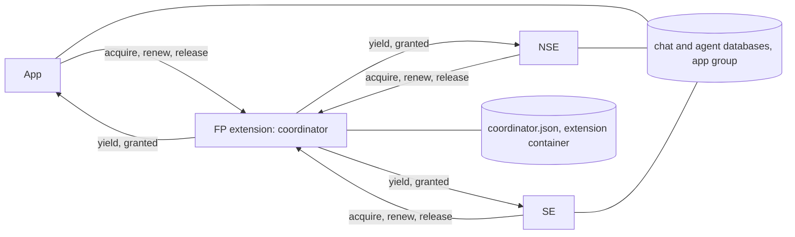
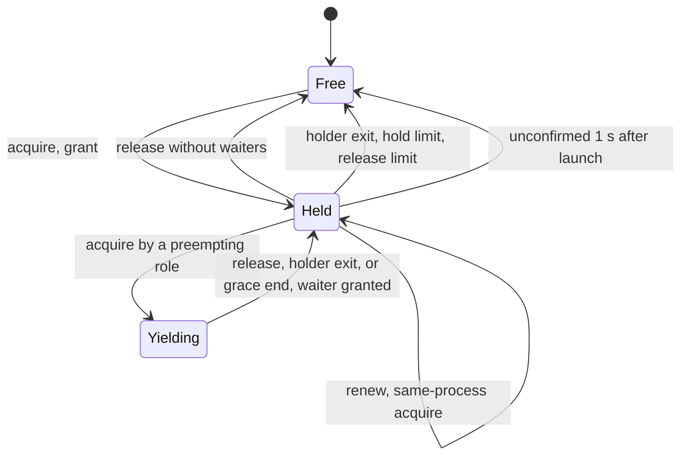
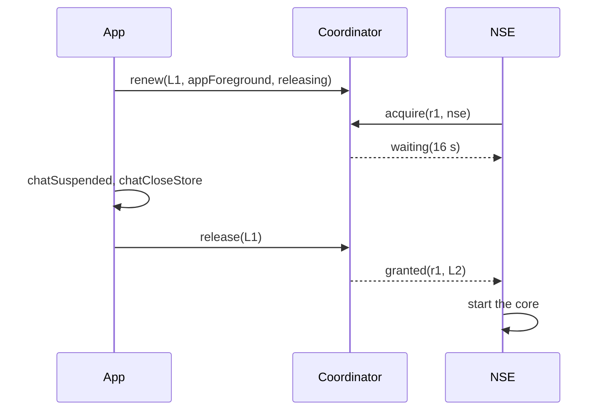
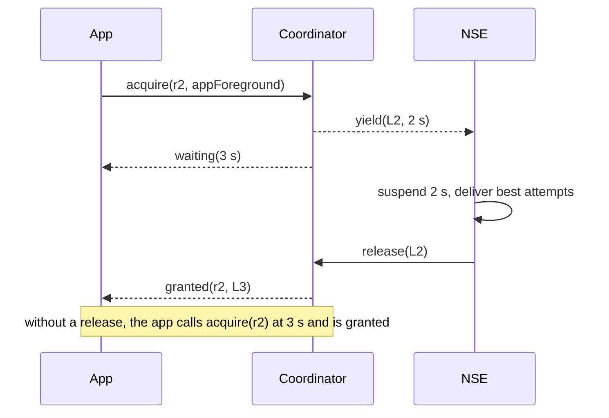
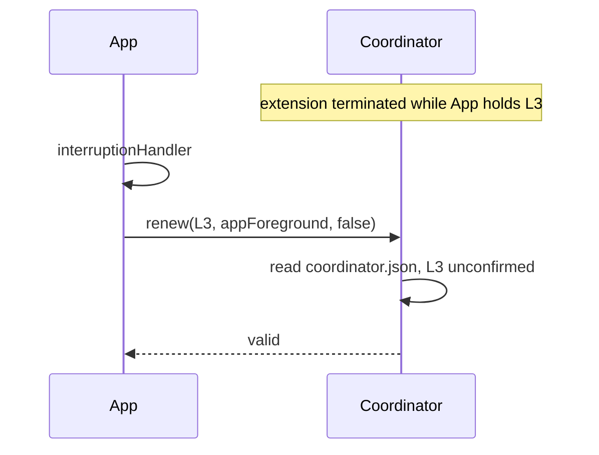
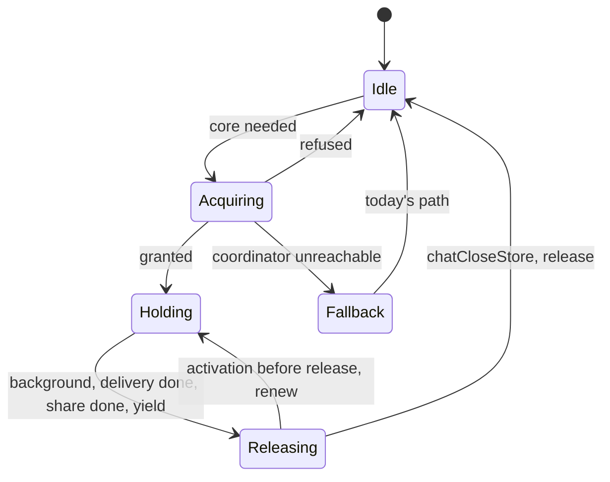

# iOS: File Provider extension as the coordinator of the chat database

The app, the notification service extension (NSE) and the share extension (SE) open one chat database in the app group. One process at a time runs the chat core. A new File Provider (FP) extension holds the one record of the current holder and grants the database to each process over XPC. Stage 1 adds coordination only; the FP extension is designed so that a later files stage extends it.

Line references are to master `8f5dfa3d4` unless another commit is named. Apple text is quoted with its URL; "header" means Apple's iOS SDK header text (iOS 16.2, 26.5 and 27.2 SDKs), read from the mirror https://github.com/xybp888/iOS-SDKs.

## 1. Today's rules, from the code

### 1.1 Requests and releases

| Process | Needs the database | Releases it |
|---|---|---|
| App, scene active | `startChatAndActivate`, SuspendChat.swift:154-187 | background: `suspendChat`, 15 s, SuspendChat.swift:51-55, AppGroup.swift:12 |
| App, cold start | `initChatAndMigrate` at `onAppear` + 0.15 s, SimpleXApp.swift:54-64, SuspendChat.swift:118-139 | as above |
| App, VoIP push | `initializeChat`, `startChatForCall`, CallController.swift:249-264, SuspendChat.swift:141-152 | call end + 3 s, CallController.swift:170-185 |
| App, refresh | `BGManager.receiveMessages`, BGManager.swift:112-149; `checkMessages` push, AppDelegate.swift:68-74 | `suspendBgRefresh`, 5 s, SuspendChat.swift:57-63 |
| App, termination | — | `terminateChat`, 0 or 3 s, SuspendChat.swift:65-84 |
| NSE | `startChat`, NotificationService.swift:846-915 | 2 s after the last delivery, suspend 4 s, NotificationService.swift:659-671; urgent: 0 s, :661-662; CallKit: 1 s + 1 s, :640-656 |
| SE | `initChat` at launch, ShareModel.swift:94-97, 179-201 | completion: suspend 3 s, then 0 s, ShareAPI.swift:94-116 |

The store is closed after `chatSuspended` or after the fallback timer of each process: SuspendChat.swift:33, 86-101; NotificationService.swift:945, 952-959; ShareAPI.swift:114.

### 1.2 Outcomes by requester and holder

The holder is read from app-group settings (AppGroup.swift:183-200). "Declared" marks a handler that is defined and never created. "Concurrent" means that both processes run their cores at once.

| Requester | Holder: none | App running | App suspending | NSE | SE |
|---|---|---|---|---|---|
| App, foreground | start, SuspendChat.swift:162-163 | same process | same process | wait ≤ 3 s, then start, SuspendChat.swift:164-178, NSESubscriber.swift:52-82; NSE yield 1 s declared, NotificationService.swift:811-817 | start, concurrent; SuspendChat.swift:154-187 reads the NSE state only |
| App, VoIP | start | same process | same process | start; the NSE suspends itself before it passes the call, NotificationService.swift:640-656 | start, concurrent |
| App, refresh | start, BGManager.swift:81 | same process | same process | skip, AppGroup.swift:203-205 | start, concurrent |
| NSE | start, NotificationService.swift:328-330 | deliver unprocessed, :362-364 | wait ≤ 16 s for `.suspended`, then start while the app state is `.suspending` or `.suspended`, :331-361, AppGroup.swift:134-140 | same process | start, concurrent; :316 reads the app state only |
| SE | start, ShareModel.swift:179-201 | launch: concurrent; send: wait ≤ 2 s, then send, SEChatState.swift:30-39; app yield declared, SuspendChat.swift:39-49 | launch: concurrent; send: wait ≤ 2 s | launch: concurrent; send: wait ≤ 2 s; NSE yield 1 s declared, NotificationService.swift:828-836 | — |

### 1.3 Defects

- F1. Declared yields are never registered. Global variables in Swift are initialized on first access ("Global constants and variables are always computed lazily", https://docs.swift.org/swift-book/documentation/the-swift-programming-language/properties/#Global-and-Local-Variables). These globals are referenced only at their declarations:
  - `appSubscriber`, NotificationService.swift:811, unreferenced since `79a954336` (2023-12-11);
  - `seSubscriber`, NotificationService.swift:828 and SuspendChat.swift:39, unreferenced since `6865515f4` (2024-07-28).
- F2. The SE starts its core at launch without a check (ShareModel.swift:94-97, 179-201).
- F3. The SE waits 3 s after every send: `suspended = false` and a `break` that ends the `switch` only (ShareAPI.swift:104-105).
- F4. A fallback timer of an earlier suspension ends a later one: the timers check the state only (SuspendChat.swift:33, 86-92; NotificationService.swift:945, 952-959).
- F5. The app waits 3 s for the NSE, not `nseSuspendTimeout` 5 s: `min(timeout - SUSPENDING_TIMEOUT, 1)` (NSESubscriber.swift:16, 76).
- F6. A cold start opens the database without a check (SimpleXApp.swift:60-63, SuspendChat.swift:118-131).
- F7. The state of a terminated process stays in settings:
  - app terminated while `.active`: the NSE delivers unprocessed notifications until the app runs again (NotificationService.swift:362);
  - NSE terminated while `.active`: refresh is skipped (AppGroup.swift:204) until the next NSE launch writes `.created` (NotificationService.swift:804-808), and the app overwrites the NSE state after 3 s (SuspendChat.swift:173).

## 2. Findings

### 2.1 File Provider lifecycle and reach

| Fact | Source |
|---|---|
| "The system automatically instantiates this class whenever it needs to provide documents to the host app." | https://developer.apple.com/library/archive/documentation/General/Conceptual/ExtensibilityPG/FileProvider.html |
| "An extension typically terminates soon after it completes the request it received from the host app." | https://developer.apple.com/library/archive/documentation/General/Conceptual/ExtensibilityPG/ExtensionOverview.html |
| "An app extension cannot: … Perform long-running background tasks" | ExtensionOverview.html, as above |
| "Design your app extension to launch quickly, aiming for well under one second. An extension that launches too slowly is terminated by the system." | https://developer.apple.com/library/archive/documentation/General/Conceptual/ExtensibilityPG/ExtensionCreation.html |
| Callers: "NSFileProviderManager can be used from the following processes: - the extension - the main app containing the extension - sibling extensions to the extension"; "The file provider framework will invoke your file provider extension in response to those calls if appropriate." | header NSFileProviderManager.h, iOS 16.2 and 27.2 |
| "An app (not necessarily the container app) should be able to use the services a file provider extension provides." | Apple DTS, https://developer.apple.com/forums/thread/760865 |
| "AFAIK the only supported use case for XPC by third-party developers on iOS is when communicating with file provider extensions." | Quinn (DTS), https://developer.apple.com/forums/thread/761295 |
| `NSFileProviderServiceSource`, `NSFileProviderService.getFileProviderConnection`, `FileManager.getFileProviderServicesForItem(at:)`: iOS 11. `NSFileProviderManager.getService(named:for:)`: iOS 16. | https://developer.apple.com/documentation/fileprovider/nsfileproviderservicesource, https://developer.apple.com/documentation/foundation/filemanager/getfileproviderservicesforitem(at:completionhandler:), https://developer.apple.com/documentation/fileprovider/nsfileprovidermanager/getservice(named:for:completionhandler:) |
| "This object can only be used to operate on the item specified by the url parameter." | getFileProviderServicesForItem page |
| `interruptionHandler`: "called if the remote process exits or crashes"; "It may be possible to re-establish the connection by simply sending another message." | https://developer.apple.com/documentation/foundation/nsxpcconnection/interruptionhandler |
| FP memory: "FileProvider app extension processes have a 20 MB memory limit on iOS." | Apple Engineer, https://developer.apple.com/forums/thread/739839 (2023); Quinn, "your 20 MiB limit", https://developer.apple.com/forums/thread/741225 |
| NSE: "The extension will be limited to 30 seconds and 24 MB total memory." | Apple DTS, https://developer.apple.com/forums/thread/770880 (2024); 30 s: https://developer.apple.com/documentation/usernotifications/unnotificationserviceextension/didreceive(_:withcontenthandler:) |
| Replicated domains on iOS: "A new domain is in a disabled state by default." "Launch the Files app, find the domain in the list of locations, and then tap to enable it." `isHidden`: macOS only. | https://developer.apple.com/documentation/fileprovider/synchronizing-files-using-file-provider-extensions (iOS 18); header NSFileProviderDomain.h, `FILEPROVIDER_API_AVAILABILITY_V3` |
| `NSFileProviderExtension` is not deprecated in the iOS 27.2 SDK; DTS recommends `NSFileProviderReplicatedExtension` for new projects. | header NSFileProviderExtension.h; https://developer.apple.com/forums/thread/793272 |
| Background runtime of apps: "There’s no general-purpose mechanism for: … Resuming in the background in response to a network or IPC request" | Quinn, https://developer.apple.com/forums/thread/685525 |
| 2022 proof of concept: the app and the NSE called a service of the FP extension; the attempt is described in 2.2. | `88c57c82d` |

Undocumented, measured in stage 0:
- the service lookup on the root container URL; the 2022 proof of concept used a placeholder item;
- the time from the first call to a running extension;
- termination of an idle extension, and its suspension between calls;
- whether an open XPC connection keeps the extension running;
- reachability from the SE;
- reachability while the app is suspended or terminated;
- whether the extension appears in the Locations of the Files app.

### 2.2 Proof of concept, 2022

Branch `_archived-ep/ios-file-provider` (upstream and fork), merge base `235fb8dc0` (2022-06-09). Search over a full clone of upstream: `git log --all -i --grep` with "file provider", "fileprovider" and "file-provider"; `git log --all -S NSFileProvider -- apps/ios`; `git log --all -i -G "file ?provider|fileprovider"`. The last search adds only the RFC commits `af379aec7` and `1d5095e39` and unrelated Android test plans.

| Commit | Date | Content |
|---|---|---|
| `1b972bc7c` | 2022-06-01 | target "SimpleX Service" from the template; Info.plist: `com.apple.fileprovider-nonui`, document group `group.chat.simplex.app`, `NSExtensionFileProviderSupportsEnumeration` NO |
| `17b8101d8` | 2022-06-02 | service source; a test XPC target "MyService"; app client `Shared/FPService.swift` |
| `af3dcc4a9` | 2022-06-02 | "file provider does not connect"; Apple forum thread https://developer.apple.com/forums/thread/707201, error 4097, FB10035749 |
| `b62f2acca` | 2022-06-02 | endpoint sent over `CFMessagePort`: "it does not work" |
| `360553dee` | 2022-06-02 | experiment |
| `e01be483d` | 2022-06-09 | "file provider service is working": a new anonymous `NSXPCListener` per `makeListenerEndpoint`, `newConnection.resume()` in `listener(_:shouldAcceptNewConnection:)`; a test call from the NSE |
| `88c57c82d` | 2022-06-10 | "file provider works": the core runs in the FP extension (`hs_init(0, nil)`, `chatSendCmd`, `chatRecvMsg`, `SimpleX Service/FileProviderService.swift`); the app and the NSE send every command over XPC (`SimpleXAppShared/ServiceAPI.swift`); the service item is a placeholder "123" in `documentStorageURL`, written in `FileProviderExtension.init`; the client retries the lookup up to 20 times |

The failure is recorded in the RFC on branch `ep/rfc-payments`, `1d5095e39:docs/rfcs/2024-03-19-external-services.md`:
- :44 "it has to run within 25 mb memory (other extensions have the same limit)";
- :46 "while it's possible to use a "fake file" simply to create a service, it would not be compliant with app store policies";
- :50 "we didn't manage to make it work withing 25mb - for full chat core it's really hard to fit in this memory limit";
- :52 "it all worked surprisingly well, till it hit 25mb memory limit".

The extension linked `libHSsimplex-chat-2.2.0` and started the runtime with default options. Apple staff state 20 MB for FP extensions (2.1). The NSE runs the core today with `-A256k -H512k -F0.5 -Fd0.3 -c` (hs_init.c `haskell_init_nse`); the app uses `-A64m -H64m` (hs_init.c `haskell_init`), which exceeds 20 MB by itself.

### 2.3 File locks

- Definition: "The operating system terminated the app because it held on to a file lock or SQLite database lock during suspension." (https://developer.apple.com/documentation/xcode/sigkill)
- Mutual exclusion: "Use Core Data, SQLite, or Posix locks to help coordinate data access in a shared container." (https://developer.apple.com/library/archive/documentation/General/Conceptual/ExtensibilityPG/ExtensionScenarios.html)
- Suspension: "processes using databases in DELETE journal mode will be instantly killed instead of suspended … Posix file locks also work, and behave similarly to SQLite database in DELETE journal mode" (TN2408, https://developer.apple.com/library/archive/technotes/tn2408/_index.html).
- iOS 14: "we’ve changed iOS 14.0b7 and later to be more forgiving in this case (r. 66931425). … The ‘rogue’ file lock could still cause a hang in some other app." "If you must use a file lock, make sure to release it before you become eligible for suspension." (Quinn, https://developer.apple.com/forums/thread/655225?page=2)
- File presenters: "If your app or extension enters the background with an active file presenter, it may be terminated by the system in order to prevent deadlock on that file." (https://developer.apple.com/documentation/foundation/nsfilecoordinator). System log text: the process is killed when its presenter "implements one or more NSFilePresenter messages requiring a response" (threads 718488, 63964). `SharedFileSubscriber` implements only `presentedItemDidChange` (SharedFileSubscriber.swift:31-39).
- Resumption: "If you are suspended, it won’t resume (or relaunch) you." (Quinn on file coordination, https://developer.apple.com/forums/thread/718488); "iOS will not resume your app to receive a Darwin notification." (Quinn, https://developer.apple.com/forums/thread/769398)
- The chat database: the connection sets `busy_timeout`, `foreign_keys`, `secure_delete` and `auto_vacuum` and leaves the journal mode at its default (simplexmq `d38bcf501` SQLite.hs:120-127); "The DELETE journaling mode is the default." (https://www.sqlite.org/pragma.html#pragma_journal_mode). Transactions are `BEGIN IMMEDIATE` (Common.hs:109) with a 3 s busy loop (Common.hs:126-137). In rollback mode "Once all reading has completed, the SHARED lock is dropped." (https://www.sqlite.org/lockingv3.html)

Answer: a file lock gives mutual exclusion among running processes, and SQLite already provides it for each transaction. A lock held at suspension terminates its holder or, since iOS 14.0b7, can stay held and stall the other processes. A lock therefore serves only as a critical section released before suspension; it cannot record ownership across suspension. The coordinator holds no file lock.

### 2.4 Visibility of File Provider items

| Fact | Source |
|---|---|
| "Files listed in the working set are indexed in the local Spotlight index and appear in offline search results." | header NSFileProviderItem.h, iOS 11 |
| Replicated: "the working set must also include all materialized items managed by the system"; "the system can enumerate and materialize the content of your working set in the background, so that Spotlight can index it." | https://developer.apple.com/documentation/fileprovider/synchronizing-the-file-provider-extension |
| Search opt-out: `NSFileProviderSearching` and `supportsStringSearchRequest` are macOS 26 only. Settings has a per-app switch "Show Content in Search"; its effect on File Provider items is undocumented. | https://developer.apple.com/documentation/fileprovider/nsfileprovidersearching, header NSFileProviderDomain.h; https://support.apple.com/en-us/118232 |
| "Starting in iOS 12 and macOS 10.15, the system maintains a cache on the local file system of files and directories previously enumerated." | header NSFileProviderItem.h |
| "a dataless copy means the system just saves the item’s metadata—such as its name, file size, and last used date" | synchronizing-the-file-provider-extension |
| "The itemIdentifier should not contain sensitive information, as it may be recorded in system logs and diagnostic files." | header NSFileProviderItem.h |
| Non-replicated: default identifiers are "the path relative to the path returned by documentStorageURL". | header NSFileProviderExtension.h |
| Non-replicated storage: "`<container URL>/File Provider Storage`" in the app group. | https://developer.apple.com/documentation/fileprovider/nsfileprovidermanager/documentstorageurl |
| Replicated storage: "The system takes ownership of the item and will move it out of the sandbox of the provider."; "On iOS, for replicated domains, the extension process will never be granted access to the user visible location". | header NSFileProviderReplicatedExtension.h, NSFileProviderManager.h |
| Backup exclusion "is not a mechanism to guarantee those items never appear in a backup"; File Provider storage reported in iCloud backups (third party). | https://developer.apple.com/documentation/foundation/optimizing-your-app-s-data-for-icloud-backup; https://github.com/blinksh/blink/issues/1789 |
| Other apps: "Document-based applications cannot know which files exist next to the file that was picked or even which file providers are installed until the user picks one of the documents." | WWDC17 243, https://asciiwwdc.com/2017/sessions/243 |
| Migration: "In order to migrate a non-replicated domain to a replicated one, implementers have to make sure that they do not use the default domain"; "It is not possible to migrate the default domain in this manner". | header NSFileProviderDomain.h |
| Threat model: "any user data stored on the device can be accessed with user's or root privileges" | docs/SECURITY.md:38-41 |

Survival of the system's metadata cache and index after the app is deleted is undocumented.

## 3. Design

### 3.1 Composition



- Target "SimpleX FP", bundle identifier `chat.simplex.app.SimpleX-FP`, extension point `com.apple.fileprovider-nonui`, principal class a subclass of `NSFileProviderExtension`, default domain.
- `NSExtensionFileProviderDocumentGroup`: `group.chat.simplex.app`.
- Service: name `chat.simplex.app.coordinator`, attached to the root container; lookup by `FileManager.getFileProviderServicesForItem(at: NSFileProviderManager.default.documentStorageURL)`.
- Items: the root container only; enumerators of the root and of the working set return empty lists.
- The extension links Foundation and FileProvider only; SimpleXChat.framework, which contains the core, is excluded from it.
- Shared source files, compiled into SimpleXChat and into the extension:
  - `SimpleXChat/CoordinatorTypes.swift`: roles, messages, the rule table, `decide`;
  - `SimpleXChat/CoordinatorProtocol.swift`: the two `@objc` protocols.
- Client: `SimpleXChat/DatabaseLease.swift`, one instance per process.

### 3.2 Rule table

One row per role; every request is evaluated by the same function.

```
RoleRule
  role: Role
  tier: Int
  preemptGrace: Seconds?
  waitForRelease: Seconds?
  holdLimit: Seconds?
  releaseLimit: Seconds
```

| Role | Tier | Preempt grace | Wait for release | Hold limit | Release limit | Sources |
|---|---|---|---|---|---|---|
| appCall | 0 | 0 s | — | — | 16 s | SuspendChat.swift:141-152, NotificationService.swift:640-656; AppGroup.swift:12, SuspendChat.swift:33 |
| appForeground | 1 | 3 s | — | — | 16 s | SuspendChat.swift:164-178, NSESubscriber.swift:76; AppGroup.swift:12, SuspendChat.swift:33 |
| share | 1 | 2 s | 2 s | — | 4 s | SEChatState.swift:30-39, ShareModel.swift:148-152; ShareAPI.swift:95-108 |
| nse | 2 | — | 16 s | 30 s after its last `acquire` | 5 s | NotificationService.swift:331-364; didReceive documentation (2.1); NotificationService.swift:22, 945 |
| appRefresh | 2 | — | — | 20 s | 6 s | BGManager.swift:27, 81, 89-91, 138-147 (≤ 18 s); SuspendChat.swift:16, 33 |

Limits exceed today's durations by 1-2 s; "—" in "Wait for release" is 0 s.

```
decide(state, request, now) -> (state, outcome, messages)
  holder void at: hold limit, release limit, 1 s after launch while unconfirmed, connection invalidated
  waiter = waiters[request.request], added at the first acquire of the request
  holder == nil                                   -> grant
  holder.pid == request.pid                       -> grant; same lease; role and since updated
  preempts(request.role, holder.role)             -> preempt
  holder.releasing and now < request.since + waitForRelease(request.role)
                                                  -> wait until min(request.since + waitForRelease(request.role), holder.releasingSince + releaseLimit(holder.role))
  otherwise                                       -> refuse

preempts(r, h) = tier(r) < tier(h) or (tier(r) == 1 and tier(h) == 1)

preempt
  holder.yield == nil -> holder.yield = (request, now + preemptGrace(request.role)); message yield(holder.lease, max(preemptGrace(request.role) - 1, 0))
  now >= holder.yield.until -> holder void; grant
  otherwise -> wait until holder.yield.until

release(lease), holder exit
  the waiter of the lowest tier, then the earliest -> granted(request, new lease)
```

- The yield timeout is the grace less 1 s, so that the holder's fallback timer (timeout + 1 s, SuspendChat.swift:33, NotificationService.swift:945) ends within the grace.
- A release with an earlier lease is ignored; a renewal with it is answered `void`.

Stage 1 changes these cells of 1.2 (question Q2):
- app foreground or VoIP while the SE holds: preempt, grace 3 s or 0 s;
- NSE while the SE holds: refused while the SE runs, wait ≤ 16 s while it releases;
- SE while the app holds for a call: refused, with an alert;
- NSE while the app holds for refresh: refused, as today.

### 3.3 Coordinator state

Persisted in `Application Support/coordinator.json` of the extension container, written with `Data.write(options: .atomic)` after each transition, excluded from backup:

```
CoordinatorFile
  nextLease: Int64
  holder: PersistedHolder?

PersistedHolder
  lease: Int64
  role: Role
  pid: Int32
  releasing: Bool
```

In memory:

```
CoordinatorState
  nextLease: Int64
  launchedAt: Double
  holder: Holder?
  waiters: [Waiter]

Holder
  lease: Int64
  role: Role
  pid: Int32
  confirmed: Bool
  since: Double
  releasing: Bool
  releasingSince: Double?
  yield: Yield?

Yield
  request: UUID
  until: Double

Waiter
  request: UUID
  role: Role
  pid: Int32
```

Times are `clock_gettime(CLOCK_MONOTONIC)` seconds, one clock for all processes, which "will continue to increment while the system is asleep" (apple-oss-distributions/Libc gen/clock_gettime.3:67-69). At launch the file is read, `confirmed` is false, and the holder is void 1 s after launch unless it renews. Waiters are kept in memory only; a waiter repeats `acquire` with its request after a relaunch, and its wait is counted from `since` of the request.

The coordinator runs no timers. Every transition is computed while a call is handled; a waiter calls `acquire` again with the same request at its deadline.



### 3.4 Protocol

Coordinator interface, exported by the extension:

```
acquire(AcquireRequest) -> AcquireReply
renew(RenewRequest) -> RenewReply
release(lease: Int64)

AcquireRequest
  request: UUID
  role: Role
  pid: Int32
  since: Double

AcquireReply
  granted(lease: Int64)
  waiting(seconds: Double)
  refused(holder: Role)

RenewRequest
  lease: Int64
  role: Role
  releasing: Bool

RenewReply
  valid
  void
```

Client interface, exported by each process on the same connection:

```
yield(lease: Int64, timeout: Double)
granted(request: UUID, lease: Int64)
```

- Messages are JSON in `Data`, bridged to `NSData`, which conforms to `NSSecureCoding`, as `NSFileProviderService` requires of parameters.
- The connection sets `remoteObjectInterface`, `exportedInterface`, `exportedObject`, `interruptionHandler` and `invalidationHandler`.
- `interruptionHandler` of a holder: a new service lookup and `renew`; on `void` the process suspends its core with timeout 0.
- Each process holds at most one lease; the NSE instances of one process share it.

NSE waits while the app suspends:



App becomes active while the NSE holds the database:



Extension relaunch:



### 3.5 Processes

| Site | Stage 1 |
|---|---|
| App, `startChatAndActivate` (SuspendChat.swift:154-187) | `acquire(appForeground)` in place of the NSE state check and `waitNSESuspended` |
| App, `initChatAndMigrate` (SuspendChat.swift:118-139) | `acquire(appForeground)` before `initializeChat` |
| App, `startChatForCall` (SuspendChat.swift:141-152) | `acquire(appCall)` |
| App, `handleRefresh` (BGManager.swift:81), `checkMessages` (AppDelegate.swift:70) | `acquire(appRefresh)` in place of `allowBackgroundRefresh` |
| App, `_suspendChat` (SuspendChat.swift:24-37) | `renew(releasing: true)`; the fallback timer is bound to the lease |
| App, `_chatSuspended` (SuspendChat.swift:94-101) | `release` after `chatCloseStore` |
| App, `yield` | `_suspendChat(timeout:)` with the given timeout, under `suspendLockQueue` |
| NSE, `didReceive` (NotificationService.swift:316-365) | after the `.stopped` check, `acquire(nse)`; granted: `receiveNtfMessages`; refused: `contentHandler(receivedNtf)` |
| NSE, `suspendChat` (NotificationService.swift:931-950) | `renew(releasing: true)`; the timer is bound to the lease |
| NSE, `chatSuspended` (NotificationService.swift:952-959) | `release` after `chatCloseStore` |
| NSE, `yield` | `suspendChat(timeout)` and `deliverBestAttemptNtf(urgent: true)` of each active instance |
| SE, `initChat` (ShareModel.swift:179-201) | `acquire(share)` before `chatMigrateInit` or `apiActivateChat` (question Q3) |
| SE, `send` (ShareModel.swift:147-148) | `waitForOtherProcessesToSuspend` removed |
| SE, `apiSuspendChat(expired:)` (ShareAPI.swift:94-116) | `renew(releasing: true)`; the loop ends on `chatSuspended`; `release` after `chatCloseStore` |
| SE, `yield` | `apiSuspendChat(expired: false)` with the given timeout |



### 3.6 Coordinator unreachable

Unreachable: the service lookup fails, the service is absent, the connection is invalidated before a reply, or a reply is absent 1 s after the call. The process then runs today's path of 1.2 unchanged (question Q4). Each process keeps writing its state to settings in stage 1 (`AppChatState`, `NSEChatState`, `SEChatState`), so that today's path of the other processes reads current states. Each fallback is logged with its cause.

### 3.7 Holder notification

The coordinator sends `yield` to the holder while it handles the preempting `acquire`, and `granted` to a waiter while it handles `release`, so that each message is sent by a running coordinator. A suspended holder receives `yield` when it resumes; its lease is void at the grace end. File coordination and Darwin notifications resume no suspended process (2.3), so the existing file messages are kept only on today's path (question Q5).

Residual: a holder resumed after its lease was void continues the core's operations until its `yield` or `renew` is handled; SQLite serializes these writes (2.3), and contention is limited by the 3 s busy loop (Common.hs:126-137), as today after the 16 s NSE fallback.

## 4. Constraints for the files stage

| Choice | Fixed once shipped | Stage 1 decision |
|---|---|---|
| Default domain or explicit domain | the default domain cannot be migrated to a replicated domain (2.4) | coordinator service on the default domain; files in an explicit domain; serving both from one extension is verified in stage 0 |
| Non-replicated or replicated files | replicated: system-owned copies outside the app sandbox, working set includes all materialized items, domain disabled until the user enables it (2.1, 2.4) | stage 1 does not depend on it; the files plan decides |
| Item identifiers | recorded in system logs; default identifiers are paths (2.4) | files stage: random stable identifiers, never derived from names or chat identifiers |
| Document group | `documentStorageURL` is derived from it | `group.chat.simplex.app` |
| Names in Files | names, sizes and dates are cached by the system (2.4) and shown to any user of the unlocked device, outside SimpleX Lock and hidden profiles (HiddenProfileView.swift:64) | files stage: enumeration follows the share extension's lock rule (ShareModel.swift:77-79); hidden profiles are never enumerated (question Q8) |
| Spotlight and Siri | working-set items are indexed; an iOS opt-out per item is undocumented (2.4) | files stage: the working set is empty unless the user enables it |
| Chunked storage | — | chunks stay in the app's storage with random names, outside `File Provider Storage`; items present assembled files |
| Backups | the app excludes the app-group container (FileUtils.swift:73-80); exclusion is not guaranteed (2.4) | unchanged |
| Testing modes | "You can’t change the test mode after you add the domain." | never set |

## 5. Stages


### Stage 0: device trial

- Change: the extension target with a service that answers `ping` with its process start time; the app, the NSE and the SE call it at their database sites and log the latency; about 200 lines and the project file.
- Measured on a device by the maintainer, on the oldest and newest supported iOS:
  - latency of the first and later calls, from each process;
  - the NSE call while the app is suspended and while it is terminated;
  - the extension after 1, 10 and 60 minutes idle: process start time, latency;
  - extension memory footprint;
  - the Locations list of the Files app;
  - the default domain and an explicit domain served by one extension.
- TestFlight external review of the build.
- Cost: about half a day of agent work; one iOS build per push, 17.5 min measured (job "macos-latest (iOS)" of run 45003402703); the maintainer's device session and the TestFlight review.
- Risk: services unreachable from the SE or the NSE; review rejection (2.1, Q1).

### Stage 1: coordinator

- Change, about 1,100 lines:
  - coordinator types, rule table, `decide`, persistence, listener: 350;
  - extension target, Info.plist, entitlements: 120, and the project file;
  - `DatabaseLease`: 200;
  - call sites (3.5): app 80, NSE 60, SE 40;
  - tests: 350.
- Tests, in "SimpleX Unit Tests" (hosted by the app, run by build-ios):
  - `decide`, with a fake clock, one test per cell of 3.2 and per changed cell, and:
    - holder exit grants the waiter;
    - a release with an earlier lease is ignored;
    - an unconfirmed holder is void 1 s after launch; `renew` confirms it;
    - the NSE lease is void at 30 s;
  - app on recorded core responses (the `replay` harness of FileUploadTests.swift):
    - a `yield` from a test coordinator suspends the app with the given timeout, and `release` follows `chatSuspended`;
    - `startChatAndActivate` activates only after `granted`;
    - suspend, state set to `.active`, suspend again: at 16 s the state stays `.suspending` (F4); on master the first fallback timer sets `.suspended` (SuspendChat.swift:33, 86-92);
  - failing first: the coordinator types and `decide` returning `grant` are committed with the tests, and the reduced build on that commit shows the failures; then the implementation.
- ios-sim: the app with the extension; the smoke test checks the log lines of `acquire` and `release` at start and background. Measured runs: 51 to 80 min (runs 44885982841, 44893347230, 44899749303, 44920386414, 44839507332).
- Device test plan for the maintainer: notification while the app is suspending; app opened during a notification; share while the app is in background; share during a call; extension terminated during each.
- Risks: the extension suspended between calls delays replies (mitigated by client deadlines and the fallback, 3.6); latency within the NSE time limit.

### Stage 2: today's path removed

- Condition: stage 1 releases without coordinator fallbacks in the logs of the maintainer's and TestFlight testers' devices; logs stay on each device.
- Change: `SharedFileSubscriber` messages, the three state settings, `waitNSESuspended`, `waitForOtherProcessesToSuspend` and the NSE app-state switch are removed; about 400 lines removed.
- Tests: the app tests of stage 1 without the fallback; the device test plan of stage 1.

### Stage 3: files

A separate plan, from the constraints of section 4.

## 6. Questions

- Q1. App Review. Ship stage 1 with a service on the root container and no files? The archived guide states "If you just want to share your app’s files, a document provider is not the right choice"; App Review Guideline 2.5.1: "Apps should use APIs and frameworks for their intended purposes" (https://developer.apple.com/app-store/review/guidelines/); the RFC of 2024 (:46) states that a placeholder file "would not be compliant with app store policies". Recommended: yes, with the TestFlight external review of stage 0 first; on rejection, coordination waits for the files stage.
- Q2. Priorities. Stage 1 applies today's rules (1.2) with the declared yields in effect (F1), and these cells changed; recommended as listed:
  - a. app foreground or VoIP while the SE holds: preempt the SE (recommended); today both run;
  - b. NSE while the SE holds: refused while the SE runs, waits while it releases (recommended); today both run;
  - c. SE while the app holds for a call: refused with an alert (recommended; the alert text needs approval); today's declared rule suspends the app during the call;
  - d. NSE while the app holds for refresh: refused, as today (recommended); alternative: the NSE preempts refresh after 1 s.
- Q3. SE lease from launch, since its core runs from launch (recommended), or from send.
- Q4. Coordinator unreachable: today's path unchanged until stage 2 (recommended), or the NSE delivers unprocessed notifications and the app and the SE proceed after their wait.
- Q5. Holder notification: `yield` over the coordinator's XPC connection (recommended); the existing file messages resume no suspended holder (2.3).
- Q6. Extension API: `NSFileProviderExtension` with the default domain, iOS 15 kept (`IPHONEOS_DEPLOYMENT_TARGET = 15.0`, project.pbxproj) (recommended; the 2022 proof of concept used it); `NSFileProviderReplicatedExtension` requires iOS 16 and a domain that the user enables in the Files app.
- Q7. Cold start acquires before opening the database (recommended; F6).
- Q8. Files stage, principle: names of conversations and files shown in the Files app and indexed for search only while SimpleX Lock is off or the user allows it, and never for hidden profiles (recommended).
