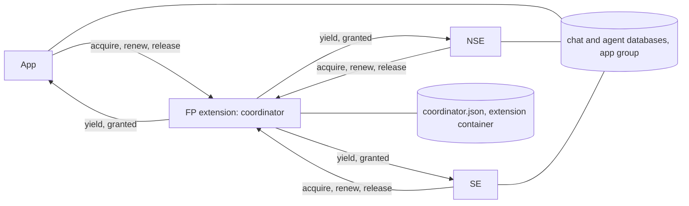
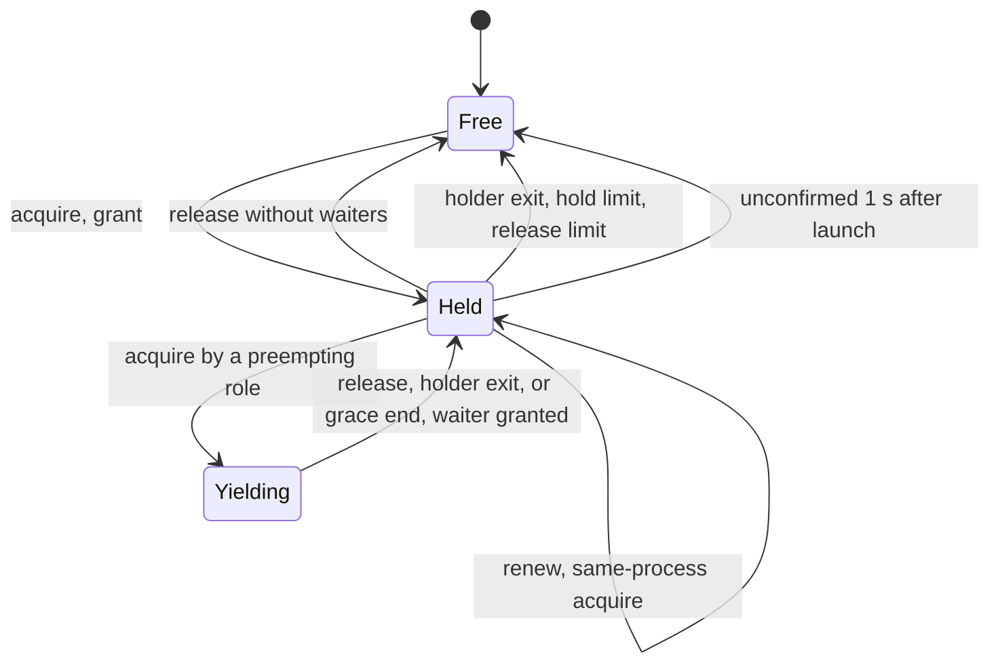
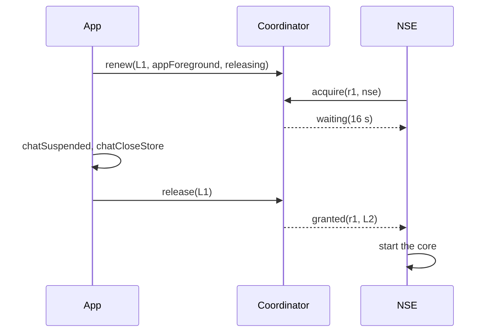
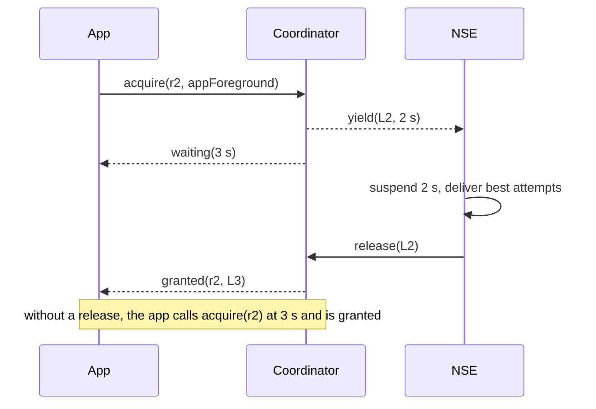
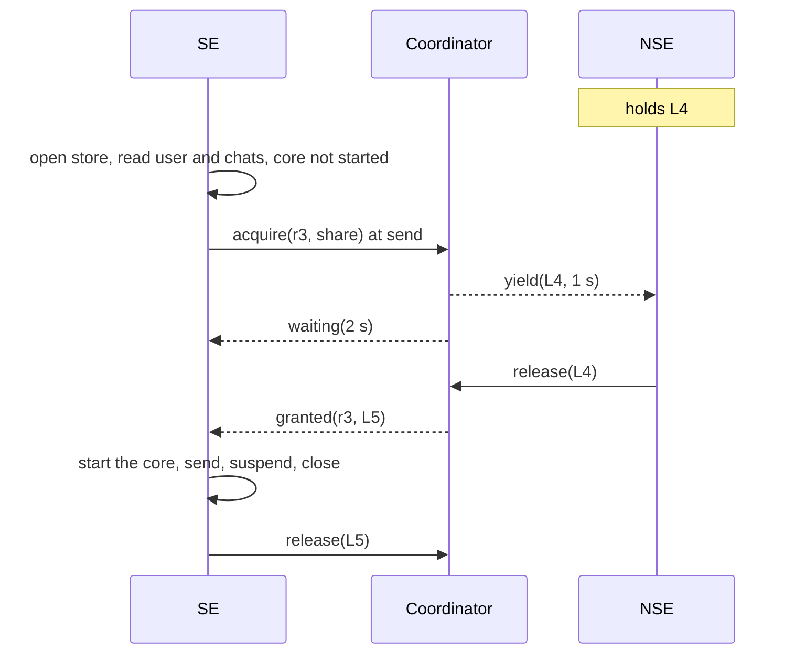
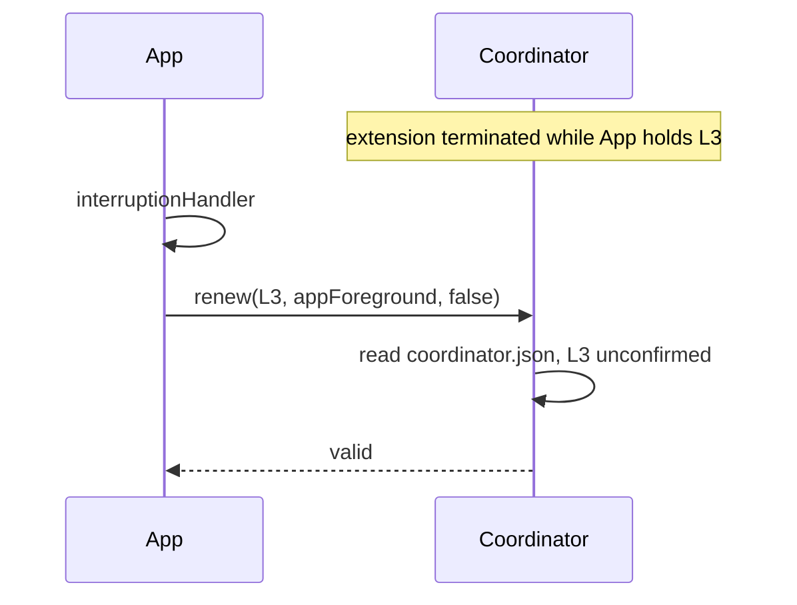
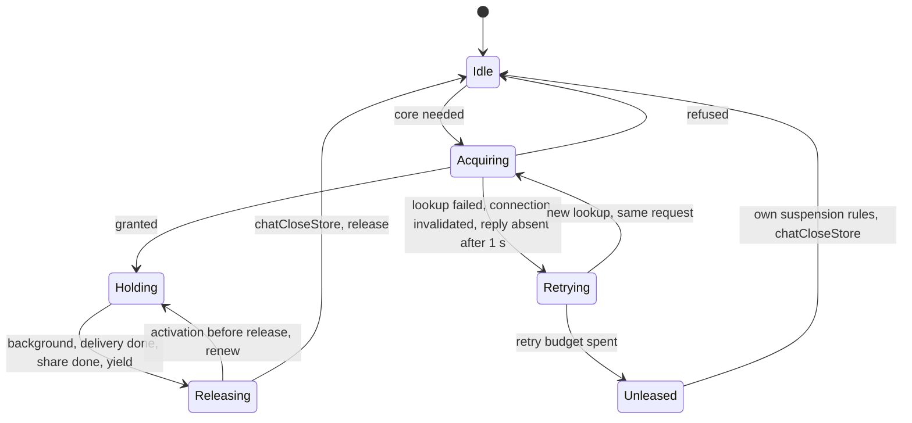
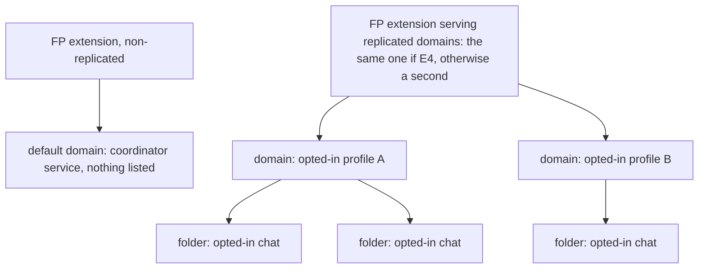
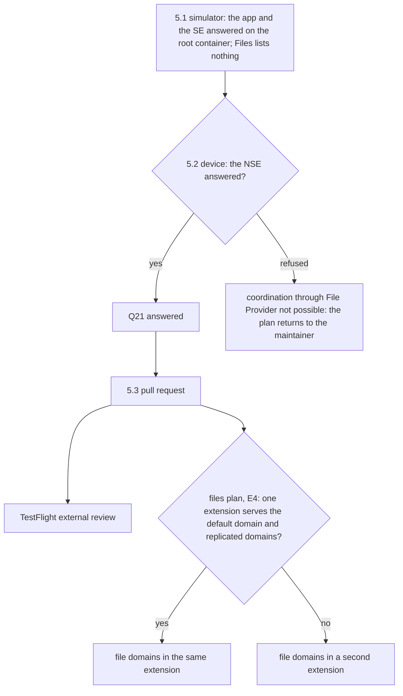

# iOS: File Provider extension as the coordinator of the chat database

The app, the notification service extension (NSE) and the share extension (SE) open one chat database in the app group. One process at a time runs the chat core. A new File Provider (FP) extension holds the one record of the current holder and grants the database to each process over XPC. The coordinator is served on the default domain of a non-replicated extension, with nothing listed in the Files app. The experiment in the simulator (5.1) confirmed the service from the app and the SE; the NSE is checked on a device (5.2); then the full design is shipped at once, in place of today's coordination (5.3). Files in the Files app are planned later, in replicated domains.

Line references are to master `8f5dfa3d4` unless another commit is named. Apple text is quoted with its URL; "header" means Apple's iOS SDK header text (iOS 16.2, 26.5 and 27.2 SDKs), read from the mirror https://github.com/xybp888/iOS-SDKs.

## 1. Today's rules, from the code

### 1.1 Requests and releases

| Process | Needs the database | Releases it |
|---|---|---|
| App, scene active | `startChatAndActivate`, SuspendChat.swift:154-187 | background: `suspendChat`, 15 s, SuspendChat.swift:51-55, AppGroup.swift:12 |
| App, cold start | `initChatAndMigrate` at `onAppear` + 0.15 s, SimpleXApp.swift:54-64, SuspendChat.swift:118-139 | as above |
| App, VoIP push | `initializeChat`, `startChatForCall`, CallController.swift:249-264, SuspendChat.swift:141-152 | call end + 3 s, CallController.swift:170-185 |
| App, refresh | `BGManager.receiveMessages`, BGManager.swift:112-149; `checkMessages` push, AppDelegate.swift:68-74 | `suspendBgRefresh`, 5 s, SuspendChat.swift:57-63 |
| App, termination | — | `terminateChat`, 0 or 3 s, SuspendChat.swift:65-84 |
| NSE | `startChat`, NotificationService.swift:846-915 | 2 s after the last delivery, suspend 4 s, NotificationService.swift:659-671; urgent: 0 s, :661-662; CallKit: 1 s + 1 s, :640-656 |
| SE | `initChat` at launch, ShareModel.swift:94-97, 179-201 | completion: suspend 3 s, then 0 s, ShareAPI.swift:94-116 |

The store is closed after `chatSuspended` or after the fallback timer of each process: SuspendChat.swift:33, 86-101; NotificationService.swift:945, 952-959; ShareAPI.swift:114.

### 1.2 Outcomes by requester and holder

The holder is read from app-group settings (AppGroup.swift:183-200). "Declared" marks a handler that is defined and never created. "Concurrent" means that both processes run their cores at once.

| Requester | Holder: none | App running | App suspending | NSE | SE |
|---|---|---|---|---|---|
| App, foreground | start, SuspendChat.swift:162-163 | same process | same process | wait ≤ 3 s, then start, SuspendChat.swift:164-178, NSESubscriber.swift:52-82; NSE yield 1 s declared, NotificationService.swift:811-817 | start, concurrent; only the NSE state is read, SuspendChat.swift:154-187 |
| App, VoIP | start | same process | same process | start; the NSE suspends itself before it passes the call, NotificationService.swift:640-656 | start, concurrent |
| App, refresh | start, BGManager.swift:81 | same process | same process | skip, AppGroup.swift:203-205 | start, concurrent |
| NSE | start, NotificationService.swift:328-330 | deliver unprocessed, :362-364 | wait ≤ 16 s for `.suspended`, then start while the app state is `.suspending` or `.suspended`, :331-361, AppGroup.swift:134-140 | same process | start, concurrent; only the app state is read, :316 |
| SE | start, ShareModel.swift:179-201 | launch: concurrent; send: wait ≤ 2 s, then send, SEChatState.swift:30-39; app yield declared, SuspendChat.swift:39-49 | launch: concurrent; send: wait ≤ 2 s | launch: concurrent; send: wait ≤ 2 s; NSE yield 1 s declared, NotificationService.swift:828-836 | — |

### 1.3 Defects

- F1. Declared yields are never registered. Global variables in Swift are initialized on first access ("Global constants and variables are always computed lazily", https://docs.swift.org/swift-book/documentation/the-swift-programming-language/properties/#Global-and-Local-Variables). These globals are referenced only at their declarations:
  - `appSubscriber`, NotificationService.swift:811, unreferenced since `79a954336` (2023-12-11);
  - `seSubscriber`, NotificationService.swift:828 and SuspendChat.swift:39, unreferenced since `6865515f4` (2024-07-28).
- F2. The SE starts its core at launch without a check (ShareModel.swift:94-97, 179-201).
- F3. The SE waits 3 s after every send: `suspended` is set to `false`, and the `break` belongs to the `switch`, not to the loop (ShareAPI.swift:104-105).
- F4. A later suspension is ended by the fallback timer of an earlier one; only the state is checked at the timer (SuspendChat.swift:33, 86-92; NotificationService.swift:945, 952-959).
- F5. The app waits 3 s for the NSE, not `nseSuspendTimeout` 5 s: `min(timeout - SUSPENDING_TIMEOUT, 1)` (NSESubscriber.swift:16, 76).
- F6. A cold start opens the database without a check (SimpleXApp.swift:60-63, SuspendChat.swift:118-131).
- F7. The state of a terminated process stays in settings:
  - app terminated while `.active`: the NSE delivers unprocessed notifications until the app runs again (NotificationService.swift:362);
  - NSE terminated while `.active`: refresh is skipped (AppGroup.swift:204) until the next NSE launch writes `.created` (NotificationService.swift:804-808), and the app overwrites the NSE state after 3 s (SuspendChat.swift:173).

## 2. Findings

### 2.1 File Provider lifecycle and reach

| Fact | Source |
|---|---|
| "The system automatically instantiates this class whenever it needs to provide documents to the host app." | https://developer.apple.com/library/archive/documentation/General/Conceptual/ExtensibilityPG/FileProvider.html |
| "An extension typically terminates soon after it completes the request it received from the host app." | https://developer.apple.com/library/archive/documentation/General/Conceptual/ExtensibilityPG/ExtensionOverview.html |
| "An app extension cannot: … Perform long-running background tasks" | ExtensionOverview.html, as above |
| "Design your app extension to launch quickly, aiming for well under one second. An extension that launches too slowly is terminated by the system." | https://developer.apple.com/library/archive/documentation/General/Conceptual/ExtensibilityPG/ExtensionCreation.html |
| Callers: "NSFileProviderManager can be used from the following processes: - the extension - the main app containing the extension - sibling extensions to the extension"; "The file provider framework will invoke your file provider extension in response to those calls if appropriate." | header NSFileProviderManager.h, iOS 16.2 and 27.2 |
| "An app (not necessarily the container app) should be able to use the services a file provider extension provides." | Apple DTS, https://developer.apple.com/forums/thread/760865 |
| "AFAIK the only supported use case for XPC by third-party developers on iOS is when communicating with file provider extensions." | Quinn (DTS), https://developer.apple.com/forums/thread/761295 |
| `NSFileProviderServiceSource`, `NSFileProviderService.getFileProviderConnection`, `FileManager.getFileProviderServicesForItem(at:)`: iOS 11. `NSFileProviderServicing.supportedServiceSources(for:completionHandler:)`, `NSFileProviderManager.getService(named:for:)`: iOS 16. | https://developer.apple.com/documentation/fileprovider/nsfileproviderservicesource, https://developer.apple.com/documentation/fileprovider/nsfileproviderservicing, https://developer.apple.com/documentation/fileprovider/nsfileprovidermanager/getservice(named:for:completionhandler:) |
| "This object can only be used to operate on the item specified by the url parameter." | https://developer.apple.com/documentation/foundation/filemanager/getfileproviderservicesforitem(at:completionhandler:) |
| `interruptionHandler`: "called if the remote process exits or crashes"; "It may be possible to re-establish the connection by simply sending another message." | https://developer.apple.com/documentation/foundation/nsxpcconnection/interruptionhandler |
| FP memory: "FileProvider app extension processes have a 20 MB memory limit on iOS." | Apple Engineer, https://developer.apple.com/forums/thread/739839 (2023); Quinn, "your 20 MiB limit", https://developer.apple.com/forums/thread/741225 |
| NSE: "The extension will be limited to 30 seconds and 24 MB total memory." | Apple DTS, https://developer.apple.com/forums/thread/770880 (2024); 30 s: https://developer.apple.com/documentation/usernotifications/unnotificationserviceextension/didreceive(_:withcontenthandler:) |
| Replicated domains on iOS: "A new domain is in a disabled state by default." "Launch the Files app, find the domain in the list of locations, and then tap to enable it." `isHidden`: macOS only. | https://developer.apple.com/documentation/fileprovider/synchronizing-files-using-file-provider-extensions (iOS 18); header NSFileProviderDomain.h, `FILEPROVIDER_API_AVAILABILITY_V3` |
| Replicated: "Your extension must handle multiple active copies of the File Provider extension in the same process, for instance, if the user has several active domains, or when the system discards one instance while initiating another." | https://developer.apple.com/documentation/fileprovider/nsfileproviderreplicatedextension/invalidate() |
| Replicated: "It is not possible to migrate the default domain in this manner (since the default domain can not be added)." | header NSFileProviderDomain.h |
| `NSFileProviderExtension` is not deprecated in the iOS 27.2 SDK; DTS recommends `NSFileProviderReplicatedExtension` for new projects. | header NSFileProviderExtension.h; https://developer.apple.com/forums/thread/793272 |
| Background runtime of apps: "There’s no general-purpose mechanism for: … Resuming in the background in response to a network or IPC request" | Quinn, https://developer.apple.com/forums/thread/685525 |
| 2022 proof of concept: the app and the NSE called a service of the FP extension; the attempt is described in 2.2. | `88c57c82d` |
| A non-replicated extension used only for coordination shows nothing in the Files app: confirmed by the maintainer from the proof of concept, whose extension declared `NSExtensionFileProviderSupportsEnumeration` false. | `88c57c82d:apps/ios/SimpleX Service/Info.plist:9-10` |
| `NSFileProviderManager.default`: "This property returns a manager for the default domain on iOS."; "You can access the default domain in both the containing app and the File Provider extension." | https://developer.apple.com/documentation/fileprovider/nsfileprovidermanager/default |
| Default file protection: "Complete until first user authentication. (Default) The file is inaccessible until the first time the user unlocks the device." | https://developer.apple.com/documentation/uikit/encrypting-your-app-s-files |

Undocumented, established by the experiment in the simulator (5.1): the service lookup on the root container; reachability from the SE; latency, suspension and relaunch of the extension; the Files app. Left to a device (5.2): reachability from the NSE, memory limit, idle termination over 10–60 minutes, behaviour before the first unlock. Left to the files plan: one extension serving the default domain and replicated domains.

### 2.2 Proof of concept, 2022

Branch `_archived-ep/ios-file-provider` (upstream and fork), merge base `235fb8dc0` (2022-06-09). Search over a full clone of upstream: `git log --all -i --grep` with "file provider", "fileprovider" and "file-provider"; `git log --all -S NSFileProvider -- apps/ios`; `git log --all -i -G "file ?provider|fileprovider"`. The last search adds only the RFC commits `af379aec7` and `1d5095e39` and unrelated Android test plans.

| Commit | Date | Content |
|---|---|---|
| `1b972bc7c` | 2022-06-01 | target "SimpleX Service" from the template; Info.plist: `com.apple.fileprovider-nonui`, document group `group.chat.simplex.app`, `NSExtensionFileProviderSupportsEnumeration` NO |
| `17b8101d8` | 2022-06-02 | service source; a test XPC target "MyService"; app client `Shared/FPService.swift` |
| `af3dcc4a9` | 2022-06-02 | "file provider does not connect"; Apple forum thread https://developer.apple.com/forums/thread/707201, error 4097, FB10035749 |
| `b62f2acca` | 2022-06-02 | endpoint sent over `CFMessagePort`: "it does not work" |
| `360553dee` | 2022-06-02 | experiment |
| `e01be483d` | 2022-06-09 | "file provider service is working": a new anonymous `NSXPCListener` per `makeListenerEndpoint`, `newConnection.resume()` in `listener(_:shouldAcceptNewConnection:)`; a test call from the NSE |
| `88c57c82d` | 2022-06-10 | "file provider works": the core runs in the FP extension (`hs_init(0, nil)`, `chatSendCmd`, `chatRecvMsg`, `SimpleX Service/FileProviderService.swift`); the app and the NSE send every command over XPC (`SimpleXAppShared/ServiceAPI.swift`); the service item is a placeholder "123" in `documentStorageURL`, written in `FileProviderExtension.init`; the lookup is retried up to 20 times |

The failure is recorded in the RFC on branch `ep/rfc-payments`, `1d5095e39:docs/rfcs/2024-03-19-external-services.md`:
- :44 "it has to run within 25 mb memory (other extensions have the same limit)";
- :46 "while it's possible to use a "fake file" simply to create a service, it would not be compliant with app store policies";
- :50 "we didn't manage to make it work withing 25mb - for full chat core it's really hard to fit in this memory limit";
- :52 "it all worked surprisingly well, till it hit 25mb memory limit".

The extension linked `libHSsimplex-chat-2.2.0` and started the runtime with default options. Apple staff state 20 MB for FP extensions (2.1). The NSE runs the core today with `-A256k -H512k -F0.5 -Fd0.3 -c` (hs_init.c `haskell_init_nse`); the app uses `-A64m -H64m` (hs_init.c `haskell_init`), an allocation area above 20 MB by itself.

### 2.3 File locks

- Definition: "The operating system terminated the app because it held on to a file lock or SQLite database lock during suspension." (https://developer.apple.com/documentation/xcode/sigkill)
- Mutual exclusion: "Use Core Data, SQLite, or Posix locks to help coordinate data access in a shared container." (https://developer.apple.com/library/archive/documentation/General/Conceptual/ExtensibilityPG/ExtensionScenarios.html)
- Suspension: "processes using databases in DELETE journal mode will be instantly killed instead of suspended … Posix file locks also work, and behave similarly to SQLite database in DELETE journal mode" (TN2408, https://developer.apple.com/library/archive/technotes/tn2408/_index.html).
- iOS 14: "we’ve changed iOS 14.0b7 and later to be more forgiving in this case (r. 66931425). … The ‘rogue’ file lock could still cause a hang in some other app." "If you must use a file lock, make sure to release it before you become eligible for suspension." (Quinn, https://developer.apple.com/forums/thread/655225?page=2)
- File presenters: "If your app or extension enters the background with an active file presenter, it may be terminated by the system in order to prevent deadlock on that file." (https://developer.apple.com/documentation/foundation/nsfilecoordinator). System log text: the process is killed when its presenter "implements one or more NSFilePresenter messages requiring a response" (threads 718488, 63964). `SharedFileSubscriber` implements only `presentedItemDidChange` (SharedFileSubscriber.swift:31-39).
- Resumption: "If you are suspended, it won’t resume (or relaunch) you." (Quinn on file coordination, https://developer.apple.com/forums/thread/718488); "iOS will not resume your app to receive a Darwin notification." (Quinn, https://developer.apple.com/forums/thread/769398)
- The lock of a statement is held until the statement is finished: "The only way to ensure that a statement has "finished" is to invoke sqlite3_reset() or sqlite3_finalize() on that statement." (https://www.sqlite.org/lang_transaction.html); an unfinalized prepared statement at suspension is named as a cause of 0xdead10cc in a third-party report (https://developer.apple.com/forums/thread/126438).

Answer: mutual exclusion among running processes is given by a file lock, and SQLite already provides it for each transaction. With a lock held at suspension, the holder is terminated or, since iOS 14.0b7, the lock can stay held and stall the other processes. A lock is therefore usable only as a critical section released before suspension, and ownership across suspension cannot be recorded with it. The coordinator holds no file lock. The journal mode of the databases is decided in 2.5.

### 2.4 Visibility of File Provider items

| Fact | Source |
|---|---|
| "Files listed in the working set are indexed in the local Spotlight index and appear in offline search results." | header NSFileProviderItem.h, iOS 11 |
| Replicated: "the working set must also include all materialized items managed by the system"; "the system can enumerate and materialize the content of your working set in the background, so that Spotlight can index it." | https://developer.apple.com/documentation/fileprovider/synchronizing-the-file-provider-extension |
| Search opt-out: `NSFileProviderSearching` and `supportsStringSearchRequest` are macOS 26 only. Settings has a per-app switch "Show Content in Search"; its effect on File Provider items is undocumented. | https://developer.apple.com/documentation/fileprovider/nsfileprovidersearching, header NSFileProviderDomain.h; https://support.apple.com/en-us/118232 |
| "Starting in iOS 12 and macOS 10.15, the system maintains a cache on the local file system of files and directories previously enumerated." | header NSFileProviderItem.h |
| "a dataless copy means the system just saves the item’s metadata—such as its name, file size, and last used date" | synchronizing-the-file-provider-extension |
| "The itemIdentifier should not contain sensitive information, as it may be recorded in system logs and diagnostic files." | header NSFileProviderItem.h |
| Replicated storage: "The system takes ownership of the item and will move it out of the sandbox of the provider."; "On iOS, for replicated domains, the extension process will never be granted access to the user visible location". | header NSFileProviderReplicatedExtension.h, NSFileProviderManager.h |
| Backup exclusion "is not a mechanism to guarantee those items never appear in a backup"; File Provider storage reported in iCloud backups (third party). | https://developer.apple.com/documentation/foundation/optimizing-your-app-s-data-for-icloud-backup; https://github.com/blinksh/blink/issues/1789 |
| Other apps: "Document-based applications cannot know which files exist next to the file that was picked or even which file providers are installed until the user picks one of the documents." | WWDC17 243, https://asciiwwdc.com/2017/sessions/243 |
| "In iOS, deleting a domain deletes all the files." | synchronizing-files-using-file-provider-extensions |
| Threat model: "any user data stored on the device can be accessed with user's or root privileges" | docs/SECURITY.md:38-41 |

Survival of the system's metadata cache and index after the app is deleted is undocumented.

### 2.5 Journal mode

The commit retry fix: sqlcipher-simple `6bf2796de` "roll back the transaction when its commit fails" (simplex-chat/sqlcipher-simple#5, 2026-11-20), pinned by simplex-chat `1966ac32e` (#8270) and simplexmq `d38bcf501` (#2085).
- Change, `Database/SQLite/Simple.hs` `withTransactionPrivate`: `commit` became ``commit `onException` rollback``; `rollback` is executed only while a transaction is active (`getAutoCommit`).
- SQLite: "An attempt to execute COMMIT might also result in an SQLITE_BUSY return code if another thread or process has an open read connection. When COMMIT fails in this way, the transaction remains active"; "An attempt to invoke the BEGIN command within a transaction will fail with an error" (https://www.sqlite.org/lang_transaction.html).
- Before the fix, after a COMMIT refused while another connection held a SHARED lock, the transaction stayed active, and the retry of `dbBusyLoop` (simplexmq Common.hs:126-137) issued `BEGIN IMMEDIATE` inside it. Since the fix the transaction is rolled back and retried whole. It is tested by `testErrorsBusyCommit`: a reader in a read transaction, the writer refused with `ErrorBusy`, then the insert completed.

The databases today:
- Both stores are opened by simplexmq's `connectDB` (Mobile.hs:351-352, Store.hs:29-30), which sets `key`, `busy_timeout`, `foreign_keys`, `secure_delete` and `auto_vacuum` (simplexmq `d38bcf501` SQLite.hs:111-127); "The DELETE journaling mode is the default." (https://www.sqlite.org/pragma.html#pragma_journal_mode). `journal_mode` and `cipher_plaintext_header_size` appear in neither repository (`git grep` of simplex-chat master, `grep -r` of the simplexmq `d38bcf501` archive).
- Every transaction is `BEGIN IMMEDIATE`, reads included (Common.hs:105-109; chat store: Controller.hs:1848-1851). "SQLite supports multiple simultaneous read transactions … but only one simultaneous write transaction"; "EXCLUSIVE and IMMEDIATE are the same in WAL mode" (lang_transaction.html). Reads of two processes are serialized in either journal mode.
- In rollback mode "Once all reading has completed, the SHARED lock is dropped" (https://www.sqlite.org/lockingv3.html): no lock is held by an open, idle connection.
- The app closes the store when it suspends (SuspendChat.swift:73-78, 100); so do the NSE (NotificationService.swift:956) and the SE (ShareAPI.swift:114). A process can also be suspended with its store open and idle: the NSE delivers before its delayed suspension (NotificationService.swift:666-673), and the SE keeps its store open until completion (ShareAPI.swift:114).

WAL with SQLCipher across the three processes:

| Aspect | Fact | Source |
|---|---|---|
| Concurrency | "readers do not block writers and a writer does not block readers"; this is true for read transactions, and every store transaction is a write transaction | https://www.sqlite.org/wal.html; Common.hs:109 |
| Locks | "All connections hold SQLITE_LOCK_SHARED continuously while attached to a WAL-mode database … even by connections that are not within transaction." | https://www.sqlite.org/walformat.html |
| iOS exemption | "if iOS can’t determine the file type from the header because it contains random data like a SQLCipher database, then iOS will kill the application process when it attempts to background with a file lock"; with `cipher_plaintext_header_size` the header is left readable and the salt is stored by the app | https://www.zetetic.net/sqlcipher/sqlcipher-api/ |
| Shared memory | "create the shared memory by mmapping a file in the same directory as the database": a `-shm` file in the app group, used by all three processes | wal.html |
| Checkpoints | "By default, SQLite does a checkpoint automatically when the WAL file reaches a threshold size of 1000 pages"; "A checkpoint is only able to run to completion, and reset the WAL file, if there are no other database connections using the WAL file"; "When the last connection to a database closes, that connection does one last checkpoint and then deletes the WAL and its associated shared-memory file" | wal.html |
| Migration | "Unlike the other journaling modes, PRAGMA journal_mode=WAL is persistent." | wal.html |
| Paths of the main file only | copied at archive export (Archive.hs:59-60); overwritten at import (Archive.hs:79-80); backed up and renamed at a passphrase change (Archive.hs:158-177); removed at deletion (Archive.hs:126-135); backed up before migrations (SQLite.hs:95-97) | code |
| Platforms | `connectDB` is used on iOS, Android and desktop (SQLite.hs:111-127) | code |

Decision: the databases stay in DELETE mode.
- With `BEGIN IMMEDIATE` transactions, no read concurrency is gained from WAL.
- With the encrypted header, a lock is held at suspension by every open WAL connection, idle readers included; the plaintext header is excluded for privacy.
- With WAL, the five paths of the main file above would need a checkpoint and the `-wal` and `-shm` files, and `connectDB` a platform condition.
- In DELETE mode no lock is held by an idle connection, so a process may keep an unstarted store open without a lease; since the commit retry fix, a writer refused by a reader is retried within the 3 s busy loop.

Consequence for the SE: the SE opens its store and reads the user and the chat list without a lease and without starting its core, while the NSE runs. It acquires the lease at send, before `apiStartChat`.

## 3. Design

### 3.1 Composition



Domains:
- A non-replicated extension always has the default domain (`NSFileProviderManager.default`, 2.1); it exists without `NSFileProviderManager.add` ("the default domain can not be added", 2.1).
- With `NSExtensionFileProviderSupportsEnumeration` false, nothing is listed in the Files app for the default domain (2022 proof of concept, 2.1; Browse and its edit mode in the simulator on iOS 26.5 and 16.4, 5.1).
- Coordination needs no visible domain: the service is attached to the root container of the default domain.
- Replicated domains for files are added later with `NSFileProviderManager.add`: by the same extension if one extension serves both kinds (experiment E4), otherwise by a second extension target (section 4).

Target:
- "SimpleX FP", bundle identifier `chat.simplex.app.SimpleX-FP`, extension point `com.apple.fileprovider-nonui`.
- Info.plist: `NSExtensionFileProviderDocumentGroup` `group.chat.simplex.app`; `NSExtensionFileProviderSupportsEnumeration` false.
- Principal class: a subclass of `NSFileProviderExtension`, as in the 2022 proof of concept; iOS 15 kept (`IPHONEOS_DEPLOYMENT_TARGET = 15.0`, project.pbxproj); iOS 16 comes with the replicated file domains.
- Items: the root container only; empty lists are returned by the enumerators of the root and the working set.
- Service `chat.simplex.app.coordinator` from `supportedServiceSources(for: .rootContainer)`; lookup by `FileManager.getFileProviderServicesForItem(at: NSFileProviderManager.default.documentStorageURL)`, answered on the root container (5.1).
- Caller check (question Q21, recommended branch): each request contains `secret`, 32 random bytes from the file `coordinator.secret` in the app group, created with an exclusive create by the first process that reads it absent; the coordinator ignores a request with another secret. A process outside SimpleX reached the service by its URL in the simulator (5.1).
- The coordinator is one object per extension process, shared by every extension instance.
- The extension links Foundation and FileProvider only; SimpleXChat.framework, which contains the core, is excluded from it.
- Shared source files, compiled into SimpleXChat and into the extension:
  - `SimpleXChat/CoordinatorTypes.swift`: roles, messages, the rule table, `decide`;
  - `SimpleXChat/CoordinatorProtocol.swift`: the two `@objc` protocols.
- Client: `SimpleXChat/DatabaseLease.swift`, one instance per process.

### 3.2 Rule table

One row per role; every request is evaluated by the same function.

```
RoleRule
  role: Role
  tier: Int
  preemptGrace: Seconds?
  waitForRelease: Seconds?
  holdLimit: Seconds?
  releaseLimit: Seconds
```

| Role | Tier | Preempt grace | Wait for release | Hold limit | Release limit | Sources |
|---|---|---|---|---|---|---|
| appCall | 0 | 0 s | — | — | 16 s | SuspendChat.swift:141-152, NotificationService.swift:640-656; AppGroup.swift:12, SuspendChat.swift:33 |
| appForeground | 1 | 3 s | — | — | 16 s | SuspendChat.swift:164-178, NSESubscriber.swift:76; AppGroup.swift:12, SuspendChat.swift:33 |
| share | 1 | 2 s | 2 s | — | 4 s | SEChatState.swift:30-39, ShareModel.swift:148-152; ShareAPI.swift:95-108 |
| nse | 2 | 1 s | 16 s | 30 s after its last `acquire` | 5 s | NotificationService.swift:24, 331-364; didReceive documentation (2.1); NotificationService.swift:22, 945 |
| appRefresh | 3 | — | — | 20 s | 6 s | BGManager.swift:27, 81, 89-91, 138-147 (≤ 18 s); SuspendChat.swift:16, 33 |

Limits exceed today's durations by 1-2 s; "—" in "Wait for release" is 0 s.

```
decide(state, request, now) -> (state, outcome, messages)
  holder void at: hold limit, release limit, 1 s after launch while unconfirmed, connection invalidated
  waiter = waiters[request.request], added at the first acquire of the request
  holder == nil                                   -> grant
  holder.pid == request.pid                       -> grant; same lease; role and since updated
  preempts(request.role, holder.role)             -> preempt
  holder.releasing and now < request.since + waitForRelease(request.role)
                                                  -> wait until min(request.since + waitForRelease(request.role), holder.releasingSince + releaseLimit(holder.role))
  otherwise                                       -> refuse

preempts(r, h) = tier(r) < tier(h) or (tier(r) == 1 and tier(h) == 1)

preempt
  holder.yield == nil -> holder.yield = (request, now + preemptGrace(request.role)); message yield(holder.lease, max(preemptGrace(request.role) - 1, 0))
  now >= holder.yield.until -> holder void; grant
  otherwise -> wait until holder.yield.until

release(lease), holder exit
  the waiter of the lowest tier, then the earliest -> granted(request, new lease)
```

- The yield timeout is the grace less 1 s, so that the holder's fallback timer (timeout + 1 s, SuspendChat.swift:33, NotificationService.swift:945) is due within the grace.
- A release with a lease other than the holder's is ignored, and a renewal with it is answered `void`. A repeated `release` or `renew` therefore changes nothing, and a repeated `acquire` with the same request is answered with the same lease or the same wait.
- A process holds the lease while its core is started or its store is migrated; none is needed for an opened store with an unstarted core (2.5).

Cells of 1.2 changed, as decided by the maintainer:
- app foreground or VoIP while the SE holds: preempt, grace 3 s or 0 s;
- NSE while the SE holds: refused while the SE runs, wait ≤ 16 s while it releases;
- SE while the app holds for a call: refused, with an alert;
- NSE while the app holds for refresh: preempt, grace 1 s;
- the declared yields of F1 are in effect.

### 3.3 Coordinator state

Persisted in `Application Support/coordinator.json` of the extension container, written with `Data.write(options: .atomic)` after each transition, with the default file protection (2.1):

```
CoordinatorFile
  holder: PersistedHolder?

PersistedHolder
  lease: UUID
  request: UUID
  role: Role
  pid: Int32
  releasing: Bool
```

Before the first unlock after a restart, the file and the databases are inaccessible alike (2.1); the coordinator then starts without a holder, and no process can open a database.

In memory:

```
CoordinatorState
  launchedAt: Double
  holder: Holder?
  waiters: [Waiter]

Holder
  lease: UUID
  request: UUID
  role: Role
  pid: Int32
  confirmed: Bool
  since: Double
  releasing: Bool
  releasingSince: Double?
  yield: Yield?

Yield
  request: UUID
  until: Double

Waiter
  request: UUID
  role: Role
  pid: Int32
```

Times are `clock_gettime(CLOCK_MONOTONIC)` seconds, one clock for all processes, which "will continue to increment while the system is asleep" (apple-oss-distributions/Libc gen/clock_gettime.3:67-69). At launch the file is read, `confirmed` is false, and the holder is void 1 s after launch unless it renews. Waiters are kept in memory only; a waiter repeats `acquire` with its request after a relaunch, and its wait is counted from `since` of the request.

The coordinator runs no timers. Every transition is computed while a call is handled; a waiter calls `acquire` again with the same request at its deadline.



### 3.4 Protocol

Coordinator interface, exported by the extension:

```
acquire(AcquireRequest) -> AcquireReply
renew(RenewRequest) -> RenewReply
release(ReleaseRequest)

AcquireRequest
  secret: Data
  request: UUID
  role: Role
  pid: Int32
  since: Double

AcquireReply
  granted(lease: UUID)
  waiting(seconds: Double)
  refused(holder: Role)

RenewRequest
  secret: Data
  lease: UUID
  role: Role
  releasing: Bool

RenewReply
  valid
  void

ReleaseRequest
  secret: Data
  lease: UUID
```

Client interface, exported by each process on the same connection:

```
yield(lease: UUID, timeout: Double)
granted(request: UUID, lease: UUID)
```

- Messages are JSON in `Data`, bridged to `NSData`, which conforms to `NSSecureCoding`, as required of parameters by `NSFileProviderService`.
- The connection sets `remoteObjectInterface`, `exportedInterface`, `exportedObject`, `interruptionHandler` and `invalidationHandler`.
- The holder keeps the connection of its `granted` until `release`; fileproviderd keeps the extension running while a client holds a service connection (5.1). The holder sends `renew` and `release` on it; a reply absent after 1 s is followed by a new lookup.
- Every other request is sent on a new lookup and connection, closed after the reply; the lookup resumes a suspended extension (5.1).
- `interruptionHandler` of a holder: a new service lookup and `renew`; on `void` the process suspends its core with timeout 0.
- Each process holds at most one lease; the NSE instances of one process share it.

NSE waits while the app suspends:



App becomes active while the NSE holds the database:



SE reads while the NSE holds, and sends:



Extension relaunch:



### 3.5 Processes

| Site | Change |
|---|---|
| App, `startChatAndActivate` (SuspendChat.swift:154-187) | `acquire(appForeground)` in place of the NSE state check and `waitNSESuspended` |
| App, `initChatAndMigrate` (SuspendChat.swift:118-139) | `acquire(appForeground)` before `initializeChat` |
| App, `startChatForCall` (SuspendChat.swift:141-152) | `acquire(appCall)` |
| App, `handleRefresh` (BGManager.swift:81), `checkMessages` (AppDelegate.swift:70) | `acquire(appRefresh)` in place of `allowBackgroundRefresh` |
| App, `_suspendChat` (SuspendChat.swift:24-37) | `renew(releasing: true)`; the fallback timer is bound to the lease |
| App, `_chatSuspended` (SuspendChat.swift:94-101) | `release` after `chatCloseStore` |
| App, `yield` | `_suspendChat(timeout:)` with the given timeout, under `suspendLockQueue` |
| App, stop chat (DatabaseView.swift:656) and start | `chatStoppedGroupDefault`, a Bool written by the app only, read by the app at launch (SuspendChat.swift:122, 192) and by the NSE |
| NSE, `didReceive` (NotificationService.swift:316-365) | `chatStoppedGroupDefault` true: "app stopped" notification (:319-327); otherwise `acquire(nse)`; granted: `receiveNtfMessages`; refused: `contentHandler(receivedNtf)` |
| NSE, `suspendChat` (NotificationService.swift:931-950) | `renew(releasing: true)`; the timer is bound to the lease |
| NSE, `chatSuspended` (NotificationService.swift:952-959) | `release` after `chatCloseStore` |
| NSE, `yield` | `suspendChat(timeout)` and `deliverBestAttemptNtf(urgent: true)` of each active instance |
| SE, `initChat` (ShareModel.swift:179-201) | migration confirmation `.error`, so that the alert "Open the app to upgrade the database" (ShareModel.swift:224-228) is shown for a pending upgrade; `apiStartChat` moved to `send`; no lease, except `acquire(share)` before a database is created (`hasDatabase` false, FileUtils.swift:218-220) |
| SE, `send` (ShareModel.swift:142-177) | `acquire(share)`, then `apiStartChat`; `waitForOtherProcessesToSuspend` removed |
| SE, `apiSuspendChat(expired:)` (ShareAPI.swift:94-116) | `renew(releasing: true)`; the loop is left on `chatSuspended`; `release` after `chatCloseStore` |
| SE, `yield` | `apiSuspendChat(expired: false)` with the given timeout |

Removed, with today's coordination:
- SharedFileSubscriber.swift;
- NSESubscriber.swift;
- `waitForOtherProcessesToSuspend` and the settings write of `SEChatState` (SEChatState.swift);
- `appStateGroupDefault`, `nseStateGroupDefault`, `seStateGroupDefault`, `allowBackgroundRefresh`, `NSEState`, `SEState` (AppGroup.swift:16-18, 152-175, 182-205); `AppState` and `DBContainer` stay;
- the settings write of `AppChatState` (SuspendChat.swift:199-200), `seSubscriber` (SuspendChat.swift:39-49) and the NSE state write (SuspendChat.swift:173);
- the app-state switch of `didReceive`, `appSubscriber`, `seSubscriber` and the settings write of `NSEChatState` (NotificationService.swift:316-365, 799, 811-836);
- readers of `appStateGroupDefault`: NtfManager.swift:44 and SnapshotTests.swift:341-426 read `AppChatState.shared.value`.



### 3.6 Coordinator reachability

Causes of an unreachable coordinator, each with its mitigation:

| Cause | Mitigation | Evidence |
|---|---|---|
| Extension terminated for memory | the coordinator links Foundation and FileProvider only and keeps one holder and its waiters in memory | limit 20 MB (2.1); the 2022 failure was caused by the full core in the extension (2.2); `phys_footprint` of the probe extension 10.4–11.8 MB on iOS 26.5 and 5.7–6.0 MB on iOS 16.4 in the simulator (5.1); device: 5.2 |
| Extension crash or termination, an interrupted XPC call | a new lookup and the same request repeated, answered idempotently (3.2); the state written atomically after each transition and read at launch, so a relaunch is transparent (3.3); a holder renews from its `interruptionHandler` (3.4) | the holder's `interruptionHandler` ran within 0.2 s of `crash` and of `kill -9`; a call on the held connection failed with NSCocoaErrorDomain 4099 in 3–9 ms; the next lookup started a new process and was answered in 0.12–1.6 s (5.1) |
| Slow launch of the extension | at launch, one small file is read | "An extension that launches too slowly is terminated by the system" (2.1); relaunch answered in 0.12–1.6 s (5.1) |
| Extension suspended between calls | the holder keeps its service connection (3.4); other requests use a new lookup, which resumes the extension; a reply absent after 1 s is retried; every transition is computed during a call, without timers (3.3) | RunningBoard suspended the extension 6–17 s after the last client closed its service connection, and fileproviderd kept it running while a client, in foreground or background, held one; a call after suspension was answered in 0.15–0.7 s, a warm call in 6–32 ms (median); no termination in 4–10 minutes idle (5.1) |
| Extension hung | as for an unanswered call; then the residual below | stopped with SIGSTOP: lookups waited in fileproviderd, no new process was started, calls timed out at the budget, replies arrived after it continued (5.1) |
| First launch after install or update | the default domain exists with the extension, without registration; requests are retried within the budget, then the process runs by its role (decided, Q1); before the app's first launch the NSE receives no notifications, since the push token is registered by the app (AppDelegate.swift:18, SimpleXAPI.swift:2450-2452); the SE acquires the lease before it creates a database (3.5), since a new database is migrated without confirmation (simplexmq Migrations.hs:53) | lookups were refused ("No valid file provider found", NSCocoaErrorDomain 257) for 4–17 s after the first launch of the app, in one run 58 s (5.1) |
| Before the first unlock after a restart | the coordinator file and the databases are inaccessible alike; no process opens a database, so nothing is coordinated | default file protection (2.1); device: 5.2 |
| iOS refusing the NSE or the SE as callers | go/no-go result of E1, not a runtime case | the SE was answered on iOS 26.5 and 16.4 in the simulator (5.1); the NSE: 5.2 |
| Domain disabled or removed by the user | a property of added domains only | the Files app listed nothing for the extension in Browse and in its edit mode; `pluginkit -e ignore` left the service answered (5.1) |
| Requests from a process outside SimpleX | the secret (3.1, Q21) | the UI-test runner, without the app group, found the service by the URL and was answered (5.1) |

Retries: a lookup failure, an invalidated connection or a reply absent after 1 s is followed by a new lookup and the same request, every 250 ms, within the process's budget:

| Process | Retry budget |
|---|---|
| NSE | 5 s of its 30 s |
| app foreground | 3 s, its preempt grace |
| app call | 1 s |
| SE | 2 s, its preempt grace |
| app refresh | 2 s |

Residual: the budget is spent without a reply. The process then runs without a lease under its own suspension rules, as today without the settings states (1.1), and SQLite serializes the transactions of concurrent cores (2.3, 2.5); the case is logged with its cause (Q1, decided):
- the NSE processes the notification and suspends after delivery (NotificationService.swift:659-671);
- the app starts and suspends in background (SuspendChat.swift:51-55);
- the SE sends and suspends at completion (ShareAPI.swift:94-116);
- the app runs refresh and suspends at its end (SuspendChat.swift:57-63).

Notifications are processed, and the app is never blocked. Risks of the residual:
- two cores may run at once, as in the cells marked concurrent in 1.2 and after today's fallbacks (SuspendChat.swift:173, NotificationService.swift:341-357);
- under contention beyond the 3 s busy loop, a database busy error is raised and shown as a critical alert (Subscriber.hs:185-194).

### 3.7 Holder notification

The coordinator sends `yield` to the holder while it handles the preempting `acquire`, and `granted` to a waiter while it handles `release`, so that each message is sent by a running coordinator. A suspended holder receives `yield` when it resumes; its lease is void at the grace end. File coordination and Darwin notifications resume no suspended process (2.3).

Residual: a holder resumed after its lease was void continues the core's operations until its `yield` or `renew` is handled; SQLite serializes these writes (2.3), and contention is limited by the 3 s busy loop (Common.hs:126-137), as today after the 16 s NSE fallback.

## 4. Constraints for files

Direction from the maintainer, planned later: files are exposed only by opt-in, per profile and per chat; SimpleX files are browsed in the Files app; the same extension later presents cloud files over XFTP, downloaded on demand. Backups of the coordination state need no handling.

Files use one replicated domain per opted-in profile, with a folder per opted-in chat; iOS 16 comes with them. The coordinator stays on the default domain. The replicated domains are served by the coordinator's extension if one extension serves both kinds (E4), otherwise by a second extension target.



| Choice | Fixed once shipped | Decision |
|---|---|---|
| Domains | an added domain is a Files location; the default domain cannot be migrated to a replicated one (2.1) | files never enter the default domain; one replicated domain per opted-in profile; opt-in and withdrawal are `add` and `remove`, and removal deletes the domain's files (2.4); hidden profiles (HiddenProfileView.swift:64) get no domain |
| On-demand XFTP | dataless items, contents fetched when opened | `fetchContents` of the replicated extension (https://developer.apple.com/documentation/fileprovider/nsfileproviderreplicatedextension/fetchcontents(for:version:request:completionhandler:)) |
| Per-chat opt-in | — | a folder per opted-in chat; a withdrawn chat is enumerated as deleted |
| Item identifiers | "may be recorded in system logs" (2.4) | random stable identifiers, never derived from names or chat identifiers |
| Spotlight and Siri | working-set items are indexed; replicated domains include all materialized items in the working set; an iOS opt-out is undocumented (2.4) | decided with the files plan |
| Names in Files | names, sizes and dates are cached by the system (2.4) and shown to any user of the unlocked device | enumeration is subject to the share extension's lock rule (ShareModel.swift:77-79) |
| File metadata source | the extension runs within 20 MB (2.1) | the extension reads names either as a lease holder of the database, with a new row in 3.2 and in `Role`, or from a store written by the app |
| XFTP in the extension | 20 MB; the full core exceeded it in 2022 (2.2) | a download client measured within 20 MB |
| Chunked storage | — | chunks stay in the app's storage with random names; items present assembled files |
| Testing modes | "You can’t change the test mode after you add the domain." | never set |

## 5. Delivery



Experiment items: E1 the service answered for the app, the NSE and the SE; E2 the Files app lists nothing for the extension; E3 the NSE's call while the app is suspended or terminated, and before and after the first unlock; E4 one extension serving the default domain and a replicated domain (files plan); E5 latency, idle, relaunch after `crash`, memory; E6 TestFlight external review.

### 5.1 Experiment in the simulator

Branch `ep/ios-fp-experiment` of the fork, not for merging, head `348a926fe`:
- target "SimpleX FP": non-replicated extension, default domain, enumeration off, display name "SimpleX"; two services on the root container, `chat.simplex.app.probe` and `chat.simplex.app.probe.restricted` (`isRestricted`);
- `ping` replies with the process identifier, start time, call count and `phys_footprint`; `crash` exits the process; on each `ping` the extension sends `notify` to every other connection that a client holds;
- callers: the app at launch, at each scene phase and on commands of the CI script; the NSE at each notification; the SE at `viewDidLoad`; the UI-test runner `chat.simplex.Tests-iOS.xctrunner`, without the app group;
- lookups: `FileManager.getFileProviderServicesForItem(at:)` on the root container and on an item; `NSFileProviderManager.getService(named:for:)` for both services; a refused lookup or a reply absent after 1 s is repeated every 250 ms within 3–5 s;
- workflow `ios-fp-experiment`: the app with stub core libraries in an iPhone simulator with iOS 26.5 and with iOS 16.4, driven by AXe; the job summary lists the calls, the RunningBoard transitions and the fileproviderd sessions of the extension.

| Run | Commit | Runtimes |
|---|---|---|
| 1: https://github.com/evgeny-simplex/simplex-chat/actions/runs/45303824863 | `32a8becdb` | iOS 26.5 |
| 3: https://github.com/evgeny-simplex/simplex-chat/actions/runs/45310468346 | `4a264a1a8` | iOS 26.5, iOS 16.4 |
| 4: https://github.com/evgeny-simplex/simplex-chat/actions/runs/45316906263 | `348a926fe` | iOS 26.5, iOS 16.4 |

| Item | Result | Runs |
|---|---|---|
| E1, app (3.1) | answered on the root container, iOS 26.5 and 16.4; the item and `getService(named:for:)` answered too | 1, 3, 4 |
| E1, SE | all four lookups answered: 7–491 ms on iOS 26.5, 3–45 ms on iOS 16.4 | 3, 4 |
| E1, NSE | not run: `simctl push` adds a local notification request through CoreSimulatorBridge, and the notification is shown without the NSE | 1, 3, 4 |
| E2 | Browse and its edit mode list iCloud Drive, On My iPhone and Recently Deleted, and nothing for the extension, on iOS 26.5 and 16.4 | 4 |
| E5, latency | warm call (lookup, connection, reply): median 6–32 ms; after suspension 0.15–0.7 s; first call 4–17 s after the first launch of the app (lookups refused before), 58 s in run 1 | 1, 3, 4 |
| E5, crash and kill | the holder's `interruptionHandler` within 0.2 s; a call on the held connection failed with NSCocoaErrorDomain 4099; the next lookup started a new process and was answered in 0.12–1.6 s | 1, 3, 4 |
| E5, idle | suspended by RunningBoard 6–17 s after the last client closed its service connection; running while a client held one (fileproviderd "lifeExtenders=true", in background "background assertion from fileproviderd"); the same process after 4–10 minutes | 1, 3, 4 |
| E5, memory | `phys_footprint` 10.4–11.8 MB on iOS 26.5, 5.7–6.0 MB on iOS 16.4 | 1, 3, 4 |
| Hung extension (3.6) | stopped with SIGSTOP: lookups timed out, no new process started, a call on the held connection timed out after 3 s; queued replies arrived after it continued | 1, 3, 4 |
| Holder notification (3.7) | `notify` reached the holding app in under 1 ms in foreground and in 0.5 s in background; a call on the held connection after 1–7 minutes in background was answered in 1–3 ms | 3, 4 |
| Restricted service | absent from the URL lookup; answered through `getService(named:for:)` to the app and the SE | 1, 3, 4 |
| Process outside SimpleX | the UI-test runner found the unrestricted service by the URL and received a reply | 4 |
| `pluginkit -e ignore` | the service still answered | 1, 3, 4 |
| App in background, holding a connection | 4 tries of 75 s per runtime, 2 of them holding: no termination; in run 3, iOS 26.5, RunningBoard ended the app 38 s after it went to background for an unended UIKit background task (`CABackingStoreCollect`) while its threads logged nothing | 3, 4 |

In the simulator RunningBoard's resume of the app returned "Operation not permitted" (`pid_resume()`), and the app ran in background; the memory limit is not applied.

### 5.2 Device checks

By the maintainer, with a build of `ep/ios-fp-experiment` with the real core and the team's signing (Xcode creates the App ID `chat.simplex.app.SimpleX-FP` with the app group), on a device with iOS 15 or 16 and on one with iOS 26; Console.app filtered by `subsystem:chat.simplex.fpx`:

| Step | Expected log | Item |
|---|---|---|
| App launch | `FPX result caller=app tag=launch method=root ok=1` | E1 |
| A message received with the app in foreground, in background for 1 minute, and closed in the app switcher | `FPX result caller=nse tag=message method=root ok=1` | E1, E3 |
| A photo shared to SimpleX | `FPX result caller=se tag=share method=root ok=1` | E1 |
| Files, Browse, ⋯, Edit | SimpleX absent | E2 |
| Restart, a message before and after the first unlock | `caller=nse` result | E3 |
| A message after 10 and 60 minutes without use | `server=`, `totalMs`, `footprint` | E5 |
| A message right after an update from TestFlight | `attempts`, `totalMs` | 3.6 |
| TestFlight build for external review | approved | E6 |

The NSE row decides the plan (flowchart above).

### 5.3 Pull request

Branch `ep/ios-file-provider`, one pull request, opened after the NSE check (5.2) and the answer to Q21; about 1,250 lines added and 350 removed:

| Part | Files | Lines |
|---|---|---|
| Rules, tests first | `SimpleXChat/CoordinatorTypes.swift`: roles, rule table, state, `decide` returning `grant`; `SimpleX Unit Tests/CoordinatorTests.swift`; the reduced build on this commit shows the failures | 150, 250 |
| Rules | `decide` of 3.2 | 120 |
| Extension | target "SimpleX FP" with the project entries of the experiment (`348a926fe`: file references, build phases, configurations, embedding, dependency); Info.plist, entitlements; `SimpleX FP/FileProviderExtension.swift`: root container, empty enumerator, service source; `SimpleX FP/Coordinator.swift`: listener, state, `coordinator.json`, secret check; `SimpleXChat/CoordinatorProtocol.swift`, compiled into SimpleXChat and the extension; scripts/ios/update-version.sh counts 12 lines of each version | 350, project |
| Client | `SimpleXChat/DatabaseLease.swift`: lookup, held connection, retries and budgets of 3.6, secret file | 200 |
| Call sites | 3.5, app, NSE, SE | 180 |
| Removals | 3.5 | −350 |
| App tests | on recorded core responses, below | 100 |
| CI | ios-sim smoke test case `coordinator`, from `scripts/ci/ios-sim/fp-experiment.sh`: lease at launch and release in background in the app log; extension killed, then the lease acquired again; extension stopped, then the app proceeds after its budget; the Files app lists nothing; scripts/ci/ios-sim/README.md | 150 |
| Docs | apps/ios/spec/services/notifications.md, spec/architecture.md, spec/database.md, spec/state.md, spec/impact.md, CODE.md document map, README.md targets | 150 |


- Tests, in "SimpleX Unit Tests" (hosted by the app, run by build-ios):
  - `decide`, with explicit times, one test per row of 3.2 and per changed cell, and:
    - holder exit grants the waiter;
    - a release with another lease is ignored;
    - a repeated `acquire` with the same request, also after a relaunch from the persisted state, is answered with the same lease;
    - an unconfirmed holder is void 1 s after launch; `renew` confirms it;
    - the NSE lease is void 30 s after its last `acquire`;
    - the NSE preempts refresh after 1 s;
    - a request with another secret changes nothing;
  - app on recorded core responses (the `replay` harness of FileUploadTests.swift):
    - a `yield` from a test coordinator suspends the app with the given timeout, and `release` follows `chatSuspended`;
    - `startChatAndActivate` activates only after `granted`;
    - a test coordinator that answers the third attempt: activation after the retries, with the same request;
    - a coordinator without replies: activation without a lease after 3 s;
    - suspend, state set to `.active`, suspend again: at 16 s the state stays `.suspending` (F4); on master the first fallback timer sets `.suspended` (SuspendChat.swift:33, 86-92);
  - failing first: the coordinator types and `decide` returning `grant` are committed with the tests, and the failures are shown by the reduced build on that commit; then the implementation.
- ios-sim: the app with the extension and the real core; the case `coordinator` above. Measured runs of ios-sim: 51 to 80 min (runs 44885982841, 44893347230, 44899749303, 44920386414, 44839507332); the experiment's simulator part: 21–33 min after a build of 11–14 min (runs 3, 4).
- UI: the SE's alert when the app holds the lease for a call (3.2) is rendered as a snapshot preview and given to the maintainer as a question before its code.
- Device test plan for the maintainer: notification while the app is suspending; app opened during a notification; share while a notification is processed; share while the app is in background; share during a call; refresh preempted by a notification; extension crashed with `crash` during each; the app in background for 1 minute while holding the lease (run 3, 5.1).
- Risks: the first requests after an install or update run by role (4–17 s in the simulator, 5.1); a suspended holder, checked on a device only (the simulator kept the app running in background, 5.1); latency within the NSE time limit; a chat list read of the SE longer than the NSE's 3 s busy loop (measured in the device tests).

## 6. Decisions and questions

Decided by the maintainer:
- App Review: coordination is shipped without files.
- Priorities: 3.2, with the changed cells of 1.2.
- SE: lease at send only (2.5).
- Holder notification: `yield` over XPC.
- Replicated domains, iOS 16: for files.
- Cold start: the app acquires the lease before opening the database.
- Delivery: one experiment, then the full design at once.
- Journal mode: DELETE kept; WAL as its own project (2.5).
- SE with a pending database upgrade: the existing alert "Open the app to upgrade the database".
- Spotlight and Siri for files: decided with the files plan.
- Q20 (2026-11-23): Q1, an unreachable coordinator is handled by role (3.6); the File Provider domain is kept if it stays disabled and empty in the Files app; the DELETE journal mode is kept; the SE shows the upgrade alert; Q2, coordination by a non-replicated extension on the default domain.

Questions:
- Q21. Who may send requests to the coordinator:
  - a. processes that read the secret in the app group, that is SimpleX's app and extensions; one lookup on iOS 15 and later (recommended, 3.1);
  - b. on iOS 16 and later the restricted service, answered only to processes that manage the domain; on iOS 15 the unrestricted service, where a process outside SimpleX that has the URL can take or refuse the lease and delay notifications (5.1);
  - c. the restricted service, with today's coordination kept on iOS 15: two coordination paths.
- Device checks of 5.2, by the maintainer; the NSE row decides the plan.
