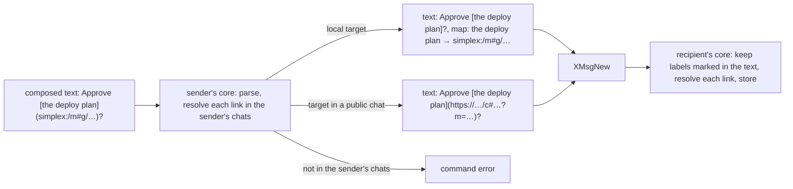
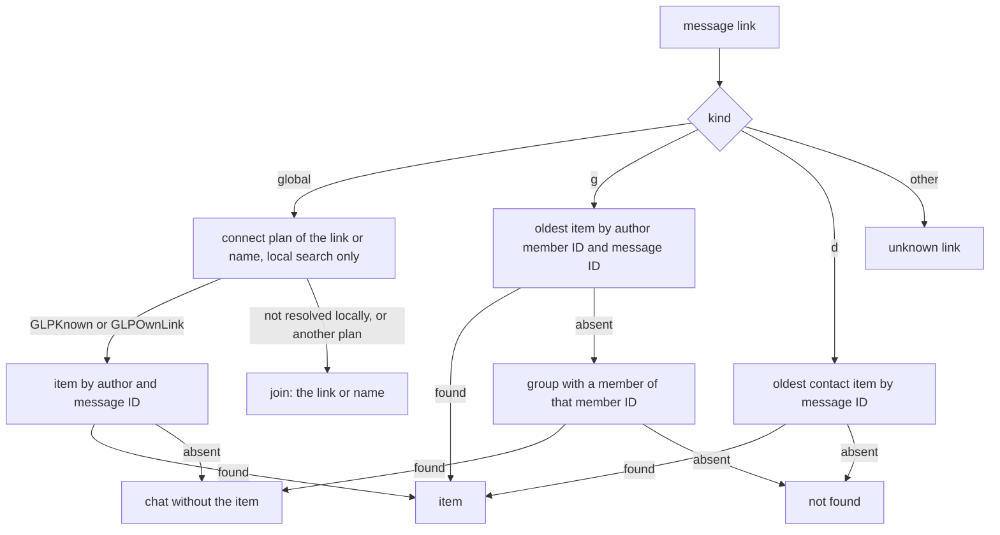
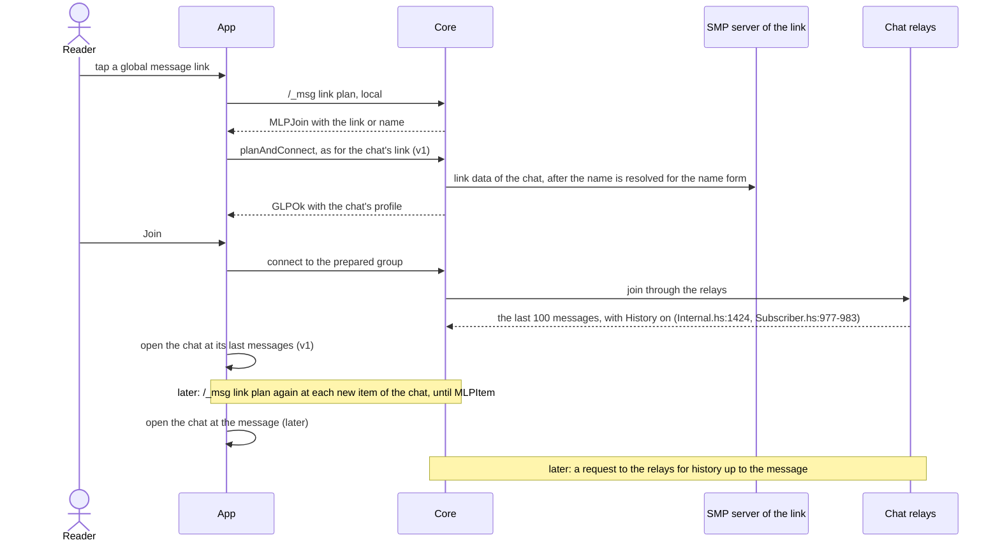
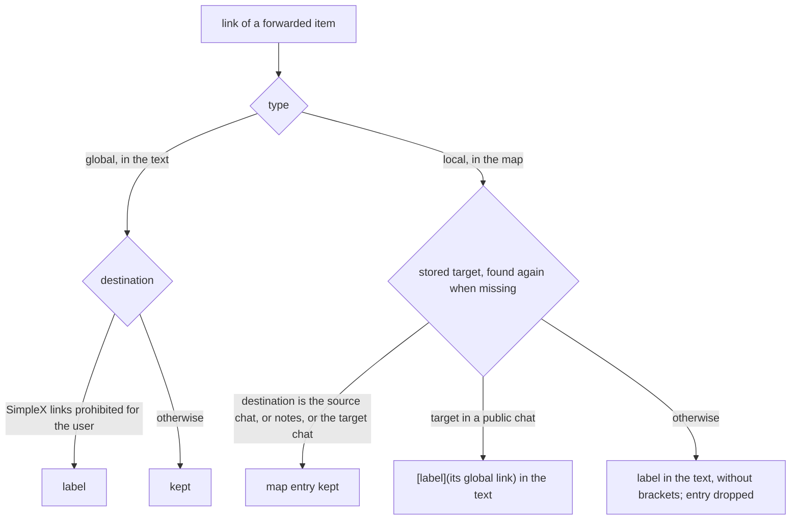
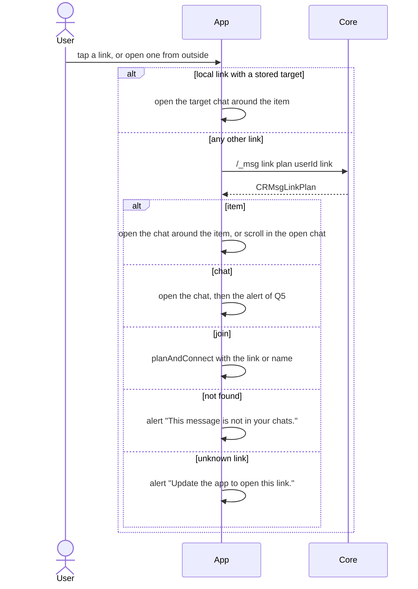
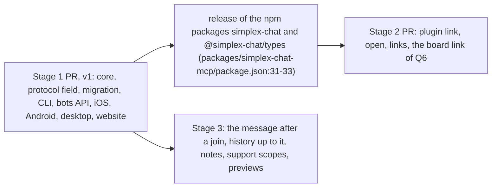

# Message references: links to messages across chats

## Problem

A person or an agent can point to a message only inside its chat, by a quote, or by forwarding a copy. From a short line in one chat, such as a list of open questions, the reader cannot open another chat at the message the line is about. A reader who is not in a public channel cannot be sent to one of its posts. Agents cannot produce or follow such a pointer.

## Acceptance

| # | After the change | Before |
|---|---|---|
| A1 | at "Copy link" in the menu of a message in a contact, group or channel chat, the app puts its message link on the clipboard | the menu offers Copy of the text only |
| A2 | a message link pasted or written in a message is shown as a tappable label | global links: a channel link; local links: plain text |
| A3 | at a tap, the app opens the chat at the message for a reader who has it, runs the connection flow of a public chat for a reader who is not in it, and shows an alert otherwise | global links: the connection flow |
| A4 | a link opened from a web page or another app is handled as in A3 | global links: the connection flow; local links: "Error: URL is invalid" (iOS), a connection error (Android, desktop) |
| A5 | the text of a message with local links contains only their labels, as `[label]`; member and message IDs are sent in the message's link map | — |
| A6 | in a forward, a local link is kept when the destination is the source chat, notes or the link's target chat, converted to a global link when its target is in a public chat, and reduced to its label otherwise | the text is forwarded unchanged |
| A7 | apps of earlier versions show `[label]` for a local link and forward the text without IDs; they open a global link as its chat | — |
| A8 | the plugin's `link` returns the link of a message; `send` takes it in the text as `[label](link)`; received messages list their links; `open` returns the message of a link, or the public chat to connect to | — |

## Options

| Option | Cost |
|---|---|
| A. URI in the message text, parsed by the core's markdown | parser, one `Format` constructor, commands, app rendering; protocol and database unchanged; the text, with its IDs, is copied and forwarded as is by people and by earlier clients |
| B. Labels in the text, as `@name` of mentions, and a link map in `XMsgNew` and `XMsgUpdate`, as `mentions` (Protocol.hs:694-697, 833-855) | protocol fields, a table, resolution at send and receive, edits; copy and forwards of earlier clients keep only the labels |
| C. A message content type with one link and a preview, as `MCChat` (Protocol.hs:752) | protocol type, card UI, one link per message; the text of a private chat is copied into the preview for a new audience |

B is chosen for local links, as their IDs must stay with the audience of the message and the link must stay correct, which the text cannot ensure: people and earlier clients copy and forward it as is. A is chosen for global links of public chats, which are meant to be shared outside chats and are correct in any audience.

## Two kinds of links

| Kind | Chats | In a sent message | A reader who is not in the chat |
|---|---|---|---|
| global | public chats served by relays: channels now, public groups later | a URI in the text, in the chat's own connection forms, with `m` and `a` | connects to the chat by the link or its SimpleX name |
| local | p2p groups, business chats, contacts | `[label]` in the text, and an entry of the message's link map | sees the label |

Schemes (Q1): `simplex:` is the scheme of URIs in the SimpleX network: connection links, SimpleX names (simplexmq SimplexName.hs:113), files (simplexmq FileTransfer/Description.hs:283) and message links. `simplexchat:` is the scheme of app-specific deep links, such as badge links (plans/2026-09-24-badge-buy-in-browser.md:43). The comments that state another rule (ContentView.swift:506, ChatListView.kt:816) are changed to these roles.

A local link has a URI form, `simplex:/m#…`: it is put on the clipboard by "Copy link", returned by the plugin's `link`, opened from outside the app, and written by people and agents in a composed text. The sender's core takes it out of the text into the link map, so it is never sent in a message text.

## Format

Message IDs are 12 random bytes in base64, 16 bytes in all (Store/Messages.hs:241-260, Store/Shared.hs:641-642, 660-661); history welcome messages have 24 random bytes (Internal.hs:1444). Every member stores a group message with the author's member ID and the same message ID, relayed messages included (Subscriber.hs:4066-4071). The keys of a p2p group are the member's own (`GKGroup`, Types.hs:493-495), and a message of a group is found by the author's member ID and the message ID (Store/Messages.hs:3092-3109). A public chat served by relays is identified by `publicGroupId`, the hash of its root key, which is the entity ID of its short link (Types.hs:910-916; Commands.hs:2795-2797, 4688-4695).

```
msg-link     = global-link | local-link
global-link  = short link of a group (CCTChannel or CCTGroup), https or simplex: form, with m and a added to its query
             | "simplex:/name#" public-name "?" query
local-link   = "simplex:/m#" kind "/" msg-id [ "?" query ]
kind         = "g"   p2p group or business chat
             | "d"   contact
public-name  = the domain of SimplexNameInfo with NTPublicGroup (simplexmq SimplexName.hs:110-132)
msg-id       = SharedMsgId bytes, base64url without padding
query        = query string, values percent-encoded, unknown names ignored
  m          = msg-id                                           global links: required
  a          = author MemberId, base64url without padding       kind g: required; global links: absent for messages sent as the chat
  h, p, c    = the server parameters of a short link, as now
```

Examples:

```
https://smp18.simplex.im/c#3tR8_b50RNZQtPkDs0Z3IxdfsszHxdyZYWQ4KHOyifg?m=Z21RRHdMR1NzSmlyNDBYeA
simplex:/c#3tR8_b50RNZQtPkDs0Z3IxdfsszHxdyZYWQ4KHOyifg?h=smp18.simplex.im&m=Z21RRHdMR1NzSmlyNDBYeA
simplex:/name#privacy.simplex?m=Z21RRHdMR1NzSmlyNDBYeA
simplex:/m#g/Z21RRHdMR1NzSmlyNDBYeA?a=UWRoR05KMk16UG1hSGRpag
simplex:/m#d/Z21RRHdMR1NzSmlyNDBYeA
```

- A public group served by relays has a short link of type `g`, with the same parameters: `https://<host>/g#<key>?m=…&a=…`. The connect plan handles links of types `c` and `g` alike (Commands.hs:4652-4653); today a relay link of another type than a channel gets `GLPUpdateRequired` (Commands.hs:4685, 4715-4717), and forward attribution already maps type `g` to `GTGroup` (Internal.hs:281-284). The global form needs no change for public groups.
- A global link is produced for a chat with a `PublicGroupProfile` (Types.hs:910-916). A short link of a group with `m`, also of a p2p group with a group link, is parsed as a global link and resolved by the same connect plan.
- The short-link parser reads only `h`, `p` and `c` of the query (simplexmq Agent/Protocol.hs:1779-1786), so `m` and `a` are reserved there for message links, and earlier cores parse a global message link as the chat's link. Apps of earlier versions show it and open it as the chat, in messages and from outside: SMP servers serve the paths `/c` and `/g` in their app association files and link pages (simplexmq apps/common/Web/static/.well-known/apple-app-site-association, apps/smp-server/SMPWeb.hs:23-24), and iOS opens `*.simplex.im` links in the app (SimpleX (iOS).entitlements:12).
- The query of the fragment is kept in the app URI built by the link page of SMP servers (simplexmq apps/common/Web/static/media/contact.js:23-33), so the app receives a message link opened in a browser with `m`.
- The name form uses the URI prefix that the SimpleX name parser accepts (simplexmq SimplexName.hs:113) and the names that connect accepts (Types.hs:1915-1920). Earlier cores show it as text, as their markdown parses no `simplex:/name` URI (Markdown.hs:506-518), and it is refused by their connect, as the domain parser consumes the word up to a space and fails at `?` (simplexmq SimplexName.hs:101-108, 120-124).
- `simplex:/m#…` is refused as a connection link: `m` is neither a short-link type letter (simplexmq Agent/Protocol.hs:1775-1778, 1809-1815) nor a full-link mode (Agent/Protocol.hs:1308). Opened from outside, earlier apps show "Error: URL is invalid" (ContentView.swift:476-486) or a connection error (ChatListView.kt:808-812).
- The fields of a global link are those of `ForwardLink` (Protocol.hs:710-717) without `displayName`, and with the link or the SimpleX name in place of `publicGroupId`. The author is set by the rule of `chatItemMember` (Messages.hs:374-380), as in forwards (Commands.hs:1158).
- The message part of kind `g` and of global links is the identity of `MsgRef` in quotes (Protocol.hs:236-242).
- A `simplex:/m#` link of an unknown kind is parsed as `MLUnknown` with its text, so no format change is required for a later kind.

## Link map

The local links of a message are sent as a map from label to link, as mentions are (Protocol.hs:694-697, 833-855): in `XMsgNew`, a field `links` of `MsgContainer` (Protocol.hs:692-708); in `XMsgUpdate`, a field `links` beside `mentions` (Protocol.hs:464, 1427-1435, 1520). A label is marked in the text as `[label]`. An empty map is omitted.

```json
{
  "event": "x.msg.new",
  "params": {
    "content": {"type": "text", "text": "Approve [the deploy plan]?"},
    "links": {"the deploy plan": "simplex:/m#g/Z21RRHdMR1NzSmlyNDBYeA?a=UWRoR05KMk16UG1hSGRpag"}
  }
}
```

- The value is the link string of `MsgLink`, so a later kind is received as `MLUnknown` and kept.
- aeson ignores unknown fields and parses an absent field as empty (plans/2026-08-22-forward-link.md, section "Protocol"), so earlier clients receive the text with `[the deploy plan]` and ignore the map. Their forwards are built from the content only (`mcForward`, Protocol.hs:741-742), and their copy takes the text, so the IDs stay in the map of the original message.
- At most 20 links are sent in a message and 30 are kept from a received message, by the rule of `uniqueMsgMentions` (Internal.hs:346-357): a label without `[label]` in the text is dropped.



At send, each `ComposedMessage` of `APISendMessages` (Commands.hs:775-788), for contacts and groups, and of `APICreateChatItems` (Commands.hs:813), for notes, passes through `composedLinks` before `composedMessageReq` and `composedMessageReqMentions` (Commands.hs:5396-5402):

```
composedLinks user text:
  global links: sent as written
  each local link of the parsed text, [label](link) or bare with the label "message":
    msgLinkPlan user link
      MLPItem item in a public chat -> written as [label](the item's global link)
      MLPItem item                  -> written as [label]; label -> link is added to the map
      otherwise                     -> command error "message link: not in your chats"
  two different links with one label -> command error, as SEInvalidMention (Internal.hs:327-336)
```

`ComposedMessageReq` (Commands.hs:5391) gets the links, as it has the `CIMention`s; `prepareMsgs` of contacts (Commands.hs:5020-5037) and `prepareGroupMsg` (Internal.hs:214-233) put them into `MsgContainer`, and `createItem` (Internal.hs:3079-3088) stores them, beside `createGroupCIMentions`.

At receipt, in `saveRcvChatItem'` (Internal.hs:3103-3124), beside the mentions:

```
rcvLinks user sender links text:
  labels marked as [label] in the text, at most 30
  MLGroup author msgId  -> target: getGroupItemIdByAuthor author msgId
  MLDirect msgId        -> target: the item of msgId in the contact chat with the sender (getDirectChatItemIdBySharedMsgId_, Store/Messages.hs:2691-2703)
  other kinds           -> stored without a target
  rows inserted into chat_item_links
```

The sender of a direct link is known at receipt: the contact of a direct chat, or the contact of the group member who sent the message. A target that is missing at receipt is found again by the plan at a tap, and at a forward.

Database, a migration for SQLite and Postgres, as `chat_item_mentions` (chat_schema.sql:774-780, 1358-1369):

```
chat_item_links
  chat_item_link_id     INTEGER PRIMARY KEY
  chat_item_id          INTEGER NOT NULL REFERENCES chat_items ON DELETE CASCADE
  label                 TEXT NOT NULL
  msg_link              BLOB NOT NULL
  target_chat_item_id   INTEGER REFERENCES chat_items ON DELETE SET NULL
UNIQUE (chat_item_id, label)
INDEX (target_chat_item_id)
```

## Types

Types.hs:

```haskell
data MsgLink
  = MLPublicGroup
      { publicChat :: ContactNameOrLink, -- Types.hs:1891: a CCTChannel or CCTGroup link, or an NTPublicGroup name, by the parser
        memberId :: Maybe MemberId,
        msgId :: SharedMsgId
      }
  | MLGroup
      { memberId :: MemberId,
        msgId :: SharedMsgId
      }
  | MLDirect {msgId :: SharedMsgId}
  | MLUnknown {linkText :: Text}

data MsgLinkType = MLTPublicGroup | MLTGroup | MLTDirect | MLTUnknown

instance StrEncoding MsgLink    -- the forms above; the link of CTLink keeps its https or simplex: scheme (SLSServer, SLSSimplex)
-- JSON: the link string, by strToJSON and strParseJSON

type LinkLabel = Text
```

Protocol.hs:

```haskell
newtype MsgLinks = MsgLinks (Map LinkLabel MsgLink) -- JSON as MsgMentions (Protocol.hs:844-855)
```

Messages.hs:

```haskell
data ChatItem c d = ChatItem
  { ...,
    mentions :: Map MemberName CIMention,
    links :: Map LinkLabel CILink, -- the local links, as mentions (Messages.hs:262-264)
    ...
  }

data CILink = CILink
  { msgLink :: MsgLink,
    target :: Maybe CILinkTarget -- the message in a chat of the user, when found
  }

data CILinkTarget = CILinkTarget
  { chatType :: ChatType,
    chatId :: Int64,
    chatItemId :: ChatItemId
  }

itemMsgLink :: ChatInfo c -> ChatItem c d -> Either String MsgLink
itemMsgLink cInfo ci@ChatItem {meta = CIMeta {itemSharedMsgId}} = case (cInfo, itemSharedMsgId) of
  (DirectChat _, Just msgId) -> Right $ MLDirect msgId
  (GroupChat g@GroupInfo {groupProfile = GroupProfile {publicGroup}} _, Just msgId) -> case publicGroup of
    Just PublicGroupProfile {groupLink} -> Right $ MLPublicGroup (CTLink groupLink) (memberId' <$> chatItemMember g ci) msgId
    Nothing -> maybe (Left "message has no author") (Right . (`MLGroup` msgId) . memberId') $ chatItemMember g ci
  _ -> Left "message has no link"
```

`groupLink` is stored in its https form on the server host (Commands.hs:4902-4903), so "Copy link" of a message in a public chat gives the https form (Q3).

## Privacy

| Kind | Readers who open it | What any other reader learns |
|---|---|---|
| global | members of the public chat; others connect to it by the link or the name | the chat, the message's ID and the author's member ID, all public in the chat |
| local `g` | members who have the message | the recipients of the message receive two random IDs in its map; links with the same `a` refer to one author in one group |
| local `d` | the two parties | the recipients of the message receive one random ID in its map |

- The IDs of a local link reach only the recipients of the message that has it: copies and forwards of its text by people and by earlier clients have the label only, and the forwards of new clients follow the forward rules below.
- Access to a message is not given by its link: only a reader who has the message can open it.
- The core resolves a link from the local database and sends no request. For a public chat that the reader is not in, its link data is then fetched from its server by the connection flow, as for its link; `m` and `a` are not sent.
- When a link in its https form is opened in a browser, the server's link page is requested; the fragment, with `m` and `a`, is not sent to the server (simplexmq apps/common/Web/static/link.html:150).
- The label is text of the writer and is visible to every reader. The apps do not fill it from the referenced message (Q4).
- The core searches only the user given by the app: the user of the chat where the link is tapped, or the active user for a link opened from outside the app. Other profiles, hidden ones included, are not searched.
- The oldest matching item is opened. A copy planted by a peer who read the link is created later than the original in the reader's database.

## Resolution

The plan resolves a link string. It is used at send, for links pasted or opened from outside, for a tap on a global link or on a local link without a stored target, at a forward, and by the plugin's `open`.



```haskell
-- Controller.hs
data MsgLinkPlan
  = MLPItem {chatItem :: AChatItem}
  | MLPChat {chatInfo :: AChatInfo}
  | MLPJoin {connTarget :: AConnectTarget} -- Types.hs:1898-1899, JSON as a string
  | MLPNotFound
  | MLPUnknownLink

-- Internal.hs
msgLinkPlan :: User -> MsgLink -> CM MsgLinkPlan
```

```
msgLinkPlan user link:
  MLPublicGroup target author msgId:
    connectPlan user (ACTarget SCMContact (CTShortContact target)) PRMNever Nothing Nothing
      CPGroupLink (GLPKnown g ..) or CPGroupLink (GLPOwnLink g):
        publicItemId g author msgId
          Just itemId -> MLPItem (item of g and itemId)
          Nothing     -> MLPChat g
      CENotResolvedLocally, or another plan -> MLPJoin target
  MLGroup author msgId:
    getGroupItemIdByAuthor author msgId
      Just (gId, itemId) -> MLPItem (item of gId and itemId)
      Nothing -> getGroupIdByMemberId author
        Just gId -> MLPChat (group gId)
        Nothing  -> MLPNotFound
  MLDirect msgId:
    getDirectItemIdByMsgId msgId
      Just (ctId, itemId) -> MLPItem (item of ctId and itemId)
      Nothing             -> MLPNotFound
  MLUnknown _ -> MLPUnknownLink
item of chat and itemId = getAChatItem (Store/Messages.hs:3376-3393), with the scope of getGroupChatScopeForItem_ (Store/Messages.hs:1510)
```

- With `PRMNever`, the connect plan is limited to the local search (Controller.hs:728-732): a public chat is found by its link (Commands.hs:4718-4722) or by its verified name (Store/Groups.hs:1116-1134); otherwise the plan is refused with `CENotResolvedLocally` (Commands.hs:4674-4676).
- `publicItemId` is the item lookup of `forwardLinkCIFF` (Internal.hs:285-292) moved into one function, used by both.
- `getGroupItemIdByAuthor`, Store/Messages.hs: the join of `getGroupMemberCIBySharedMsgId` (Store/Messages.hs:3092-3109) without the group, `WHERE m.user_id = ? AND m.member_id = ? AND i.shared_msg_id = ?`, `ORDER BY i.chat_item_id ASC LIMIT 1`. Own items, stored with `group_member_id` NULL, are matched by the own membership row.
- `getDirectItemIdByMsgId`, Store/Messages.hs: `WHERE user_id = ? AND contact_id IS NOT NULL AND shared_msg_id = ?`, `ORDER BY chat_item_id ASC LIMIT 1`. The user's entries of `idx_chat_items_direct_shared_msg_id` (chat_schema.sql:1031-1035) are scanned; it is used without a sender, for a link pasted or opened from outside, and its time on a database with 1 million contact items is measured before review.
- A deleted or moderated item is returned as an item. For an item removed by deletion or by the chat's time to live, the plan is `MLPChat` for a group or a public chat, and `MLPNotFound` for a contact.
- No database row is written by the plan.

A reader who is not in the public chat:



## Markdown

Markdown.hs:

```haskell
data Format
  = ...
  | MessageLink {showText :: Maybe Text, linkType :: MsgLinkType, msgLink :: MsgLink} -- a link in the text
  | LinkLabel {label :: Text} -- [label]; a link when the item's links have the label, as Mention (Markdown.hs:67)
```

| Form | Result |
|---|---|
| `[label](link)` | `MessageLink (Just label)` |
| `<link>` | `MessageLink Nothing` |
| bare link | `MessageLink Nothing` |
| `[label]`, not followed by `(` | `LinkLabel label` |
| a short link without `m` | `SimplexLink`, as now |
| a known form with an invalid field | text, or the chat's link, as now |

- `LinkLabel` follows `Mention`: `mentionP` (Markdown.hs:442) parses every `@name`, and the apps render it as a mention only when the item's `mentions` have the name (MsgContentView.swift:675-692). An unmatched `[label]` is shown as it is written. A label is one or more characters without `[`, `]` or a line break, and without a space at either end.
- `linkType` is set by the parser from `msgLink`, as `linkType` of `SimplexLink` (Markdown.hs:546-567).
- `linkMD` and `hyperLinkFormat` (Markdown.hs:461-467, 506-518) try `MsgLink` before `AConnectionLink`.
- `sowLinkP` (Markdown.hs:450-456): with a message link, the label is any text up to `]` without `[` or a line break. The punctuation rule of web hyperlinks (Markdown.hs:453-454) is not applied. A label with a link in its own markdown (`isLink`) is refused: the label is left as text and the link is parsed bare, as for spoofed web links (MarkdownTests.hs:344-348).
- A bare link is parsed whole first, then without its trailing punctuation (`linkEndLength`, Markdown.hs:519-532), so a final `-` of an ID is kept.
- `markdownText` returns the source text, as for `SimplexLink` (Markdown.hs:978).
- `MessageLink` and a matched `LinkLabel` are included in `isLink`, so `hasLink` is set for the item (Internal.hs:3159-3167). `MessageLink` with `MLPublicGroup` is included in `isSimplexLink` (Markdown.hs:315-318), so the group preference is applied at send (Commands.hs:5076), edit (Commands.hs:854) and receive (Subscriber.hs:2260, 2336, 2357), and in member profiles (Internal.hs:1376-1385), as earlier cores apply it to the chat's link. Local links are not SimpleX links: they connect nobody.

## Core API

| Command | Syntax | Response |
|---|---|---|
| `APIGetChatItemLink {chatRef, chatItemId}` | `/_get item link <chatRef> <chatItemId>` | `CRChatItemLink {user, msgLink}` |
| `ShowChatItemLink {chatName, msg}` | `/item link <chatName> <text>`, as `/item info` (Commands.hs:3567-3570, 7109) | the same |
| `APIMsgLinkPlan {userId, msgLink}` | `/_msg link plan <userId> <msgLink>` | `CRMsgLinkPlan {user, msgLinkPlan}` |

- Local links are sent in the text of `APISendMessages` and `APIUpdateChatItem` as `[label](link)` or bare, and moved into the link map by the core. `ComposedMessage` and `UpdatedMessage` (Controller.hs:1379-1391) get no field: unlike a mention's display name, a link in the text is unambiguous. To edit a message, the app writes each `[label]` of the item's `links` back as `[label](link)`.
- `APIGetChatItemLink`: `getAChatItem`, then `itemMsgLink`; `Left` is returned as a command error. Notes and items without a message ID, such as group events, are refused.
- CLI views, View.hs: the link is printed for `CRChatItemLink`; for `CRMsgLinkPlan`, the chat and the item line, or `message link: not in your chats`, `message link: the message is not in CHAT`, `message link: connect with TARGET`, `message link: unknown link type`. A received item with links is followed by one line per link, `[label]: CHAT`, with its target chat when found.
- Bots API: `APIGetChatItemLink` and `APIMsgLinkPlan` in the category "Message commands" (bots/src/API/Docs/Commands.hs:95-111), the types `MsgLink` (string), `MsgLinkType`, `MsgLinkPlan`, `CILink`, `CILinkTarget`, the field `links` of `ChatItem`, and the formats `MessageLink` and `LinkLabel`; bots/api/*.md and the TypeScript and Python types are generated again.

## Forwards and edits



- In each destination branch of `APIForwardChatItems` (Commands.hs:1109-1130), the result of `prepareForward` (Commands.hs:1134-1257) is mapped by `forwardedLinks`, after the mention names (Commands.hs:1161-1166) and the owner signature (Commands.hs:1186-1190) are set: the content and the links of each `ComposedMessageReq` (Commands.hs:5391) are changed, and its texts are computed again by `msgContentTexts` (Internal.hs:368-369).
- Mentions are kept only in forwards to the same group (Commands.hs:1164); local links are kept also in forwards to their target chat, whose members have the target.
- A forward is never refused for its message links: a global link is reduced to its label where SimpleX links are prohibited for the user (`groupFeatureMemberAllowed SGFSimplexLinks`, as in Internal.hs:431).
- A local link written in a received text, by a client that sends it so, is handled as a map entry.
- Edits: `XMsgUpdate` sends the new map, which replaces the item's links, as `updateGroupCIMentions` replaces mentions (Store/Messages.hs:2826-2840; Commands.hs:868-880; Subscriber.hs:2415-2418).
- Quotes: a quote has the content only (Protocol.hs:633), so a quoted local link is shown as `[label]`.
- A new message, as opposed to a forward, is sent as written.

## Apps



| Part | iOS | Android and desktop |
|---|---|---|
| `Format`, `MsgLinkType`, `CILink` | SimpleXChat/ChatTypes.swift:3959-3987, 6008-6027 | ChatModel.kt:5382-5412 and `ChatItem` |
| commands and `MsgLinkPlan` | Shared/Model/AppAPITypes.swift, Shared/Model/SimpleXAPI.swift | model/SimpleXAPI.kt |
| rendering and tap | MsgContentView.swift:300-313, 653-692: an attribute key for message links; `LinkLabel` by the item's `links`, as `.mention` by `mentions` | TextItemView.kt:354, 401-416, 489-504: the annotation `MESSAGE_LINK` |
| open at the item | `ItemsModel.loadOpenChatNoWait(chatId, itemId)` (ChatModel.swift:143-157), as the forward header (FramedItemView.swift:117-123) | `openChat(null, rhId, chatType, apiId, itemId)` (ChatListNavLinkView.kt:212-236), as FramedItemView.kt:362-370 |
| link from outside | `connectViaUrl_` (ContentView.swift:463-488): a URL that the core parses as a message link goes to the plan before the path switch, for the paths `/m`, `/c`, `/g` and `/name` | `connectIfOpenedViaUri` (ChatListView.kt:800-814): the same check before `planAndConnect` |
| compose | a pasted link is shown as `[message]`, and the link is kept in the compose state, as mentions are kept (ComposeView.swift:56-137); the text is sent with `[label](link)` | the same in the Compose view |
| Copy link | the item menu (ChatView.swift:2447-2507) | `MsgContentItemDropdownMenu` (ChatItemView.kt:394-451) |
| link pasted in search | `strConnectTarget` (NewChatView.swift:860-872), then the plan | `strConnectTarget` (NewChatView.kt:834), then the plan |

- Copy of a message's text gives the text with its `[label]` markers. "Copy link" gives the message's own link: global for a public chat, `simplex:/m#…` otherwise.
- The label is `showText` or the `[label]` text, or the generic label of Q4. At long-press, the app opens the item menu, as now (ChatItemView.kt:129).
- The decision from `MsgLinkPlan` to an action is one pure function in each app, tested on recorded core responses.
- For an item in a member support scope, the app opens its group in stage 1 and its support chat in stage 3.
- `simplex:` is registered on iOS (SimpleX--iOS--Info.plist:40-43), Android (AndroidManifest.xml:75) and desktop (plans/2026-09-28-desktop-deep-links.md, section "`simplex:` connection links"); https links on preset servers open the app on iOS (SimpleX (iOS).entitlements:12) and Android (AndroidManifest.xml:86-112).
- `minRemoteCtrlVersion` and `minRemoteHostVersion` (Remote.hs:77-82) are set to the release version, as for block markdown (plans/2026-10-13-block-markdown.md:691), because an earlier desktop cannot decode the new `Format` and `ChatItem` fields.
- A `messageLink` case is added to the website renderer (website/src/js/simplex-lib.jsc:234-294): the label is rendered as a link; the href of a global link in a short-link form is `platformSimplexUri` of the link (simplex-lib.jsc:307-329), which keeps `m` and `a`, and the name form is used as it is. A `[label]` is shown as text.
- Message links are described in spec/client/navigation.md of both apps.

## Plugin

| Tool | Input | Output |
|---|---|---|
| `link` | `item`, and `chat`: `@N` or `#N`; without `chat` in the plugin, the item of the session's group | `{link}`: global for a public chat, `simplex:/m#…` otherwise |
| `send`, `reply` | `text` with links as `[label](link)` | as now; a link that is not in the agent's chats: `text: message link LINK is not in your chats.` |
| `open` | `link` | `status`: `found` with `message`; `chat` with the chat fields; `join` with `target`, the link or name for `connect`; `none`; `update` |

- Message object (messages.ts:23-35), a field `links` when the message has local links: an array of `{label, link}`, with `chat` and `item` of the target when it is a message of a chat that the session owns. `text` keeps the `[label]` markers. A channel prompt from the session's group gets `meta.links`, the same array as a JSON string (spec/api.md:1036).
- No action is created by `link` or `open`; both only read, as `receive`.
- After `connect` to the public chat of a `join`, `open` of the same link returns `found` once the message is received with the chat's history.
- `open` returns `none` for a chat that the session does not own (spec/api.md:686), so chats of other sessions are kept hidden. A message of the session's group is returned with `item` and without `chat`, as the channel's prompts (spec/api.md:1036).
- `connect` with a global message link connects to its chat, as earlier cores parse it. `connect` with a `simplex:/m#` link returns `TARGET is a message link; open returns its message.` in place of `Not a SimpleX link or name: TARGET` (spec/api.md:132).
- One sentence is added to the instructions (tools.ts:495-506): `A message link references one message: link returns the link of a message, which you write in a text as [label](link); links lists the links of a received message; open returns the message of a link, or the public chat to connect to.`

Agents can use such links under three conditions, each stated by the design:

1. Every link is taken from a `link` result, a `links` field or a received text.
2. The agent writes it as `[label](link)`; the core sends the local ones as labels with a map.
3. The agent follows it with `open`, or with the `chat` and `item` of its `links` entry.

| Evidence | Source |
|---|---|
| agents already write Markdown, and `[text](url)` in their posts is parsed by the core | Claude's text is posted to the session group (spec/api.md:911); Markdown.hs:450-456 |
| opaque `simplex:/` links are copied by agents between results and calls | `connect` takes them (tools.ts:284) |
| an ID cannot be produced from memory, as it is random | Store/Shared.hs:660-661 |
| a damaged link is refused at send, parsed as the chat's link, or resolved as `none` | the send and the plan above |
| a global message link given to `connect` connects to its chat; a local link gets the error above | Agent/Protocol.hs:1779-1786 |

## Stages



| Stage | Content |
|---|---|
| 1, v1 | every form of the Format section, parsed and encoded; the link map in `XMsgNew` and `XMsgUpdate`, the table, resolution at send and receive; Copy link; the plan; for a public chat that the reader is not in, the connection flow as for its link, which opens the chat at its last messages; forwards and edits; group preference; app rendering, tap, compose, links from outside, search paste; remote versions; website case; the comments of the scheme roles |
| 2 | plugin `link`, `open` and the `links` field, the `simplex:/m#` error of `connect`, instructions; the board link of Q6 |
| 3 | after a join from a message link, the plan is run again at each new item of the chat, and the app opens the chat at the message; a request to the relays for history up to a message; the forward header of `CIFFGroupLink` opens the original message by the same flow (FramedItemView.swift:120-121); kind `n` for notes, by local IDs, in the maps of notes only; the support chat at the item; a preview of the referenced message at long-press |

No v1 format is changed in stage 3, or when public groups are served by relays: every form is defined in v1, the global form is keyed by the chat's link or name of either group type, unknown parameters and map entries of unknown kinds are kept, and a new kind of `simplex:/m#` is parsed as `MLUnknown` by v1 cores. The map is an optional field, so the chat protocol version is unchanged, as for `forwardLink` (plans/2026-08-22-forward-link.md, section "Protocol").

## Tests

Each test fails on master, except the compatibility tests, which pin how earlier cores parse a global link and a message with a map.

| File | Test |
|---|---|
| tests/MarkdownTests.hs | `[Should I merge?](simplex:/m#g/…?a=…)` gives `MessageLink (Just "Should I merge?") MLTGroup …`; `see [the plan] now` gives `LinkLabel "the plan"`; `[ ]` and `[x](y)` give text |
| | the https, `simplex:` and name forms of a global message link give `MessageLink … MLTPublicGroup …`, for links of types `c` and `g`; the same short link without `m` gives `SimplexLink` |
| | compatibility: `strDecode` of a global message link as `AConnectionLink` gives the chat's link |
| | `see simplex:/m#d/ID.` gives text, a bare link and `.`; a final `-` of an ID is kept; `simplex:/m#x/…` gives `MLUnknown` |
| | `[https://example.com](simplex:/m#d/…)` gives the label as text and a bare link |
| | `strDecode . strEncode` returns each `MsgLink` variant in each form |
| tests/ProtocolTests.hs | `x.msg.new` and `x.msg.update` with `links` are encoded and parsed; compatibility: a container without `links` parses with an empty map, as `x.msg.new forward with channel link` (ProtocolTests.hs:273-277) |
| tests/ChatTests/Groups.hs | alice sends in `#club` `Approve [q](link of bob's message in #team)?`; cath, in `#club` and `#team`, receives the text `Approve [q]?` with a stored target; dan receives the label only; `/_msg link plan` gives cath the item and dan `not in your chats` |
| | a channel post: a subscriber gets the item by the https form; a non-subscriber gets `join` with the link, connects with it, and then gets the item |
| | a link to a channel post given as `simplex:/m#…` is sent as its global link in the text |
| | a link that is not in the sender's chats is refused at send |
| | an edit that changes a label replaces the item's links for every member |
| | `#club` with SimpleX links off: a global message link is refused, and a local link is sent |
| tests/ChatTests/Names.hs | a channel with a verified name, as in `testConnectByChannelName`: a subscriber gets the item by the name form; a non-subscriber gets `join` with the name |
| tests/ChatTests/Direct.hs | alice's message to bob, its link sent to bob in a group: bob's item has the target in his chat with alice; cath's item has none |
| tests/ChatTests/Forward.hs | a local link forwarded to its target chat is kept; to the source chat and to notes it is kept; to another chat its label is written without brackets and the entry is dropped; a local link to a public chat message is written as its global link; a global link is kept, and reduced to its label in a group with SimpleX links off |
| app tests on recorded core responses | `Format.messageLink`, `Format.linkLabel` and `ChatItem.links` are decoded; each `MsgLinkPlan` variant gives its action; a pasted link is shown as `[message]` and sent as `[message](link)` |
| plugin unit and e2e tests | `link` of a sent message, then `send` with `[label](link)` in another chat, then `links` of the received message and `open`; `open` for a chat of another session returns `none`; `connect` with a `simplex:/m#` link returns its error |

## Questions

| ID | Question | Recommendation |
|---|---|---|
| Q1 | `simplex:` for every message link. Links of public chats served by relays (channels now, public groups later) are URIs in the text, in the chat's own connection forms (https on its link's server host, `simplex:` link, `simplex:/name`) with `m` and `a`. Local links of groups, business chats and contacts are `[label]` in the text and an entry of the message's link map; their URI form `simplex:/m#…` is for the clipboard, links from outside and composed texts, and is never sent in a message text. `simplexchat:` stays the scheme of app-specific deep links, such as badge links. | decided by you |
| Q2 | In a forward, a local link is kept when the destination is the source chat, notes or its target chat; it is written as its global link when the target is in a public chat; otherwise its label is written without brackets. A global link is kept where SimpleX links are allowed. | yes |
| Q3 | "Copy link" of a message in a public chat gives the https form on its link's server host. The name form, for a chat with a verified name, is written by hand in v1. | yes: the https form opens in browsers and in apps of earlier versions |
| Q4 | A link pasted without a label gets the label `message`, shown as "message" with a link icon. Copy of a message's text gives the text with its `[label]` markers; Copy link gives the link. | yes |
| Q5 | When the chat is known and the message is gone, the app opens the chat and shows an alert: the message is deleted or not received yet. | yes |
| Q6 | The session's message on the board in the Main group links "waiting for you" to the oldest pending card of the session. | yes, in stage 2 |
