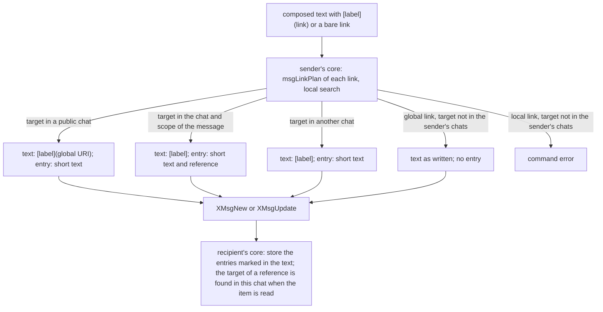
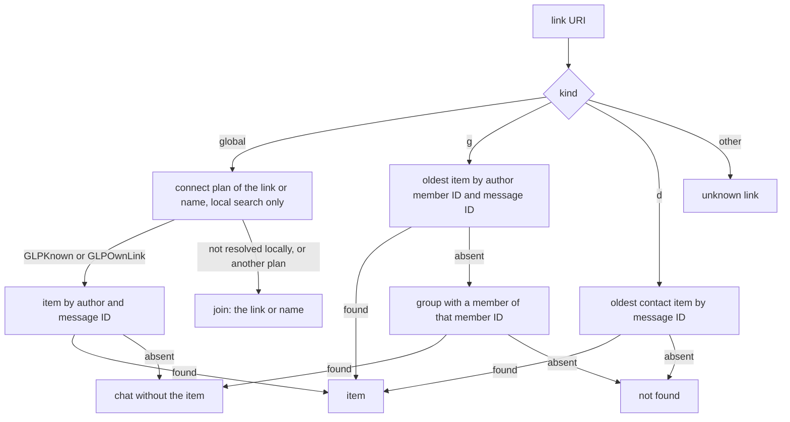
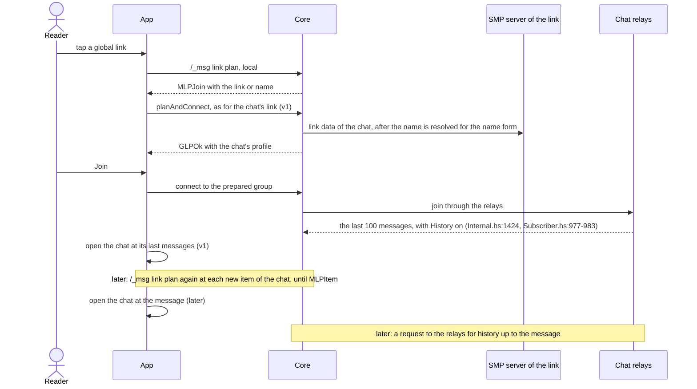
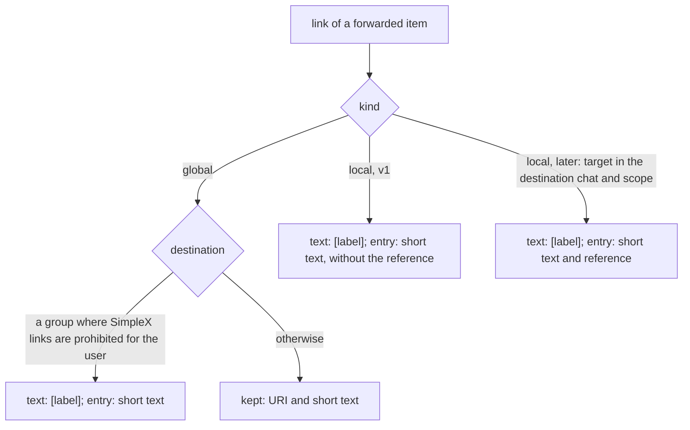
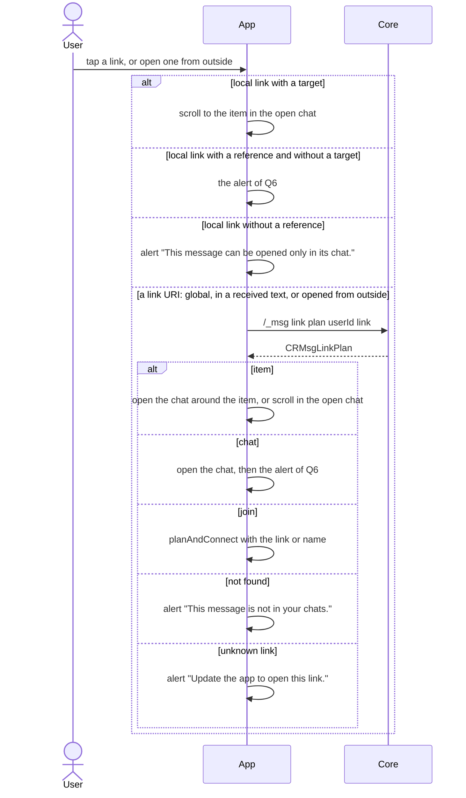
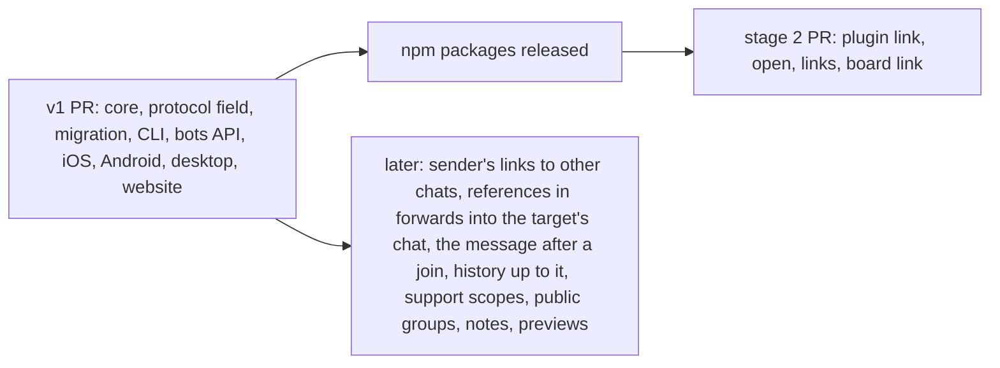

# Message references: links to messages across chats

## Problem

A person or an agent can point to a message only inside its chat, by a quote, or by forwarding a copy. From a short line, such as one of a list of open questions, the reader can neither open the message the line is about nor see its beginning. A reader who is not in a public channel cannot be sent to one of its posts. Agents have no way to produce or follow such a pointer.

In v1, the problem is solved for links to messages of the same chat, such as a list of questions in a session's group that links to the questions in that group, and for links to posts of public chats, which anyone can open.

## Acceptance

| # | After the change | Before |
|---|---|---|
| A1 | at "Copy link" in the menu of a message in a contact, group or channel chat, the app puts its link on the clipboard | the menu offers Copy of the text only |
| A2 | a link pasted or written in a message is shown as its label with the short text of the linked message | global links: a channel link; local links: plain text |
| A3 | at a tap, the app opens the chat at the message for a reader who can open it, runs the connection flow of a public chat for a reader who is not in it, and shows an alert otherwise | global links: the connection flow |
| A4 | a link opened from a web page or another app is handled as in A3 | global links: the connection flow; local links: "Error: URL is invalid" (iOS), a connection error (Android, desktop) |
| A5 | the text of a message has only the labels of its local links, as `[label]`; their short texts, and the references of links to the same chat, are sent in the message's link map | — |
| A6 | a forwarded message keeps the labels and short texts of its links; local links are forwarded as text, without references; global links stay openable | the text is forwarded unchanged |
| A7 | apps of earlier versions show `[label]` for a local link and open a global link as its chat; their forwards and copies have the text only | — |
| A8 | the plugin's `link` returns the link of a message; `send` takes it in the text as `[label](link)`; received messages list their links with short texts; `open` returns the message of a link, or the public chat to connect to | — |

## Options

| Option | Cost |
|---|---|
| A. URI in the message text, parsed by the core's markdown | parser, a `Format` constructor, commands, app rendering; protocol and database unchanged; the text, with its IDs, is copied and forwarded as is by people and by earlier clients; recipients see no beginning of the message |
| B. Labels in the text, as `@name` of mentions, and a link map in `XMsgNew` and `XMsgUpdate`, as `mentions` (Protocol.hs:694-697, 833-855) | protocol fields, a table, resolution at send and receive, edits; copies and forwards of earlier clients keep only the labels; the map has room for the short text |
| C. A message content type with one link and a preview, as `MCChat` (Protocol.hs:752) | protocol type, card UI, one link per message |

B is chosen for every link: short texts, and the references of local links, are sent in the map, so that they reach only the recipients of the message and are not copied with its text. Global links of public chats are also written in the text as URIs, by A, because they are meant to be shared outside chats, are correct in any audience, and open in apps of earlier versions.

## Kinds of links and what is sent

| Kind | Target | In the text | Map entry | Recipients can open it |
|---|---|---|---|---|
| global | a message of a public chat served by relays: a channel now, a public group later | `[label](URI)`, the URI in the chat's own connection forms with `m` and `a` | short text | yes: members by the local search, others by joining |
| local, same chat | a message of the chat of the linking message: the same contact, or the same group and scope | `[label]` | short text and reference | yes |
| local, other chat | a message of another chat that is not public | `[label]` | short text | no; later the sender opens it from the sender's own copy |

- A business chat is a group (Types.hs:524), so its links follow the group rule. A member support scope (Messages.hs:119) is a chat of its own for this rule: the reference is sent only for a target in the same scope.
- The same chat is decided by the sender's core for each new or edited message: the chat and scope that the message is sent to. Forwards follow the forward rules below.
- The reference of a link to another chat stays only in the sender's own copy, stored locally, so that the sender can open it; that is a later stage (column `target_chat_item_id`). In v1, the sender's copy of such a link has its label and short text, as the recipients' copies.
- A link to a message of a public chat is always global, also inside that chat, so that forwards out of it stay openable.

Schemes (Q1, decided): `simplex:` is the scheme of URIs in the SimpleX network: connection links, SimpleX names (simplexmq SimplexName.hs:113), files (simplexmq FileTransfer/Description.hs:283) and message links. `simplexchat:` is the scheme of app-specific deep links, such as badge links (plans/2026-09-24-badge-buy-in-browser.md:43). The comments that state another rule (ContentView.swift:506, ChatListView.kt:816) are changed to these roles.

## Link URIs

A link is a URI on the clipboard, in a composed text and when opened from outside the app. Global links are also sent in the text; local link URIs are not: the sender's core moves them into the map.

```
msg-link     = global-link | local-link
global-link  = short link of a group (CCTChannel or CCTGroup), https or simplex: form, with m and a added to its query
             | "simplex:/name#" public-name "?" query
local-link   = "simplex:/m#" kind "/" msg-id [ "?" query ]
kind         = "g"   p2p group or business chat
             | "d"   contact
public-name  = the domain of SimplexNameInfo with NTPublicGroup (simplexmq SimplexName.hs:110-132)
msg-id       = SharedMsgId bytes, base64url without padding
query        = query string, values percent-encoded, unknown names ignored
  m          = msg-id                                           global links: required
  a          = author MemberId, base64url without padding       kind g: required; global links: absent for messages sent as the chat
  h, p, c    = the server parameters of a short link, as now
```

Examples:

```
https://smp18.simplex.im/c#3tR8_b50RNZQtPkDs0Z3IxdfsszHxdyZYWQ4KHOyifg?m=Z21RRHdMR1NzSmlyNDBYeA
simplex:/c#3tR8_b50RNZQtPkDs0Z3IxdfsszHxdyZYWQ4KHOyifg?h=smp18.simplex.im&m=Z21RRHdMR1NzSmlyNDBYeA
simplex:/name#privacy.simplex?m=Z21RRHdMR1NzSmlyNDBYeA
simplex:/m#g/Z21RRHdMR1NzSmlyNDBYeA?a=UWRoR05KMk16UG1hSGRpag
simplex:/m#d/Z21RRHdMR1NzSmlyNDBYeA
```

- Message IDs are 12 random bytes in base64, 16 bytes in all (Store/Messages.hs:241-260, Store/Shared.hs:641-642, 660-661); history welcome messages have 24 random bytes (Internal.hs:1444). Every member stores a group message with the author's member ID and the same message ID, relayed messages included (Subscriber.hs:4066-4071), and a message of a group is found by the author's member ID and the message ID (Store/Messages.hs:3092-3109).
- A public group served by relays has a short link of type `g`, with the same parameters: `https://<host>/g#<key>?m=…&a=…`. The connect plan handles links of types `c` and `g` alike (Commands.hs:4652-4653); today a relay link of another type than a channel gets `GLPUpdateRequired` (Commands.hs:4685, 4715-4717), and forward attribution already maps type `g` to `GTGroup` (Internal.hs:281-284). Public groups need no change of the global form.
- A global link is produced for a chat with a `PublicGroupProfile` (Types.hs:910-916), from its `groupLink`, which is stored in its https form on the server host (Commands.hs:4902-4903). A short link of a group with `m`, also of a p2p group with a group link, is parsed as a global link and resolved by the same connect plan.
- The short-link parser reads only `h`, `p` and `c` of the query (simplexmq Agent/Protocol.hs:1779-1786), so `m` and `a` are reserved there for message links, and earlier cores parse a global link as the chat's link. Apps of earlier versions open it as the chat, in messages and from outside: SMP servers serve the paths `/c` and `/g` in their app association files and link pages (simplexmq apps/common/Web/static/.well-known/apple-app-site-association, apps/smp-server/SMPWeb.hs:23-24), and iOS opens `*.simplex.im` links in the app (SimpleX (iOS).entitlements:12).
- The query of the fragment is kept in the app URI built by the link page of SMP servers (simplexmq apps/common/Web/static/media/contact.js:23-33), so the app receives a global link opened in a browser with `m`.
- The name form uses the URI prefix that the SimpleX name parser accepts (simplexmq SimplexName.hs:113) and the names that connect accepts (Types.hs:1915-1920). Earlier cores show it as text, as their markdown parses no `simplex:/name` URI (Markdown.hs:506-518), and it is refused by their connect, as the domain parser consumes the word up to a space and fails at `?` (simplexmq SimplexName.hs:101-108, 120-124).
- `simplex:/m#…` is refused as a connection link: `m` is neither a short-link type letter (simplexmq Agent/Protocol.hs:1775-1778, 1809-1815) nor a full-link mode (Agent/Protocol.hs:1308). Opened from outside, earlier apps show "Error: URL is invalid" (ContentView.swift:476-486) or a connection error (ChatListView.kt:808-812).
- The author is set by the rule of `chatItemMember` (Messages.hs:374-380), as in forwards (Commands.hs:1158).
- A `simplex:/m#` link of an unknown kind is parsed as `MLUnknown` with its text, so no format change is required for a later kind.

## Link map

The links of a message are sent as a map from label to entry, as mentions are (Protocol.hs:694-697, 833-855): in `XMsgNew`, a field `links` of `MsgContainer` (Protocol.hs:692-708), whose JSON is the event's params (Protocol.hs:1425, 1516-1518); in `XMsgUpdate`, a field `links` beside `mentions` (Protocol.hs:464, 1427-1435, 1520). An empty map is omitted, as `MsgMentions` (Protocol.hs:844-851).

One message with a local link to a question in the same group and a global link to a channel post:

```json
{
  "v": "1-16",
  "msgId": "b2xRZ1h6Zk1wN2pLM2RzVw==",
  "event": "x.msg.new",
  "params": {
    "content": {
      "type": "text",
      "text": "Before the release: [Approve the deploy plan?] and [Release notes 7.2](https://smp18.simplex.im/c#3tR8_b50RNZQtPkDs0Z3IxdfsszHxdyZYWQ4KHOyifg?m=Z21RRHdMR1NzSmlyNDBYeA)"
    },
    "links": {
      "Approve the deploy plan?": {
        "text": "Approve the deploy plan?",
        "ref": {"msgId": "UXhQdlR3WmNrTjhyRDFtYQ==", "memberId": "UWRoR05KMk16UG1hSGRpag=="}
      },
      "Release notes 7.2": {"text": "SimpleX Chat 7.2: message links and faster groups"}
    }
  }
}
```

Entry:

```haskell
-- Protocol.hs
newtype MsgLinks = MsgLinks (Map LinkLabel MsgLinkEntry) -- JSON as MsgMentions (Protocol.hs:844-851)

data MsgLinkEntry = MsgLinkEntry
  { text :: Maybe Text, -- the short text of the target; absent when the sender does not have it
    ref :: Maybe LinkRef -- only for a target in the chat and scope of the message
  }

data LinkRef = LinkRef
  { msgId :: SharedMsgId,
    memberId :: Maybe MemberId -- the author in a group; absent in a contact chat
  }

type LinkLabel = Text
```

- A label is marked in the text as `[label]` for a local link and as `[label](URI)` for a global link; a map entry without its marker in the text is dropped by the recipient, by the rule of `uniqueMsgMentions` (Internal.hs:346-357).
- At most 20 links are sent in a message and 30 are kept from a received message. The message is limited as now by `maxEncodedMsgLength` (Protocol.hs:930-931): a message over it is refused at send with `SELargeMsg` (Store/Messages.hs:245).
- aeson ignores unknown fields and parses an absent field as empty (plans/2026-08-22-forward-link.md, section "Protocol"), so earlier clients receive the text and ignore the map; the chat protocol version is unchanged. Their forwards are built from the content only (`mcForward`, Protocol.hs:741-742), and their copies take the text.

Short text, `linkText :: MsgContent -> Text`, Messages.hs, beside `parsedMsgContent` (Messages.hs:633-637):

1. the text of the content, or the file name when the text is empty, as in quotes (Internal.hs:396-400);
2. its first line, after the markdown is removed: the shown text of each segment, the label of a link, `…` for a secret;
3. bidi controls removed and spaces trimmed, as in the plugin's quote lines (messages.ts:233-248);
4. at most 80 characters; a longer line is cut to 79 characters, with `…` appended.

The short text is taken by the sender's core when the message is sent, from the sender's copy of the target, and again when the message is edited. A later edit or deletion of the target leaves the short text unchanged; a tap opens the target as it is then, or shows the alert of Q6 when it is gone. A received short text is cut to 80 characters.

## Send and receive



At send, the content of `APISendMessages` (Commands.hs:775-788), for contacts and groups, of `APIUpdateChatItem` (Commands.hs:824-899), and of `APICreateChatItems` (Commands.hs:813), for notes, passes through `composedLinks`, before `composedMessageReq` and `composedMessageReqMentions` (Commands.hs:5396-5402) for a new message:

```
composedLinks user chat scope text:
  each link segment of the parsed text, written as [label](link) or bare:
    label = the written label, or the item's short text for a bare link
    msgLinkPlan user link
      MLPItem item, in a public chat         -> written as [label](global link): the link as given, or the item's global link for a local URI; entry {text}
      MLPItem item, in the chat and scope     -> written as [label]; entry {text, ref}
      MLPItem item, elsewhere                 -> written as [label]; entry {text}
      global link, otherwise                  -> as written; no entry
      local link, otherwise                   -> command error "message link: not in your chats"
  entry text = linkText item
  an edit: the item's entries whose [label] stays in the text are kept, with the short texts taken again
  two different links with one label -> command error, as SEInvalidMention (Internal.hs:327-336)
```

`ComposedMessageReq` (Commands.hs:5391) gets the links, as it has the `CIMention`s; `prepareMsgs` of contacts (Commands.hs:5020-5037) and `prepareGroupMsg` (Internal.hs:214-233) put them into `MsgContainer`, and `createItem` (Internal.hs:3079-3088) stores them, beside `createGroupCIMentions`.

At receipt, in `saveRcvChatItem'` (Internal.hs:3103-3124), beside the mentions:

```
rcvLinks links text:
  entries marked in the text, at most 30; texts cut to 80 characters
  rows inserted into chat_item_links: label, short text, and the reference when the entry has one
```

The target of a reference is found when the item's links are read, in the chat and scope of the item, as mentions are read with their members (Store/Messages.hs:3446-3466):

- group: the item of `msgId` by the member of `memberId`, with the own membership as `group_member_id` NULL, as `forwardLinkCIFF` finds it (Internal.hs:285-292; `getGroupChatItemBySharedMsgId_`, Store/Messages.hs:3078-3090);
- contact: the item of `msgId` in this contact chat (`getDirectChatItemIdBySharedMsgId_`, Store/Messages.hs:2691-2703).

So a target received after the link is found too, and the sender's copy is read by the same rule.

Database, a migration for SQLite and Postgres, as `chat_item_mentions` (chat_schema.sql:774-780, 1358-1369):

```
chat_item_links
  chat_item_link_id     INTEGER PRIMARY KEY
  chat_item_id          INTEGER NOT NULL REFERENCES chat_items ON DELETE CASCADE
  label                 TEXT NOT NULL
  link_text             TEXT
  shared_msg_id         BLOB              -- the reference
  member_id             BLOB              -- its author in a group
UNIQUE (chat_item_id, label)
```

A later stage adds the target of a link to another chat to the sender's copy, as a column `target_chat_item_id`.

## Types

Types.hs, the URI of a link:

```haskell
data MsgLink
  = MLPublicGroup
      { publicChat :: ContactNameOrLink, -- Types.hs:1891: a CCTChannel or CCTGroup link, or an NTPublicGroup name, by the parser
        memberId :: Maybe MemberId,
        msgId :: SharedMsgId
      }
  | MLGroup
      { memberId :: MemberId,
        msgId :: SharedMsgId
      }
  | MLDirect {msgId :: SharedMsgId}
  | MLUnknown {linkText :: Text}

data MsgLinkType = MLTPublicGroup | MLTGroup | MLTDirect | MLTUnknown

instance StrEncoding MsgLink    -- the URIs above; the link of CTLink keeps its https or simplex: scheme (SLSServer, SLSSimplex)
-- JSON: the link string, by strToJSON and strParseJSON
```

Messages.hs:

```haskell
data ChatItem c d = ChatItem
  { ...,
    mentions :: Map MemberName CIMention,
    links :: Map LinkLabel CILink, -- as mentions (Messages.hs:262-264)
    ...
  }

data CILink = CILink
  { text :: Maybe Text,
    target :: Maybe CILinkTarget -- the target in this chat, when its reference is found there
  }

data CILinkTarget = CILinkTarget
  { chatType :: ChatType,
    chatId :: Int64,
    chatItemId :: ChatItemId
  }

itemMsgLink :: ChatInfo c -> ChatItem c d -> Either String MsgLink
itemMsgLink cInfo ci@ChatItem {meta = CIMeta {itemSharedMsgId}} = case (cInfo, itemSharedMsgId) of
  (DirectChat _, Just msgId) -> Right $ MLDirect msgId
  (GroupChat g@GroupInfo {groupProfile = GroupProfile {publicGroup}} _, Just msgId) -> case publicGroup of
    Just PublicGroupProfile {groupLink} -> Right $ MLPublicGroup (CTLink groupLink) (memberId' <$> chatItemMember g ci) msgId
    Nothing -> maybe (Left "message has no author") (Right . (`MLGroup` msgId) . memberId') $ chatItemMember g ci
  _ -> Left "message has no link"
```

## Who sees what

| Party | Local link, same chat | Local link, other chat | Global link |
|---|---|---|---|
| sender | the label and the short text, in the compose preview before sending and in the sent message; opens it | the label and the short text; opens it later, from the sender's own copy | the label and the short text; opens it |
| recipient in the chat | the label and the short text; opens it | the label and the short text | the label and the short text; opens it as a member, or joins the chat |
| recipient of a forward | the label and the short text; later, opens it when the forward is into the chat of the target | the label and the short text | the label and the short text; opens it, or joins the chat |
| earlier client | `[label]` | `[label]` | the label and the chat's link, which opens the chat |

Privacy:

- The short text reaches everyone who receives the linking message and everyone it is forwarded to by new clients; as the default label (Q4), it is also in the text, so copies and forwards of earlier clients have it. The sender sees it in the compose preview before sending. For a link to another chat, it is text of that chat shown to the audience of this one.
- The reference of a local link is sent only in a new or edited message to the chat of its target, whose members have the target. Forwards have the labels and short texts; copies of the text, and forwards of earlier clients, have the labels only.
- Access to a message is not given by its link: only a reader who has the message can open it.
- The core resolves a link from the local database and sends no request. For a public chat that the reader is not in, its link data is then fetched from its server by the connection flow, as for its link; `m` and `a` are not sent.
- When a global link in its https form is opened in a browser, the server's link page is requested; the fragment, with `m` and `a`, is not sent to the server (simplexmq apps/common/Web/static/link.html:150).
- The core searches only the user given by the app: the user of the chat where the link is tapped, or the active user for a link opened from outside the app. Other profiles, hidden ones included, are not searched.
- For a link URI opened from outside, the oldest matching item is opened. A copy planted by a peer who read the link is created later than the original in the reader's database.

## Plan of a link URI

The plan resolves a link URI: at send, for a link opened from outside or pasted in search, for a tap on a global link, and for the plugin's `open`.



```haskell
-- Controller.hs
data MsgLinkPlan
  = MLPItem {chatItem :: AChatItem, linkText :: Text} -- the short text, for the compose preview
  | MLPChat {chatInfo :: AChatInfo}
  | MLPJoin {connTarget :: AConnectTarget} -- Types.hs:1898-1899, JSON as a string
  | MLPNotFound
  | MLPUnknownLink

-- Internal.hs
msgLinkPlan :: User -> MsgLink -> CM MsgLinkPlan
```

```
msgLinkPlan user link:
  MLPublicGroup target author msgId:
    connectPlan user (ACTarget SCMContact (CTShortContact target)) PRMNever Nothing Nothing
      CPGroupLink (GLPKnown g ..) or CPGroupLink (GLPOwnLink g):
        publicItemId g author msgId
          Just itemId -> MLPItem (item of g and itemId)
          Nothing     -> MLPChat g
      CENotResolvedLocally, or another plan -> MLPJoin target
  MLGroup author msgId:
    getGroupItemIdByAuthor author msgId
      Just (gId, itemId) -> MLPItem (item of gId and itemId)
      Nothing -> getGroupIdByMemberId author
        Just gId -> MLPChat (group gId)
        Nothing  -> MLPNotFound
  MLDirect msgId:
    getDirectItemIdByMsgId msgId
      Just (ctId, itemId) -> MLPItem (item of ctId and itemId)
      Nothing             -> MLPNotFound
  MLUnknown _ -> MLPUnknownLink
item of chat and itemId = getAChatItem (Store/Messages.hs:3376-3393), with the scope of getGroupChatScopeForItem_ (Store/Messages.hs:1510), and its linkText
```

- With `PRMNever`, the connect plan is limited to the local search (Controller.hs:728-732): a public chat is found by its link (Commands.hs:4718-4722) or by its verified name (Store/Groups.hs:1116-1134), and the link's entity ID is checked against the chat's identity when the link data is fetched (Commands.hs:4688-4695); otherwise the plan is refused with `CENotResolvedLocally` (Commands.hs:4674-4676).
- `publicItemId` is the item lookup of `forwardLinkCIFF` (Internal.hs:285-292) moved into one function, used by both.
- `getGroupItemIdByAuthor`, Store/Messages.hs: the join of `getGroupMemberCIBySharedMsgId` (Store/Messages.hs:3092-3109) without the group, `WHERE m.user_id = ? AND m.member_id = ? AND i.shared_msg_id = ?`, `ORDER BY i.chat_item_id ASC LIMIT 1`. Own items, stored with `group_member_id` NULL, are matched by the own membership row.
- `getDirectItemIdByMsgId`, Store/Messages.hs: `WHERE user_id = ? AND contact_id IS NOT NULL AND shared_msg_id = ?`, `ORDER BY chat_item_id ASC LIMIT 1`. The user's entries of `idx_chat_items_direct_shared_msg_id` (chat_schema.sql:1031-1035) are scanned; its time on a database with 1 million contact items is measured before review. Received references need neither scan: they are found in the chat of the message.
- A deleted or moderated item is returned as an item. For an item removed by deletion or by the chat's time to live, the plan is `MLPChat` for a group or a public chat, and `MLPNotFound` for a contact.
- No database row is written by the plan.

A reader who is not in the public chat:



## Markdown

Markdown.hs:

```haskell
data Format
  = ...
  | MessageLink {showText :: Maybe Text, linkType :: MsgLinkType, msgLink :: MsgLink} -- a link URI in the text
  | LinkLabel {label :: Text} -- [label]: a link when the item's links have the label, as Mention (Markdown.hs:67)
```

| Form | Result |
|---|---|
| `[label](link)` | `MessageLink (Just label)` |
| `<link>` | `MessageLink Nothing` |
| bare link | `MessageLink Nothing` |
| `[label]`, not followed by `(` | `LinkLabel label` |
| a short link without `m` | `SimplexLink`, as now |
| a known form with an invalid field | text, or the chat's link, as now |

- `LinkLabel` follows `Mention`: `mentionP` (Markdown.hs:442) parses every `@name`, and the apps render it as a mention only when the item's `mentions` have the name (MsgContentView.swift:675-692). An unmatched `[label]` is shown as it is written. A label is one or more characters without `[`, `]` or a line break, and without a space at either end.
- `linkType` is set by the parser from `msgLink`, as `linkType` of `SimplexLink` (Markdown.hs:546-567).
- `linkMD` and `hyperLinkFormat` (Markdown.hs:461-467, 506-518) try `MsgLink` before `AConnectionLink`.
- `sowLinkP` (Markdown.hs:450-456): with a message link, the label is any text up to `]` without `[` or a line break. The punctuation rule of web hyperlinks (Markdown.hs:453-454) is not applied. A label with a link in its own markdown (`isLink`) is refused: the label is left as text and the link is parsed bare, as for spoofed web links (MarkdownTests.hs:344-348).
- A bare link is parsed whole first, then without its trailing punctuation (`linkEndLength`, Markdown.hs:519-532), so a final `-` of an ID is kept.
- `markdownText` returns the source text, as for `SimplexLink` (Markdown.hs:978).
- `MessageLink` and a matched `LinkLabel` are included in `isLink`, so `hasLink` is set for the item (Internal.hs:3159-3167). `MessageLink` with `MLPublicGroup` is included in `isSimplexLink` (Markdown.hs:315-318), so the group preference is applied at send (Commands.hs:5076), edit (Commands.hs:854) and receive (Subscriber.hs:2260, 2336, 2357), and in member profiles (Internal.hs:1376-1385), as earlier cores apply it to the chat's link. Local links are not SimpleX links: they connect nobody.

## Core API

| Command | Syntax | Response |
|---|---|---|
| `APIGetChatItemLink {chatRef, chatItemId}` | `/_get item link <chatRef> <chatItemId>` | `CRChatItemLink {user, msgLink}` |
| `ShowChatItemLink {chatName, msg}` | `/item link <chatName> <text>`, as `/item info` (Commands.hs:3567-3570, 7109) | the same |
| `APIMsgLinkPlan {userId, msgLink}` | `/_msg link plan <userId> <msgLink>` | `CRMsgLinkPlan {user, msgLinkPlan}` |

- Links are written in the text of `APISendMessages` and `APIUpdateChatItem` as `[label](link)` or bare, and moved into the link map by the core (Q7). `ComposedMessage` and `UpdatedMessage` (Controller.hs:1379-1391) get no field: unlike a mention's display name, a link in the text is unambiguous. An edit keeps the item's entries whose `[label]` is still in the new text, so the app sends the edited text as it is shown.
- `APIGetChatItemLink`: `getAChatItem`, then `itemMsgLink`; `Left` is returned as a command error. Notes and items without a message ID, such as group events, are refused.
- CLI views, View.hs: the link is printed for `CRChatItemLink`; for `CRMsgLinkPlan`, the chat and the item line, or `message link: not in your chats`, `message link: the message is not in CHAT`, `message link: connect with TARGET`, `message link: unknown link type`. A received item with links is followed by one line per link: `[label]: SHORT TEXT`.
- Bots API: `APIGetChatItemLink` and `APIMsgLinkPlan` in the category "Message commands" (bots/src/API/Docs/Commands.hs:95-111), the types `MsgLink` (string), `MsgLinkType`, `MsgLinkPlan`, `CILink`, `CILinkTarget`, the field `links` of `ChatItem`, and the formats `MessageLink` and `LinkLabel`; bots/api/*.md and the TypeScript and Python types are generated again.

## Forwards and edits



- In v1, a forward sends local links as text: the label and the short text, without the reference, also into the chat of the target and to notes. A later stage sends the reference in a forward into the chat and scope of the target, by the rule of new messages; v1 recipients use it, so the format is unchanged.
- In each destination branch of `APIForwardChatItems` (Commands.hs:1109-1130), the result of `prepareForward` (Commands.hs:1134-1257) is mapped by `forwardedLinks`, after the mention names (Commands.hs:1161-1166) and the owner signature (Commands.hs:1186-1190) are set: the content and the links of each `ComposedMessageReq` are changed, and its texts are computed again by `msgContentTexts` (Internal.hs:368-369). The destination group is read by `getGroupInfoKeys` (Commands.hs:1122) before the mapping.
- A forward is never refused for its message links: a global link is reduced to its label and short text where SimpleX links are prohibited for the user (`groupFeatureMemberAllowed SGFSimplexLinks`, as in Internal.hs:431).
- Mentions are kept only in forwards to the same group (Commands.hs:1164); labels and short texts are kept in every forward.
- A local link URI in a received text, as an earlier client sends what its user types, is shown and opened by the plan; in a forward, it is moved into the map as its label and short text.
- Edits: the new map has the links written in the new text and the item's entries whose `[label]` is still in it; the sender's core takes the short texts of the targets it has again. `XMsgUpdate` sends the new map, which replaces the item's links, as `updateGroupCIMentions` replaces mentions (Store/Messages.hs:2826-2840; Commands.hs:868-880; Subscriber.hs:2415-2418).
- Quotes: a quote has the content only (Protocol.hs:633), so a quoted link is shown as its label.

## Apps



| Part | iOS | Android and desktop |
|---|---|---|
| `Format`, `MsgLinkType`, `CILink` | SimpleXChat/ChatTypes.swift:3959-3987, 6008-6027 | ChatModel.kt:5382-5412 and `ChatItem` |
| commands and `MsgLinkPlan` | Shared/Model/AppAPITypes.swift, Shared/Model/SimpleXAPI.swift | model/SimpleXAPI.kt |
| rendering and tap | MsgContentView.swift:300-313, 653-692: an attribute key for links; `LinkLabel` by the item's `links`, as `.mention` by `mentions` | TextItemView.kt:354, 401-416, 489-504: the annotation `MESSAGE_LINK` |
| open at the item | `ItemsModel.loadOpenChatNoWait(chatId, itemId)` (ChatModel.swift:143-157), as the forward header (FramedItemView.swift:117-123) | `openChat(null, rhId, chatType, apiId, itemId)` (ChatListNavLinkView.kt:212-236), as FramedItemView.kt:362-370 |
| link from outside | `connectViaUrl_` (ContentView.swift:463-488): a URL that the core parses as a message link goes to the plan before the path switch, for the paths `/m`, `/c`, `/g` and `/name` | `connectIfOpenedViaUri` (ChatListView.kt:800-814): the same check before `planAndConnect` |
| compose | a pasted link is shown as `[short text]` with the short text from the plan, and the link is kept in the compose state, as mentions are kept (ComposeView.swift:56-137); the text is sent with `[label](link)` | the same in the Compose view |
| Copy link | the item menu (ChatView.swift:2447-2507) | `MsgContentItemDropdownMenu` (ChatItemView.kt:394-451) |
| link pasted in search | `strConnectTarget` (NewChatView.swift:860-872), then the plan | `strConnectTarget` (NewChatView.kt:834), then the plan |

- A link is shown as its label with its short text (Q3, Q4). Copy of a message's text gives the text with its `[label]` markers. "Copy link" gives the message's own link: global for a public chat, `simplex:/m#…` otherwise. At long-press on a link, the app opens the item menu, as now (ChatItemView.kt:129).
- The decision from a link and its `MsgLinkPlan` to an action is one pure function in each app, tested on recorded core responses.
- `simplex:` is registered on iOS (SimpleX--iOS--Info.plist:40-43), Android (AndroidManifest.xml:75) and desktop (plans/2026-09-28-desktop-deep-links.md, section "`simplex:` connection links"); https links on preset servers open the app on iOS (SimpleX (iOS).entitlements:12) and Android (AndroidManifest.xml:86-112).
- `minRemoteCtrlVersion` and `minRemoteHostVersion` (Remote.hs:77-82) are set to the release version, as for block markdown (plans/2026-10-13-block-markdown.md:691), because an earlier desktop cannot decode the new `Format` and `ChatItem` fields.
- A `messageLink` case is added to the website renderer (website/src/js/simplex-lib.jsc:234-294): the label is rendered as a link; the href of a global link in a short-link form is `platformSimplexUri` of the link (simplex-lib.jsc:307-329), which keeps `m` and `a`, and the name form is used as it is. A `[label]` is shown as text.
- Message links are described in spec/client/navigation.md of both apps.

## Plugin

| Tool | Input | Output |
|---|---|---|
| `link` | `item`, and `chat`: `@N` or `#N`; without `chat` in the plugin, the item of the session's group | `{link}`: global for a public chat, `simplex:/m#…` otherwise |
| `send`, `reply` | `text` with links as `[label](link)` | as now; a link that is not in the agent's chats: `text: message link LINK is not in your chats.` |
| `open` | `link` | `status`: `found` with `message`; `chat` with the chat fields; `join` with `target`, the link or name for `connect`; `none`; `update` |

- Message object (messages.ts:23-35), a field `links` when the message has links: an array of `{label, text}`, with `link` for a global link, and `chat` and `item` of the target when it is a message of a chat that the session owns. `text` of the message keeps the `[label]` markers. A channel prompt from the session's group gets `meta.links`, the same array as a JSON string (spec/api.md:1036).
- The size check of `send` (spec/api.md:201) adds the JSON of the link map.
- No action is created by `link` or `open`; both only read, as `receive`.
- After `connect` to the public chat of a `join`, `open` of the same link returns `found` once the message is received with the chat's history.
- `open` returns `none` for a chat that the session does not own (spec/api.md:686), so chats of other sessions are kept hidden. A message of the session's group is returned with `item` and without `chat`, as the channel's prompts (spec/api.md:1036).
- `connect` with a global link connects to its chat, as earlier cores parse it. `connect` with a `simplex:/m#` link returns `TARGET is a message link; open returns its message.` in place of `Not a SimpleX link or name: TARGET` (spec/api.md:132).
- One sentence is added to the instructions (tools.ts:495-506): `A message link references one message: link returns the link of a message, which you write in a text as [label](link); links lists the links of a received message with their short texts; open returns the message of a link, or the public chat to connect to.`
- The session's group is the desk of v1: Claude writes, in its live message there, links to the questions and cards of the same group, which its members open.

Agents can use such links under three conditions, each stated by the design:

1. Every link is taken from a `link` result, a `links` field or a received text.
2. The agent writes it as `[label](link)`; the core sends the label, the short text and, for the same chat, the reference.
3. The agent follows it with `open`, or with the `chat` and `item` of its `links` entry.

| Evidence | Source |
|---|---|
| agents already write Markdown, and `[text](url)` in their posts is parsed by the core | Claude's text is posted to the session group (spec/api.md:911); Markdown.hs:450-456 |
| opaque `simplex:/` links are copied by agents between results and calls | `connect` takes them (tools.ts:284) |
| an ID cannot be produced from memory, as it is random | Store/Shared.hs:660-661 |
| a damaged link is refused at send, parsed as the chat's link, or resolved as `none` | the send and the plan above |
| a global link given to `connect` connects to its chat; a local link gets the error above | Agent/Protocol.hs:1779-1786 |

## Design and stages

| Part | Stage |
|---|---|
| global links in the https, `simplex:` link and `simplex:/name` forms, parsed, encoded, resolved; joining by the connection flow, which opens the chat at its last messages | v1 |
| local links to the same chat: `[label]` and a map entry with the short text and the reference | v1 |
| short texts of every link, in the map | v1 |
| local links to another chat: the label and the short text only | v1 |
| forwards: labels and short texts kept, local links as text without references, global links kept | v1 |
| edits: a new map with new short texts | v1 |
| link URIs for "Copy link", links from outside and composed texts; the plan; `/_get item link` | v1 |
| apps: rendering, tap, compose, Copy link, links from outside, search paste; website; remote versions; the comments of the scheme roles | v1 |
| plugin: `link`, `open`, the `links` field, the `connect` error, instructions | stage 2, after the release of the npm packages simplex-chat and @simplex-chat/types (packages/simplex-chat-mcp/package.json:31-33) |
| the board link of Q8 | stage 2 |
| the sender opens a link to another chat from the sender's own copy, which keeps its target | later |
| a forward into the chat and scope of a link's target sends its reference | later |
| after a join from a link, the chat opens at the message when it arrives | later |
| a request to the relays for history up to a message | later |
| links between member support scopes and their group | later |
| public groups served by relays, by links of type `g` | later, with their release |
| the forward header of `CIFFGroupLink` opens the original message by the same flow (FramedItemView.swift:120-121) | later |
| kind `n` for links to notes, by local IDs, in maps of notes only | later |
| a preview of the referenced message at long-press | later |



No v1 format is changed later: every URI form and map field is defined in v1; a later stage sends a reference where v1 sends none, which v1 recipients use; the global form is keyed by the chat's link or name of either group type; unknown query parameters are ignored, and a `simplex:/m#` link of a new kind is parsed as `MLUnknown`.

## Tests

Each test fails on master, except the compatibility tests, which pin how earlier cores parse a global link and a message with a map.

| File | Test |
|---|---|
| tests/MarkdownTests.hs | `[Should I merge?](simplex:/m#g/…?a=…)` gives `MessageLink (Just "Should I merge?") MLTGroup …`; `see [the plan] now` gives `LinkLabel "the plan"`; `[ ]` and `[x](y)` give text |
| | the https, `simplex:` and name forms of a global link give `MessageLink … MLTPublicGroup …`, for links of types `c` and `g`; the same short link without `m` gives `SimplexLink` |
| | compatibility: `strDecode` of a global link as `AConnectionLink` gives the chat's link |
| | `see simplex:/m#d/ID.` gives text, a bare link and `.`; a final `-` of an ID is kept; `simplex:/m#x/…` gives `MLUnknown` |
| | `[https://example.com](simplex:/m#d/…)` gives the label as text and a bare link |
| | `strDecode . strEncode` returns each `MsgLink` variant in each form |
| | `linkText`: the first line without markdown, a secret as `…`, a file name for an empty text, 80 characters with `…` |
| tests/ProtocolTests.hs | `x.msg.new` and `x.msg.update` with `links` are encoded and parsed; compatibility: a container without `links` parses with an empty map, as `x.msg.new forward with channel link` (ProtocolTests.hs:273-277) |
| tests/ChatTests/Groups.hs | in `#team`, alice sends `Approve [q](link of bob's message in #team)?`; bob and cath receive `Approve [q]?` with the short text and the target |
| | alice sends in `#club` a link to bob's message in `#team`; cath, in both groups, receives the label and the short text without a target: the reference is not sent |
| | a channel post: a subscriber gets the item by the https form; a non-subscriber gets `join` with the link, connects with it, and then gets the item; the short text is shown before the join |
| | the target is edited after the link is sent: the short text is unchanged; the target is deleted: the plan is the chat |
| | a link that is not in the sender's chats is refused at send; 21 links are refused |
| | an edit that changes a label replaces the item's links for every member |
| | `#club` with SimpleX links off: a global link is refused, and a local link is sent |
| tests/ChatTests/Names.hs | a channel with a verified name, as in `testConnectByChannelName`: a subscriber gets the item by the name form; a non-subscriber gets `join` with the name |
| tests/ChatTests/Direct.hs | alice links to her earlier message to bob in their chat: bob's item has the target; a link from that chat to a group message reaches bob without a target |
| tests/ChatTests/Forward.hs | a link to the same group, forwarded to a contact and into the target's own group, keeps its label and short text without a reference; a global link is kept, and reduced to its label and short text in a group with SimpleX links off |
| app tests on recorded core responses | `Format.messageLink`, `Format.linkLabel` and `ChatItem.links` are decoded; each kind of link and `MsgLinkPlan` variant gives its action; a pasted link is shown as `[short text]` and sent as `[short text](link)` |
| plugin unit and e2e tests | `link` of a message in the session's group, then a live message with `[label](link)`, then `links` of the message for a member and `open`; `open` for a chat of another session returns `none`; `connect` with a `simplex:/m#` link returns its error |

## Questions

Q1 is decided: `simplex:` for every message link; global links of public chats served by relays (channels now, public groups later) are URIs in the text in the chat's own connection forms, with `m` and `a`; local links are `[label]` in the text and an entry of the message's link map, and their URI form `simplex:/m#…` is not sent in a message text; `simplexchat:` stays the scheme of app-specific deep links.

| ID | Question | Options and consequences | Recommendation |
|---|---|---|---|
| Q2 | v1 scope | a. local links within the same chat; global links, forwarded as links; forwards of local links, and links to other private chats, as labels and short texts without references: the desk and channel posts are covered; the sender of a link to another private chat cannot open it until later<br>b. a, and the sender opens links to other private chats from the sender's own copy: a target column in the sender's copy and its reading<br>c. a, with links to other private chats refused: the sender sees an error | a, as the lead recommended |
| Q3 | short text | a. first line, markdown removed, 80 characters, `…` when cut<br>b. 140 characters: longer links in messages and larger maps<br>c. none: the label only | a |
| Q4 | the label of a pasted link | a. its short text: earlier clients and copies show the beginning of the message<br>b. `message`: a uniform word, and the short text only in new clients | a |
| Q5 | "Copy link" of a message in a public chat | a. the https form on its link's server host: it opens in browsers and in apps of earlier versions<br>b. the name form for a chat with a verified name: readable, not opened by apps of earlier versions | a; the name form is written by hand in v1 |
| Q6 | a known chat whose message is gone | a. the app opens the chat and shows an alert that the message is deleted or not received yet<br>b. an alert only | a |
| Q7 | how agents and bots send links | a. in the text as `[label](link)`, moved into the map by the core: one API form for apps, bots, CLI and agents<br>b. a `links` field in `ComposedMessage`, as `mentions`: a second input, with its own validation | a |
| Q8 | the board in the Main group | a. the session's message links "waiting for you" to the oldest pending card of the session, with its short text<br>b. unchanged | a, in stage 2 |
| Q9 | privacy of short texts | the short text of a link reaches everyone who receives the message and everyone it is forwarded to; for a link to another chat, it is text of that chat shown to a new audience, which the sender sees before sending | accept |
