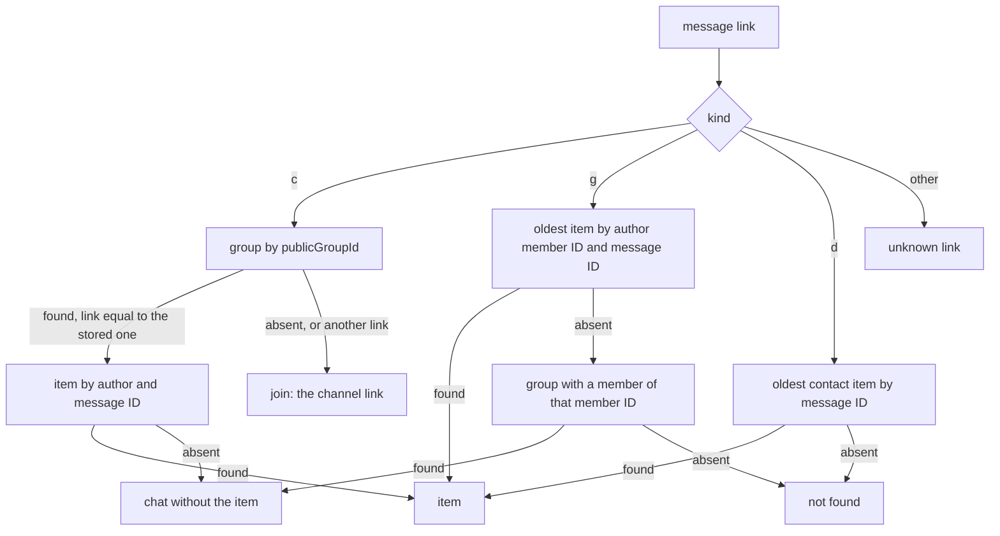
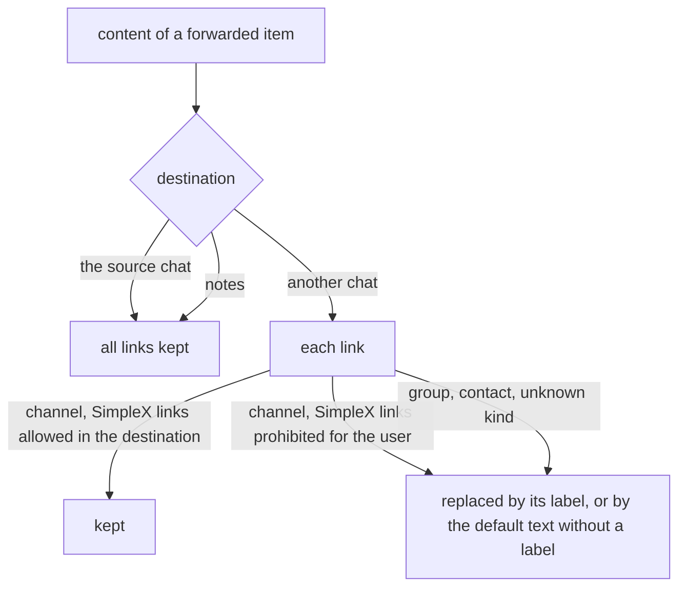
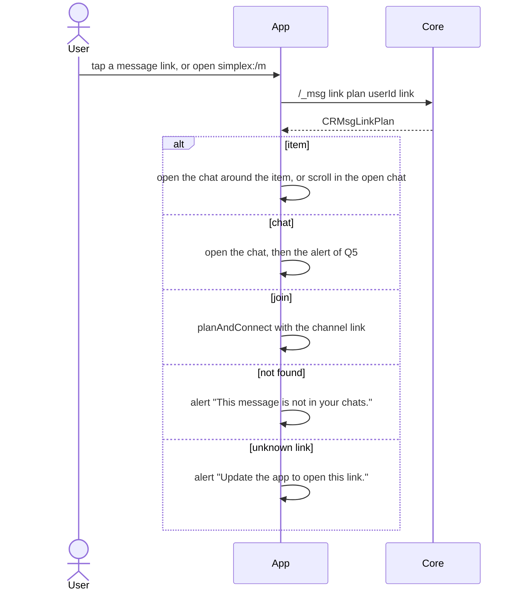
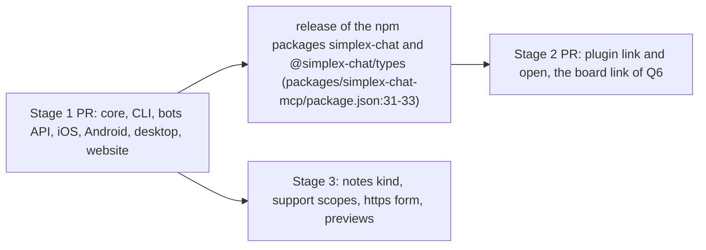

# Message references: links to messages across chats

## Problem

A person or an agent can point to a message only inside its chat, by a quote, or by forwarding a copy. From a short line in one chat, such as a list of open questions, the reader cannot open another chat at the message the line is about. Agents cannot produce or follow such a pointer.

## Acceptance

| # | After the change | Before |
|---|---|---|
| A1 | at "Copy link" in the menu of a message in a contact, group or channel chat, the app puts `simplex:/m#…` on the clipboard | the menu offers Copy of the text only |
| A2 | `[label](simplex:/m#…)` and a bare `simplex:/m#…` in a message are shown as a tappable label | plain text |
| A3 | at a tap, the app opens the chat at the message for a reader who has it, offers to join a channel that the reader is not in, and shows an alert otherwise | plain text |
| A4 | `simplex:/m#…` opened from a web page or another app is handled as in A3 | "Error: URL is invalid" (iOS), a connection error (Android, desktop) |
| A5 | group and contact links are replaced by their labels in a forward to another chat, and channel links are kept where SimpleX links are allowed; all links are kept when the forward is to the same chat or to notes | the text is forwarded unchanged |
| A6 | where SimpleX links are prohibited for the sender, the core refuses a channel message link as a SimpleX link and sends group and contact message links | — |
| A7 | apps of earlier versions show the text unchanged | — |
| A8 | the plugin's `link` returns the link of a message; `open` returns the message of a link | — |

## Options

| Option | Cost |
|---|---|
| A. URI in the message text, parsed by the core's markdown | parser, one `Format` constructor, three commands, app rendering; protocol and database unchanged; copy, paste and links from web pages are supported |
| B. Side map in `MsgContainer`, as `mentions` (Protocol.hs:697), with markers in the text | fields in `XMsgNew` and `XMsgUpdate`, a database table, a compose API for apps and bots; the links are lost at copy and paste; earlier apps show the markers |
| C. A message content type with one link and a preview, as `MCChat` (Protocol.hs:752) | protocol type, card UI, one link per message; the text of a private chat is copied into the preview for a new audience |

A is chosen: it is the cheapest, and the only option with copy, paste and links from web pages.

## Format

Message IDs are 12 random bytes in base64, 16 bytes in all (Store/Messages.hs:241-260, Store/Shared.hs:641-642, 660-661); history welcome messages have 24 random bytes (Internal.hs:1444). Every member stores a group message with the author's member ID and the same message ID, relayed messages included (Subscriber.hs:4066-4071). The keys of a p2p group are the member's own (`GKGroup`, Types.hs:493-495), and a message of a group is found by the author's member ID and the message ID (Store/Messages.hs:3092-3109). A channel is identified by `publicGroupId`, the hash of its root key, and by its link (Types.hs:910-916).

```
msg-link = "simplex:/m#" kind "/" msg-id [ "?" params ]
kind     = "c"   channel
         | "g"   group or business chat
         | "d"   contact
msg-id   = SharedMsgId bytes, base64url without padding
params   = query string, values percent-encoded, unknown names ignored
  g      = publicGroupId, base64url without padding, 32 bytes      kind c
  a      = author MemberId, base64url without padding              kind g: required; kind c: absent for posts sent as the channel
  l      = channel short link (strEncode)                           kind c, written last
```

Examples:

```
simplex:/m#d/Z21RRHdMR1NzSmlyNDBYeA
simplex:/m#g/Z21RRHdMR1NzSmlyNDBYeA?a=UWRoR05KMk16UG1hSGRpag
simplex:/m#c/Z21RRHdMR1NzSmlyNDBYeA?g=fTqrymkSeMiupJmPD3Xy_bn6Thlrb6MNy8oeQoSZvhQ&l=simplex%3A%2Fc%233tR8_b50RNZQtPkDs0Z3IxdfsszHxdyZYWQ4KHOyifg%3Fh%3Dsmp18.simplex.im
```

- `simplex:/m#…` is refused as a connection link: `m` is neither a short-link type letter (simplexmq Agent/Protocol.hs:1775-1778, 1809-1815) nor a full-link mode (Agent/Protocol.hs:1308).
- The fields of kind `c` are the fields of `ForwardLink` without the name (Protocol.hs:710-717). The author is set by the rule of `chatItemMember` (Messages.hs:374-380), as in forwards (Commands.hs:1158).
- The message part of kinds `g` and `c` is the identity of `MsgRef` in quotes (Protocol.hs:236-242).
- A link of an unknown kind is parsed as `MLUnknown` with its text, so no format change is required for a later kind.
- Names (`#name`) are not used as identity, as a name can expire or be moved to another chat (Controller.hs:1185-1188); a label can show a name.

Types, Types.hs:

```haskell
data MsgLink
  = MLChannel
      { publicGroupId :: B64UrlByteString,
        groupLink :: ShortLinkContact,
        memberId :: Maybe MemberId,
        msgId :: SharedMsgId
      }
  | MLGroup
      { memberId :: MemberId,
        msgId :: SharedMsgId
      }
  | MLDirect {msgId :: SharedMsgId}
  | MLUnknown {linkText :: Text}

data MsgLinkType = MLTChannel | MLTGroup | MLTDirect | MLTUnknown

instance StrEncoding MsgLink    -- the URI above
-- JSON: the URI string, by strToJSON and strParseJSON
```

The link of an item, Messages.hs:

```haskell
itemMsgLink :: ChatInfo c -> ChatItem c d -> Either String MsgLink
itemMsgLink cInfo ci@ChatItem {meta = CIMeta {itemSharedMsgId}} = case (cInfo, itemSharedMsgId) of
  (DirectChat _, Just msgId) -> Right $ MLDirect msgId
  (GroupChat g@GroupInfo {groupProfile = GroupProfile {publicGroup}} _, Just msgId) -> case publicGroup of
    Just PublicGroupProfile {publicGroupId, groupLink} -> Right $ MLChannel publicGroupId groupLink (memberId' <$> chatItemMember g ci) msgId
    Nothing -> maybe (Left "message has no author") (Right . (`MLGroup` msgId) . memberId') $ chatItemMember g ci
  _ -> Left "message has no link"
```

## Privacy

| Kind | Readers who open it | What any other reader learns |
|---|---|---|
| `c` | subscribers; others can join with `l` | the channel, the post and the author's member ID, all public in the channel |
| `g` | members who have the message | two random IDs; links with the same `a` refer to one author in one group |
| `d` | the two parties | one random ID |

- Access to a message is not given by its link: only a reader who has the message can open it.
- The core resolves a link from the local database and sends no request. A channel is joined through the connection flow with its confirmation.
- The label is text of the writer and is visible to every reader. The apps do not fill it from the referenced message (Q4).
- The core searches only the user given by the app: the user of the chat where the link is tapped, or the active user for a link opened from outside the app. Other profiles, hidden ones included, are not searched.
- The oldest matching item is opened. A copy planted by a peer who read the link is created later than the original in the reader's database.

## Resolution



```haskell
-- Controller.hs
data MsgLinkPlan
  = MLPItem {chatItem :: AChatItem}
  | MLPChat {chatInfo :: AChatInfo}
  | MLPJoin {groupLink :: ShortLinkContact}
  | MLPNotFound
  | MLPUnknownLink

-- Internal.hs
msgLinkPlan :: User -> MsgLink -> CM MsgLinkPlan
```

```
msgLinkPlan user link:
  MLChannel pgId gLink author msgId:
    channelMsgItem pgId gLink author msgId
      Just (gId, Just itemId) -> MLPItem (item of gId and itemId)
      Just (gId, Nothing)     -> MLPChat (group gId)
      Nothing                 -> MLPJoin gLink
  MLGroup author msgId:
    getGroupItemIdByAuthor author msgId
      Just (gId, itemId) -> MLPItem (item of gId and itemId)
      Nothing -> getGroupIdByMemberId author
        Just gId -> MLPChat (group gId)
        Nothing  -> MLPNotFound
  MLDirect msgId:
    getDirectItemIdByMsgId msgId
      Just (ctId, itemId) -> MLPItem (item of ctId and itemId)
      Nothing             -> MLPNotFound
  MLUnknown _ -> MLPUnknownLink
item of chat and itemId = getAChatItem (Store/Messages.hs:3376-3393), with the scope of getGroupChatScopeForItem_ (Store/Messages.hs:1510)
```

- `channelMsgItem` is the lookup of `forwardLinkCIFF` (Internal.hs:272-292) moved into one function; `forwardLinkCIFF` returns `CIFFGroup` or `CIFFGroupLink` from its result. Forward attribution and channel links are resolved by one rule.
- `getGroupItemIdByAuthor`, Store/Messages.hs: the join of `getGroupMemberCIBySharedMsgId` (Store/Messages.hs:3092-3109) without the group, `WHERE m.user_id = ? AND m.member_id = ? AND i.shared_msg_id = ?`, `ORDER BY i.chat_item_id ASC LIMIT 1`. Own items, stored with `group_member_id` NULL, are matched by the own membership row.
- `getDirectItemIdByMsgId`, Store/Messages.hs: `WHERE user_id = ? AND contact_id IS NOT NULL AND shared_msg_id = ?`, `ORDER BY chat_item_id ASC LIMIT 1`. The user's entries of `idx_chat_items_direct_shared_msg_id` (chat_schema.sql:1031-1035) are scanned; the time on a database with 1 million contact items is measured before review.
- A deleted or moderated item is returned as an item. For an item removed by deletion or by the chat's time to live, the plan is `MLPChat` for a group or a channel, and `MLPNotFound` for a contact.
- No database row is written by resolution.

## Markdown

Markdown.hs:

```haskell
data Format
  = ...
  | MessageLink {showText :: Maybe Text, linkType :: MsgLinkType, msgLink :: MsgLink}
```

| Form | Result |
|---|---|
| `[label](simplex:/m#…)` | `MessageLink (Just label)` |
| `<simplex:/m#…>` | `MessageLink Nothing` |
| bare `simplex:/m#…` | `MessageLink Nothing` |
| a known kind with an invalid field | text, as now |

- `linkType` is set by the parser from `msgLink`, as `linkType` of `SimplexLink` (Markdown.hs:546-567).
- `sowLinkP` and `hyperLinkFormat` (Markdown.hs:450-467): the label is any text up to `]` without `[` or a line break. The punctuation rule of web hyperlinks (Markdown.hs:453-454) is not applied. A label with a link in its own markdown (`isLink`) is refused: the label is left as text and the link is parsed bare, as for spoofed web links (MarkdownTests.hs:344-348).
- `linkMD` (Markdown.hs:506-518): a word starting with `simplex:/m#` is parsed whole first, then without its trailing punctuation (`linkEndLength`, Markdown.hs:519-532), so a final `-` of an ID is kept.
- `markdownText` returns the source text, as for `SimplexLink` (Markdown.hs:978).
- `MessageLink` is included in `isLink`, so `hasLink` is set for the item (Internal.hs:3159-3167). `MessageLink` with `MLChannel` is included in `isSimplexLink` (Markdown.hs:315-318), so the group preference is applied at send (Commands.hs:5076), edit (Commands.hs:854) and receive (Subscriber.hs:2260, 2336, 2357), and in member profiles (Internal.hs:1376-1385).
- Every form is parsed as text by earlier cores: `strDecode` fails for `simplex:/m#`, and schemes other than http and https are refused by `parseUri` (Markdown.hs:873-882; MarkdownTests.hs:316).

## Core API

| Command | Syntax | Response |
|---|---|---|
| `APIGetChatItemLink {chatRef, chatItemId}` | `/_get item link <chatRef> <chatItemId>` | `CRChatItemLink {user, msgLink}` |
| `ShowChatItemLink {chatName, msg}` | `/item link <chatName> <text>`, as `/item info` (Commands.hs:3567-3570, 7109) | the same |
| `APIMsgLinkPlan {userId, msgLink}` | `/_msg link plan <userId> <msgLink>` | `CRMsgLinkPlan {user, msgLinkPlan}` |

- `APIGetChatItemLink`: `getAChatItem`, then `itemMsgLink`; `Left` is returned as a command error. Notes and items without a message ID, such as group events, are refused.
- CLI views, View.hs: the link is printed for `CRChatItemLink`; for `CRMsgLinkPlan`, the chat and the item line, or `message link: not in your chats`, `message link: the message is not in CHAT`, `message link: join CHANNEL_LINK`, `message link: unknown link type`.
- Bots API: `APIGetChatItemLink` and `APIMsgLinkPlan` in the category "Message commands" (bots/src/API/Docs/Commands.hs:95-111), the types `MsgLink` (string), `MsgLinkType`, `MsgLinkPlan` and `Format.MessageLink`; bots/api/*.md and the TypeScript and Python types are generated again.

## Forwards



- In each destination branch of `APIForwardChatItems` (Commands.hs:1109-1130), the result of `prepareForward` (Commands.hs:1134-1257) is mapped by `forwardedLinks keep`, after the mention names (Commands.hs:1161-1166) and the owner signature (Commands.hs:1186-1190) are set: the content of each `ComposedMessageReq` (Commands.hs:5391) is changed, and its texts are computed again by `msgContentTexts` (Internal.hs:368-369).
- `keep` is `const True` when `toChat == fromChat` and in the notes branch. In the group branch, after `getGroupInfoKeys` (Commands.hs:1122), it is `const False` where SimpleX links are prohibited for the user (`groupFeatureMemberAllowed SGFSimplexLinks`, as in Internal.hs:431), and `isChannelLink` otherwise. In the contact branch, it is `isChannelLink`. A forward is thus never refused for its message links.
- `forwardedLinks :: (MsgLink -> Bool) -> MsgContent -> MsgContent`, Messages.hs, beside `parsedMsgContent` (Messages.hs:633-637): the content is parsed by `parsedMsgContent`, each replaced segment is changed to its label or to the default text (Q2), and `text` is set to the concatenation of `markdownText` of the segments, as in `updatedMentionNames` (Internal.hs:294-301).
- A new message, as opposed to a forward, is sent as written.

## Apps



| Part | iOS | Android and desktop |
|---|---|---|
| `Format` and `MsgLinkType` | SimpleXChat/ChatTypes.swift:6008-6027 | ChatModel.kt:5382-5412 |
| commands and `MsgLinkPlan` | Shared/Model/AppAPITypes.swift, Shared/Model/SimpleXAPI.swift | model/SimpleXAPI.kt |
| rendering and tap | MsgContentView.swift:300-313, 653-665: an attribute key for message links | TextItemView.kt:401-416, 489-504: the annotation `MESSAGE_LINK` |
| open at the item | `ItemsModel.loadOpenChatNoWait(chatId, itemId)` (ChatModel.swift:143-157), as the forward header (FramedItemView.swift:117-123) | `openChat(null, rhId, chatType, apiId, itemId)` (ChatListNavLinkView.kt:212-236), as FramedItemView.kt:362-370 |
| link from outside | `connectViaUrl_`, the path `/m` (ContentView.swift:463-488) | `connectIfOpenedViaUri`, a branch before `planAndConnect` (ChatListView.kt:800-814) |
| Copy link | the item menu (ChatView.swift:2447-2507) | `MsgContentItemDropdownMenu` (ChatItemView.kt:394-451) |
| link pasted in search | `strConnectTarget` (NewChatView.swift:860-872), then the plan | `strConnectTarget` (NewChatView.kt:834), then the plan |

- The label is `showText`, or the generic label of Q4. At long-press, the app opens the item menu, as now (ChatItemView.kt:129).
- The decision from `MsgLinkPlan` to an action is one pure function in each app, tested on recorded core responses.
- For an item in a member support scope, the app opens its group in stage 1 and its support chat in stage 3.
- `simplex:` is registered on iOS (SimpleX--iOS--Info.plist:40-43), Android (AndroidManifest.xml:75) and desktop (plans/2026-09-28-desktop-deep-links.md, section "`simplex:` connection links").
- `minRemoteCtrlVersion` and `minRemoteHostVersion` (Remote.hs:77-82) are set to the release version, as for block markdown (plans/2026-10-13-block-markdown.md:691), because an earlier desktop cannot decode the new `Format`.
- A `messageLink` case is added to the website renderer (website/src/js/simplex-lib.jsc:234-294): the label is rendered as a link to the `simplex:/m#` URI.
- The path `/m` is described in spec/client/navigation.md of both apps.

## Plugin

| Tool | Input | Output |
|---|---|---|
| `link` | `item`, and `chat`: `@N` or `#N`; without `chat` in the plugin, the item of the session's group | `{link}` |
| `open` | `link` | `status`: `found` with `message`; `chat` with the chat fields; `join` with `link`, the channel link for `connect`; `none`; `update` |

- No action is created by either tool; both only read, as `receive`.
- `open` returns `none` for a chat that the session does not own (spec/api.md:686), so chats of other sessions are kept hidden. A message of the session's group is returned with `item` and without `chat`, as the channel's prompts (spec/api.md:1036).
- `connect` with a `simplex:/m#` target returns `TARGET is a message link; open returns its message.` in place of `Not a SimpleX link or name: TARGET` (spec/api.md:132).
- One sentence is added to the instructions (tools.ts:495-506): `A message link is a simplex:/m#… URI: link returns the link of a message, which you write as [label](link); open returns the message of a link.`
- The Message object (messages.ts:23-35) is unchanged: with a link in every message, each message would be 60 to 170 characters longer, for up to 100 messages per result.

Agents can use such links under three conditions, each stated by the design:

1. Every link is taken from a `link` result or from a received text.
2. The agent writes it as `[label](link)`.
3. The agent follows it with `open`.

| Evidence | Source |
|---|---|
| agents already write Markdown, and `[text](url)` in their posts is parsed by the core | Claude's text is posted to the session group (spec/api.md:911); Markdown.hs:450-456 |
| opaque `simplex:/` links are copied by agents between results and calls | `connect` takes them (tools.ts:284) |
| an ID cannot be produced from memory, as it is random | Store/Shared.hs:660-661 |
| a damaged link is parsed as text or resolved as `none` | the parser and the plan above |
| `simplex:/` is shared with connection links; the case is covered by the `connect` error above | Markdown.hs:533 |

## Stages



| Stage | Content |
|---|---|
| 1 | kinds `c`, `g`, `d`; parser; `Format.MessageLink`; three commands; resolution; forwards; group preference; app rendering, tap, links from outside, Copy link, search paste; remote versions; website case |
| 2 | plugin `link` and `open`, the `connect` error, instructions; the board link of Q6 |
| 3 | kind `n` for notes, by local IDs, replaced by its label in every message sent outside notes; the support chat at the item; `https://simplex.chat/m#…` with the same fragment and the app association files; a preview of the referenced message at long-press; `l` in kind `g` for groups with a public link |

No stage 1 format is changed in stage 3: a new kind is parsed as `MLUnknown` by stage 1 cores, unknown parameters are ignored, and the fragment is kept in the https form.

## Tests

Each test fails on master: the syntax, the commands or the forwarded text are new.

| File | Test |
|---|---|
| tests/MarkdownTests.hs | `[Should I merge?](simplex:/m#g/…?a=…)` gives `MessageLink (Just "Should I merge?") MLTGroup …` |
| | `see simplex:/m#d/ID.` gives text, a bare link and `.`; a final `-` of an ID is kept |
| | `simplex:/m#x/…` gives `MLUnknown` |
| | `[https://example.com](simplex:/m#d/…)` gives the label as text and a bare link |
| | `strDecode . strEncode` returns each `MsgLink` variant; `l` is percent-encoded both ways |
| tests/ChatTests/Groups.hs | `/item link #team hi` by alice; the link is sent in `#club`; cath, a member of `#team`, gets the item from `/_msg link plan`; dan gets `not in your chats` |
| | a channel post: a subscriber gets the item; a non-subscriber gets `join` with the channel link |
| | after `/_delete item … internal` by cath, the plan is the chat |
| | `#club` with SimpleX links off: a channel message link is refused, and a group message link is sent |
| tests/ChatTests/Direct.hs | alice's message to bob, its link sent to bob in a group: bob gets the item, cath gets `not in your chats` |
| tests/ChatTests/Forward.hs | a group link forwarded to a contact is replaced by its label; it is kept in forwards to the same group and to notes; a channel link is kept, and replaced by its label in a group with SimpleX links off |
| app tests on recorded core responses | `Format.messageLink` is decoded; each `MsgLinkPlan` variant gives its action |
| plugin unit and e2e tests | `link` of a sent message, then `open` of the link in the same session; `open` for a chat of another session returns `none`; `connect` with a message link returns its error |

## Questions

| ID | Question | Recommendation |
|---|---|---|
| Q1 | Scheme. The plan uses `simplex:/m#`, as you proposed. By a rule recorded in both apps, `simplexchat:` is reserved for every link that is not a connection link (ContentView.swift:506, ChatListView.kt:816; plans/2026-09-24-badge-buy-in-browser.md:43). With `simplex:`, apps before stage 1 show "Error: URL is invalid" or a connection error for a link opened from outside. With `simplexchat:`, apps with app links (ContentView.swift:514-522, ChatListView.kt:828-839) show "Update the app to open this link.", and a second URI prefix is added to the core markdown (Markdown.hs:533). Which rule holds? | your proposal and the recorded rule conflict: escalated without a recommendation |
| Q2 | In forwards to another chat, group and contact links are replaced by their labels, and channel links are kept where SimpleX links are allowed; a link without a label is replaced by `message`. | yes |
| Q3 | A channel message link counts as a SimpleX link for the group preference; group and contact message links are allowed where SimpleX links are off. | yes, as for forward attribution (plans/2026-08-22-forward-link.md, lines 13-14) |
| Q4 | A link without a label is shown as "message" with a link icon; Copy link copies the URI without text of the message. | yes |
| Q5 | When the chat is known and the message is gone, the app opens the chat and shows an alert: the message is deleted or not received yet. | yes |
| Q6 | The session's message on the board in the Main group links "waiting for you" to the oldest pending card of the session. | yes, in stage 2 |
