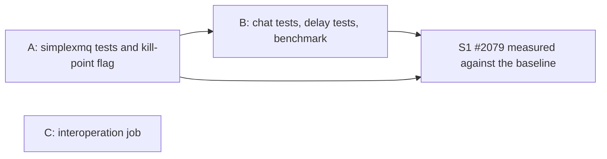

# S0: tests and measurement before the transport rework

## Scope

1. Reproduction tests of the open transport defects, marked pending until their fix lands.
2. Per-member delivery delay in groups of 20, 50 and 100 members, recorded as a baseline.
3. Crash-window tests with kill points behind a test-only build flag.
4. Commit benchmark of the store layouts.
5. Throughput and latency of event processing: PostgreSQL by pool size, RPC round trip under an event backlog.
6. Interoperation job: the released CLI against the new CLI.

The pin bump to simplexmq master is its own PR after simplexmq #2082 merges.

## PRs

| PR | Repository | Contents |
|---|---|---|
| A | simplexmq | agent reproduction tests T1, T4, T6-T9, T12, T13, T17, T18; agent kill points behind a new flag `test_hooks` |
| B | simplex-chat | chat reproduction tests T2, T3, T5, T20, T21; delay tests D1-D4; chat kill points behind `test_hooks` (added by #8284); benchmarks B1-B3 |
| C | simplex-chat | CI job: released CLI against the branch CLI |

Order: A, then B on A's commit (DO NOT MERGE until A merges), C independent.

## Reproduction tests

Each test asserts the fixed behaviour and is marked pending with the defect id until its fix.

| Id | Defect | Repository | Asserts |
|---|---|---|---|
| T1 | three threads wait on each other (ICAck worker, subscriber, chat send) | simplexmq | sendMessages returns and every flooded message arrives within 10 s |
| T2 | group leave holds the group lock across blocking queue writes | simplex-chat | the command returns; a direct message is shown within 10 s |
| T3 | HELLO acknowledged before the chat handles CON | simplex-chat | after a stop between them, B and C connect and pending group messages are sent |
| T4 | queue pending after a kill before ACK | simplexmq | after reopen: queue active, message redelivered, ACK empties the queue |
| T5 | backlog after an upgrade | simplex-chat | every message of 500 in a 50-member group is processed |
| T6 | queue rotation waits for the peer without a deadline | simplexmq | the switch ends with an error after the deadline |
| T7 | moveable command retried forever | simplexmq | ERR after the age limit; the command is deleted |
| T8 | ICQDelete retried forever | simplexmq | the old queue is abandoned after deleteErrorCount failures |
| T9 | dead connection kept for 15 minutes | simplexmq | reconnect and receipt within 10 s after forwarding stops |
| T12 | IPv4 not tried after an IPv6 timeout | simplexmq | connection succeeds within tcpConnectTimeout |
| T13 | network reported offline without validation | simplexmq | the message is delivered or the wait is bounded |
| T17 | chunk deadline assumes a minimum throughput | simplexmq | the file completes or ends with RFERR in bounded time |
| T18 | retry reuses the replica record read before the first attempt | simplexmq | the replica has exactly the recipients; the file completes |
| T20 | cancelled upload never reported to the recipient | simplex-chat | the recipient's item ends cancelled |
| T21 | group leave interrupted between the agent call and the member status | simplex-chat | every member receives the leave, or none |

T6, T7, T8, T17 and T20 assert deadlines (decision D6: every unfinished state gets one); durations per state in each test.

## Delay tests

Setup:
- in-process SMP servers with queue quota 16
- retry intervals scaled: initialInterval, increaseAfter and maxInterval together
- groups of 20, 50 and 100 members

| Id | Scenario | Measured |
|---|---|---|
| D1 | member X offline while more than 16 messages are sent | per member: send to SENT, created_at minus item_ts, MWARN count, time to QCONT |
| D2 | stop between the quota counter reset and the pending send | pending messages left after restart |
| D3 | messages forwarded or relayed to an inactive member | messages never delivered |
| D4 | the chat store busy for one message of member X | stall until resubscription |

Output per test: p50, p95 and max delay; messages never delivered; recovery time after restart.

## Kill points

Flag: `test_hooks` in both packages, manual, default off; CI enables it in builds other than v* tags, as #8284 does for the chat.

| Point | Window |
|---|---|
| chat: after the chat write, before the agent call | Wa |
| chat: after the agent call, before the chat write | Wb |
| agent: after commit, before the event is queued | We |
| agent: after the network request, before its result is stored | Wn |

One process-level test kills a child committing to both SQLCipher files with SIGKILL and checks a cross-file invariant after reopen.

## Benchmark

| Id | Layouts | Transaction classes |
|---|---|---|
| B1 | two stores; one connection with the agent file attached; three connections | chat-only, agent-only, combined |

Measured: p50 and p99 commit latency; with two processes on the same files, the busy rate.

| Id | Setup | Measured |
|---|---|---|
| B2 | PostgreSQL client with pool size 1, 4 and 10; 50 groups exchanging messages | events handled per second; one event thread against one worker per agent connection |
| B3 | a service request while a 100-member group fills the event queue | round-trip time of the reply, p50 and p99 |

