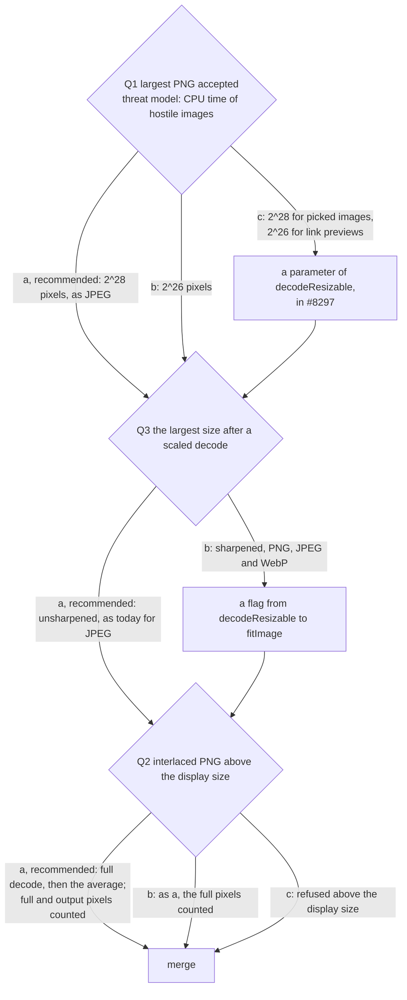
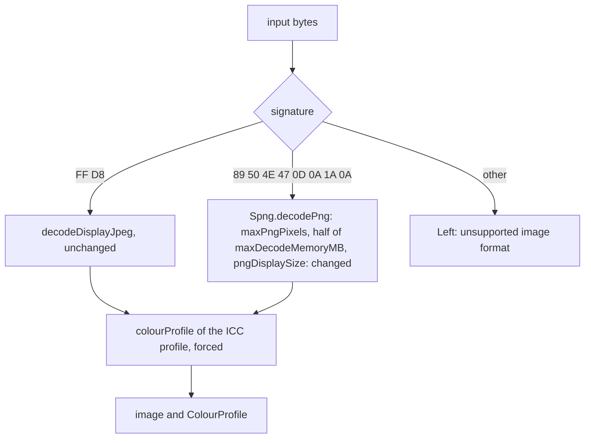
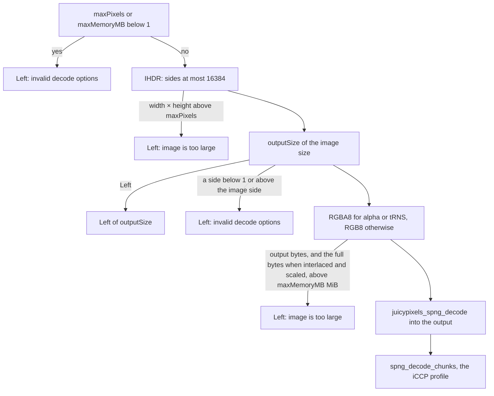
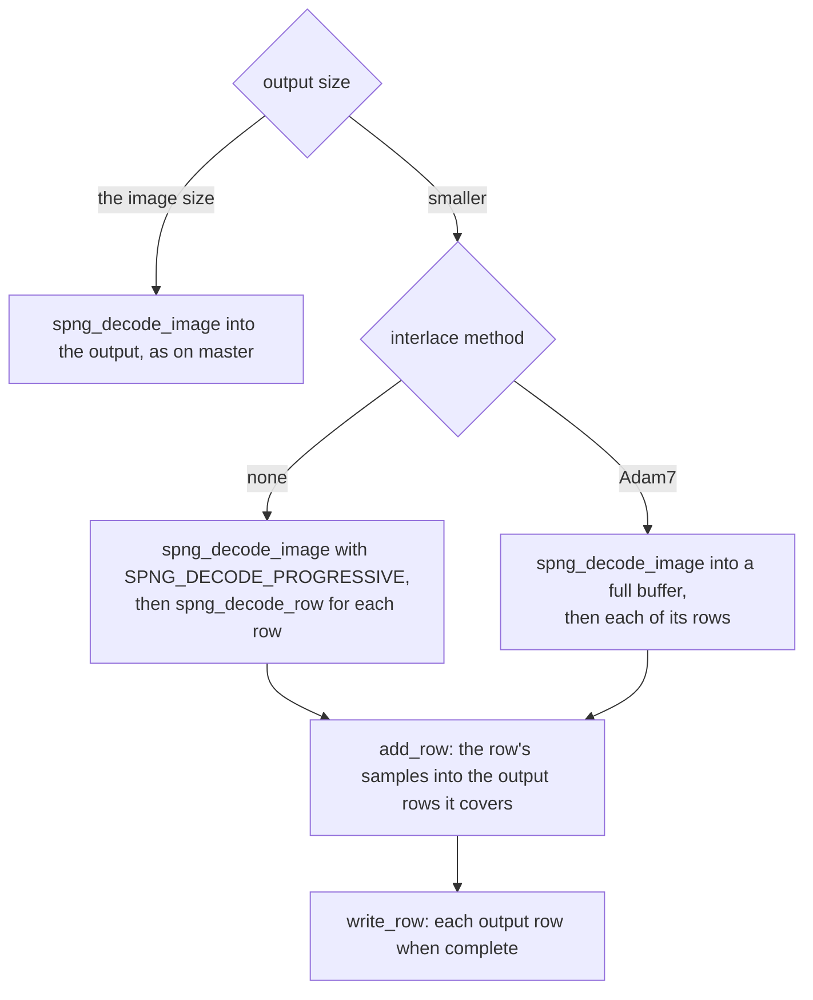

# PNG decoded at the display size in one pass

A PNG with a side above 4320 pixels is decoded by the core at its full size, then scaled down to the display size: the user waits for the full decode and for Catmull-Rom over every pixel of every trial, the process holds the whole image and, for RGBA, its premultiplied copy, and a PNG above about 8192×8192 RGBA in mobile builds is refused, so that the apps decode the picked file on the platform at full size (desktop `ImageIO.read`, Utils.desktop.kt:163-169; Android `ImageDecoder.decodeBitmap`, Utils.android.kt:278-283).
Measured on master: a 12952×10156 photo takes 19.7 s and 1021 MiB for the image data in desktop builds and is refused in mobile builds; an 8192×8192 RGBA image takes 4.8 s and 924 MiB in both (Measurements).

The product owner decided, 2026-11-24, that PNG input is decoded and scaled down to the display size in one pass, as JPEG and WebP input are, if possible ("then obviously we must be doing it, and for PNG too, if possible"; "ok, so needs fixing too").

libspng decodes the image row by row; each row is added to the output rows it covers, as an average of the area of each output pixel, in `JuicyPixels-spng` of simplex-chat/hs-jpeg-turbo. `decodeResizable` passes the display size to the binding, as for WebP input on branch `ep/core-webp`. The output for a PNG with no side above 4320 is unchanged; the output formats, the colour profiles and the C functions are unchanged.

References are to branch `ep/core-png` at the commit of this plan, based on master `6b44de0a11`; "master" lines are at `6b44de0a11`.
Haskell paths without a directory are in `src/Simplex/Chat/`.

| Name | Source |
|---|---|
| hs-jpeg-turbo | simplex-chat/hs-jpeg-turbo master `c1b5080`, pinned at `d0a4d95` on master (cabal.project:76-80); package code identical in both |
| hs-jpeg-turbo change | branch `ep/png-scaled` of evgeny-simplex/hs-jpeg-turbo from master `c1b5080` |
| libspng | `fb768002`, tag v0.7.4, the submodule `JuicyPixels-spng/cbits/libspng` |
| measurements | branch `ep/png-measure` of evgeny-simplex/hs-jpeg-turbo, from `ep/png-scaled` |
| image resizing plan | plans/2026-10-23-core-image-resizing.md (D18, D19, D24) |
| WebP plan | plans/2026-11-22-core-webp-decoding.md on branch `ep/core-webp` at `b243a0c027` |
| link previews | branch `ep/link-previews` at `dc0fe753b1`, simplex-chat/simplex-chat#8297: `og:image` at most 2 MiB, an image link at most 10 MiB (LinkPreview.hs:94-98) |

## Acceptance

| Who | Before | After |
|---|---|---|
| user who picks a PNG with no side above 4320 | image data and preview | byte for byte the same |
| user who picks a PNG with a side above 4320, mobile builds | decoded at full size, refused above 256 MiB of pixels (about 8192×8192 RGBA): `""`, then the platform decode at full size | decoded at the display size; refused above `maxPngPixels` pixels (Q1) |
| user who picks a PNG with a side above 4320, desktop builds | decoded at full size, refused above 512 MiB of pixels | as mobile builds |
| user who picks an interlaced PNG with a side above 4320 | decoded at full size within half of `maxDecodeMemoryMB` | decoded at full size, then averaged to the display size, the full and the output pixels within half of `maxDecodeMemoryMB` (Q2) |
| any user | time and memory of the full decode and of Catmull-Rom from the full image in each trial | time and memory of the decode at the display size (Measurements) |

Evidence at review:
- hs-jpeg-turbo CI on `ep/png-scaled`, the full matrix and the armv7 job: the package tests pass with GHC 8.10.7 and 9.6.3 on Linux x86-64, with GHC 9.6.3 on Linux aarch64, macOS aarch64 and x86-64, and Windows; the scaled outputs of the PngSuite equal the area averages of their full decodes, computed in Haskell; the armv7, aarch64 and sanitizer builds decode 178 PNGs at four sizes identically, and the sanitizer build decodes truncated and changed copies of each;
- the measurement run on `ep/png-measure` with this branch's `Image.hs`: memory, time, equality with master for PNGs with no side above 4320, quality for PNGs above it (Measurements);
- the reduced build of this branch with `/Image resize/` and `/Mobile API Tests/`.

## Decisions and recommendations

Decided by the product owner, 2026-11-24:
- PNG input is decoded and scaled down to the display size in one pass, as JPEG and WebP input are, if possible.

The other rows are recommendations to the product owner; the branch implements the first option of each.

| ID | Choice | Options, recommended first |
|---|---|---|
| R1 | **Area average in C, row by row.** Method; costs in "Methods". | (a) area average in `JuicyPixels-spng`, rows from libspng's progressive decode. Other options: "Methods". |
| R2 | **API as for WebP.** `Spng.DecodeOptions {maxPixels, maxMemoryMB, outputSize}`; `outputSize` maps the image size to the output size, as `Webp.DecodeOptions` on `ep/core-webp` (WebP plan D2). `decodeResizable` passes `pngDisplaySize`, the size of `displaySize` (Image.hs:88-94). | (a) one decode function with `outputSize`. (b) `readPngHeader`, then a decode at a given size, as JPEG: two passes over the chunks before the image data. |
| R3 | **Largest PNG: `maxPngPixels = 2 ^ 28`** (Image.hs:319-320), as `maxJpegPixels`; the side limit 16384 of the binding is unchanged (Spng.hsc). | Q1 |
| R4 | **Interlaced PNG above the display size: full decode, then the same average.** | Q2 |
| R5 | **Sharpening at the largest size unchanged (D18).** | Q3 |

## Open questions

| Q | Question | Options | Recommendation |
|---|---|---|---|
| Q1 | Largest PNG accepted; a threat-model question | (a) 2^28 pixels, 16384×16384, as JPEG: a 2 MiB PNG of 16384×16384 RGBA, 16 bits per sample, within the `og:image` limit, is decoded in 3.2 s and resized to a preview in 5.0 s within 262 MiB; with the Paeth filter on every row, 2.02 MiB, within the image link limit (10 MiB), 6.9 s and 8.6 s. (b) 2^26 pixels, today's RGBA limit of mobile builds, in every build: an 8192×8192 RGBA PNG with 8-bit samples decoded in 0.9 s, its preview in 2.7 s; 16-bit samples not measured; larger PNGs `""`, then the platform decode at full size in the apps. (c) (a) for picked images and (b) for link previews: a limit parameter of `decodeResizable`, in #8297. | (a): the preview of the largest PNG within the `og:image` limit takes 5.0 s, today's preview of an 8192×8192 RGBA PNG with 8-bit samples 5.1 s; its memory is 262 MiB against today's 647 MiB (Measurements) |
| Q2 | Interlaced (Adam7) PNG above the display size; libspng completes the even rows in pass 6 and the odd rows in pass 7 (spng.c:3561-3604, 3284) | (a) full decode by libspng, then the same average from the decoded rows; the full and the output pixels within half of `maxDecodeMemoryMB`: square RGBA images refused from 7327×7327 in mobile builds, from 8193×8193 today. (b) as (a), the full pixels alone counted: today's limits; the full image, the output and its premultiplied copy at most 256 + 71.2 + 71.2 MiB in mobile builds. (c) refused when the display size differs from the image size: `""`, then the platform decode. (d) the passes added to sums over the whole output: 16 bytes per output pixel, 285 MiB at 4320×4320, above half of the mobile limit. | (a): one memory rule for the binding, D24's half kept; the images between the two limits are decoded by the platform |
| Q3 | The image at the largest size after a scaled decode is returned unsharpened (D18; Image.hs:337, 347), today for JPEG above 4320 (Image.hs:84) and WebP (`ep/core-webp`), with this change for PNG | (a) unsharpened, as today. (b) sharpened when the decoder scaled the image: `decodeResizable` returns the flag, `fitImage` sharpens at the largest size; about 10 lines in Image.hs, Mobile/File.hs and Library/Commands.hs. Measured mean gain: PNG +0.3 phone, +0.9 large screen; JPEG +0.2 and +0.1. | (a): the mean gain is below the score noise of the size search, median 0.7 (plans/2026-10-31-image-search.md:41) |

## Methods

Costs for a 16384×16384 RGBA PNG; "today" is master's full decode, then Catmull-Rom from the full image in each trial.

| Option | Memory at 16384×16384 | Time | Quality against today | Interlaced | Code and dependencies |
|---|---|---|---|---|---|
| (a) area average in C, rows from libspng's progressive decode | output 64 MiB and per-row buffers of at most 0.8 MiB; measured 80 MiB of process for the decode | the decode and one integer pass: 2.8 s for RGBA, 3.2 s for 16-bit RGBA | no side above 4320: identical (183 inputs); above: mean preview equal, phone −0.9, large screen −1.7; worst −7.6 (a screenshot on the large screen) | full decode, then the average (Q2) | 142 lines of C, 24 of Haskell changed; libspng's API |
| (b) Catmull-Rom of stb_image_resize v0.97 with a row callback, a patched copy of the header in JuicyPixels-spng | output and about 2.2 MB of rings | Catmull-Rom over every input row: today's trial at the largest size, Catmull-Rom with sharpening, takes 2.1 s for 8192×8192 RGBA and 13.7 s for 12952×10156 RGB | the largest size as today's when sharpened (Q3 b); smaller trials from the display size | full decode | a patched copy of the 2,634-line header, `STB_IMAGE_RESIZE_STATIC`, `-ffp-contract=off`, about 100 lines of C |
| (c) own Catmull-Rom in C, streamed | output and about 1 MB | estimated: (a) and about 4 multiply-adds per sample | close to (b), not identical | full decode | about 200 lines of new numeric C |
| (d) 2^k box during decode to at most twice the display size, then today's Catmull-Rom | 256 MiB at 8192×8192 and its premultiplied copy: above half of the mobile limit | Catmull-Rom on 4 times the pixels of (a) | about today's | full decode | about 110 lines |
| (e) the PNG decoded again for each trial, Catmull-Rom streamed | the trial and about 2 MB | the decode times the trials: at most 8, then the halvings of `shrink` (Image.hs:256, 272-277) | identical | full decode | (b) and a `fitImage` over a decoder in place of an image |
| (f) libwebp's rescaler | as (a) | as (a), SIMD | as (a) | full decode | depends on `ep/core-webp`, held |
| (g) stb_image_resize2 2.18 with input callbacks | output and about 2 MB | as (b) | differs from today's stb_image_resize v0.97 | full decode | a new 10,679-line header from a moved repository |
| (h) area average in Haskell, rows through FFI | as (a) | a Haskell loop over each sample | as (a) | full decode | about 60 lines of Haskell, no C |

(a) is the cheapest: (b), (e) and (g) add Catmull-Rom over every input row and a vendored resizer; (c) adds new numeric code; (d) exceeds the mobile memory limit; (f) waits for WebP; (h) moves the sample loop to Haskell.

## Decoding

`decodeResizable` (Image.hs:69-78):

`Spng.decodePng` (Spng.hsc):

`juicypixels_spng_decode` (JuicyPixels-spng/cbits/decode.c):

Area average:
- Output pixel j of n covers input pixels [j·m/n, (j+1)·m/n) of an input side m; an input pixel covers at most two output pixels, as n ≤ m; its weight in each is the length of the overlap, in units of 1/n input pixel (`span_of`); the weights of one output pixel sum to m.
- RGBA: colour multiplied by alpha before the sums, as D15; output colour `round(Σ c·a·w / Σ a·w)`, 0 when `Σ a·w` is 0, as `unpremultiply` (Image.hs:362-367); alpha `round(Σ a·w / (m_x·m_y))`.
- RGB: `round(Σ c·w / (m_x·m_y))`.
- Integer arithmetic: a row's sums are at most 16384 × 65025 < 2^32, the output sums at most 2^28 × 65025 < 2^64; the result is the same on every platform.
- Rows are converted by libspng as on master: 16-bit samples to 8 bits, `tRNS` to alpha, no gamma (`SPNG_DECODE_TRNS`, spng.c:3491-3528).

Memory of the binding: the output; per-row buffers, at most 0.8 MiB for 16384 input columns and 4320 output columns (decode.c:111-115; libspng's two scanline buffers, spng.c:3672-3679); for an interlaced PNG above the display size, the full image too. `maxMemoryMB` is checked against the output bytes, plus the full bytes for an interlaced PNG above the display size, before the output is allocated. libspng's chunk cache, at most 64 MiB (Spng.hsc:116), is outside the check, as on master.

Errors, unchanged except:

| Condition | `Left` |
|---|---|
| `maxPixels` below 1 | `invalid decode options` |
| width × height above `maxPixels` | `image is too large` |
| `outputSize` returns `Left`: from `decodeResizable`, `displaySize` without a size | `image does not fit`, from `decodeResizable` in place of `resizeImage` |
| `outputSize` returns a side below 1 or above the image side | `invalid decode options` |

## hs-jpeg-turbo: JuicyPixels-spng

Branch `ep/png-scaled` of evgeny-simplex/hs-jpeg-turbo from master `c1b5080`:
- `cbits/decode.c`, `cbits/juicypixels_spng.h`: `juicypixels_spng_decode(ctx, fmt, out, width, height)`; in `c-sources`
- `Codec.Picture.Spng`:
  - `DecodeOptions {maxPixels, maxMemoryMB, outputSize}`, in place of the newtype of `maxMemoryMB`
  - `PngHeader`: `pngInterlaceMethod` added
  - `decodePng`: the checks of "Decoding", then `juicypixels_spng_decode`; `spng_decoded_image_size` and `spng_decode_image` are called from C
- `CHANGELOG.md`
- tests, `test/SpngTest.hs`:
  - each PngSuite image of `suite`, interlaced ones included, decoded at 16×16, 11×7, 1×1, 32×5, 3×31 and 31×32, equal to the area average of its full decode computed in Haskell with `Integer`
  - solid colours of 16384×16, 16×16384, 8641×3, RGB and RGBA, kept in every output pixel
  - memory: a 2048×2048 RGBA PNG at full size within 16 MiB and at 1024×1024 within 4 MiB; interlaced, at full size within 16 MiB and at 1024×1024 within 20 MiB; each refused within 1 MiB less
  - `maxPixels` equal to the pixels decoded, one less refused; `outputSize` of `Left` and sizes outside the image refused
  - truncations of a progressive and an interlaced image decoded at 11×7: `Left`; truncations within the IEND CRC decoded
- CI (`.github/workflows/build.yml`, `.github/scripts/png-check.sh`, `.github/scripts/png.c`):
  - armv7 job: the PngSuite and three generated PNGs (4500×600 RGBA, its Adam7 copy, 16384×9 RGB 16-bit) decoded with sides of at most 16384, 4320, 16 and 5 by armv7, aarch64 and sanitizer (clang 18, address and undefined) builds: outputs identical; interlaced images equal to their progressive copies; each input truncated at 64 lengths and changed in 64 bytes, decoded with sanitizers
  - `coverage.sh`: the gcov line and branch coverage of `cbits/decode.c`
  - `workflow_dispatch` input `full`: the full matrix and the armv7 job on a dispatch, as on `ep/webp`

## Builds

| Build | Change |
|---|---|
| `cabal.project:76-80` | `evgeny-simplex/hs-jpeg-turbo` at the commit of `ep/png-scaled` |
| `scripts/nix/sha256map.nix:12` | its hash, computed with submodules |
| docs/dependencies/HASKELL.md:26, 27, 145 | the links of `JuicyPixels-jpeg-turbo`, `JuicyPixels-spng` and `jpeg-turbo` to that commit |
| nix, Android, iOS, Windows, reproducible Android build | unchanged: one more C file in `c-sources` of a package that these builds compile already |

After the pull request in simplex-chat/hs-jpeg-turbo is merged, one commit changes these three files to its squash commit.

## Security

Threat model:

| Who | Supplies | Through |
|---|---|---|
| website owner | a crafted PNG | link previews (#8297): `og:image` of at most 2 MiB, image links of at most 10 MiB |
| contact | a crafted PNG file | a received file that the user picks and sends again |
| bot operator | own input | `resizeImage` of the bot libraries |

- Measures: sides at most 16384 and pixels at most `maxPngPixels` (Q1), checked from IHDR before allocation; the binding's pixel buffers within half of `maxDecodeMemoryMB`; integer sums with bounds stated in "Decoding"; libspng pinned at v0.7.4, as on master.
- CPU time: libspng inflates every row of an accepted image; the time of the largest hostile PNG is in Q1 and "Measurements".
- CI: the sanitizer runs of "hs-jpeg-turbo" on truncated and changed inputs at four output sizes.

## Measurements

Run [45512713564](https://github.com/evgeny-simplex/hs-jpeg-turbo/actions/runs/45512713564) of `ep/png-measure` at `6ef5286`, with master's `Image.hs` whose PNG line is replaced by the line of this branch; the run with this branch's commit replaces it. Each process alone on a GitHub ubuntu-24.04 runner, Intel Xeon 6975P-C; maximum resident set and wall time of one call: `decode` is `decodeResizable`; `image`, `decodeResizable` and `resizeImage` of 261120 bytes in the format of `imageFormat` (`chat_resize_image` with png = −1); `preview`, `decodeResizable` and `resizeImageDataUri` of 14000 characters.

Largest accepted images, generated in the run, mobile limit (512); MiB and seconds:

| Input | Bytes | Master: decode | image | preview | Branch: decode | image | preview |
|---|---|---|---|---|---|---|---|
| 16384×16384 RGBA 16-bit, zero | 2,087,353 | refused | | | 80 MiB, 3.2 s | 218 MiB, 4.0 s | 262 MiB, 5.0 s |
| as above, Paeth filter on every row | 2,116,104 | refused | | | 80 MiB, 6.9 s | 218 MiB, 7.7 s | 262 MiB, 8.6 s |
| 16384×16384 RGBA, zero, Paeth | 1,071,389 | refused | | | 79 MiB, 2.8 s | 218 MiB, 3.6 s | 262 MiB, 4.5 s |
| 8192×8192 RGBA, zero, Paeth | 275,556 | 270 MiB, 0.8 s | 924 MiB, 4.8 s | 647 MiB, 5.1 s | 78 MiB, 0.9 s | 218 MiB, 1.7 s | 262 MiB, 2.7 s |
| 8192×8192 RGBA, Adam7, Paeth | 294,003 | 270 MiB, 0.9 s | 924 MiB, 4.8 s | 647 MiB, 5.1 s | refused (Q2 a) | | |
| 16384×16384 grey JPEG, for comparison | 4,194,929 | 66 MiB, 0.2 s | 176 MiB, 4.7 s | 107 MiB, 0.9 s | the same | | |

Desktop limit (1024): the same, except the Adam7 image: branch 334 MiB, 1.0 s, 1.8 s and 2.8 s.

PNGs above 4320 from Wikimedia Commons, image data, mobile limit; master in desktop builds where mobile refuses:

| Input | Size | Master | Branch |
|---|---|---|---|
| saturn-photo | 12952×10156 RGB | refused; desktop 1021 MiB, 19.7 s | 151 MiB, 5.5 s |
| world-map | 16000×8000 | refused; desktop 489 MiB, 6.4 s | 101 MiB, 4.2 s |
| floor-plan | 14400×9600 | refused; desktop 497 MiB, 5.5 s | 127 MiB, 2.8 s |
| relief-transparent | 10433×5778 RGBA | 540 MiB, 5.4 s | 64 MiB, 2.5 s |
| large | 6220×6220 RGBA | 482 MiB, 5.6 s | 174 MiB, 4.4 s |
| earthrise-photo | 6417×5190 | 358 MiB, 7.8 s | 144 MiB, 4.5 s |

Equality, no side above 4320: 183 PNGs (the research inputs, the two test fixtures, the PngSuite of libspng): `decodeResizable` (samples, size, constructor, profile), image data and preview byte for byte identical to master.

Quality: SSIMULACRA2 at display size, the method of the PNG research (plan 2026-10-23, D20): previews shown 910 px wide (landscape) or 682 px (portrait); images fitted into 1179×2556 (phone) and 2560×1600 (large screen); reference: the source resized with premultiplied Lanczos3; candidate: the output resized bilinear; both over the bubble colours #F5F5F6 and #18262E, the lower score kept. 16 PNGs above 4320; master with `maxDecodeMemoryMB` 4096, so that its algorithm runs on every input; "sharpened": the image at the largest size sharpened (Q3 b).

| Path | Preview | Phone | Large screen |
|---|---|---|---|
| master: full decode, Catmull-Rom with sharpening | 14.0 | 73.1 | 53.7 |
| branch: area average, largest size unsharpened | 14.0 | 72.2 | 52.0 |
| branch, sharpened | 14.0 | 72.5 | 52.9 |

- Largest differences, branch against master: codex-screenshot large screen 50.6 against 58.2 (sharpened 53.6); world-map 75.5 against 81.2 (78.9); mars-panorama 79.2 against 82.3 (81.5); saturn-photo 87.1 against 89.9 (89.4). The image at the largest size fits the limit in each: the scores compare one resampling of the full image with another.
- JPEG above 4320, 6 photos, master: sharpening at the largest size changes one input (snail, phone 86.5 to 87.4); means 79.2 to 79.4 (phone) and 58.7 to 58.8 (large screen).

## Tests

`tests/ImageTests.hs`, group "PNG decoding":
- "should decode PNG at the display size": solid RGB and RGBA PNGs of 4320, 4321, 8640, 8641 and 16384 by 16 pixels and transposed, decoded by `decodeResizable` at 4320×16, 2160×8, 4320×8, 4320×8 and 4096×4, every pixel of the colour
- "should decode interlaced PNG as the same image without interlacing": gradients of 4322×2, 2×4322 and 37×23, Adam7 PNGs assembled in the test (`adam7Png`), decoded equal to the JuicyPixels-encoded PNG of the same pixels
- "should refuse interlaced PNG above the memory limit": the IHDR of a 16384×8192 RGBA PNG, interlaced: `image is too large` in every build; without interlacing: decoded until the short image data, `IDAT stream too short`

Pattern of the reduced build: `/Image resize/`, `/Mobile API Tests/`.

## Mechanics

hs-jpeg-turbo, branch `ep/png-scaled`: "hs-jpeg-turbo: JuicyPixels-spng".

simplex-chat, branch `ep/core-png`:
- `Image.hs`:
  - `decodeResizable` (:76-78): `Spng.DecodeOptions maxPngPixels (maxDecodeMemoryMB `div` 2) pngDisplaySize`; `pngDisplaySize`, as `webpDisplaySize` of `ep/core-webp`, merged into one function in whichever of the two pull requests is merged second
  - `maxPngPixels` (:319-320)
- `cabal.project`, `scripts/nix/sha256map.nix`, docs/dependencies/HASKELL.md: "Builds".
- `tests/ImageTests.hs`: "Tests".

Commits:
1. `docs: plan of PNG decoded at the display size in one pass`
2. `core: decode PNG at the display size in one pass`

## Out of scope

- Images of other formats; WebP decoding (`ep/core-webp`).
- The chunk cache limit of libspng, 64 MiB.
- Sharpening rules of `fitImage` other than Q3.
