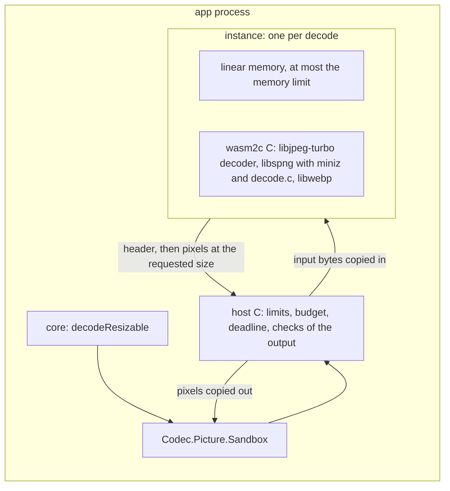
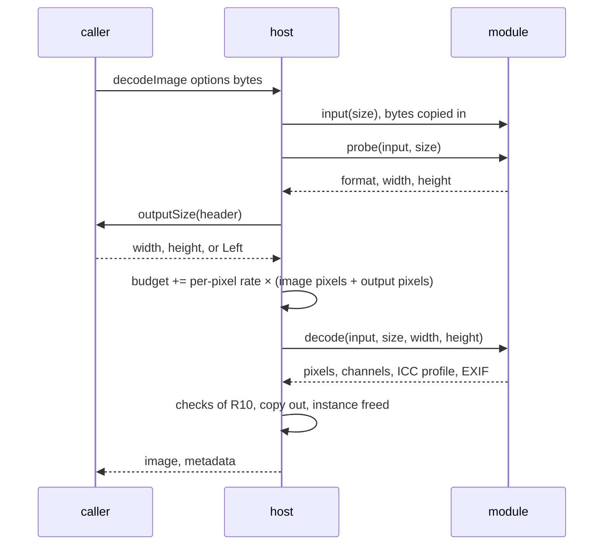
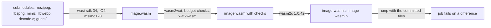
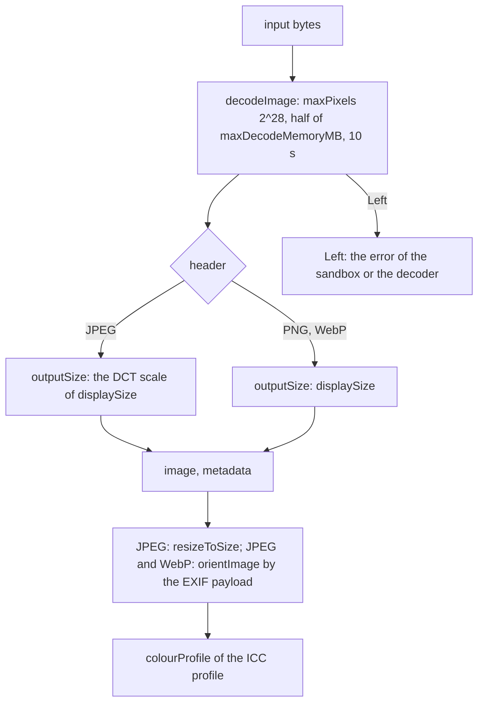
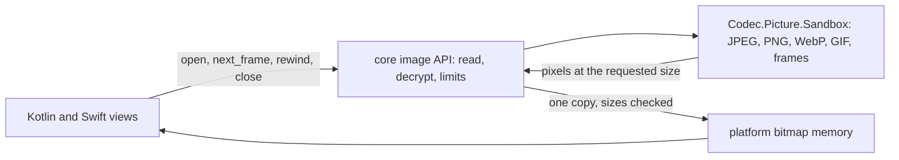
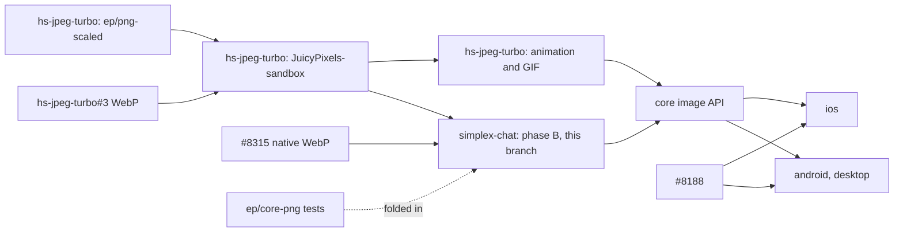

# Image decoding in a WebAssembly sandbox

The core and the apps decode images chosen by other people: images and previews received from contacts and group members, their profile images, and the images of websites that link previews fetch.
The reason for this change is decoder bugs on such images: the decoders are C code in the app process, with the app's memory.

The decoders are compiled to WebAssembly and translated by wasm2c to C with a bounds check at every memory access.
Each decode runs in a new instance with its own linear memory, a memory limit, an iteration budget and a deadline; the host copies the pixels out after it checks their size.
A decode that exceeds a limit or traps returns an error, and the image is shown as failed.
The work has three phases: the sandboxed decoders in simplex-chat/hs-jpeg-turbo (A), every decode of the core through them (B), and received images decoded by the core for the apps (C).

References are to master `9c50255914`; Haskell paths without a directory are in `src/Simplex/Chat/`.

| Name | Source |
|---|---|
| hs-jpeg-turbo | simplex-chat/hs-jpeg-turbo master `c1b5080`, pinned at `d0a4d95` (cabal.project:76-80) |
| JPEG decoder | mozjpeg `08265790`, based on libjpeg-turbo 3.0.5, the submodule `jpeg-turbo/cbits/mozjpeg`: the decoder of libjpeg-turbo with its scaled DCT |
| PNG decoder | libspng `fb768002` (v0.7.4) with miniz `77d0dce8`, submodules of `JuicyPixels-spng`; the one-pass scaler `JuicyPixels-spng/cbits/decode.c` of branch `ep/png-scaled` of evgeny-simplex/hs-jpeg-turbo at `5cbd2cd` |
| WebP decoder | libwebp `68dd1c30`, the submodule `JuicyPixels-libwebp/cbits/libwebp` of simplex-chat/hs-jpeg-turbo#3 at `24f5cda` |
| native WebP | simplex-chat/simplex-chat#8315 at `4a7cf67158`, plan plans/2026-11-22-core-webp-decoding.md on its branch |
| native PNG scaling | branch `ep/core-png` of evgeny-simplex/simplex-chat at `94df962b77`, plan plans/2026-11-24-core-png-scaled-decoding.md on it |
| link previews | simplex-chat/simplex-chat#8297 at `9e01a15f60`: `imageDataPreview` calls `decodeResizable` (Image.hs:229-232 on its branch) |
| measurements | branch `ep/wasm-measure` of evgeny-simplex/hs-jpeg-turbo at `9ecfd96`, run [45899158892](https://github.com/evgeny-simplex/hs-jpeg-turbo/actions/runs/45899158892) |
| tools | wasi-sdk 34 (clang 23), wabt 1.0.42 (wasm2c), simde of wabt 1.0.42 |

## Acceptance

| Who | Before | After |
|---|---|---|
| user who picks a JPEG, PNG or WebP image | decoded by the native decoders in the core | decoded in the sandbox; the same image data and preview, byte for byte or within the differences stated in the tests of phase A |
| user who types a link with a preview image (#8297) | image decoded by the native decoders in the core | decoded in the sandbox |
| bot and CLI user | as the first row | as the first row |
| user who receives an image, a preview, a quote or a profile image (phase C) | decoded by the platform decoders in the app | decoded by the core in the sandbox into the platform bitmap |
| user whose image exceeds a limit, or whose decode traps | an error, or the platform decode of the picked file | an error; the image is shown as failed; no other decoder is tried (D3, recommended) |

Evidence at review of each phase: its tests pass in CI on the targets of the CI table of phase A, with the run links in the pull request; the measurements of "Measurements still missing" for the phase are in its description.

## Decisions

Decided by the product owner:

| ID | Decision | Date | Place | Words |
|---|---|---|---|---|
| D1 | Received images are decoded in the core, in the sandbox. | 2026-11-26 | decision page | "received" |
| D2 | The sandbox is wasm2c, in the process, on every platform. | 2026-11-26 | decision page | "wasm" |
| D7 | The image sandbox is built. | 2026-11-26 | conversation | "do that, execute, let's make images secure, finally" |
| D8 | A counter at every loop of the compiled WebAssembly stops a decode at its budget. | by 2026-11-26 | conversation | "yes, fine" |
| D9 | The default deadline of a decode is 10 s. | by 2026-11-26 | conversation | "yes, ok" |
| D10 | Decoders written in memory-safe languages are rejected. | by 2026-11-26 | conversation | "this is a myth" |

Recommended, not yet decided; the branches implement them:

| ID | Recommendation |
|---|---|
| D3 | A caught violation (a trap, the memory limit, the budget or the deadline) returns an error and shows a failed image. Memory accesses are bounds-checked on every target. A failed decode never falls back to an unsandboxed decoder. |
| D4 | All images decode in the sandbox, the user's picked images included. |
| D6 | Every x86-64 CPU stays supported: the build requires SSE2 only, as x86-64 itself, and no x86-64-v2 instructions. |

The rows below are technical recommendations of this plan; each follows from the decisions above.

| ID | Recommendation |
|---|---|
| R1 | One package `JuicyPixels-sandbox` in hs-jpeg-turbo, module `Codec.Picture.Sandbox`, with one WebAssembly module of the three decoders. |
| R2 | The module is generated in CI from the decoders' submodules; the generated C is committed; CI generates it again and fails on any difference. |
| R3 | Each decode is checked at its loop headers, its function entries and its bulk memory operations: an iteration budget from the input bytes and the pixels, and the deadline read from the monotonic clock every 4096 iterations. |
| R4 | The memory limit of a decode is the limit of the caller: half of `maxDecodeMemoryMB` in the core (Image.hs:318-322). |
| R5 | The host runtime uses no thread-local storage. |
| R6 | One decode function for the three formats, with the output size chosen by the caller from the image header, as `Webp.decodeWebp` on #8315. |

## Sandbox



Rules:
- R7 (D2, D3): every memory access of the module is checked against the size of its linear memory; an access outside traps.
- R8 (D2): each decode creates a new instance and frees it when the call returns; nothing of one decode is visible to the next.
- R9 (D8, D9): the budget and the deadline stop a decode that does not end; R3 states the checks.
- R10 (D3): the host accepts the output only when its width, height and channels equal those it requested and the buffer is inside the linear memory.
- R11 (D3): the module imports its memory and three host functions: `refuel` for the budget and the deadline, `fill` and `copy` for bulk memory operations, which check their bounds before writing; any other import is a function without access to the linear memory.
- R12 (D6): libwebp's SSE2 code is compiled to WebAssembly SIMD and translated by wasm2c to the SIMD of the host, through simde: SSE2 on x86-64, Neon on Arm.

Decode protocol, two calls into one instance:



Output by format:

| Format | Sizes the caller may request | Pixels |
|---|---|---|
| JPEG | the image size divided by 1, 2, 4 or 8, rounded up: libjpeg-turbo's scaled DCT | Y8, RGB8 or CMYK8, as `decodeJpeg` (JuicyPixels-jpeg-turbo) |
| PNG | any size up to the image size: area average of `decode.c` | RGB8 or RGBA8, as `Spng.decodePng` |
| WebP | any size up to the canvas, at least 1/256 of it: libwebp's rescaler, frame 1 | RGB8 or RGBA8, as `Webp.decodeWebp` |

Metadata: the ICC profile of each format; the EXIF payload of JPEG and WebP. The core applies them as today (Image.hs:107-129, 181-185).

Limits of one decode, each a field of `Limits`:
- memory: at most the linear memory, `memoryLimitMB`;
- budget: `base + perByte × input bytes + perPixel × (image pixels + output pixels)`, per format, calibrated in phase A on the conformance files, the fixtures and the generated worst cases, with the smallest margin stated in the pull request;
- deadline: `timeoutMs`, 10 000 by default (D9);
- check interval: 4096 iterations.

Measured for libwebp at `9ecfd96`, run [45899158892](https://github.com/evgeny-simplex/hs-jpeg-turbo/actions/runs/45899158892), 8 workloads, geometric means:

| Platform | Native time ÷ sandbox time without the counter, gcc / clang | Time with the counter, budget and deadline ÷ time without them |
|---|---|---|
| Linux x86-64 | 0.49 / 0.70 | 1.02 to 1.10 |
| Linux aarch64 | 0.57 / 0.62 | 1.08 to 1.10 |
| armv7 | 0.47 / 0.37 | 1.03 to 1.06 |

- Budget rule for WebP: `1,048,576 + 16 × bytes + 64 × pixels`; no false refusal on 96 conformance files, 7 fixtures and 4,284 truncated and changed files, at full size and at sides of at most 64; the smallest ratio of the budget to the counted iterations 12.13 on conformance and changed files.
- From the deadline to the error return: 0.35–1.44 ms median for decodes, most of it the release of the linear memory.

## Phase A: decoders in hs-jpeg-turbo

Package `JuicyPixels-sandbox` (R1):
- `cbits/image-wasm.c`, `cbits/image-wasm.h`: the module, generated, committed (R2)
- `cbits/wasm-rt*.h`, `cbits/wasm-rt-mem-impl*.c`, `cbits/simde/`: wasm2c's memory functions and headers, copied from wabt 1.0.42
- `cbits/host.c`, `cbits/sandbox.h`: instances, limits, budget, deadline, bulk operations, the trap target without thread-local storage (R5), the checks of R10
- `guest/`: the C of the module's exports: `input`, `probe`, `decode`, and the test exports `load`, `spin` and `tree`
- `src/Codec/Picture/Sandbox.hsc`: `decodeImage`, `Limits`, `defaultLimits`

```haskell
data ImageFormat = JPEG | PNG | WebP

data ImageHeader = ImageHeader
  { format :: ImageFormat
  , width :: Int
  , height :: Int
  }

data Limits = Limits
  { memoryLimitMB :: Int
  , timeoutMs :: Int
  , checkInterval :: Word32
  }

data DecodeOptions = DecodeOptions
  { limits :: Limits
  , maxPixels :: Int
  , outputSize :: ImageHeader -> Either String (Int, Int)
  }

data Metadata = Metadata
  { iccProfile :: Maybe ByteString
  , exif :: Maybe ByteString
  }

decodeImage :: DecodeOptions -> ByteString -> IO (Either String (DynamicImage, Metadata))
```

The budget rates are constants of the package per format, from the calibration.

Generation, `.github/scripts/wasm-generate.sh`, in CI:



Tests, `test/SandboxTest.hs`:
- each decoder against its native binding in the same repository, at full size and at the sizes of `decodeResizable`: the libjpeg-turbo test images and generated JPEGs (grey, CMYK, YCCK, progressive), the PngSuite and the PNGs of `ep/png-scaled`'s tests, the libwebp conformance files and the WebP fixtures; JPEG and PNG equal; WebP equal at full size, within 2 when scaled, as at `9ecfd96`
- the ICC profile and EXIF payload of each format equal to those of the native bindings
- refusals: the memory limit, the input above the budget, the deadline, a trap of the test export `load`, and outputs of other sizes than requested
- a loop that never ends (`spin`) and a recursion without loops (`tree`) stopped by the budget and by the deadline
- truncated and changed files: the same result as the native binding, or a sandbox error
- 8 concurrent decodes and traps on 8 threads

CI, every target the core is built for:

| Target | Build | Checks |
|---|---|---|
| Linux x86-64 | GHC 8.10.7 and 9.6.3, gcc | package tests; generation check; coverage |
| Linux aarch64 | GHC 9.6.3 | package tests |
| macOS aarch64 and x86-64 | GHC 9.6.3, Apple clang | package tests |
| Windows x86-64 | GHC 9.6.3, its clang | package tests |
| Android aarch64 and armv7a | the compilers of the core's nix builds: nixpkgs clang for aarch64, the NDK clang for armv7a, API 26 | decode and stop checks, symbols without thread-local storage, measurements |
| iOS | the nixpkgs clang of the core's nix build for aarch64-darwin | as Android |
| sanitizers | clang, address and undefined | host and module on truncated and changed files |

## Phase B: every decode of the core through the sandbox

- `decodeResizable` (Image.hs:69-77) calls `decodeImage` for JPEG, PNG and WebP; the calls of `readJpegHeader`, `decodeJpeg`, `Spng.decodePng` and `Webp.decodeWebp` are removed from the core. `jpegSegments`, `exifTiff` and `jpegIccProfile` (Image.hs:131-152) are replaced by the metadata of `decodeImage`; `exifOrientation` reads the EXIF payload, as for WebP on #8315.
- Link previews decode through `decodeResizable` (#8297), so they use the sandbox without a change.
- Encoding is unchanged: `encodeRGB` and `Spng.encodePng` encode the decoded pixels.
- `cabal.project`, `scripts/nix/sha256map.nix`, docs/dependencies: the hs-jpeg-turbo commit with `JuicyPixels-sandbox`; `JuicyPixels-libwebp` removed from the core's dependencies.


- Licence notices: wasm2c's runtime (Apache-2.0) and simde (MIT).
- Tests: `/Image resize/` unchanged; with sandbox cases for each error string; the tests of `ep/core-png` (display size, interlaced PNG, memory refusal).

## Phase C: received images decoded by the core for the apps

The core reads and decrypts the file, decodes it in the sandbox at the size the app requests, and writes the pixels into the platform's bitmap memory; animations are decoded frame by frame.



```c
typedef struct { int32_t width, height, frame_count, loop_count, has_alpha; } chat_image_info;
void *chat_image_open_file(const char *path, const char *key, const char *nonce, int max_w, int max_h, chat_image_info *info);
void *chat_image_open_data_uri(const char *uri, int max_w, int max_h, chat_image_info *info);
int chat_image_next_frame(void *image, uint8_t *pixels, int row_bytes, int format);
void chat_image_rewind(void *image);
void chat_image_close(void *image);
```

- `chat_image_next_frame` writes RGBA or BGRA, premultiplied, and returns the frame's duration in milliseconds, or −1 for an error.
- Pixels, without a second decoder: Android, `Bitmap.createBitmap` and `AndroidBitmap_lockPixels`; desktop, Skia `Bitmap.allocPixels` and `peekPixels`; iOS, `CGDataProvider` and `CGImage`.
- Animations: libwebp's animation decoder and a GIF decoder, added to the module in hs-jpeg-turbo.
- Sites: chat item images and their full screen views, previews of images and videos, quotes, chat list previews, profile images, link preview images, notification icons; with D4, the picked images, wallpapers and imported theme images.

## Pull requests and order

| Phase | Pull request | Contents | Merged after |
|---|---|---|---|
| A | simplex-chat/hs-jpeg-turbo#3 | `JuicyPixels-libwebp`: libwebp `68dd1c30`, the source of the WebP decoder | |
| A | hs-jpeg-turbo, branch `ep/png-scaled` | `decode.c`, the source of the PNG scaler | |
| A | hs-jpeg-turbo, branch `ep/image-sandbox` | `JuicyPixels-sandbox` | both above |
| B | simplex-chat/simplex-chat#8315 | WebP in the core and the desktop picker; WebP fixtures and tests | |
| B | simplex-chat, branch `ep/image-sandbox` | this plan; phase B; the tests of `ep/core-png` | #8315 and the hs-jpeg-turbo pull request of phase A |
| C | hs-jpeg-turbo, a new branch | animation frames of WebP and GIF in the module | phase A |
| C | simplex-chat, a new branch | the core's image API (Mobile.hs, SimpleX.h) | phase B |
| C | simplex-chat, a new branch | android and desktop | the core's image API and #8188, which changes the same files |
| C | simplex-chat, a new branch | ios | the core's image API and #8188 |



- #8315 is merged first: its app changes and WebP tests stay, and phase B replaces its decoder under them.
- `ep/core-png` is not opened: phase B decodes PNG at the display size with the same `decode.c` in the sandbox, and takes its tests and its limits.

## Measurements still missing

| Measurement | Phase | Why |
|---|---|---|
| the largest picked PNG (16384×16384, 16-bit RGBA, Paeth on every row) and the largest picked JPEG (16384×16384, baseline and progressive) decoded in the sandbox on the slowest runner | A | the 10 s deadline (D9) was accepted on the condition that picked images stay well within it; the PNG takes 6.9 s natively on a Xeon 6975P-C (plan of `ep/core-png`, "Measurements") |
| JPEG and PNG in the sandbox against their native bindings, per platform | A | the cost of D3 and D4 for the formats measured only natively |
| the budget rates of JPEG and PNG, and their smallest margins | A | R3 |
| the builds of the NDK clang (armv7a) and of nixpkgs clang (aarch64 Android, iOS): time, the deadline's latency, thread-local storage | A | the core's mobile builds use these compilers; CI measured gcc, clang and Apple clang only |
| the size added to `libsimplex.so` and to the iOS library | B | download size |
| decodes of received images at bubble size against the platform decoders, on devices | C | CI runners are not phones |

## Open questions

| Q | Question | Options | Recommendation |
|---|---|---|---|
| Q1 | Picked images whose sandboxed decode exceeds the deadline, after the measurement of phase A | (a) lower pixel limits for every image (2^26 pixels: 8192×8192).<br>(b) a longer deadline for picked images than for received ones.<br>(c) the limits kept; such images shown as failed. | after the measurement |
| Q2 | Picked images without a sandboxed decoder, with D4: HEIC files on Android, camera and pasted images on iOS | (a) converted by the platform from the user's own file, as today.<br>(b) refused. | (a): these images are chosen by the user, not by other people |
| Q3 | The GIF decoder of phase C | chosen in its pull request, with the same sandbox and tests | |
| Q4 | The open questions of the plan of `ep/core-png`, folded into phase B: the largest PNG, interlaced PNG above the display size, sharpening at the largest size | the options and recommendations of that plan | as that plan: 2^28 pixels, as JPEG; a full decode, then the average; unsharpened; Q1 may change the first |

## Out of scope

- Video and voice messages.
- Encoding of images.
- Image formats other than JPEG, PNG, WebP and, in phase C, GIF.
